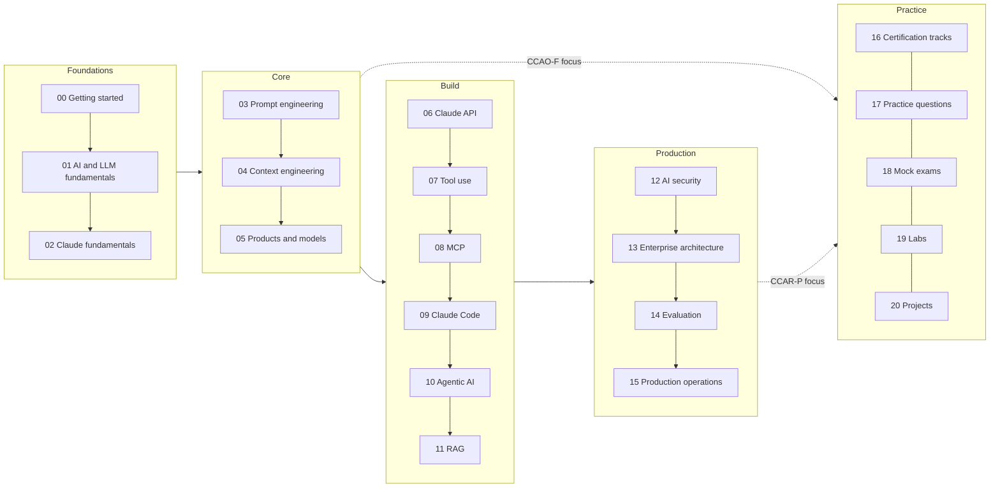

# Module 00: Getting Started

> **Level:** Beginner · **Time:** ~1.5 hours · **Exam relevance:** orientation for CCAO-F and CCAR-P

Welcome. This repository takes you from your very first prompt to designing production-ready systems with Claude, and prepares you for Anthropic's Claude certifications along the way. You do not need any prior experience with AI. You do not need to be a programmer, either, unless you choose the architect track.

This module helps you set up, pick a direction and plan your time. It takes about an hour and a half, and it will save you many hours of wandering later.

> **Unofficial resource.** This is an independent, community-written study repository. It is not produced or endorsed by Anthropic. Every explanation and practice question is original. Always read the official exam guide before you sit an exam; exam facts used here are recorded in [`registry.yaml`](../16-certification-tracks/registry.yaml) and summarised in [Exam facts](../25-official-resources/exam-facts.md).

> **Before you plan to sit an exam:** as of 2026-10-24, Anthropic's certification exams are open only to people at
> organisations in the **Claude Partner Network**. Everything in this repository is free to use either way. See
> [exam facts](../25-official-resources/exam-facts.md) for eligibility and registration.

## Learning objectives

After completing this module you will be able to:

1. Explain how the repository is organised and how modules, labs, practice questions, mock exams and flashcards fit together.
2. Set up a working environment that runs every lab offline at no cost, and optionally against the real Claude API.
3. Choose between the three supported certification tracks, CCAO-F for business users, CCAR-F for builders and CCAR-P for architects, or a non-exam learning path.
4. Pick a study roadmap that matches your experience and the time you have, from 7 to 90 days.

## Page order

| # | Page | What you get | Time |
|---|---|---|---|
| 1 | [How to use this repository](how-to-use-this-repo.md) | A map of the folders and a study method that works | 20 min |
| 2 | [Choose your path](choose-your-path.md) | Which certification (if any) suits you, and the modules for each | 20 min |
| 3 | [Environment setup](environment-setup.md) | Python, the labs in mock mode, and optional live API access | 30 min |
| 4 | [Study roadmaps](roadmaps/README.md) | Day-by-day plans of 7, 15, 30, 60 and 90 days | 20 min |

Business users who will not write code can skim the environment page: you can complete the CCAO-F track using the Claude apps alone, and run labs only if you are curious.

## Prerequisites

None. If you can use a web browser, you can start.

Helpful but optional:

- A Claude account (the Free plan is enough for Modules 01 and 02; some features in Module 05 need a paid plan).
- Python 3.10 or later, if you want to run the labs. [Environment setup](environment-setup.md) explains how to install it.

## What this repository covers

## Exam relevance

This module teaches no exam content directly. It points you at the right content for:

- **CCAO-F (Claude Certified Associate – Foundations):** for business and knowledge workers who use Claude as a productivity tool and build Claude Projects. See the [CCAO-F track](../16-certification-tracks/ccao-f/README.md).
- **CCAR-P (Claude Certified Architect – Professional):** for solution architects, AI/ML engineers and senior engineers who design production Claude solutions. See the [CCAR-P track](../16-certification-tracks/ccar-p/README.md).

The registry also records other Anthropic certifications whose facts are known but for which this repository does not yet provide a full track.

## Next module

Once you have chosen a path and a roadmap, start [Module 01: AI and LLM fundamentals](../01-ai-and-llm-fundamentals/README.md).
