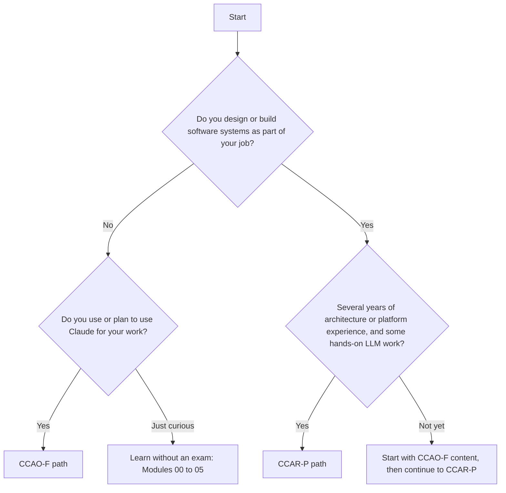

# Choose Your Path

> **Level:** Beginner · **Time:** ~20 min · **Exam relevance:** orientation for CCAO-F and CCAR-P

> **Before you plan to sit an exam:** as of 2026-10-24, Anthropic's certification exams are open only to people at
> organisations in the **Claude Partner Network**. Everything in this repository is free to use either way. See
> [exam facts](../25-official-resources/exam-facts.md) for eligibility and registration.

## In plain English

This repository supports two Anthropic certifications, and you can also use it without sitting any exam:

| Path | In one sentence |
|---|---|
| **CCAO-F**, Claude Certified Associate – Foundations | For people who *use* Claude at work and set up Claude Projects: prompting, judging outputs, choosing features and models, configuring Projects, and using AI responsibly |
| **CCAR-P**, Claude Certified Architect – Professional | For people who *design and deliver* production systems with Claude: architecture, models and context, integration, evaluation, governance, stakeholders and developer tooling |
| **Learn without an exam** | Pick the modules that match your role and skip the exam preparation |

If you are not a developer, CCAO-F is almost certainly your path. If you design systems for a living, CCAR-P is. If you are a developer who is new to AI, start with CCAO-F content (it is the foundation for everything) and continue to CCAR-P.

## Why it matters

The two exams test different skills. CCAO-F does not expect you to write code. CCAR-P assumes several years of systems experience and hands-on work with LLMs in production. Studying the wrong material wastes weeks.

## How it works

### The two tracks compared

All exam facts below come from [`registry.yaml`](../16-certification-tracks/registry.yaml), verified on 2026-10-24 against the official v1.0 exam guides. See [Exam facts](../25-official-resources/exam-facts.md) for sources, retake rules and the change scheduled for later in 2026.

| | CCAO-F | CCAR-P |
|---|---|---|
| Audience | Business and knowledge workers: operations, marketing, project management, education, communications | Mid- to senior-level solution architects, AI/ML engineers, technical leads, senior software engineers |
| Prerequisites | None mandatory; regular hands-on Claude use recommended | None mandatory; recommended 3+ years in systems architecture or platform engineering and 6+ months hands-on with Claude or comparable LLM systems in production |
| Format | 60 items, multiple-choice and multiple-response, 120 minutes | 63 items, multiple-choice and multiple-response, 120 minutes |
| Coding required? | No | Not in the exam itself, but the knowledge assumes technical depth |
| Track overview | [CCAO-F](../16-certification-tracks/ccao-f/README.md) | [CCAR-P](../16-certification-tracks/ccar-p/README.md) |

Fees, pass marks and validity periods are recorded in the registry; check them there and on the official pages before booking.

### Domains at a glance

**CCAO-F domains:** 1 Prompting and Task Execution · 2 Output Evaluation and Validation · 3 Product and Model Selection · 4 Workflow Integration and Solution Design · 5 Configuration and Knowledge Management · 6 Governance, Risk, and Responsible Use · 7 Troubleshooting and Optimization.

**CCAR-P domains:** 1 Solution Design & Architecture · 2 Claude Models, Prompting & Context Engineering · 3 Integration · 4 Evaluation, Testing & Optimization · 5 Governance, Safety & Risk Management · 6 Stakeholder Communication & Lifecycle Management · 7 Developer Productivity & Operational Enablement.

Domain weights are in the registry.

### Which path? A quick decision

### Modules by path

| Module | CCAO-F | CCAR-P | Notes |
|---|---|---|---|
| [00 Getting started](README.md) | Required | Required | |
| [01 AI and LLM fundamentals](../01-ai-and-llm-fundamentals/README.md) | Required | Required (skim if experienced) | |
| [02 Claude fundamentals](../02-claude-fundamentals/README.md) | Required | Required (skim if experienced) | |
| [03 Prompt engineering](../03-prompt-engineering/README.md) | Required | Required | |
| [04 Context engineering](../04-context-engineering/README.md) | Pages 01, 02, 04 | Required | |
| [05 Claude products and models](../05-claude-products-and-models/README.md) | Required | Required | Core for CCAO-F Domains 3 and 5 |
| [06 Claude API](../06-claude-api/README.md) | Optional | Required | |
| [07 Tool use](../07-tool-use-and-function-calling/README.md) | Optional page 01 | Required | |
| [08 Model Context Protocol](../08-model-context-protocol/README.md) | Optional page 01 | Required | |
| [09 Claude Code](../09-claude-code/README.md) | Optional | Required | CCAR-P Domain 7 |
| [10 Agentic AI](../10-agentic-ai/README.md) | Optional pages 01, 05 | Required | |
| [11 RAG and knowledge systems](../11-rag-and-knowledge-systems/README.md) | Optional page 01 | Required | |
| [12 AI security](../12-ai-security/README.md) | Pages 02, 04, 12, 13 | Required | |
| [13 Enterprise AI architecture](../13-enterprise-ai-architecture/README.md) | Pages 06, 08 | Required | |
| [14 Evaluation and testing](../14-evaluation-and-testing/README.md) | Page 01 | Required | |
| [15 Production operations](../15-production-operations/README.md) | Not needed | Required | |
| [19 Hands-on labs](../19-hands-on-labs/README.md) | Labs 01 to 06 optional | Labs 01 to 20 | |

### Learning without an exam, by role

| Role | Suggested modules |
|---|---|
| Manager or team lead | 00 to 05, then 12 page 12 (governance) and 13 pages 06 and 08 |
| Security engineer | 00 to 04, then 06, 07, 08, 12 (all) and Labs 14 and 15 |
| DevSecOps or platform engineer | 00 to 04, then 06 to 09, 12, 15 and Labs 07 to 10, 17 to 19 |
| Developer new to AI | 00 to 07, then 09 to 11 |

### Then pick a roadmap

The [roadmaps README](roadmaps/README.md) matches each plan to your experience and track. In short: complete beginners take the 30-day plan for CCAO-F or the 90-day plan for CCAR-P; experienced people can compress.

## Example

Three fictional learners choose their paths:

- **Amira**, a marketing coordinator who uses Claude daily for drafts: CCAO-F, 30-day roadmap.
- **Ben**, a backend engineer with five years' experience but no LLM work: CCAO-F content first (Modules 01 to 05), then the CCAR-P 90-day roadmap, building production experience on the way.
- **Chen**, a solution architect who has shipped two LLM applications: CCAR-P, 60-day roadmap, skimming Modules 01 and 02.

## Enterprise use case

*Acme Logistics* plans certification for its AI programme. The business enablement team (operations, customer service, communications) takes CCAO-F so that Project owners across departments share a common standard. The three architects who own the platform take CCAR-P. Each person's manager agrees a roadmap and protected study time before they start.

## Common mistakes

- **Choosing the architect exam for prestige without the experience.** The recommended experience exists for a reason.
- **Skipping CCAO-F foundations as an engineer.** Prompting, output evaluation and responsible use are tested in both tracks.
- **Booking the exam before choosing a roadmap.** Plan backwards from a realistic study schedule.

## Security considerations

Both tracks test governance and responsible use. Whatever your path, read [Responsible use](../02-claude-fundamentals/05-responsible-use.md) early: it changes how you practise (no real customer data in exercises, no API keys in files).

## Troubleshooting

| Situation | Suggestion |
|---|---|
| Unsure between the two tracks | Take the CCAO-F [readiness assessment](../16-certification-tracks/ccao-f/readiness-assessment.md); if you score well easily, look at CCAR-P |
| Your organisation is not yet in a position to register you | Exam eligibility and registration are described in [Exam facts](../25-official-resources/exam-facts.md); you can still follow the learning path |
| You want a certification this repository does not cover | Check the registry for its status; supported tracks are marked `supported` |

## Check your understanding

1. Which track is designed for business users who build Claude Projects?
2. What experience does the CCAR-P exam guide recommend?
3. Where are exam facts such as item counts and weights recorded in this repository?

Answers

1. CCAO-F (Claude Certified Associate – Foundations).
2. Three or more years in systems architecture or platform engineering and at least six months hands-on with Claude or comparable LLM systems in production. It is recommended, not mandatory.
3. In `16-certification-tracks/registry.yaml`, summarised in `25-official-resources/exam-facts.md`.

## Further reading

- [Certification tracks overview](../16-certification-tracks/README.md)
- [Exam facts](../25-official-resources/exam-facts.md)
- [Pearson VUE: Claude Certification Program](https://www.pearsonvue.com/us/en/anthropic.html)
- Next: [Study roadmaps](roadmaps/README.md)
