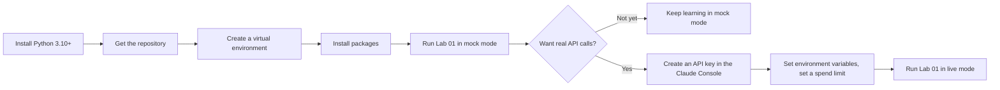

# Environment Setup

> **Level:** Beginner · **Time:** ~30 min · **Exam relevance:** CCAR-P D7 (7.1); supports all hands-on labs

## In plain English

To run the hands-on labs you need three things on your computer: **Python** (the programming language the labs use), a copy of this **repository**, and a few **packages**. That is all. The labs run in **mock mode** by default, which means they work offline, cost nothing and need no account. When you are ready, you can switch to **live mode** to call the real Claude API with your own API key.

If you are on the business-user (CCAO-F) path and do not plan to code, you only need a Claude account and a web browser. You can skip to [Set up a Claude account](#set-up-a-claude-account) and come back to the rest later if you get curious.

## Why it matters

A working environment lets you learn by doing. Mock mode removes the two biggest barriers for beginners: cost and setup complexity. Live mode, used carefully, shows you real model behaviour, real token usage and real errors, which is valuable preparation for the architect exam (CCAR-P Domain 7 covers configuring Claude tools and environments for teams).

## How it works

### What you will set up



### Step 1: install Python 3.10 or later

Check whether you already have it. Open a terminal (Terminal on macOS, PowerShell on Windows) and type:

```bash
python3 --version
```

On Windows, the command is often `python --version` or `py --version`. If you see `Python 3.10` or higher, move on. Otherwise install the latest Python 3 from [python.org/downloads](https://www.python.org/downloads/). On Windows, tick "Add python.exe to PATH" during installation.

### Step 2: get the repository

If you use Git:

```bash
git clone <this-repository-url>
cd claude-certification-zero-to-hero
```

Replace `<this-repository-url>` with the URL shown on the repository's home page. If you do not use Git, download the repository as a ZIP file from its home page, unzip it, and open a terminal in the unzipped folder.

### Step 3: create a virtual environment

A virtual environment keeps this project's packages separate from everything else on your computer. From the repository root:

```bash
# macOS and Linux
python3 -m venv .venv
source .venv/bin/activate
```

```powershell
# Windows PowerShell
py -m venv .venv
.venv\Scripts\Activate.ps1
```

Your prompt should now start with `(.venv)`. Activate it again whenever you open a new terminal.

### Step 4: install packages

```bash
pip install -r requirements-dev.txt                 # repository tooling: PyYAML, jsonschema, pytest
pip install -r 19-hands-on-labs/requirements.txt    # the official Anthropic SDK, needed only for live mode
```

Mock mode needs only the Python standard library, so even if the second command fails (for example, on a locked-down work laptop), the labs still run offline.

### Step 5: run your first lab in mock mode

```bash
python 19-hands-on-labs/lab-01-first-claude-interaction/lab.py
```

You should see a banner that says **MOCK — offline, no credits used** followed by the lab's output. Congratulations: your environment works.

### Step 6 (optional): live mode

Live mode calls the real Claude API.

> **Cost:** requires API credits (live mode). API usage is billed per token, separately from any Claude app subscription.

1. **Create an account and API key** in the Claude Console at [platform.claude.com](https://platform.claude.com/). Keys are created under the API keys section.
2. **Set a spend limit** in the Console before experimenting, so a mistake cannot become a large bill.
3. **Provide the key through the environment**, never in code:

```bash
# macOS and Linux, for the current terminal session
export CLAUDE_LAB_MODE=live
export ANTHROPIC_API_KEY="paste-your-key-here"
```

```powershell
# Windows PowerShell, for the current session
$env:CLAUDE_LAB_MODE = "live"
$env:ANTHROPIC_API_KEY = "paste-your-key-here"
```

Alternatively, copy the example environment file and edit the copy. The real `.env` file is ignored by Git so it is never committed:

```bash
cp 19-hands-on-labs/.env.example 19-hands-on-labs/.env
```

The official SDK can also use credentials from the `ant` command-line tool if you sign in with `ant auth login`; see the [authentication docs](https://platform.claude.com/docs/en/manage-claude/authentication).

4. **Run Lab 01 again.** The banner now says **LIVE — uses API credits**.

### Environment variables used by the labs

| Variable | Default | Purpose |
|---|---|---|
| `CLAUDE_LAB_MODE` | `mock` | `mock` for offline and free; `live` for real API calls |
| `ANTHROPIC_API_KEY` | not set | Your API key; needed only in live mode |
| `CLAUDE_LAB_MODEL` | `claude-opus-5-5` | Main model used by labs |
| `CLAUDE_LAB_FAST_MODEL` | `claude-haiku-5-5` | Cheaper, faster model for cost-sensitive steps |

Model IDs are current as of 2026-10-24; see [Model families](../05-claude-products-and-models/02-model-families.md) for the line-up and the [models overview](https://platform.claude.com/docs/en/about-claude/models/overview) for updates.

### Set up a Claude account

For the app-based exercises (Modules 01, 02, 03 and 05, and the whole CCAO-F track):

1. Go to [claude.ai](https://claude.ai) and sign up, or install the desktop or mobile app from [claude.com/download](https://claude.com/download).
2. The Free plan is enough to begin. Some features (research, chat search, larger Project knowledge) need a paid plan; pages say when.
3. If your employer provides a Team or Enterprise account, use it for work-related practice and follow your organisation's AI policy. Use fictional data for exercises.

### Optional extras for technical tracks

| Tool | Needed for | Where to get it |
|---|---|---|
| Git | Cloning the repository; Claude Code workflows | [git-scm.com](https://git-scm.com/) |
| A code editor (for example VS Code) | Reading and editing lab code | [code.visualstudio.com](https://code.visualstudio.com/) |
| Claude Code | [Module 09](../09-claude-code/README.md) and Lab 10 | [Claude Code setup](https://code.claude.com/docs/en/overview) |
| Node.js | Only some MCP examples in [Module 08](../08-model-context-protocol/README.md) | [nodejs.org](https://nodejs.org/) |

## Example

A complete first-time setup on macOS, from an empty terminal to a passing mock lab:

```bash
python3 --version                       # expect 3.10 or later
cd ~/projects/claude-certification-zero-to-hero
python3 -m venv .venv && source .venv/bin/activate
pip install -r requirements-dev.txt
python 19-hands-on-labs/lab-01-first-claude-interaction/lab.py
```

## Enterprise use case

*Northwind Lending*'s platform team prepares laptops for a 12-person CCAR-P study group. Corporate policy forbids personal API keys on company machines. The team:

- runs every lab in mock mode during study sessions (no keys needed);
- creates one Console **workspace** for the study group, with a monthly spend limit, and issues short-lived keys through the company's secrets manager for scheduled live-mode sessions;
- injects `ANTHROPIC_API_KEY` from the secrets manager into the terminal session, so keys never appear in files, chat or screen recordings.

This mirrors the controls they will later apply in production ([Secrets management](../12-ai-security/10-secrets-management.md)).

## Common mistakes

- **Pasting the API key into a lab file.** Use environment variables or a git-ignored `.env` file.
- **Forgetting to activate the virtual environment.** Symptoms: "module not found" errors.
- **Running live mode without a spend limit.** Set one first.
- **Running commands from the wrong folder.** Run labs from the repository root, as shown.
- **Sharing screenshots that show keys.** Keys in terminal history and screenshots leak easily.

## Security considerations

- Treat an API key like a password. If one is exposed (committed, pasted in chat, shown in a screenshot), revoke it in the Console immediately and create a new one.
- Keep `.env` files out of version control (this repository's ignore rules already exclude them). Never share them.
- Prefer short-lived credentials and secrets managers in organisational settings.
- Only download packages from the official index using the provided requirements files.

## Troubleshooting

| Symptom | Likely cause | Fix |
|---|---|---|
| `python3: command not found` | Python not installed or not on PATH | Install from python.org; on Windows try `py` |
| `ModuleNotFoundError: claude_lab` | Running from the wrong folder | Run from the repository root |
| `ModuleNotFoundError: anthropic` in live mode | SDK not installed in the active environment | Activate `.venv`; `pip install -r 19-hands-on-labs/requirements.txt` |
| `authentication_error` in live mode | Missing, mistyped or revoked key | Re-export `ANTHROPIC_API_KEY`; check it in the Console |
| PowerShell refuses to run `Activate.ps1` | Script execution policy | Run `Set-ExecutionPolicy -Scope CurrentUser RemoteSigned`, or ask IT |
| Banner says MOCK when you wanted LIVE | `CLAUDE_LAB_MODE` not set in this terminal | Export it again in the current session |

More fixes: [Labs and repository troubleshooting](../24-troubleshooting/labs-and-repository.md) and [API errors](../24-troubleshooting/api-errors.md).

## Check your understanding

1. What do you need to run a lab in mock mode?
2. Where should your API key live?
3. What should you do before your first live-mode run?
4. What happens if `CLAUDE_LAB_MODE` is not set?

<details>
<summary>Answers</summary>

1. Python 3.10 or later and a copy of the repository. No account, key or extra packages are required.
2. In an environment variable (or a git-ignored `.env` file, or a secrets manager), never in code or committed files.
3. Set a spend limit in the Claude Console.
4. Labs default to mock mode: offline and free.

</details>

## Further reading

- [Get started with the Claude API](https://platform.claude.com/docs/en/get-started) (Anthropic documentation)
- [Hands-on labs overview](../19-hands-on-labs/README.md)
- Next: [Study roadmaps](roadmaps/README.md)
