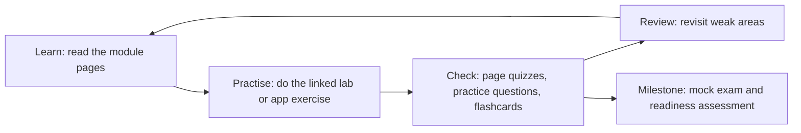

# How to Use This Repository

> **Level:** Beginner · **Time:** ~20 min · **Exam relevance:** orientation for CCAO-F and CCAR-P

## In plain English

This repository is a self-paced course in folders. Each numbered folder is a module or a practice resource. You read concept pages, try what you learned in hands-on labs, check yourself with practice questions and flashcards, and finally sit timed mock exams. A roadmap tells you what to do each day.

You do not have to read everything. Your chosen [path](choose-your-path.md) and [roadmap](roadmaps/README.md) tell you which parts matter for your goal.

## Why it matters

People who study from a structured loop (learn, practise, test, review) retain far more than people who read straight through. The repository is built around that loop, so knowing where each piece lives lets you use it properly.

## How it works

### The folders

| Folder | What it contains | Who needs it |
|---|---|---|
| [`00-getting-started`](README.md) | Orientation, setup, paths, roadmaps | Everyone |
| [`01-ai-and-llm-fundamentals`](../01-ai-and-llm-fundamentals/README.md) | What AI and LLMs are; tokens, context, hallucinations | Everyone |
| [`02-claude-fundamentals`](../02-claude-fundamentals/README.md) | How Claude works, first conversation, safety, responsible use | Everyone |
| [`03-prompt-engineering`](../03-prompt-engineering/README.md) | Writing effective prompts | Everyone |
| [`04-context-engineering`](../04-context-engineering/README.md) | Managing long context, caching, memory, Skills | Everyone (depth varies) |
| [`05-claude-products-and-models`](../05-claude-products-and-models/README.md) | Apps, plans, models, Projects, Artifacts, connectors | Everyone |
| [`06-claude-api`](../06-claude-api/README.md) | Calling Claude from code | Technical learners |
| [`07-tool-use-and-function-calling`](../07-tool-use-and-function-calling/README.md) | Letting Claude call tools | Technical learners |
| [`08-model-context-protocol`](../08-model-context-protocol/README.md) | MCP servers and clients | Technical learners |
| [`09-claude-code`](../09-claude-code/README.md) | Agentic coding with Claude Code | Technical learners |
| [`10-agentic-ai`](../10-agentic-ai/README.md) | Workflows, agents, multi-agent systems | Technical learners |
| [`11-rag-and-knowledge-systems`](../11-rag-and-knowledge-systems/README.md) | Retrieval-augmented generation | Technical learners |
| [`12-ai-security`](../12-ai-security/README.md) | Threats and controls for LLM systems | Architects, security engineers; selected pages for everyone |
| [`13-enterprise-ai-architecture`](../13-enterprise-ai-architecture/README.md) | Solution design, patterns, governance, stakeholders | Architects |
| [`14-evaluation-and-testing`](../14-evaluation-and-testing/README.md) | Measuring quality, safety and cost | Architects |
| [`15-production-operations`](../15-production-operations/README.md) | Observability, cost, latency, reliability | Architects |
| [`16-certification-tracks`](../16-certification-tracks/README.md) | Exam overviews, study guides by domain, readiness checks | Exam candidates |
| [`17-practice-questions`](../17-practice-questions/README.md) | Original practice questions mapped to objectives | Exam candidates |
| [`18-mock-examinations`](../18-mock-examinations/README.md) | Timed mock exams in the terminal or browser | Exam candidates |
| [`19-hands-on-labs`](../19-hands-on-labs/README.md) | Twenty labs that run offline by default | Everyone (business users: labs 01 to 06 are optional extras) |
| [`20-real-world-projects`](../20-real-world-projects/README.md) | Five portfolio projects | Technical learners |
| [`21-interview-preparation`](../21-interview-preparation/README.md) | Interview questions for AI roles | Job seekers |
| [`22-cheat-sheets`](../22-cheat-sheets/README.md) | One-page summaries for revision | Everyone |
| [`23-flashcards`](../23-flashcards/README.md) | Spaced-repetition decks | Everyone |
| [`24-troubleshooting`](../24-troubleshooting/README.md) | Fixes for common problems | Everyone |
| [`25-official-resources`](../25-official-resources/README.md) | Links to official sources, exam facts, verification log | Everyone |

### The anatomy of a concept page

Every concept page in modules 00 to 15 uses the same headings, so you always know where to look:

| Heading | Use it to |
|---|---|
| Level, time, exam relevance (the line under the title) | Decide whether and when to read it; objective IDs link it to the exam |
| In plain English | Get the idea quickly, with an analogy |
| Why it matters | See how it connects to real work and the exam |
| How it works | Learn the details |
| Example | Try something concrete |
| Enterprise use case | See it applied at a fictional organisation |
| Common mistakes | Avoid the usual traps (exam distractors often live here) |
| Security considerations | Learn the risks |
| Troubleshooting | Fix problems |
| Check your understanding | Test yourself; answers are hidden in a collapsible block |
| Further reading | Go to official sources |

### The study loop

1. **Learn.** Read the pages your roadmap lists for the day. Do not skip "Check your understanding".
2. **Practise.** Do the lab or the in-app exercise. Doing beats reading.
3. **Check.** Answer [practice questions](../17-practice-questions/README.md) for the domain and review [flashcards](../23-flashcards/README.md).
4. **Review.** Every few days, revisit what you got wrong. Each roadmap schedules revision milestones.
5. **Milestone.** Near the end, sit [mock exams](../18-mock-examinations/README.md) and complete the track's readiness assessment ([CCAO-F](../16-certification-tracks/ccao-f/readiness-assessment.md), [CCAR-P](../16-certification-tracks/ccar-p/readiness-assessment.md)).

### Objective IDs

Each certification's exam guide is divided into domains and objectives. This repository gives every objective an ID such as `CCAO-F-3.4` (CCAO-F, Domain 3, objective 4). You will see IDs at the top of pages, on practice questions and in coverage matrices. They let you trace any weak area back to the exact pages that teach it. The full list is in [`registry.yaml`](../16-certification-tracks/registry.yaml).

### Labs: mock and live

Labs run in **mock mode** by default: offline, free and deterministic, so you can learn the code path without an account. Switch to **live mode** to call the real Claude API, which uses paid credits. [Environment setup](environment-setup.md) explains both.

### Keeping facts current

Claude's products, models and prices change often. Pages mark time-sensitive facts with a date ("as of 2026-10-24") and link to the official page. If you are reading this much later, follow the links. Exam facts are kept in one place, [`registry.yaml`](../16-certification-tracks/registry.yaml), with a [verification log](../25-official-resources/verification-log.md).

## Example

A typical one-hour study session on a 30-day roadmap:

| Minutes | Activity |
|---|---|
| 0 to 5 | Review yesterday's flashcards |
| 5 to 35 | Read today's two concept pages and answer their quizzes |
| 35 to 50 | Do the linked exercise in the Claude app or lab |
| 50 to 60 | Answer five practice questions for the domain; note any misses in your study log |

## Enterprise use case

*Contoso Health*'s learning-and-development team uses this repository for an internal Claude enablement programme. Business staff follow the CCAO-F path in cohorts with a weekly discussion session; the platform engineering team follows the CCAR-P path and builds one of the [real-world projects](../20-real-world-projects/README.md) as a capstone. Because the material is open and every fact links to an official source, the team adds its own internal AI policy as a supplement rather than rewriting the course.

## Common mistakes

- **Reading without practising.** The exams test judgement in scenarios; you build judgement by doing.
- **Skipping "Check your understanding".** It is the cheapest way to find gaps.
- **Treating practice-question scores as exam predictions.** They are a study signal only; questions here are unofficial.
- **Going too deep in modules your track does not need.** Follow your path.

## Security considerations

- Never commit API keys or put them in code. Labs read credentials from environment variables only; see [Environment setup](environment-setup.md).
- Use only fictional or synthetic data in exercises, like the examples in this repository.

## Troubleshooting

| Problem | What to do |
|---|---|
| A link points to a page that is not there yet | The repository is under active development; check the [roadmap](../ROADMAP.md) or the module README |
| A product screen looks different from the description | Products change; check the linked Help Center page |
| A lab fails | See [Labs and repository troubleshooting](../24-troubleshooting/labs-and-repository.md) |

## Check your understanding

1. Which folder holds the practice questions, and which holds the timed mock exams?
2. What does the objective ID `CCAR-P-2.1` mean?
3. Name the four steps of the study loop.
4. Why do labs default to mock mode?

Answers

1. Practice questions are in `17-practice-questions`; mock exams are in `18-mock-examinations`.
2. CCAR-P certification, Domain 2, objective 1 (select Claude models based on trade-offs).
3. Learn, practise, check, review (with mock exams and readiness assessments as milestones).
4. So you can run them offline, for free, without an account, and so CI can test them.

## Further reading

- [Choose your path](choose-your-path.md)
- [Study roadmaps](roadmaps/README.md)
- [Official resources](../25-official-resources/README.md)
