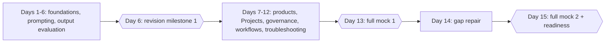

# 15-Day Preparation Plan (CCAO-F)

> **Level:** Beginner to Intermediate · **Time:** about 2 hours a day, ~30 hours total · **Track:** CCAO-F (Claude Certified Associate – Foundations)

## Who this plan is for

This plan suits people who have **used Claude or a similar AI assistant now and then** and want to prepare properly for CCAO-F in about two weeks. No coding is required. It assumes you are comfortable trying things in an app and can find two hours a day.

It is **not ideal for complete beginners**: it moves through the fundamentals quickly. If AI is entirely new to you, take the [30-day structured plan](30-day-structured.md) instead. If you already use Claude daily and have built Projects, the [7-day plan](7-day-accelerated.md) may be enough.

Exam format and domain weights are in [`registry.yaml`](../../16-certification-tracks/registry.yaml) and [Exam facts](../../25-official-resources/exam-facts.md).

## How to use the tables

Each row is one day. "Checkpoint" is what you must be able to do before moving on; if you cannot, spend 20 minutes on the weakest page and retry. Practice questions are in [17-practice-questions](../../17-practice-questions/README.md); run them in the [mock exam engine](../../18-mock-examinations/README.md) in learning mode with `--domain`. Labs run free in mock mode ([environment setup](../environment-setup.md)); in-app exercises need a Claude account.

## Days 1 to 6: foundations, prompting and output evaluation

| Day | Objectives | Reading | Practical exercises | Time | Knowledge checkpoint |
|---|---|---|---|---|---|
| 1 | Explain AI, generative AI and LLMs; define tokens | [What is AI?](../../01-ai-and-llm-fundamentals/01-what-is-ai.md) · [Generative AI](../../01-ai-and-llm-fundamentals/02-generative-ai.md) · [Large language models](../../01-ai-and-llm-fundamentals/03-large-language-models.md) · [Tokens](../../01-ai-and-llm-fundamentals/04-tokens-and-tokenisation.md) | [Lab 01: First Claude interaction](../../19-hands-on-labs/lab-01-first-claude-interaction/README.md) in mock mode, or the classify-versus-generate exercise in [Generative AI](../../01-ai-and-llm-fundamentals/02-generative-ai.md) | 2 h | All four page quizzes correct; estimate tokens for a 1,000-word document |
| 2 | Explain context windows, hallucinations and limitations; explain statelessness and roles | [Context windows](../../01-ai-and-llm-fundamentals/05-context-windows.md) · [Hallucinations](../../01-ai-and-llm-fundamentals/06-hallucinations.md) · [Capabilities and limitations](../../01-ai-and-llm-fundamentals/07-capabilities-and-limitations.md) · [How Claude works](../../02-claude-fundamentals/01-how-claude-works.md) | The statelessness test (incognito chat) from [How Claude works](../../02-claude-fundamentals/01-how-claude-works.md); the summarise-and-restart exercise | 2 h | State restart, summarise and persist with one example each; list five hallucination-reduction techniques |
| 3 | Hold a productive conversation; write a structured prompt (CCAO-F-1.1, 1.3) | [Your first conversation](../../02-claude-fundamentals/02-first-conversation.md) · [Prompt fundamentals](../../02-claude-fundamentals/03-prompt-fundamentals.md) · [Clear, direct instructions](../../03-prompt-engineering/01-clear-direct-instructions.md) · [XML tags](../../03-prompt-engineering/02-structure-with-xml-tags.md) | The guided office-move exercise in [Your first conversation](../../02-claude-fundamentals/02-first-conversation.md); [Lab 02: Prompt improvement](../../19-hands-on-labs/lab-02-prompt-improvement/README.md) | 2 h | Rewrite a vague prompt using all eight building blocks without notes |
| 4 | Use examples, decompose tasks, iterate, adapt to task type (1.2, 1.3, 1.4) | [Few-shot examples](../../03-prompt-engineering/03-examples-few-shot.md) · [Task decomposition](../../03-prompt-engineering/05-task-decomposition-and-chaining.md) · [Iterating on prompts](../../03-prompt-engineering/08-iterating-on-prompts.md) · [Study guide: Domain 1](../../16-certification-tracks/ccao-f/study-guide/domain-1.md) | Split a real multi-part request into a chain of three prompts in the app; Domain 1 items in [practical exercises](../../16-certification-tracks/ccao-f/practical-exercises.md) | 2 h | 80% or more on 15 Domain 1 practice questions |
| 5 | Evaluate outputs, catch hallucinations, fact-check, decide on human review (2.1 to 2.4) | Re-read the techniques in [Hallucinations](../../01-ai-and-llm-fundamentals/06-hallucinations.md) · [Responsible use: verify](../../02-claude-fundamentals/05-responsible-use.md) · [Study guide: Domain 2](../../16-certification-tracks/ccao-f/study-guide/domain-2.md) | [Lab 04: Document-grounded Q&A](../../19-hands-on-labs/lab-04-document-grounded-qa/README.md); in the app, verify every figure in a Claude summary of a public report | 2 h | Classify five outputs as low, medium or high stakes and state the review each needs |
| 6 | Adapt outputs for audiences and choose formats (2.5, 2.6) | [Artifacts and output formats](../../05-claude-products-and-models/05-artifacts-and-output-formats.md) · [Structured output](../../03-prompt-engineering/06-structured-output.md) | [Lab 03: Structured outputs](../../19-hands-on-labs/lab-03-structured-outputs/README.md); the four-formats exercise in the Artifacts page | 2 h | 80% or more on 20 Domain 2 questions. **Revision milestone 1:** [fundamentals flashcards](../../23-flashcards/README.md) and a review of your study log |

## Days 7 to 12: products, Projects, governance, workflows and troubleshooting

| Day | Objectives | Reading | Practical exercises | Time | Knowledge checkpoint |
|---|---|---|---|---|---|
| 7 | Choose features; differentiate model families; match models to needs (3.1 to 3.3) | [Product ecosystem](../../05-claude-products-and-models/01-product-ecosystem.md) · [Model families](../../05-claude-products-and-models/02-model-families.md) · [Model selection](../../05-claude-products-and-models/03-model-selection.md) · [Study guide: Domain 3](../../16-certification-tracks/ccao-f/study-guide/domain-3.md) | [Lab 06: Model comparison](../../19-hands-on-labs/lab-06-model-comparison/README.md) in mock mode; in the app, run one prompt on two models and compare | 2 h | Pick a feature and a model for five scenarios and justify each in one sentence |
| 8 | Manage context and memory; configure Projects (3.4, 5.1) | [Projects and knowledge](../../05-claude-products-and-models/04-projects-and-knowledge.md) · [What is context engineering?](../../04-context-engineering/01-what-is-context-engineering.md) · [Memory and persistence](../../04-context-engineering/04-memory-and-persistence.md) | [Lab 05: Context management](../../19-hands-on-labs/lab-05-context-management/README.md); create a Project for a recurring task | 2 h | 80% or more on 10 Domain 3 questions |
| 9 | Write system-level instructions; manage knowledge and connectors; maintain configurations (5.2 to 5.4) | [System prompts and roles](../../03-prompt-engineering/07-system-prompts-and-roles.md) · [Connectors and integrations](../../05-claude-products-and-models/06-connectors-and-integrations.md) · [Study guide: Domain 5](../../16-certification-tracks/ccao-f/study-guide/domain-5.md) | Rewrite yesterday's Project instructions in six sections; add a change note; test with three standard questions; enable one connector read-only and try it | 2 h | 80% or more on 15 Domain 5 questions |
| 10 | Apply responsible use, data sensitivity and policy (6.1 to 6.4) | [Anthropic's safety approach](../../02-claude-fundamentals/04-anthropic-safety-approach.md) · [Responsible use](../../02-claude-fundamentals/05-responsible-use.md) · [AI governance](../../12-ai-security/12-ai-governance.md) · [Human oversight](../../12-ai-security/13-human-oversight.md) · [Study guide: Domain 6](../../16-certification-tracks/ccao-f/study-guide/domain-6.md) | Classify ten work tasks with the Usage Policy flowchart; draft a one-page team AI-use checklist | 2 h | 80% or more on 15 Domain 6 questions |
| 11 | Use Claude for requirements, research, design and workflow integration; communicate value and limits (4.1 to 4.5) | [Capabilities and limitations](../../01-ai-and-llm-fundamentals/07-capabilities-and-limitations.md) · [Workflows versus agents](../../10-agentic-ai/01-workflows-vs-agents.md) · [Stakeholder communication](../../13-enterprise-ai-architecture/06-stakeholder-communication.md) · [Study guide: Domain 4](../../16-certification-tracks/ccao-f/study-guide/domain-4.md) | Map one of your processes into assist, augment and automate steps; write a short stakeholder note | 2 h | 80% or more on 15 Domain 4 questions |
| 12 | Diagnose poor outputs; adjust from feedback; optimise workflows (7.1 to 7.3) | [Prompts and outputs troubleshooting](../../24-troubleshooting/prompts-and-outputs.md) · [Study guide: Domain 7](../../16-certification-tracks/ccao-f/study-guide/domain-7.md) · [Decision scenarios](../../16-certification-tracks/ccao-f/decision-scenarios.md) | Take three weak outputs from earlier days and fix each with one targeted change | 2 h | 80% or more on 10 Domain 7 questions |

## Days 13 to 15: mock exams and readiness

| Day | Objectives | Reading | Practical exercises | Time | Knowledge checkpoint |
|---|---|---|---|---|---|
| 13 | Perform under exam conditions | None beforehand | **Revision milestone 2:** full-length timed mock (`python 18-mock-examinations/run_mock_exam.py --track CCAO-F --mode timed`); review every miss | 2.5 h | 70% or more in every domain; list your two weakest domains |
| 14 | Repair gaps | [Common misconceptions](../../16-certification-tracks/ccao-f/common-misconceptions.md) · the study-guide pages for your two weakest domains | Retry missed questions with `--weak`; 15 more questions per weak domain; [CCAO-F flashcards](../../23-flashcards/README.md) | 2 h | 80% or more on the retried and new questions |
| 15 | Confirm readiness | [Revision notes](../../16-certification-tracks/ccao-f/revision-notes.md) · [CCAO-F one-pager](../../22-cheat-sheets/ccao-f-one-pager.md) · [Exam day](../../16-certification-tracks/ccao-f/exam-day.md) | **Revision milestone 3:** second full mock using a different form; [readiness assessment](../../16-certification-tracks/ccao-f/readiness-assessment.md) | 2.5 h | Above 80% overall, no domain below 70%, and "ready" on the assessment. Otherwise add three days of targeted revision |

## Revision milestones

| Day | What | Pass bar |
|---|---|---|
| 6 | Fundamentals flashcards; study-log review | All cards answered confidently or scheduled for review |
| 13 | Full timed mock 1 | 70% in every domain |
| 15 | Full timed mock 2 and readiness assessment | 80% overall, 70% per domain |

Practice scores are a study signal only; the questions are unofficial and do not predict an official scaled score.
