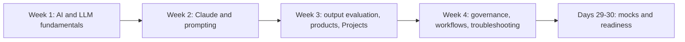

# 30-Day Structured Plan (CCAO-F)

> **Level:** Beginner · **Time:** 1 to 1.5 hours a day, ~38 hours total · **Track:** CCAO-F (Claude Certified Associate – Foundations)

## Who this plan is for

This plan is written for **complete beginners**. You do not need to have used an AI model before, and you do not need to write code. If you can use a web browser and set aside about an hour a day, you can follow it.

By day 30 you will have learned how AI and Claude work, practised prompting and evaluating outputs in the Claude app, set up and maintained a Project, learned the governance rules that apply at work, and sat two full mock exams. CCAO-F format and weights are in [`registry.yaml`](../../16-certification-tracks/registry.yaml) and [Exam facts](../../25-official-resources/exam-facts.md).

If you already use Claude regularly, the [15-day plan](15-day-preparation.md) will save you time.

## What you need

- A Claude account. The Free plan is enough for most of the plan; a few exercises mention features (research, chat search) that need a paid plan, and you can read about those instead.
- Optional: Python, if you want to try the labs (they run offline and free in mock mode). See [Environment setup](../environment-setup.md). Every lab in this plan is optional; an in-app alternative is always given.
- A notebook or document for your **study log**: write down every checkpoint question you miss and where the answer lives.

## Week 1: AI and LLM fundamentals

| Day | Objectives | Reading | Practical exercises | Time | Knowledge checkpoint |
|---|---|---|---|---|---|
| 1 | Understand how the repository and the exam work; choose your plan | [Getting started](../README.md) · [How to use this repository](../how-to-use-this-repo.md) · [Choose your path](../choose-your-path.md) | Create a Claude account ([environment setup: account section](../environment-setup.md#set-up-a-claude-account)); start your study log | 1 h | Explain the four steps of the study loop and the purpose of objective IDs |
| 2 | Explain AI, machine learning and generative AI | [What is AI?](../../01-ai-and-llm-fundamentals/01-what-is-ai.md) · [Generative AI](../../01-ai-and-llm-fundamentals/02-generative-ai.md) | In the app, try the classify-versus-generate example on the Generative AI page | 1 h | Both page quizzes fully correct |
| 3 | Explain how an LLM produces text; describe pre-training, fine-tuning and the knowledge cutoff | [Large language models](../../01-ai-and-llm-fundamentals/03-large-language-models.md) | Ask Claude an unfinished sentence and a question about yesterday's local news; note how it handles each. Optional: [Lab 01](../../19-hands-on-labs/lab-01-first-claude-interaction/README.md) in mock mode | 1 h | Explain next-token prediction to a friend in three sentences |
| 4 | Define tokens; estimate token counts; explain why output costs more | [Tokens and tokenisation](../../01-ai-and-llm-fundamentals/04-tokens-and-tokenisation.md) | Estimate the tokens in three of your own emails using the rule of thumb; optionally run the page's Python snippet | 1 h | Estimate tokens for a 1,000-word document and explain why long chats cost more |
| 5 | Explain the context window; choose restart, summarise or persist (CCAO-F-3.4) | [Context windows](../../01-ai-and-llm-fundamentals/05-context-windows.md) | The offsite-planning summarise-and-restart exercise on that page | 1.25 h | Give the right strategy for four scenarios without notes |
| 6 | Explain hallucinations; apply reduction and checking techniques (2.2, 2.3) | [Hallucinations](../../01-ai-and-llm-fundamentals/06-hallucinations.md) · [Capabilities and limitations](../../01-ai-and-llm-fundamentals/07-capabilities-and-limitations.md) | Ask Claude to summarise a public report with numbers; verify every number against the source | 1.5 h | List five techniques to reduce hallucination and three things to spot-check first |
| 7 | **Revision milestone 1** | Re-read any Module 01 page with a missed quiz question | Review the [fundamentals flashcards](../../23-flashcards/README.md); take a 15-question learning-mode drill on CCAO-F Domain 3 in the [mock exam engine](../../18-mock-examinations/README.md) (`python 18-mock-examinations/run_mock_exam.py --track CCAO-F --domain 3 --mode learn --count 15`, or the same in the browser app) | 1 h | 75% or more on the Domain 3 drill; study log updated |

## Week 2: Claude fundamentals and prompting

| Day | Objectives | Reading | Practical exercises | Time | Knowledge checkpoint |
|---|---|---|---|---|---|
| 8 | Explain how Claude is trained, statelessness and the system, user and assistant roles | [How Claude works](../../02-claude-fundamentals/01-how-claude-works.md) | The incognito statelessness test on that page | 1 h | Explain why a new chat does not know an old chat's contents, and how Projects and memory change that |
| 9 | Hold a productive conversation; give specific feedback (1.3) | [Your first conversation](../../02-claude-fundamentals/02-first-conversation.md) | The full six-step office-move exercise | 1.25 h | Turn three pieces of vague feedback into specific feedback |
| 10 | Write a structured prompt (1.1) | [Prompt fundamentals](../../02-claude-fundamentals/03-prompt-fundamentals.md) | Rewrite two of your own past requests using the eight building blocks; optional [Lab 02](../../19-hands-on-labs/lab-02-prompt-improvement/README.md) | 1.25 h | List the eight building blocks from memory |
| 11 | Give clear instructions; separate instructions from material | [Clear, direct instructions](../../03-prompt-engineering/01-clear-direct-instructions.md) · [Structure with XML tags](../../03-prompt-engineering/02-structure-with-xml-tags.md) | Wrap a pasted document in tags and ask two questions about it | 1 h | Page quizzes fully correct |
| 12 | Use examples; ask for reasoning when it helps | [Examples (few-shot)](../../03-prompt-engineering/03-examples-few-shot.md) · [Reasoning and thinking](../../03-prompt-engineering/04-reasoning-and-thinking.md) | Give Claude two example replies in your team's style and ask for a third | 1 h | Explain when examples help and when they over-constrain |
| 13 | Decompose complex tasks; iterate; adapt to task type (1.2, 1.3, 1.4) | [Task decomposition and chaining](../../03-prompt-engineering/05-task-decomposition-and-chaining.md) · [Iterating on prompts](../../03-prompt-engineering/08-iterating-on-prompts.md) · [Study guide: Domain 1](../../16-certification-tracks/ccao-f/study-guide/domain-1.md) | Break "plan a team event" into a chain of four prompts; Domain 1 items in [practical exercises](../../16-certification-tracks/ccao-f/practical-exercises.md) | 1.5 h | 75% or more on 10 Domain 1 [practice questions](../../17-practice-questions/README.md) |
| 14 | **Revision milestone 2** | Pages linked from missed questions | [Fundamentals flashcards](../../23-flashcards/README.md) again; 10 more Domain 1 questions | 1 h | 80% or more on Domain 1 overall |

## Week 3: output evaluation, products and Projects

| Day | Objectives | Reading | Practical exercises | Time | Knowledge checkpoint |
|---|---|---|---|---|---|
| 15 | Choose output formats; adapt outputs for audiences (2.5, 2.6) | [Artifacts and output formats](../../05-claude-products-and-models/05-artifacts-and-output-formats.md) · [Structured output](../../03-prompt-engineering/06-structured-output.md) | The four-formats exercise on the Artifacts page; optional [Lab 03](../../19-hands-on-labs/lab-03-structured-outputs/README.md) | 1.25 h | Choose a format for five scenarios and justify each |
| 16 | Evaluate accuracy; fact-check; decide when human review is needed (2.1 to 2.4) | [Study guide: Domain 2](../../16-certification-tracks/ccao-f/study-guide/domain-2.md) | Ground an answer in a document with the quote-first prompt from [Hallucinations](../../01-ai-and-llm-fundamentals/06-hallucinations.md); optional [Lab 04](../../19-hands-on-labs/lab-04-document-grounded-qa/README.md) | 1.5 h | 75% or more on 15 Domain 2 questions |
| 17 | Describe the product ecosystem and model families (3.1, 3.2) | [Product ecosystem](../../05-claude-products-and-models/01-product-ecosystem.md) · [Model families](../../05-claude-products-and-models/02-model-families.md) | Explore your app: find the model menu, the Projects area and the feature menu; note which features your plan has | 1.25 h | Name the four model lines in order of speed and pick a feature for five tasks |
| 18 | Match models to cost, speed and quality (3.3) | [Model selection](../../05-claude-products-and-models/03-model-selection.md) · [Study guide: Domain 3](../../16-certification-tracks/ccao-f/study-guide/domain-3.md) | Run one prompt on two models in the app and compare; optional [Lab 06](../../19-hands-on-labs/lab-06-model-comparison/README.md) | 1.25 h | 75% or more on 10 Domain 3 questions |
| 19 | Configure a Project with instructions and knowledge (5.1, 3.4) | [Projects and knowledge](../../05-claude-products-and-models/04-projects-and-knowledge.md) · [What is context engineering?](../../04-context-engineering/01-what-is-context-engineering.md) | Build the weekly-update Project from the Projects page; optional [Lab 05](../../19-hands-on-labs/lab-05-context-management/README.md) | 1.5 h | Explain what goes in instructions versus knowledge, with reasons |
| 20 | Write system-level instructions; manage connectors; maintain configurations (5.2 to 5.4) | [System prompts and roles](../../03-prompt-engineering/07-system-prompts-and-roles.md) · [Connectors and integrations](../../05-claude-products-and-models/06-connectors-and-integrations.md) · [Memory and persistence](../../04-context-engineering/04-memory-and-persistence.md) · [Study guide: Domain 5](../../16-certification-tracks/ccao-f/study-guide/domain-5.md) | Improve your Project instructions; add a change note; test with three standard questions | 1.5 h | 75% or more on 10 Domain 5 questions |
| 21 | **Revision milestone 3** | Pages linked from missed questions | Half-length mock in learning mode covering Domains 1, 2, 3 and 5 | 1.25 h | 75% or more overall |

## Week 4: governance, workflows and troubleshooting

| Day | Objectives | Reading | Practical exercises | Time | Knowledge checkpoint |
|---|---|---|---|---|---|
| 22 | Describe Anthropic's safety approach (6.1, 6.4) | [Anthropic's safety approach](../../02-claude-fundamentals/04-anthropic-safety-approach.md) | Classify the three example proposals on that page, then three of your own | 1 h | Name the three layers and the two high-risk requirements |
| 23 | Apply data sensitivity and privacy rules (6.2) | [Responsible use](../../02-claude-fundamentals/05-responsible-use.md) · [Data exfiltration and disclosure](../../12-ai-security/04-data-exfiltration-and-disclosure.md) | Run the six-question pre-flight checklist on three real tasks | 1.25 h | Explain what to remove before asking Claude to draft a customer reply |
| 24 | Follow organisational policy; understand oversight and injection risks (6.3) | [Prompt injection](../../12-ai-security/02-prompt-injection.md) · [AI governance](../../12-ai-security/12-ai-governance.md) · [Human oversight](../../12-ai-security/13-human-oversight.md) · [Study guide: Domain 6](../../16-certification-tracks/ccao-f/study-guide/domain-6.md) | Find and read your organisation's AI policy (or a public example) and note three rules | 1.5 h | 75% or more on 15 Domain 6 questions |
| 25 | Use Claude for requirements, research and design; integrate into workflows (4.1 to 4.4) | [Workflows versus agents](../../10-agentic-ai/01-workflows-vs-agents.md) · [Business value and ROI](../../13-enterprise-ai-architecture/08-business-value-and-roi.md) · [Study guide: Domain 4](../../16-certification-tracks/ccao-f/study-guide/domain-4.md) | Map one of your weekly processes into assist, augment and automate steps | 1.25 h | Explain augment versus automate with one example each |
| 26 | Communicate value and limitations (4.5) | [Capabilities and limitations](../../01-ai-and-llm-fundamentals/07-capabilities-and-limitations.md) (re-read) · [Stakeholder communication](../../13-enterprise-ai-architecture/06-stakeholder-communication.md) | Write a half-page note to a manager on what Claude can and cannot do for your team; Domain 4 [decision scenarios](../../16-certification-tracks/ccao-f/decision-scenarios.md) | 1.25 h | 75% or more on 15 Domain 4 questions |
| 27 | Diagnose and fix poor outputs; optimise workflows (7.1 to 7.3) | [Prompts and outputs troubleshooting](../../24-troubleshooting/prompts-and-outputs.md) · [Iterating on prompts](../../03-prompt-engineering/08-iterating-on-prompts.md) (re-read) · [Study guide: Domain 7](../../16-certification-tracks/ccao-f/study-guide/domain-7.md) | Fix three weak outputs from earlier in the month with one targeted change each | 1.25 h | 75% or more on 10 Domain 7 questions |
| 28 | **Revision milestone 4: full mock exam** | None beforehand | Full-length timed mock (`python 18-mock-examinations/run_mock_exam.py --track CCAO-F --mode timed`, or the browser version) | 2 h | 70% or more in every domain; note your two weakest |

## Days 29 and 30: repair and readiness

| Day | Objectives | Reading | Practical exercises | Time | Knowledge checkpoint |
|---|---|---|---|---|---|
| 29 | Repair weak areas | [Common misconceptions](../../16-certification-tracks/ccao-f/common-misconceptions.md) · study guides for your two weakest domains | Retry missed questions (`--weak`); [CCAO-F flashcards](../../23-flashcards/README.md) | 1.5 h | 80% or more on retried questions |
| 30 | **Revision milestone 5: readiness** | [Revision notes](../../16-certification-tracks/ccao-f/revision-notes.md) · [CCAO-F one-pager](../../22-cheat-sheets/ccao-f-one-pager.md) · [Exam day](../../16-certification-tracks/ccao-f/exam-day.md) | Second full mock with a different form; [readiness assessment](../../16-certification-tracks/ccao-f/readiness-assessment.md) | 2.5 h | Above 80% overall with no domain below 70%, and "ready" on the assessment |

If you are not ready on day 30, that is normal. Add a week: one day per weak domain, then another full mock.

## Revision milestones

| Day | Milestone | Pass bar |
|---|---|---|
| 7 | Fundamentals flashcards and question set | 75% |
| 14 | Domain 1 consolidation | 80% on Domain 1 |
| 21 | Half-length mock (Domains 1, 2, 3, 5) | 75% |
| 28 | Full timed mock 1 | 70% in every domain |
| 30 | Full timed mock 2 and readiness assessment | 80% overall, 70% per domain |

Practice scores are a study signal only; the questions are unofficial and do not predict an official scaled score.
