# 60-Day Comprehensive Plan (CCAR-P)

> **Level:** Intermediate to Advanced · **Time:** 1.5 to 2 hours a day, ~110 hours total · **Track:** CCAR-P (Claude Certified Architect – Professional)

## Who this plan is for

This plan is for **experienced technical professionals**: software engineers, platform engineers, solution or enterprise architects, security engineers and technical leads with several years of experience who want to prepare thoroughly for CCAR-P. It assumes you can read Python, understand APIs, authentication and cloud architecture, and ideally have worked on at least one project that used an LLM.

It is **not suitable for complete beginners**, either to technology or to AI at speed. If you are a developer who has never worked with LLMs, take the [90-day enterprise engineering plan](90-day-enterprise-engineering.md), which builds the foundations first. If you are not technical, the CCAO-F plans ([30-day](30-day-structured.md), [15-day](15-day-preparation.md)) are the right starting point.

The exam guide recommends 3+ years in systems architecture or platform engineering and 6+ months hands-on with Claude or comparable LLM systems in production; the format and domain weights are recorded in [`registry.yaml`](../../16-certification-tracks/registry.yaml) and summarised in [Exam facts](../../25-official-resources/exam-facts.md). Hands-on labs are the substitute for some of that production experience, so do not skip them.

```mermaid
gantt
    title 60-day CCAR-P plan
    dateFormat X
    axisFormat Day %s
    section Build knowledge
    Foundations and API          :1, 8
    Prompting and context (D2)   :8, 15
    Tools and MCP (D3)           :15, 22
    RAG and agents (D1, D3)      :22, 29
    Security and governance (D5) :29, 36
    Evaluation and operations (D4) :36, 43
    Architecture, stakeholders, Claude Code (D1, D6, D7) :43, 50
    section Apply and test
    Project and gap repair       :50, 57
    Final revision               :57, 61
```

## How to use this plan

- Numbers in brackets in the Objectives column are CCAR-P objective IDs: "2.2" means `CCAR-P-2.2` in the [registry](../../16-certification-tracks/registry.yaml).
- Each row is one day. Weekends can absorb a missed day; the seventh day of each week is a revision milestone.
- Labs run free in mock mode ([environment setup](../environment-setup.md)). Live mode is optional.
  > **Cost:** live-mode lab runs require API credits. Set a spend limit in the Console first.
- Practice questions and mocks run in the [mock exam engine](../../18-mock-examinations/README.md); use `--track CCAR-P --domain N` for domain practice.
- Keep a study log of every missed checkpoint and the page that answers it.
- Skim pages you already know well, but always answer their "Check your understanding" questions.

## Week 1 (days 1 to 7): foundations refresh and the Claude API

Focus: Domains 2 and 3 groundwork.

| Day | Objectives | Reading | Practical exercises | Time | Knowledge checkpoint |
|---|---|---|---|---|---|
| 1 | Refresh LLM fundamentals: tokens, context windows, hallucination (CCAR-P-2.4, 5.2) | [Large language models](../../01-ai-and-llm-fundamentals/03-large-language-models.md) · [Tokens](../../01-ai-and-llm-fundamentals/04-tokens-and-tokenisation.md) · [Context windows](../../01-ai-and-llm-fundamentals/05-context-windows.md) · [Hallucinations](../../01-ai-and-llm-fundamentals/06-hallucinations.md) | [Lab 01: First Claude interaction](../../19-hands-on-labs/lab-01-first-claude-interaction/README.md) in mock mode; read the lab code and the shared helper | 1.5 h | All four page quizzes correct; explain why history re-sending drives cost |
| 2 | Explain Claude's training, statelessness and roles; Anthropic's safety layers (2.2, 5.1) | [How Claude works](../../02-claude-fundamentals/01-how-claude-works.md) · [Anthropic's safety approach](../../02-claude-fundamentals/04-anthropic-safety-approach.md) · [Responsible use](../../02-claude-fundamentals/05-responsible-use.md) | Draft a one-paragraph explanation of the Usage Policy's high-risk requirements for an engineering audience | 1.5 h | Name the constitution's four priorities and the RSP's core idea |
| 3 | Map the product ecosystem; select models on trade-offs (2.1, 7.1) | [Product ecosystem](../../05-claude-products-and-models/01-product-ecosystem.md) · [Model families](../../05-claude-products-and-models/02-model-families.md) · [Model selection](../../05-claude-products-and-models/03-model-selection.md) | [Lab 06: Model comparison](../../19-hands-on-labs/lab-06-model-comparison/README.md); compare two models at two effort levels | 2 h | Justify a model and effort choice for three workloads |
| 4 | Make Messages API calls; handle stop reasons (3.3) | [Getting started with the API](../../06-claude-api/01-getting-started-with-the-api.md) · [Messages API](../../06-claude-api/02-messages-api.md) | [Lab 07: API integration](../../19-hands-on-labs/lab-07-api-integration/README.md), first half | 2 h | Write from memory a request with system prompt, messages and a stop_reason check |
| 5 | Use streaming, handle errors and retries, count tokens (3.3, 4.5) | [Streaming](../../06-claude-api/03-streaming.md) · [Errors, rate limits, retries](../../06-claude-api/06-errors-rate-limits-retries.md) · [Token counting and cost](../../06-claude-api/08-token-counting-and-cost.md) | [Lab 07: API integration](../../19-hands-on-labs/lab-07-api-integration/README.md), second half | 2 h | Classify five API errors as retryable or not |
| 6 | Use documents, citations and batches; know cloud platform differences (3.7) | [Vision, documents and citations](../../06-claude-api/04-vision-documents-and-citations.md) · [Batch processing](../../06-claude-api/05-batch-processing.md) · [Cloud platforms](../../06-claude-api/07-cloud-platforms.md) | Sketch when you would choose the Batch API and when a cloud platform; note feature-availability caveats | 1.5 h | Explain one advantage of each cloud platform option |
| 7 | **Revision milestone 1** | Pages linked from any missed quiz this week | [Fundamentals flashcards](../../23-flashcards/README.md); a 15-question learning-mode drill on CCAO-F Domain 3 in the [mock exam engine](../../18-mock-examinations/README.md) (`python 18-mock-examinations/run_mock_exam.py --track CCAO-F --domain 3 --mode learn --count 15`, or the same in the browser app) | 1 h | 75% or more on the Domain 3 drill |

## Week 2 (days 8 to 14): prompting and context engineering

Focus: Domain 2.

| Day | Objectives | Reading | Practical exercises | Time | Knowledge checkpoint |
|---|---|---|---|---|---|
| 8 | Write clear, structured prompts with examples (2.2, 2.3) | [Clear, direct instructions](../../03-prompt-engineering/01-clear-direct-instructions.md) · [XML tags](../../03-prompt-engineering/02-structure-with-xml-tags.md) · [Few-shot examples](../../03-prompt-engineering/03-examples-few-shot.md) | [Lab 02: Prompt improvement](../../19-hands-on-labs/lab-02-prompt-improvement/README.md) | 1.5 h | Rewrite a weak system prompt into a structured one |
| 9 | Apply reasoning, decomposition and structured outputs (2.3) | [Reasoning and thinking](../../03-prompt-engineering/04-reasoning-and-thinking.md) · [Task decomposition and chaining](../../03-prompt-engineering/05-task-decomposition-and-chaining.md) · [Structured output](../../03-prompt-engineering/06-structured-output.md) | [Lab 03: Structured outputs](../../19-hands-on-labs/lab-03-structured-outputs/README.md) | 2 h | Explain when to chain prompts versus one prompt |
| 10 | Design system prompts, templates and guardrails; iterate systematically (2.2) | [System prompts and roles](../../03-prompt-engineering/07-system-prompts-and-roles.md) · [Iterating on prompts](../../03-prompt-engineering/08-iterating-on-prompts.md) · [CCAR-P study guide D2](../../16-certification-tracks/ccar-p/study-guide/domain-2.md) | Write a production system prompt for a fictional support assistant with scope, tone and refusal guidance | 2 h | Peer-review checklist for system prompts from memory |
| 11 | Manage long context and grounding (2.4) | [What is context engineering?](../../04-context-engineering/01-what-is-context-engineering.md) · [Managing long context](../../04-context-engineering/02-managing-long-context.md) | [Lab 04: Document-grounded Q&A](../../19-hands-on-labs/lab-04-document-grounded-qa/README.md) | 1.5 h | List three tactics against lost-in-the-middle |
| 12 | Use prompt caching and compaction to optimise tokens (2.4, 2.5, 4.5) | [Prompt caching](../../04-context-engineering/03-prompt-caching.md) · [Compaction and context editing](../../04-context-engineering/05-compaction-and-context-editing.md) | [Lab 05: Context management](../../19-hands-on-labs/lab-05-context-management/README.md) · [Lab 17: Cost optimisation](../../19-hands-on-labs/lab-17-cost-optimisation/README.md) | 2 h | Lay out a request for maximum cache hits and say how to verify them |
| 13 | Design memory, persistence, progressive disclosure and Skills (2.5, 3.8) | [Memory and persistence](../../04-context-engineering/04-memory-and-persistence.md) · [Progressive disclosure and Skills](../../04-context-engineering/06-progressive-disclosure-and-skills.md) · [Projects and knowledge](../../05-claude-products-and-models/04-projects-and-knowledge.md) | Compare a monolithic context design with a progressive-discovery design for a 300-document knowledge base | 1.5 h | Explain progressive discovery versus monolithic context in two sentences |
| 14 | **Revision milestone 2** | [CCAR-P study guide D2](../../16-certification-tracks/ccar-p/study-guide/domain-2.md) (re-read weak sections) | Domain 2 [practice questions](../../17-practice-questions/README.md) in the [mock exam engine](../../18-mock-examinations/README.md), learning mode | 1.5 h | 80% or more on Domain 2 |

## Week 3 (days 15 to 21): tools, MCP and integration mechanisms

Focus: Domain 3.

| Day | Objectives | Reading | Practical exercises | Time | Knowledge checkpoint |
|---|---|---|---|---|---|
| 15 | Define tools and run the tool-use loop (3.1) | [Tool use fundamentals](../../07-tool-use-and-function-calling/01-tool-use-fundamentals.md) · [Defining tools](../../07-tool-use-and-function-calling/02-defining-tools.md) · [The tool-use loop](../../07-tool-use-and-function-calling/03-the-tool-use-loop.md) | [Lab 08: Tool invocation](../../19-hands-on-labs/lab-08-tool-invocation/README.md) | 2 h | Trace a two-tool conversation, message by message |
| 16 | Use server tools; design and secure tools; avoid capability bloat (3.1, 3.2) | [Server tools](../../07-tool-use-and-function-calling/04-server-tools.md) · [Tool design best practices](../../07-tool-use-and-function-calling/05-tool-design-best-practices.md) · [Tool security](../../07-tool-use-and-function-calling/06-tool-security.md) | Audit a fictional agent with 25 tools and propose a smaller tool surface | 2 h | Name three signs of capability bloat |
| 17 | Explain MCP and its architecture (3.7) | [What is MCP?](../../08-model-context-protocol/01-what-is-mcp.md) · [MCP architecture](../../08-model-context-protocol/02-architecture.md) | Diagram host, client and server for a fictional integration | 1.5 h | Explain MCP's roles and transports |
| 18 | Build and use an MCP server (3.7) | [Building an MCP server](../../08-model-context-protocol/03-building-an-mcp-server.md) · [Using MCP with Claude](../../08-model-context-protocol/04-using-mcp-with-claude.md) | [Lab 09: MCP fundamentals](../../19-hands-on-labs/lab-09-mcp-fundamentals/README.md) | 2 h | Explain how a remote MCP server is authorised |
| 19 | Secure MCP; compare MCP with API, CLI and agent-to-agent options (3.2, 3.7) | [MCP security](../../08-model-context-protocol/05-mcp-security.md) · [MCP versus alternatives](../../08-model-context-protocol/06-mcp-vs-alternatives.md) · [MCP server security](../../12-ai-security/08-mcp-server-security.md) | Write a short decision record choosing an integration mechanism for one scenario | 2 h | Pick an integration mechanism for four scenarios |
| 20 | Analyse authentication and authorisation in app-level integrations (3.2) | [Connectors and integrations](../../05-claude-products-and-models/06-connectors-and-integrations.md) · [Agent identity and permissions](../../12-ai-security/09-agent-identity-and-permissions.md) · [CCAR-P study guide D3](../../16-certification-tracks/ccar-p/study-guide/domain-3.md) | Map permissions for a connector rollout: who, what, read or write, approvals | 1.5 h | Explain the risk of an over-privileged service identity |
| 21 | **Revision milestone 3** | Pages linked from missed questions | Domain 3 [practice questions](../../17-practice-questions/README.md) (tools and MCP objectives) | 1.5 h | 75% or more |

## Week 4 (days 22 to 28): retrieval and agentic architecture

Focus: Domains 1 and 3.

| Day | Objectives | Reading | Practical exercises | Time | Knowledge checkpoint |
|---|---|---|---|---|---|
| 22 | Explain RAG; choose chunking strategies (3.5) | [RAG fundamentals](../../11-rag-and-knowledge-systems/01-rag-fundamentals.md) · [Chunking strategies](../../11-rag-and-knowledge-systems/02-chunking-strategies.md) | Chunk one long fictional policy three ways and compare | 1.5 h | Choose a chunking strategy for three document types |
| 23 | Choose embeddings, indexing and retrieval strategies (3.5, 3.6) | [Embeddings and indexing](../../11-rag-and-knowledge-systems/03-embeddings-and-indexing.md) · [Retrieval strategies](../../11-rag-and-knowledge-systems/04-retrieval-strategies.md) | [Lab 11: RAG pipeline](../../19-hands-on-labs/lab-11-rag-pipeline/README.md) | 2 h | Match retrieval strategy to data shape for four cases |
| 24 | Ground with citations; evaluate RAG; decide RAG versus long context (3.6, 3.8, 4.2) | [Grounding and citations](../../11-rag-and-knowledge-systems/05-grounding-and-citations.md) · [RAG evaluation](../../11-rag-and-knowledge-systems/06-rag-evaluation.md) · [RAG versus long context](../../11-rag-and-knowledge-systems/07-rag-vs-long-context.md) | Write evaluation criteria for a RAG assistant | 2 h | State when long context beats RAG |
| 25 | Distinguish workflows from agents; apply workflow patterns (1.3, 1.5) | [Workflows versus agents](../../10-agentic-ai/01-workflows-vs-agents.md) · [Workflow patterns](../../10-agentic-ai/02-workflow-patterns.md) | Classify five fictional use cases as single call, workflow or agent | 1.5 h | Name five workflow patterns |
| 26 | Design the agent loop and multi-agent orchestration (1.4) | [The agent loop](../../10-agentic-ai/03-the-agent-loop.md) · [Multi-agent architecture](../../10-agentic-ai/04-multi-agent-architecture.md) | [Lab 12: Agentic task execution](../../19-hands-on-labs/lab-12-agentic-task-execution/README.md) | 2 h | Explain orchestrator-worker trade-offs |
| 27 | Apply human-in-the-loop; use managed agents and the Agent SDK; engineer reliability (5.3, 1.4) | [Human in the loop](../../10-agentic-ai/05-human-in-the-loop.md) · [Managed Agents and Agent SDK](../../10-agentic-ai/06-managed-agents-and-agent-sdk.md) · [Agent reliability](../../10-agentic-ai/07-agent-reliability.md) | [Lab 13: Human in the loop](../../19-hands-on-labs/lab-13-human-in-the-loop/README.md) | 2 h | Place approval gates in an agent that can send email and issue refunds |
| 28 | **Revision milestone 4** | [CCAR-P study guide D1](../../16-certification-tracks/ccar-p/study-guide/domain-1.md) · [CCAR-P study guide D3](../../16-certification-tracks/ccar-p/study-guide/domain-3.md) | Half-length mock in learning mode across Domains 1 to 3 in the [mock exam engine](../../18-mock-examinations/README.md) | 2 h | 75% or more overall |

## Week 5 (days 29 to 35): AI security and governance

Focus: Domain 5.

| Day | Objectives | Reading | Practical exercises | Time | Knowledge checkpoint |
|---|---|---|---|---|---|
| 29 | Threat-model LLM systems; defend against direct and indirect prompt injection (5.1, 5.2) | [LLM threat modelling](../../12-ai-security/01-llm-threat-modelling.md) · [Prompt injection](../../12-ai-security/02-prompt-injection.md) · [Indirect prompt injection](../../12-ai-security/03-indirect-prompt-injection.md) | [Lab 14: Prompt injection testing](../../19-hands-on-labs/lab-14-prompt-injection-testing/README.md) | 2 h | Draw a trust-boundary diagram for a RAG agent |
| 30 | Prevent data disclosure, excessive agency and insecure output handling (5.1) | [Data exfiltration and disclosure](../../12-ai-security/04-data-exfiltration-and-disclosure.md) · [Tool misuse and excessive agency](../../12-ai-security/05-tool-misuse-and-excessive-agency.md) · [Insecure output handling](../../12-ai-security/06-insecure-output-handling.md) | [Lab 15: Sensitive data protection](../../19-hands-on-labs/lab-15-sensitive-data-protection/README.md) | 2 h | List controls for each of the three risks |
| 31 | Manage supply chain, agent identity and secrets (3.2, 5.1) | [Supply-chain risks](../../12-ai-security/07-supply-chain-risks.md) · [Agent identity and permissions](../../12-ai-security/09-agent-identity-and-permissions.md) · [Secrets management](../../12-ai-security/10-secrets-management.md) | Review a fictional deployment for secrets and identity weaknesses | 1.5 h | Explain short-lived credentials for agents |
| 32 | Logging, governance, human oversight and deployment controls (5.3, 3.4) | [Logging and auditability](../../12-ai-security/11-logging-and-auditability.md) · [AI governance](../../12-ai-security/12-ai-governance.md) · [Human oversight](../../12-ai-security/13-human-oversight.md) · [Enterprise deployment controls](../../12-ai-security/14-enterprise-deployment-controls.md) · [OWASP LLM mapping](../../12-ai-security/owasp-llm-mapping.md) | Map your design from day 29 to the OWASP LLM risks | 2 h | Name the main OWASP LLM risks and a control for each |
| 33 | Ensure regulatory compliance; address bias, fairness and transparency (5.4, 5.5) | [Data governance and compliance](../../13-enterprise-ai-architecture/05-data-governance-and-compliance.md) · [CCAR-P study guide D5](../../16-certification-tracks/ccar-p/study-guide/domain-5.md) | Write a data-handling summary for a fictional health-sector deployment | 1.5 h | Explain what changes when regulated data is in scope |
| 34 | Integrate security into an enterprise architecture (5.1, 1.2) | [Lab 20: Secure enterprise architecture](../../19-hands-on-labs/lab-20-secure-enterprise-architecture/README.md) (README and design) | [Lab 20: Secure enterprise architecture](../../19-hands-on-labs/lab-20-secure-enterprise-architecture/README.md), first half | 2 h | Explain each control in the lab's reference design |
| 35 | **Revision milestone 5** | Pages linked from missed questions | Domain 5 [practice questions](../../17-practice-questions/README.md) | 1.5 h | 80% or more on Domain 5 |

## Week 6 (days 36 to 42): evaluation, testing and production operations

Focus: Domain 4 and Domain 3 operations.

| Day | Objectives | Reading | Practical exercises | Time | Knowledge checkpoint |
|---|---|---|---|---|---|
| 36 | Define evaluation metrics across accuracy, latency, cost, safety and security (4.1) | [Why evaluate](../../14-evaluation-and-testing/01-why-evaluate.md) · [Metrics](../../14-evaluation-and-testing/02-metrics.md) | Define metrics for a fictional extraction service | 1.5 h | Name a metric in each of the five categories |
| 37 | Design eval datasets and grading methods (4.2) | [Building eval datasets](../../14-evaluation-and-testing/03-building-eval-datasets.md) · [Grading methods](../../14-evaluation-and-testing/04-grading-methods.md) | [Lab 16: Evaluation framework](../../19-hands-on-labs/lab-16-evaluation-framework/README.md) | 2 h | Explain code-based, model-based and human grading trade-offs |
| 38 | Run A/B tests; diagnose failures; run safety and red-team evals (4.3, 4.4) | [A/B testing and iteration](../../14-evaluation-and-testing/05-ab-testing-and-iteration.md) · [Diagnosing failures](../../14-evaluation-and-testing/06-diagnosing-failures.md) · [Safety and red-team evals](../../14-evaluation-and-testing/07-safety-and-red-team-evals.md) | Diagnose three fictional failure reports as prompt, retrieval or model mismatch | 2 h | State a diagnosis order for a hallucination report |
| 39 | Prepare for production; build observability (3.4, 4.6) | [Production readiness](../../15-production-operations/01-production-readiness.md) · [Observability](../../15-production-operations/02-observability.md) | [Lab 19: Observability](../../19-hands-on-labs/lab-19-observability/README.md) | 2 h | List what to log for every Claude call |
| 40 | Optimise cost and latency (4.5, 3.3) | [Cost optimisation](../../15-production-operations/03-cost-optimisation.md) · [Latency optimisation](../../15-production-operations/04-latency-optimisation.md) | [Lab 17: Cost optimisation](../../19-hands-on-labs/lab-17-cost-optimisation/README.md) (revisit) | 1.5 h | Rank five cost levers for a given workload |
| 41 | Engineer reliability; plan capacity; respond to incidents; manage model upgrades (6.5, 7.3) | [Reliability engineering](../../15-production-operations/05-reliability-engineering.md) · [Rate limits and capacity](../../15-production-operations/06-rate-limits-and-capacity.md) · [Incident response](../../15-production-operations/07-incident-response.md) · [Model upgrades and change management](../../15-production-operations/08-model-upgrades-and-change-management.md) | [Lab 18: Reliability engineering](../../19-hands-on-labs/lab-18-reliability-engineering/README.md) | 2 h | Outline a model-upgrade runbook |
| 42 | **Revision milestone 6** | [CCAR-P study guide D4](../../16-certification-tracks/ccar-p/study-guide/domain-4.md) | Domain 4 [practice questions](../../17-practice-questions/README.md); half-length mock across all domains | 2 h | 80% on Domain 4; 75% overall |

## Week 7 (days 43 to 49): architecture, stakeholders and developer enablement

Focus: Domains 1, 6 and 7.

| Day | Objectives | Reading | Practical exercises | Time | Knowledge checkpoint |
|---|---|---|---|---|---|
| 43 | Translate business problems into solutions; follow a design process (1.1, 1.2, 6.1) | [Solution design process](../../13-enterprise-ai-architecture/01-solution-design-process.md) · [Architecture patterns](../../13-enterprise-ai-architecture/02-architecture-patterns.md) | Run a structured discovery for a fictional client brief | 1.5 h | List your discovery questions from memory |
| 44 | Apply reference architectures and integration patterns (1.2, 1.3) | [Reference architectures](../../13-enterprise-ai-architecture/03-reference-architectures.md) · [Integration patterns](../../13-enterprise-ai-architecture/04-integration-patterns.md) | Adapt a reference architecture to the day-43 brief | 2 h | Justify the pattern you chose |
| 45 | Communicate decisions and trade-offs; write ADRs (6.2, 6.4) | [Stakeholder communication](../../13-enterprise-ai-architecture/06-stakeholder-communication.md) · [Architecture decision records](../../13-enterprise-ai-architecture/07-architecture-decision-records.md) · [CCAR-P study guide D6](../../16-certification-tracks/ccar-p/study-guide/domain-6.md) | Write one ADR for the day-44 design | 1.5 h | ADR sections from memory |
| 46 | Align to business value; manage the lifecycle and SLAs (1.6, 6.3, 6.5) | [Business value and ROI](../../13-enterprise-ai-architecture/08-business-value-and-roi.md) · [Lifecycle management](../../13-enterprise-ai-architecture/09-lifecycle-management.md) | Estimate cost and value for the design; draft SLAs | 1.5 h | Explain how you would set expectations on accuracy |
| 47 | Configure Claude Code for teams (7.1) | [What is Claude Code?](../../09-claude-code/01-what-is-claude-code.md) · [Setup and first session](../../09-claude-code/02-setup-and-first-session.md) · [CLAUDE.md and memory](../../09-claude-code/03-claude-md-and-memory.md) · [Permissions and settings](../../09-claude-code/04-permissions-and-settings.md) | [Lab 10: Claude Code workflows](../../19-hands-on-labs/lab-10-claude-code-workflows/README.md) | 2 h | Explain CLAUDE.md scope and permission modes |
| 48 | Use commands, Skills, subagents, hooks, MCP and CI with Claude Code (7.2, 7.3) | [Commands, Skills, subagents](../../09-claude-code/05-commands-skills-subagents.md) · [Hooks](../../09-claude-code/06-hooks.md) · [MCP in Claude Code](../../09-claude-code/07-mcp-in-claude-code.md) · [Team rollout](../../09-claude-code/08-team-rollout.md) · [Headless, CI and Agent SDK](../../09-claude-code/09-headless-ci-and-agent-sdk.md) · [CCAR-P study guide D7](../../16-certification-tracks/ccar-p/study-guide/domain-7.md) | Design a team rollout plan with guardrails | 2 h | Name two hook use cases and one CI use case |
| 49 | **Revision milestone 7: full mock 1** | None beforehand | Full-length timed CCAR-P mock (`python 18-mock-examinations/run_mock_exam.py --track CCAR-P --mode timed`) | 2.5 h | 70% or more in every domain; record your two weakest |

## Week 8 (days 50 to 56): applied project and gap repair

Focus: All domains.

| Day | Objectives | Reading | Practical exercises | Time | Knowledge checkpoint |
|---|---|---|---|---|---|
| 50 | Scope a portfolio project: requirements, architecture, evaluation plan (1.1, 6.1) | [Project 2: Knowledge-base Q&A assistant](../../20-real-world-projects/02-knowledge-base-qa-assistant/README.md) or [Project 3: Security alert triage assistant](../../20-real-world-projects/03-security-alert-triage-assistant/README.md) | Write the project's scope and success metrics | 2 h | Success metrics cover quality, latency, cost and safety |
| 51 | Build the core path in mock mode (1.2, 3.5) | The chosen project's README and source | Implement and run the project's tests in mock mode | 2 h | Tests pass in mock mode |
| 52 | Add evaluation, guardrails and observability (4.1, 5.1, 4.6) | The chosen project's README | Add at least three eval cases and one guardrail; log usage | 2 h | You can explain every control to a reviewer |
| 53 | Practise architectural judgement on scenarios | [CCAR-P decision scenarios](../../16-certification-tracks/ccar-p/decision-scenarios.md) · [practical exercises](../../16-certification-tracks/ccar-p/practical-exercises.md) | Answer every scenario in writing before reading the discussion | 2 h | Agree with the discussion on at least four in five |
| 54 | Repair your weakest domain | [Common misconceptions](../../16-certification-tracks/ccar-p/common-misconceptions.md) · the study guide for that domain | 20 [practice questions](../../17-practice-questions/README.md) in that domain | 2 h | 80% on that domain |
| 55 | Repair your second-weakest domain | The study guide for that domain | 20 [practice questions](../../17-practice-questions/README.md) in that domain; retry missed with `--weak` | 2 h | 80% on that domain |
| 56 | **Revision milestone 8: full mock 2** | None beforehand | Full-length timed mock using a different form | 2.5 h | 75% overall; no domain below 70% |

## Days 57 to 60: final revision and readiness

Focus: All domains.

| Day | Objectives | Reading | Practical exercises | Time | Knowledge checkpoint |
|---|---|---|---|---|---|
| 57 | Consolidate key facts and trade-offs | [Revision notes](../../16-certification-tracks/ccar-p/revision-notes.md) · [CCAR-P one-pager](../../22-cheat-sheets/ccar-p-one-pager.md) · [Model selection cheat sheet](../../22-cheat-sheets/model-selection.md) · [AI security cheat sheet](../../22-cheat-sheets/ai-security.md) | Write a one-page summary of your own weak points | 1.5 h | Explain every item on your summary aloud |
| 58 | Fix remaining misses | Pages linked from missed questions | [CCAR-P flashcards](../../23-flashcards/README.md); retry missed questions (`--weak`) | 1.5 h | No repeated misses |
| 59 | **Revision milestone 9: readiness** | [Readiness assessment](../../16-certification-tracks/ccar-p/readiness-assessment.md) | Third full mock (a different form); readiness assessment | 3 h | Above 80% overall with no domain below 70%, and "ready" |
| 60 | Prepare for exam day | [Exam-day guide](../../16-certification-tracks/ccar-p/exam-day.md) | Light review only; rest | 0.5 h | Logistics confirmed |

## Revision milestones

| Day | Milestone | Pass bar |
|---|---|---|
| 7 | CCAO-F Domain 3 drill (15 questions) | 75% |
| 14 | Domain 2 questions | 80% |
| 21 | Domain 3 (tools and MCP) questions | 75% |
| 28 | Half-length mock, Domains 1 to 3 | 75% |
| 35 | Domain 5 questions | 80% |
| 42 | Domain 4 questions and half-length mock | 80% on Domain 4, 75% overall |
| 49 | Full timed mock 1 | 70% in every domain |
| 56 | Full timed mock 2 | 75% overall |
| 59 | Full timed mock 3 and readiness assessment | 80% overall, 70% per domain |

Practice scores are a study signal only; the questions are unofficial and do not predict an official scaled score.
