# 7-Day Accelerated Plan (CCAO-F)

> **Level:** Intermediate · **Time:** 3 to 4 hours a day, ~25 hours total · **Track:** CCAO-F (Claude Certified Associate – Foundations)

## Who this plan is for

This is a sprint for **experienced Claude users**: people who already use Claude (or a similar assistant) most working days, have set up at least one Project, and are comfortable iterating on prompts. It is **not suitable for complete beginners**. If you are new to AI, use the [30-day structured plan](30-day-structured.md); if you have some experience but not daily use, use the [15-day plan](15-day-preparation.md).

The plan follows the seven CCAO-F domains and spends the most time on the most heavily weighted ones. Weights and exam format are recorded in [`registry.yaml`](../../16-certification-tracks/registry.yaml) and summarised in [Exam facts](../../25-official-resources/exam-facts.md).

```mermaid
gantt
    title 7-day accelerated plan
    dateFormat X
    axisFormat Day %s
    section Learn
    D1 Prompting                     :1, 2
    D2 Output evaluation             :2, 3
    D3 and D5 Products, models, Projects :3, 4
    D4 and D7 Workflows, troubleshooting :4, 5
    D6 Governance                    :5, 6
    section Test and revise
    Full mock exam and gap repair    :6, 7
    Final revision and readiness     :7, 8
```

## Before you start (30 minutes)

- Do the [CCAO-F readiness assessment](../../16-certification-tracks/ccao-f/readiness-assessment.md) once, untimed, to find your weakest domains. Give those domains extra time on their day.
- Make sure you can run the mock exam engine: see [Mock examinations](../../18-mock-examinations/README.md).
- Have a Claude account ready. A paid plan helps (research, larger Project knowledge) but is not essential.

## Day 1: Prompting and task execution (Domain 1)

| | |
|---|---|
| **Objectives** | Write prompts that state task, context, audience, format and constraints (CCAO-F-1.1); decompose a complex request (1.2); iterate based on output (1.3); adapt to drafting, analysis, research and brainstorming (1.4) |
| **Reading** | [Prompt fundamentals](../../02-claude-fundamentals/03-prompt-fundamentals.md) · [Clear, direct instructions](../../03-prompt-engineering/01-clear-direct-instructions.md) · [Structure with XML tags](../../03-prompt-engineering/02-structure-with-xml-tags.md) · [Examples (few-shot)](../../03-prompt-engineering/03-examples-few-shot.md) · [Task decomposition and chaining](../../03-prompt-engineering/05-task-decomposition-and-chaining.md) · [Iterating on prompts](../../03-prompt-engineering/08-iterating-on-prompts.md) · [Study guide: Domain 1](../../16-certification-tracks/ccao-f/study-guide/domain-1.md) |
| **Practical exercises** | [Lab 02: Prompt improvement](../../19-hands-on-labs/lab-02-prompt-improvement/README.md) (mock mode) or the in-app version: take one real work task, write a one-line prompt, then rewrite it with all eight building blocks and compare. Do the Domain 1 items in [practical exercises](../../16-certification-tracks/ccao-f/practical-exercises.md) |
| **Estimated time** | 3.5 hours (2 h reading, 1 h exercises, 30 min questions) |
| **Knowledge checkpoint** | Score 80% or more on 15 Domain 1 [practice questions](../../17-practice-questions/README.md) in learning mode. From memory, list the eight prompt building blocks and match each task type to its most helpful technique |

## Day 2: Output evaluation and validation (Domain 2, the heaviest domain)

| | |
|---|---|
| **Objectives** | Evaluate accuracy and completeness (2.1); spot hallucinations, inconsistency and bias (2.2); apply fact-checking (2.3); decide when human review is needed (2.4); adapt outputs for an audience (2.5); choose output formats (2.6) |
| **Reading** | [Hallucinations](../../01-ai-and-llm-fundamentals/06-hallucinations.md) · [Capabilities and limitations](../../01-ai-and-llm-fundamentals/07-capabilities-and-limitations.md) · [Artifacts and output formats](../../05-claude-products-and-models/05-artifacts-and-output-formats.md) · [Structured output](../../03-prompt-engineering/06-structured-output.md) · [Study guide: Domain 2](../../16-certification-tracks/ccao-f/study-guide/domain-2.md) |
| **Practical exercises** | [Lab 04: Document-grounded Q&A](../../19-hands-on-labs/lab-04-document-grounded-qa/README.md) and [Lab 03: Structured outputs](../../19-hands-on-labs/lab-03-structured-outputs/README.md). In the app: ask Claude for a summary of a public report with statistics, then verify every figure against the source and record what you found |
| **Estimated time** | 4 hours |
| **Knowledge checkpoint** | 80% or more on 20 Domain 2 questions. Explain from memory the three review levels (low, medium, high stakes) and give one example of each |

## Day 3: Products, models and configuration (Domains 3 and 5)

| | |
|---|---|
| **Objectives** | Choose the right feature: chat, Projects, research, Artifacts (3.1); differentiate model families (3.2); match model to cost, speed and quality (3.3); manage context with restart, summarise or persist (3.4); configure Projects with instructions and knowledge (5.1); manage knowledge and connectors (5.2); write system-level instructions (5.3); maintain configurations (5.4) |
| **Reading** | All of [Module 05](../../05-claude-products-and-models/README.md): [ecosystem](../../05-claude-products-and-models/01-product-ecosystem.md), [model families](../../05-claude-products-and-models/02-model-families.md), [model selection](../../05-claude-products-and-models/03-model-selection.md), [Projects and knowledge](../../05-claude-products-and-models/04-projects-and-knowledge.md), [connectors](../../05-claude-products-and-models/06-connectors-and-integrations.md) · [Context windows](../../01-ai-and-llm-fundamentals/05-context-windows.md) · [System prompts and roles](../../03-prompt-engineering/07-system-prompts-and-roles.md) · Study guides: [Domain 3](../../16-certification-tracks/ccao-f/study-guide/domain-3.md), [Domain 5](../../16-certification-tracks/ccao-f/study-guide/domain-5.md) |
| **Practical exercises** | Build a Project for a recurring task with six-section instructions and two knowledge files, then test it with three standard questions. [Lab 05: Context management](../../19-hands-on-labs/lab-05-context-management/README.md) and [Lab 06: Model comparison](../../19-hands-on-labs/lab-06-model-comparison/README.md) in mock mode |
| **Estimated time** | 4 hours |
| **Knowledge checkpoint** | 80% or more on 10 Domain 3 and 10 Domain 5 questions. Without notes, state when to restart, summarise or persist, and name the four model lines in order of speed |

## Day 4: Workflow integration and troubleshooting (Domains 4 and 7)

| | |
|---|---|
| **Objectives** | Use Claude to analyse requirements (4.1), research and plan (4.2), support solution design (4.3), integrate into workflows (4.4), and communicate value and limitations (4.5); diagnose poor outputs (7.1), adjust from feedback (7.2), and optimise workflows (7.3) |
| **Reading** | [Capabilities and limitations](../../01-ai-and-llm-fundamentals/07-capabilities-and-limitations.md) (re-read the augment versus automate section) · [Stakeholder communication](../../13-enterprise-ai-architecture/06-stakeholder-communication.md) · [Business value and ROI](../../13-enterprise-ai-architecture/08-business-value-and-roi.md) · [Workflows versus agents](../../10-agentic-ai/01-workflows-vs-agents.md) · [Prompts and outputs troubleshooting](../../24-troubleshooting/prompts-and-outputs.md) · Study guides: [Domain 4](../../16-certification-tracks/ccao-f/study-guide/domain-4.md), [Domain 7](../../16-certification-tracks/ccao-f/study-guide/domain-7.md) |
| **Practical exercises** | Map one of your own weekly processes, mark which steps Claude could assist, augment or automate, and write a half-page stakeholder note on value and limits. Work through the [decision scenarios](../../16-certification-tracks/ccao-f/decision-scenarios.md) for Domains 4 and 7 |
| **Estimated time** | 3.5 hours |
| **Knowledge checkpoint** | 80% or more on 10 Domain 4 and 10 Domain 7 questions. Given a weak output, name its likely cause and fix within one minute |

## Day 5: Governance, risk and responsible use (Domain 6)

| | |
|---|---|
| **Objectives** | Distinguish appropriate from inappropriate use (6.1); apply data-sensitivity, regulatory and privacy considerations (6.2); follow organisational policy (6.3); understand ethical implications (6.4) |
| **Reading** | [Anthropic's safety approach](../../02-claude-fundamentals/04-anthropic-safety-approach.md) · [Responsible use](../../02-claude-fundamentals/05-responsible-use.md) · [Prompt injection](../../12-ai-security/02-prompt-injection.md) · [Data exfiltration and disclosure](../../12-ai-security/04-data-exfiltration-and-disclosure.md) · [AI governance](../../12-ai-security/12-ai-governance.md) · [Human oversight](../../12-ai-security/13-human-oversight.md) · [Study guide: Domain 6](../../16-certification-tracks/ccao-f/study-guide/domain-6.md) |
| **Practical exercises** | Classify ten realistic tasks from your job as allowed, allowed with human review, or not allowed, using the Usage Policy flowchart. Skim the README of [Lab 15: Sensitive data protection](../../19-hands-on-labs/lab-15-sensitive-data-protection/README.md) |
| **Estimated time** | 3.5 hours |
| **Knowledge checkpoint** | 80% or more on 15 Domain 6 questions. **Revision milestone:** a half-length mock exam in learning mode across all domains |

## Day 6: Full mock exam and gap repair

| | |
|---|---|
| **Objectives** | Sit a full-length timed mock under exam conditions; turn every miss into a targeted fix |
| **Reading** | Only the pages linked from your missed questions. Then [common misconceptions](../../16-certification-tracks/ccao-f/common-misconceptions.md) |
| **Practical exercises** | **Revision milestone:** full-length timed mock (`python 18-mock-examinations/run_mock_exam.py --track CCAO-F --mode timed`), then retry missed questions with `--weak` |
| **Estimated time** | 4 hours (2 h mock, 2 h review) |
| **Knowledge checkpoint** | Every domain at 70% or more. Any domain below that gets a 45-minute focused re-read and 10 more questions today |

## Day 7: Final revision and readiness

| | |
|---|---|
| **Objectives** | Consolidate; confirm readiness; prepare for exam day |
| **Reading** | [Revision notes](../../16-certification-tracks/ccao-f/revision-notes.md) · [CCAO-F one-pager](../../22-cheat-sheets/ccao-f-one-pager.md) · [Exam-day guide](../../16-certification-tracks/ccao-f/exam-day.md) |
| **Practical exercises** | Review the [CCAO-F flashcards](../../23-flashcards/decks/ccao-f.yaml). **Revision milestone:** a second full mock using a different form, then the [readiness assessment](../../16-certification-tracks/ccao-f/readiness-assessment.md) |
| **Estimated time** | 3.5 hours |
| **Knowledge checkpoint** | Above 80% overall on the second mock with no domain below 70%, and a "ready" result on the readiness assessment. If not, extend by two or three days using the 15-day plan's revision days |

## Revision milestones summary

| When | Milestone | Pass bar |
|---|---|---|
| End of Day 5 | Half-length mock, learning mode | 75% overall |
| Day 6 | Full timed mock 1 | 70% in every domain |
| Day 7 | Full timed mock 2 and readiness assessment | 80% overall, 70% per domain, "ready" |

Practice scores are a study signal, not a prediction of an official scaled score.
