# 90-Day Enterprise Engineering Plan (CCAR-P)

> **Level:** Beginner (in AI) to Advanced · **Time:** 1.5 to 2 hours on weekdays plus 3 to 4 hours at weekends, ~170 hours total · **Track:** CCAR-P (Claude Certified Architect – Professional), with an optional CCAO-F milestone

## Who this plan is for

This plan is for **technical professionals who are new to AI**: software engineers, DevSecOps and platform engineers, security engineers, cloud and enterprise architects, and technical leads. It assumes no AI or LLM knowledge at all, but it does assume you are comfortable with programming (Python preferred), APIs, authentication and basic cloud architecture.

- **Complete beginners to AI:** yes, this plan starts from zero on AI.
- **Complete beginners to technology:** no. If you are not technical, follow the [30-day CCAO-F plan](30-day-structured.md) instead.
- **Already experienced with LLMs in production:** the [60-day plan](60-day-comprehensive.md) will be faster.

The CCAR-P exam guide recommends 3+ years in systems architecture or platform engineering and 6+ months hands-on with Claude or comparable LLM systems in production. Ninety days of study cannot replace production experience, but the labs, the capstone project and the decision scenarios are designed to build the judgement the exam tests. Consider gaining real project experience alongside or after this plan before booking. Format and domain weights are in [`registry.yaml`](../../16-certification-tracks/registry.yaml) and [Exam facts](../../25-official-resources/exam-facts.md).

Around day 41 there is an **optional CCAO-F milestone**: by then you have covered all CCAO-F content, and sitting that exam first is a reasonable stepping stone.

```mermaid
gantt
    title 90-day enterprise engineering plan
    dateFormat X
    axisFormat Day %s
    section Phase 1 Foundations
    AI, Claude, prompting, products        :1, 22
    section Phase 2 Build
    API, context, tools, MCP, Claude Code  :22, 43
    section Phase 3 Agents and security
    Agents, RAG, security, governance      :43, 64
    section Phase 4 Production
    Evaluation, operations, architecture   :64, 78
    section Phase 5 Capstone and exam
    Capstone and readiness                 :78, 91
```

## How to use this plan

- Weeks have five weekday rows and one weekend row. The weekend row lists each day's objective; use it for longer labs and revision milestones.
- Numbers in brackets in the Objectives column are objective IDs from the [registry](../../16-certification-tracks/registry.yaml).
- Labs run free in mock mode ([environment setup](../environment-setup.md)).
  > **Cost:** live-mode lab runs require API credits. Set a spend limit in the Console first.
- Practice questions and mocks run in the [mock exam engine](../../18-mock-examinations/README.md); use `--track CCAR-P --domain N` (or `--track CCAO-F`) for domain practice.
- Keep a study log of every missed checkpoint and the page that answers it.

## Phase 1: foundations (weeks 1 to 3, days 1 to 21)

The same foundations a CCAO-F candidate learns, at a technical pace. Even experienced engineers should do these properly: both exams test prompting, output evaluation and responsible use.

### Week 1 (days 1 to 7): AI and LLM fundamentals

| Day | Objectives | Reading | Practical exercises | Time | Knowledge checkpoint |
|---|---|---|---|---|---|
| 1 | Set up your environment; choose your plan; understand objective IDs | [Getting started](../../00-getting-started/README.md) · [How to use this repository](../../00-getting-started/how-to-use-this-repo.md) · [Environment setup](../../00-getting-started/environment-setup.md) | [Lab 01: First Claude interaction](../../19-hands-on-labs/lab-01-first-claude-interaction/README.md) in mock mode | 1.5 h | Lab 01 runs and you can explain mock versus live mode |
| 2 | Explain AI, ML, deep learning and generative AI | [What is AI?](../../01-ai-and-llm-fundamentals/01-what-is-ai.md) · [Generative AI](../../01-ai-and-llm-fundamentals/02-generative-ai.md) | Classify-versus-generate exercise in the app | 1 h | Page quizzes correct |
| 3 | Explain next-token prediction, pre-training and fine-tuning; count tokens | [Large language models](../../01-ai-and-llm-fundamentals/03-large-language-models.md) · [Tokens](../../01-ai-and-llm-fundamentals/04-tokens-and-tokenisation.md) | Run the token-estimate snippet; compare with `count_tokens` if you have a key | 1.5 h | Estimate token cost for a 5,000-word document on two models |
| 4 | Explain context windows; restart, summarise or persist | [Context windows](../../01-ai-and-llm-fundamentals/05-context-windows.md) | Summarise-and-restart exercise in the app | 1 h | Explain what fills the window in an API request |
| 5 | Explain hallucination; reason about capabilities and limitations | [Hallucinations](../../01-ai-and-llm-fundamentals/06-hallucinations.md) · [Capabilities and limitations](../../01-ai-and-llm-fundamentals/07-capabilities-and-limitations.md) | Verify a Claude summary of a public report figure by figure | 1.5 h | List five reduction techniques and the review levels by stakes |
| 6-7 | Weekend. Day 6: consolidate fundamentals. Day 7: **revision milestone 1** | Pages with missed quiz questions | [Fundamentals flashcards](../../23-flashcards/README.md); a 15-question learning-mode drill on CCAO-F Domain 3 in the [mock exam engine](../../18-mock-examinations/README.md) (`python 18-mock-examinations/run_mock_exam.py --track CCAO-F --domain 3 --mode learn --count 15`, or the same in the browser app) | 2 h total | 75% or more on the Domain 3 drill |

### Week 2 (days 8 to 14): Claude fundamentals and prompting

| Day | Objectives | Reading | Practical exercises | Time | Knowledge checkpoint |
|---|---|---|---|---|---|
| 8 | Explain Claude's training, statelessness and the three roles | [How Claude works](../../02-claude-fundamentals/01-how-claude-works.md) | Run the page's system-prompt snippet in mock mode; extend it to a two-turn conversation | 1.5 h | Write a two-turn `messages` list from memory |
| 9 | Hold a productive conversation; write structured prompts (CCAO-F-1.1, 1.3) | [First conversation](../../02-claude-fundamentals/02-first-conversation.md) · [Prompt fundamentals](../../02-claude-fundamentals/03-prompt-fundamentals.md) | Office-move exercise in the app | 1.5 h | Eight building blocks from memory |
| 10 | Write clear instructions and structure inputs with tags | [Clear, direct instructions](../../03-prompt-engineering/01-clear-direct-instructions.md) · [XML tags](../../03-prompt-engineering/02-structure-with-xml-tags.md) | Wrap a document in tags and query it | 1 h | Page quizzes correct |
| 11 | Use few-shot examples and reasoning | [Few-shot examples](../../03-prompt-engineering/03-examples-few-shot.md) · [Reasoning and thinking](../../03-prompt-engineering/04-reasoning-and-thinking.md) | Compare zero-shot and few-shot outputs on a classification task | 1.5 h | Explain when examples over-constrain |
| 12 | Decompose tasks; produce structured output (CCAR-P-2.3) | [Task decomposition and chaining](../../03-prompt-engineering/05-task-decomposition-and-chaining.md) · [Structured output](../../03-prompt-engineering/06-structured-output.md) | Build a three-step prompt chain in the app | 1.5 h | Explain structured outputs versus instructions for JSON |
| 13-14 | Weekend. Day 13: hands-on prompting labs. Day 14: **revision milestone 2** | [CCAO-F study guide D1](../../16-certification-tracks/ccao-f/study-guide/domain-1.md) | [Lab 02: Prompt improvement](../../19-hands-on-labs/lab-02-prompt-improvement/README.md) · [Lab 03: Structured outputs](../../19-hands-on-labs/lab-03-structured-outputs/README.md) · CCAO-F Domain 1 [practice questions](../../17-practice-questions/README.md) | 3 h total | 80% or more on CCAO-F Domain 1 |

### Week 3 (days 15 to 21): system prompts, products, models, Projects, safety

| Day | Objectives | Reading | Practical exercises | Time | Knowledge checkpoint |
|---|---|---|---|---|---|
| 15 | Design system prompts; iterate systematically (CCAR-P-2.2) | [System prompts and roles](../../03-prompt-engineering/07-system-prompts-and-roles.md) · [Iterating on prompts](../../03-prompt-engineering/08-iterating-on-prompts.md) | Write and test a system prompt for a fictional internal assistant | 1.5 h | System-prompt review checklist from memory |
| 16 | Map the product ecosystem and model families (CCAO-F-3.1, 3.2) | [Product ecosystem](../../05-claude-products-and-models/01-product-ecosystem.md) · [Model families](../../05-claude-products-and-models/02-model-families.md) | List models via the Models API (live) or read the models overview | 1.5 h | Four model lines in order of speed and cost |
| 17 | Select models on trade-offs (CCAR-P-2.1) | [Model selection](../../05-claude-products-and-models/03-model-selection.md) | [Lab 06: Model comparison](../../19-hands-on-labs/lab-06-model-comparison/README.md) | 1.5 h | Justify a model and effort choice for three workloads |
| 18 | Configure Projects; choose output formats (CCAO-F-5.1, 2.6) | [Projects and knowledge](../../05-claude-products-and-models/04-projects-and-knowledge.md) · [Artifacts and output formats](../../05-claude-products-and-models/05-artifacts-and-output-formats.md) | Build a Project with six-section instructions and two knowledge files | 1.5 h | Instructions versus knowledge, with reasons |
| 19 | Manage connectors; apply Anthropic's safety approach and responsible use (CCAO-F-5.2, 6.1 to 6.4) | [Connectors and integrations](../../05-claude-products-and-models/06-connectors-and-integrations.md) · [Anthropic's safety approach](../../02-claude-fundamentals/04-anthropic-safety-approach.md) · [Responsible use](../../02-claude-fundamentals/05-responsible-use.md) | Classify ten tasks with the Usage Policy flowchart | 2 h | Two high-risk requirements and the constitution's priorities |
| 20-21 | Weekend. Day 20: grounding and context labs. Day 21: **revision milestone 3** | [CCAO-F study guide D2](../../16-certification-tracks/ccao-f/study-guide/domain-2.md) · [CCAO-F study guide D3](../../16-certification-tracks/ccao-f/study-guide/domain-3.md) · [CCAO-F study guide D5](../../16-certification-tracks/ccao-f/study-guide/domain-5.md) | [Lab 04: Document-grounded Q&A](../../19-hands-on-labs/lab-04-document-grounded-qa/README.md) · [Lab 05: Context management](../../19-hands-on-labs/lab-05-context-management/README.md) · half-length CCAO-F mock in learning mode | 3.5 h total | 75% or more overall |

## Phase 2: building with the API, tools, MCP and Claude Code (weeks 4 to 6, days 22 to 42)

You move from using Claude to building with it. This phase includes an optional CCAO-F milestone.

### Week 4 (days 22 to 28): the Claude API

| Day | Objectives | Reading | Practical exercises | Time | Knowledge checkpoint |
|---|---|---|---|---|---|
| 22 | Make Messages API calls; check stop reasons (CCAR-P-3.3) | [Getting started with the API](../../06-claude-api/01-getting-started-with-the-api.md) · [Messages API](../../06-claude-api/02-messages-api.md) | [Lab 07: API integration](../../19-hands-on-labs/lab-07-api-integration/README.md), part 1 | 2 h | A request with system prompt and stop_reason handling from memory |
| 23 | Stream responses; handle errors, rate limits and retries | [Streaming](../../06-claude-api/03-streaming.md) · [Errors, rate limits, retries](../../06-claude-api/06-errors-rate-limits-retries.md) | [Lab 07: API integration](../../19-hands-on-labs/lab-07-api-integration/README.md), part 2 | 1.5 h | Retryable versus non-retryable errors |
| 24 | Send documents and images; use citations; count tokens and estimate cost (CCAR-P-4.5) | [Vision, documents and citations](../../06-claude-api/04-vision-documents-and-citations.md) · [Token counting and cost](../../06-claude-api/08-token-counting-and-cost.md) | Estimate monthly cost for a fictional workload on two models | 1.5 h | Cost estimate within 10% of a worked answer |
| 25 | Use batch processing; compare cloud platforms (CCAR-P-3.7) | [Batch processing](../../06-claude-api/05-batch-processing.md) · [Cloud platforms](../../06-claude-api/07-cloud-platforms.md) | Decide batch or real-time for five fictional jobs | 1.5 h | Explain one reason to use each cloud platform |
| 26 | Engineer context: long context and grounding (CCAR-P-2.4) | [What is context engineering?](../../04-context-engineering/01-what-is-context-engineering.md) · [Managing long context](../../04-context-engineering/02-managing-long-context.md) | Restructure a long prompt for grounding with quotes | 1.5 h | Three lost-in-the-middle tactics |
| 27-28 | Weekend. Day 27: finish and extend Lab 07. Day 28: **revision milestone 4** | Pages with missed questions | [Lab 07: API integration](../../19-hands-on-labs/lab-07-api-integration/README.md) extension: add retries and usage logging | 3 h total | Lab passes in mock mode with your extension |

### Week 5 (days 29 to 35): context engineering and tool use

| Day | Objectives | Reading | Practical exercises | Time | Knowledge checkpoint |
|---|---|---|---|---|---|
| 29 | Use prompt caching (CCAR-P-2.5) | [Prompt caching](../../04-context-engineering/03-prompt-caching.md) | [Lab 17: Cost optimisation](../../19-hands-on-labs/lab-17-cost-optimisation/README.md) | 1.5 h | Lay out a request for cache hits and verify with usage fields |
| 30 | Design memory and persistence; use compaction; apply progressive disclosure and Skills (CCAR-P-2.5, 3.8) | [Memory and persistence](../../04-context-engineering/04-memory-and-persistence.md) · [Compaction and context editing](../../04-context-engineering/05-compaction-and-context-editing.md) · [Progressive disclosure and Skills](../../04-context-engineering/06-progressive-disclosure-and-skills.md) | Compare monolithic and progressive context designs for one scenario | 2 h | Progressive discovery versus monolithic context in two sentences |
| 31 | Define tools (CCAR-P-3.1) | [Tool use fundamentals](../../07-tool-use-and-function-calling/01-tool-use-fundamentals.md) · [Defining tools](../../07-tool-use-and-function-calling/02-defining-tools.md) | Write two tool schemas with strict validation | 1.5 h | Explain what makes a tool description good |
| 32 | Run the tool-use loop; use server tools | [The tool-use loop](../../07-tool-use-and-function-calling/03-the-tool-use-loop.md) · [Server tools](../../07-tool-use-and-function-calling/04-server-tools.md) | [Lab 08: Tool invocation](../../19-hands-on-labs/lab-08-tool-invocation/README.md) | 2 h | Trace a tool-use exchange message by message |
| 33 | Design and secure tools; avoid capability bloat (CCAR-P-3.1, 3.2) | [Tool design best practices](../../07-tool-use-and-function-calling/05-tool-design-best-practices.md) · [Tool security](../../07-tool-use-and-function-calling/06-tool-security.md) | Reduce a 25-tool agent to a minimal surface | 1.5 h | Three signs of capability bloat |
| 34-35 | Weekend. Day 34: tool labs. Day 35: **revision milestone 5** | [CCAR-P study guide D2](../../16-certification-tracks/ccar-p/study-guide/domain-2.md) | CCAR-P Domain 2 [practice questions](../../17-practice-questions/README.md) | 3 h total | 75% or more on CCAR-P Domain 2 |

### Week 6 (days 36 to 42): MCP and Claude Code, plus the optional CCAO-F milestone

| Day | Objectives | Reading | Practical exercises | Time | Knowledge checkpoint |
|---|---|---|---|---|---|
| 36 | Explain MCP and its architecture (CCAR-P-3.7) | [What is MCP?](../../08-model-context-protocol/01-what-is-mcp.md) · [MCP architecture](../../08-model-context-protocol/02-architecture.md) | Diagram a host, client and server for one integration | 1.5 h | MCP roles and transports |
| 37 | Build an MCP server | [Building an MCP server](../../08-model-context-protocol/03-building-an-mcp-server.md) | [Lab 09: MCP fundamentals](../../19-hands-on-labs/lab-09-mcp-fundamentals/README.md) | 2 h | Lab passes in mock mode |
| 38 | Use MCP with Claude; secure it; compare alternatives (CCAR-P-3.2, 3.7) | [Using MCP with Claude](../../08-model-context-protocol/04-using-mcp-with-claude.md) · [MCP security](../../08-model-context-protocol/05-mcp-security.md) · [MCP versus alternatives](../../08-model-context-protocol/06-mcp-vs-alternatives.md) · [MCP server security](../../12-ai-security/08-mcp-server-security.md) | Choose an integration mechanism for four scenarios | 2 h | Justify each choice in one sentence |
| 39 | Set up Claude Code and run a first session (CCAR-P-7.1) | [What is Claude Code?](../../09-claude-code/01-what-is-claude-code.md) · [Setup and first session](../../09-claude-code/02-setup-and-first-session.md) | Install Claude Code and explore this repository read-only | 1.5 h | Explain the permission prompts you saw |
| 40 | Configure CLAUDE.md, memory, permissions and settings for a team (CCAR-P-7.1) | [CLAUDE.md and memory](../../09-claude-code/03-claude-md-and-memory.md) · [Permissions and settings](../../09-claude-code/04-permissions-and-settings.md) | [Lab 10: Claude Code workflows](../../19-hands-on-labs/lab-10-claude-code-workflows/README.md) | 1.5 h | Scopes of CLAUDE.md and settings files |
| 41-42 | Weekend. Day 41: **optional CCAO-F milestone**: full timed CCAO-F mock and readiness assessment. Day 42: catch-up | [CCAO-F readiness assessment](../../16-certification-tracks/ccao-f/readiness-assessment.md) · [CCAO-F exam day](../../16-certification-tracks/ccao-f/exam-day.md) | `python 18-mock-examinations/run_mock_exam.py --track CCAO-F --mode timed` | 3 h total | If above 80% overall with no domain below 70%, you may choose to sit CCAO-F now |

## Phase 3: agents, retrieval and security (weeks 7 to 9, days 43 to 63)

The heart of the architect role: agentic patterns, retrieval and the security of systems that act.

### Week 7 (days 43 to 49): Claude Code depth and agentic AI

| Day | Objectives | Reading | Practical exercises | Time | Knowledge checkpoint |
|---|---|---|---|---|---|
| 43 | Use commands, Skills, subagents and hooks (CCAR-P-7.2) | [Commands, Skills, subagents](../../09-claude-code/05-commands-skills-subagents.md) · [Hooks](../../09-claude-code/06-hooks.md) | Write one hook and one Skill for a sample repository | 1.5 h | Two hook use cases |
| 44 | Use MCP in Claude Code; plan team rollout; run headless in CI (CCAR-P-7.1 to 7.3) | [MCP in Claude Code](../../09-claude-code/07-mcp-in-claude-code.md) · [Team rollout](../../09-claude-code/08-team-rollout.md) · [Headless, CI and Agent SDK](../../09-claude-code/09-headless-ci-and-agent-sdk.md) · [CCAR-P study guide D7](../../16-certification-tracks/ccar-p/study-guide/domain-7.md) | Draft a team rollout plan with guardrails | 2 h | Three rollout risks and controls |
| 45 | Distinguish workflows and agents; apply workflow patterns (CCAR-P-1.3, 1.5) | [Workflows versus agents](../../10-agentic-ai/01-workflows-vs-agents.md) · [Workflow patterns](../../10-agentic-ai/02-workflow-patterns.md) | Classify five use cases as single call, workflow or agent | 1.5 h | Five workflow patterns |
| 46 | Design the agent loop and multi-agent systems (CCAR-P-1.4) | [The agent loop](../../10-agentic-ai/03-the-agent-loop.md) · [Multi-agent architecture](../../10-agentic-ai/04-multi-agent-architecture.md) | [Lab 12: Agentic task execution](../../19-hands-on-labs/lab-12-agentic-task-execution/README.md) | 2 h | Orchestrator-worker trade-offs |
| 47 | Design human-in-the-loop; use managed agents and the Agent SDK; make agents reliable (CCAR-P-5.3) | [Human in the loop](../../10-agentic-ai/05-human-in-the-loop.md) · [Managed Agents and Agent SDK](../../10-agentic-ai/06-managed-agents-and-agent-sdk.md) · [Agent reliability](../../10-agentic-ai/07-agent-reliability.md) | [Lab 13: Human in the loop](../../19-hands-on-labs/lab-13-human-in-the-loop/README.md) | 2 h | Place approval gates in a fictional agent |
| 48-49 | Weekend. Day 48: agent labs. Day 49: **revision milestone 6** | [CCAR-P study guide D1](../../16-certification-tracks/ccar-p/study-guide/domain-1.md) | CCAR-P Domain 1 and Domain 7 [practice questions](../../17-practice-questions/README.md) | 3 h total | 75% or more on both domains |

### Week 8 (days 50 to 56): retrieval and the start of security

| Day | Objectives | Reading | Practical exercises | Time | Knowledge checkpoint |
|---|---|---|---|---|---|
| 50 | Explain RAG; choose chunking (CCAR-P-3.5) | [RAG fundamentals](../../11-rag-and-knowledge-systems/01-rag-fundamentals.md) · [Chunking strategies](../../11-rag-and-knowledge-systems/02-chunking-strategies.md) | Chunk one fictional policy three ways | 1.5 h | Chunking choice for three document types |
| 51 | Choose embeddings, indexes and retrieval strategies (CCAR-P-3.5, 3.6) | [Embeddings and indexing](../../11-rag-and-knowledge-systems/03-embeddings-and-indexing.md) · [Retrieval strategies](../../11-rag-and-knowledge-systems/04-retrieval-strategies.md) | [Lab 11: RAG pipeline](../../19-hands-on-labs/lab-11-rag-pipeline/README.md) | 2 h | Retrieval strategy for four data shapes |
| 52 | Ground with citations; evaluate RAG; choose RAG or long context (CCAR-P-3.8) | [Grounding and citations](../../11-rag-and-knowledge-systems/05-grounding-and-citations.md) · [RAG evaluation](../../11-rag-and-knowledge-systems/06-rag-evaluation.md) · [RAG versus long context](../../11-rag-and-knowledge-systems/07-rag-vs-long-context.md) | Write RAG evaluation criteria | 1.5 h | When long context beats RAG |
| 53 | Threat-model LLM systems; defend against prompt injection (CCAR-P-5.1, 5.2) | [LLM threat modelling](../../12-ai-security/01-llm-threat-modelling.md) · [Prompt injection](../../12-ai-security/02-prompt-injection.md) | Draw trust boundaries for your Week 7 agent | 1.5 h | Name the trust boundaries |
| 54 | Defend against indirect injection and data disclosure | [Indirect prompt injection](../../12-ai-security/03-indirect-prompt-injection.md) · [Data exfiltration and disclosure](../../12-ai-security/04-data-exfiltration-and-disclosure.md) | [Lab 14: Prompt injection testing](../../19-hands-on-labs/lab-14-prompt-injection-testing/README.md) | 2 h | Three indirect-injection controls |
| 55-56 | Weekend. Day 55: security lab. Day 56: **revision milestone 7** | [CCAR-P study guide D3](../../16-certification-tracks/ccar-p/study-guide/domain-3.md) | [Lab 15: Sensitive data protection](../../19-hands-on-labs/lab-15-sensitive-data-protection/README.md) · CCAR-P Domain 3 [practice questions](../../17-practice-questions/README.md) | 3 h total | 75% or more on Domain 3 |

### Week 9 (days 57 to 63): security and governance

| Day | Objectives | Reading | Practical exercises | Time | Knowledge checkpoint |
|---|---|---|---|---|---|
| 57 | Prevent excessive agency and insecure output handling | [Tool misuse and excessive agency](../../12-ai-security/05-tool-misuse-and-excessive-agency.md) · [Insecure output handling](../../12-ai-security/06-insecure-output-handling.md) | Review a fictional agent's tools for excessive agency | 1.5 h | Least-privilege changes for that agent |
| 58 | Manage supply-chain and MCP server risks | [Supply-chain risks](../../12-ai-security/07-supply-chain-risks.md) · [MCP server security](../../12-ai-security/08-mcp-server-security.md) | Write an MCP server intake checklist | 1.5 h | Checklist from memory |
| 59 | Manage agent identity, permissions and secrets (CCAR-P-3.2) | [Agent identity and permissions](../../12-ai-security/09-agent-identity-and-permissions.md) · [Secrets management](../../12-ai-security/10-secrets-management.md) | Design credentials for an agent with short-lived tokens | 1.5 h | Explain why shared service keys are risky |
| 60 | Design logging, auditability and AI governance (CCAR-P-3.4) | [Logging and auditability](../../12-ai-security/11-logging-and-auditability.md) · [AI governance](../../12-ai-security/12-ai-governance.md) | Define an audit log schema for Claude calls | 1.5 h | What to log and what never to log |
| 61 | Design human oversight and enterprise deployment controls; map to OWASP (CCAR-P-5.1, 5.3) | [Human oversight](../../12-ai-security/13-human-oversight.md) · [Enterprise deployment controls](../../12-ai-security/14-enterprise-deployment-controls.md) · [OWASP LLM mapping](../../12-ai-security/owasp-llm-mapping.md) | Map your agent's controls to the OWASP LLM risks | 2 h | A control for each main OWASP LLM risk |
| 62-63 | Weekend. Day 62: secure architecture lab. Day 63: **revision milestone 8** | [CCAR-P study guide D5](../../16-certification-tracks/ccar-p/study-guide/domain-5.md) | [Lab 20: Secure enterprise architecture](../../19-hands-on-labs/lab-20-secure-enterprise-architecture/README.md) · CCAR-P Domain 5 [practice questions](../../17-practice-questions/README.md) | 4 h total | 80% or more on Domain 5 |

## Phase 4: evaluation, operations and architecture (weeks 10 and 11, days 64 to 77)

From working prototypes to production systems that stakeholders trust.

### Week 10 (days 64 to 70): evaluation and production operations

| Day | Objectives | Reading | Practical exercises | Time | Knowledge checkpoint |
|---|---|---|---|---|---|
| 64 | Define evaluation metrics (CCAR-P-4.1) | [Why evaluate](../../14-evaluation-and-testing/01-why-evaluate.md) · [Metrics](../../14-evaluation-and-testing/02-metrics.md) | Metrics for a fictional extraction service | 1.5 h | A metric in each of accuracy, latency, cost, safety, security |
| 65 | Build eval datasets and choose grading methods (CCAR-P-4.2) | [Building eval datasets](../../14-evaluation-and-testing/03-building-eval-datasets.md) · [Grading methods](../../14-evaluation-and-testing/04-grading-methods.md) | [Lab 16: Evaluation framework](../../19-hands-on-labs/lab-16-evaluation-framework/README.md) | 2 h | Grading-method trade-offs |
| 66 | Run A/B tests; diagnose failures; run safety and red-team evals (CCAR-P-4.3, 4.4) | [A/B testing and iteration](../../14-evaluation-and-testing/05-ab-testing-and-iteration.md) · [Diagnosing failures](../../14-evaluation-and-testing/06-diagnosing-failures.md) · [Safety and red-team evals](../../14-evaluation-and-testing/07-safety-and-red-team-evals.md) | Diagnose three failure reports | 2 h | Diagnosis order for a hallucination report |
| 67 | Prepare for production; build observability (CCAR-P-4.6) | [Production readiness](../../15-production-operations/01-production-readiness.md) · [Observability](../../15-production-operations/02-observability.md) | [Lab 19: Observability](../../19-hands-on-labs/lab-19-observability/README.md) | 2 h | What to log for every call |
| 68 | Optimise cost and latency (CCAR-P-4.5, 3.3) | [Cost optimisation](../../15-production-operations/03-cost-optimisation.md) · [Latency optimisation](../../15-production-operations/04-latency-optimisation.md) | Rank cost levers for a fictional workload | 1.5 h | Lever ranking with reasons |
| 69-70 | Weekend. Day 69: evaluation and observability labs. Day 70: **revision milestone 9** | [CCAR-P study guide D4](../../16-certification-tracks/ccar-p/study-guide/domain-4.md) | CCAR-P Domain 4 [practice questions](../../17-practice-questions/README.md) | 3 h total | 75% or more on Domain 4 |

### Week 11 (days 71 to 77): reliability and enterprise architecture

| Day | Objectives | Reading | Practical exercises | Time | Knowledge checkpoint |
|---|---|---|---|---|---|
| 71 | Engineer reliability; plan capacity; respond to incidents; manage model upgrades (CCAR-P-6.5) | [Reliability engineering](../../15-production-operations/05-reliability-engineering.md) · [Rate limits and capacity](../../15-production-operations/06-rate-limits-and-capacity.md) · [Incident response](../../15-production-operations/07-incident-response.md) · [Model upgrades and change management](../../15-production-operations/08-model-upgrades-and-change-management.md) | [Lab 18: Reliability engineering](../../19-hands-on-labs/lab-18-reliability-engineering/README.md) | 2 h | A model-upgrade runbook outline |
| 72 | Translate business problems into solutions; follow a design process (CCAR-P-1.1, 6.1) | [Solution design process](../../13-enterprise-ai-architecture/01-solution-design-process.md) · [Architecture patterns](../../13-enterprise-ai-architecture/02-architecture-patterns.md) | Run a structured discovery for a fictional brief | 1.5 h | Discovery questions from memory |
| 73 | Apply reference architectures and integration patterns (CCAR-P-1.2) | [Reference architectures](../../13-enterprise-ai-architecture/03-reference-architectures.md) · [Integration patterns](../../13-enterprise-ai-architecture/04-integration-patterns.md) | Adapt a reference architecture to the brief | 1.5 h | Justify your pattern |
| 74 | Apply data governance and compliance; communicate with stakeholders (CCAR-P-5.4, 6.2) | [Data governance and compliance](../../13-enterprise-ai-architecture/05-data-governance-and-compliance.md) · [Stakeholder communication](../../13-enterprise-ai-architecture/06-stakeholder-communication.md) · [CCAR-P study guide D6](../../16-certification-tracks/ccar-p/study-guide/domain-6.md) | Write a stakeholder summary of trade-offs | 1.5 h | What changes when regulated data is in scope |
| 75 | Write ADRs; align to business value; manage the lifecycle (CCAR-P-1.6, 6.3, 6.4) | [Architecture decision records](../../13-enterprise-ai-architecture/07-architecture-decision-records.md) · [Business value and ROI](../../13-enterprise-ai-architecture/08-business-value-and-roi.md) · [Lifecycle management](../../13-enterprise-ai-architecture/09-lifecycle-management.md) | Write one ADR and an SLA draft | 2 h | ADR sections from memory |
| 76-77 | Weekend. Day 76: catch-up. Day 77: **revision milestone 10: full mock 1** | None beforehand | Full timed CCAR-P mock (`--track CCAR-P --mode timed`) | 3 h total | 70% or more in every domain; record your two weakest |

## Phase 5: capstone and exam readiness (weeks 12 and 13, days 78 to 90)

Apply everything in one realistic project, then close your gaps.

### Week 12 (days 78 to 84): capstone project

| Day | Objectives | Reading | Practical exercises | Time | Knowledge checkpoint |
|---|---|---|---|---|---|
| 78 | Scope the capstone: requirements, architecture, evaluation plan (CCAR-P-1.1, 6.1) | [Project 4: DevSecOps code review assistant](../../20-real-world-projects/04-devsecops-code-review-assistant/README.md) or [Project 5: Agentic investigation assistant](../../20-real-world-projects/05-agentic-investigation-assistant/README.md) | Write scope, success metrics and a threat model | 2 h | Metrics cover quality, latency, cost and safety |
| 79 | Build the core path in mock mode (CCAR-P-1.2) | The chosen project's README | Implement and run the project's tests in mock mode | 2 h | Tests pass |
| 80 | Add evaluation (CCAR-P-4.2) | [Building eval datasets](../../14-evaluation-and-testing/03-building-eval-datasets.md) | At least five eval cases, including two adversarial ones | 2 h | Eval runs and reports results |
| 81 | Add guardrails and human approval (CCAR-P-5.1, 5.3) | [Human in the loop](../../10-agentic-ai/05-human-in-the-loop.md) · [Tool misuse and excessive agency](../../12-ai-security/05-tool-misuse-and-excessive-agency.md) | Add an approval gate and an output validator | 2 h | Explain every control |
| 82 | Document and present (CCAR-P-6.2, 6.4) | [Architecture decision records](../../13-enterprise-ai-architecture/07-architecture-decision-records.md) | Write an ADR and a one-page architecture summary for a non-technical sponsor | 1.5 h | A colleague can follow your summary |
| 83-84 | Weekend. Day 83: finish the capstone. Day 84: architectural judgement practice | [CCAR-P decision scenarios](../../16-certification-tracks/ccar-p/decision-scenarios.md) · [practical exercises](../../16-certification-tracks/ccar-p/practical-exercises.md) | Answer each scenario in writing before reading the discussion | 4 h total | Agree with the discussion on at least four in five |

### Week 13 and final days (days 85 to 90): gap repair and readiness

| Day | Objectives | Reading | Practical exercises | Time | Knowledge checkpoint |
|---|---|---|---|---|---|
| 85 | Review misconceptions | [Common misconceptions](../../16-certification-tracks/ccar-p/common-misconceptions.md) | [CCAR-P flashcards](../../23-flashcards/README.md) | 1.5 h | No card marked unknown twice |
| 86 | Repair your weakest domain | The study guide for that domain | 20 [practice questions](../../17-practice-questions/README.md) in that domain | 2 h | 80% on that domain |
| 87 | Repair your second-weakest domain | The study guide for that domain | 20 [practice questions](../../17-practice-questions/README.md); retry missed with `--weak` | 2 h | 80% on that domain |
| 88 | **Revision milestone 11: full mock 2** | None beforehand | Full timed mock using a different form | 2.5 h | 75% overall; no domain below 70% |
| 89 | **Revision milestone 12: readiness** | [Revision notes](../../16-certification-tracks/ccar-p/revision-notes.md) · [CCAR-P one-pager](../../22-cheat-sheets/ccar-p-one-pager.md) · [readiness assessment](../../16-certification-tracks/ccar-p/readiness-assessment.md) | Third full mock (different form); readiness assessment | 3 h | Above 80% overall, no domain below 70%, and "ready" |
| 90 | Prepare for exam day | [Exam-day guide](../../16-certification-tracks/ccar-p/exam-day.md) | Light review only; rest | 0.5 h | Logistics confirmed |

## Revision milestones

| Day | Milestone | Pass bar |
|---|---|---|
| 7 | CCAO-F Domain 3 drill (15 questions) | 75% |
| 14 | CCAO-F Domain 1 questions | 80% |
| 21 | Half-length CCAO-F mock (learning mode) | 75% |
| 28 | Extended Lab 07 | Passes in mock mode |
| 35 | CCAR-P Domain 2 questions | 75% |
| 41 | Optional: full CCAO-F mock and readiness assessment | 80% overall, 70% per domain |
| 49 | CCAR-P Domains 1 and 7 questions | 75% |
| 56 | CCAR-P Domain 3 questions | 75% |
| 63 | CCAR-P Domain 5 questions | 80% |
| 70 | CCAR-P Domain 4 questions | 75% |
| 77 | Full timed CCAR-P mock 1 | 70% in every domain |
| 88 | Full timed CCAR-P mock 2 | 75% overall |
| 89 | Full timed CCAR-P mock 3 and readiness assessment | 80% overall, 70% per domain |

Practice scores are a study signal only; the questions are unofficial and do not predict an official scaled score.
