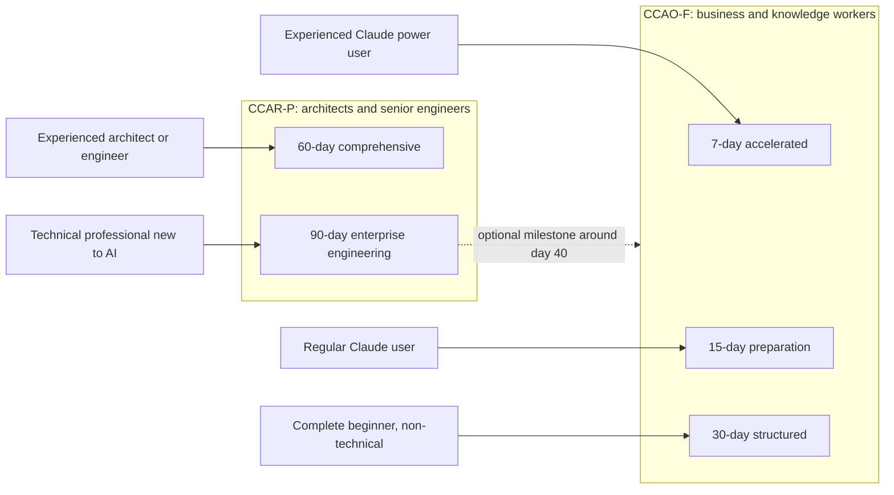

# Study Roadmaps

> **Level:** Beginner · **Time:** ~20 min to choose · **Exam relevance:** CCAO-F and CCAR-P preparation plans

A roadmap turns "I should study for this" into "today I do these three things". Each plan below lists, for every day: objectives, reading (links to module pages), practical exercises (links to labs or in-app exercises), estimated time, a knowledge checkpoint, and revision milestones along the way.

Pick the plan that matches **your experience** and **the track you are taking**, then adjust it to your calendar. It is fine to take two days over a heavy day; it is not fine to skip the checkpoints.

> Exam facts referred to in these plans (item counts, timing, domain weights) come from [`registry.yaml`](../../16-certification-tracks/registry.yaml); see [Exam facts](../../25-official-resources/exam-facts.md). The official exam guides are scheduled to be updated (the registry records the dates). If you are studying after an update, re-check the domain list before you start.

## Which plan is for you?

| Plan | Track | Suits complete beginners? | Assumes | Daily time | Total |
|---|---|---|---|---|---|
| [7-day accelerated](7-day-accelerated.md) | CCAO-F | **No** | Months of regular hands-on Claude use at work, including Projects; comfortable with prompting | 3 to 4 h | ~25 h |
| [15-day preparation](15-day-preparation.md) | CCAO-F | **No**, but close | Some hands-on use of Claude or a similar AI assistant; no coding needed | 2 h | ~30 h |
| [30-day structured](30-day-structured.md) | CCAO-F | **Yes** | Nothing beyond basic computer use | 1 to 1.5 h | ~38 h |
| [60-day comprehensive](60-day-comprehensive.md) | CCAR-P | **No** | Several years of software, systems or platform experience; Python reading ability; ideally some LLM project work | 1.5 to 2 h | ~110 h |
| [90-day enterprise engineering](90-day-enterprise-engineering.md) | CCAR-P (with an optional CCAO-F milestone on the way) | **Yes for AI, no for technology**: no AI knowledge needed, but you should be a working developer, engineer or architect | Programming and systems fundamentals | 1.5 to 2 h on weekdays, plus some weekend lab time | ~170 h |

### Mapping plans to the supported tracks

- **CCAO-F** (Claude Certified Associate – Foundations) is aimed at business and knowledge workers who use Claude as a productivity tool and build Claude Projects. It is not aimed at API developers. The 7-, 15- and 30-day plans target it.
- **CCAR-P** (Claude Certified Architect – Professional) is for experienced architects, AI engineers, tech leads and senior developers who take Claude systems into production. The 60- and 90-day plans target it.
- **CCAR-F** (Claude Certified Architect – Foundations) is for builders who work with the Agent SDK, Claude Code and MCP. There is no dedicated plan yet: follow Weeks 1 to 4 of the 60-day plan (API, prompting, tools and MCP, agents), add Module 09 (Claude Code), then switch to the [CCAR-F track](../../16-certification-tracks/ccar-f/README.md) study guides and its scenario-based mock exams.

If you are unsure, read [Choose your path](../choose-your-path.md) first.

## How the plans are structured

Every plan uses the same elements:

| Element | What it means |
|---|---|
| **Objectives** | What you should be able to do by the end of the day |
| **Reading** | Module pages, in order |
| **Practical exercises** | A lab from [19-hands-on-labs](../../19-hands-on-labs/README.md) (mock mode is free) or an exercise in the Claude app |
| **Time** | A realistic estimate for an average learner, including exercises |
| **Knowledge checkpoint** | A self-test: page quizzes, practice questions, or a task you must be able to do from memory. If you fail it, repeat the day's weakest page before moving on |
| **Revision milestone** | Scheduled review days and mock exams. Do not skip them; spaced revision is where retention comes from |

All plans use the same practice resources:

- [Practice questions](../../17-practice-questions/README.md), organised by track and domain
- [Mock exams](../../18-mock-examinations/README.md), timed or in learning mode
- [Flashcards](../../23-flashcards/README.md), including the fundamentals deck and one deck per track
- Track materials: [CCAO-F](../../16-certification-tracks/ccao-f/README.md) and [CCAR-P](../../16-certification-tracks/ccar-p/README.md) study guides, revision notes, common misconceptions and readiness assessments

## Tips for any plan

1. **Book protected time.** Put study sessions in your calendar like meetings.
2. **Keep a study log.** Note every missed checkpoint question and the page that answers it. Revision days start from this log.
3. **Practise in the real product.** For CCAO-F, hands-on use of Claude matters as much as reading.
4. **Mock exam scores are a signal, not a prediction.** Questions here are unofficial; aim for comfortable margins (above 80%) in every domain rather than a borderline average.
5. **Use fictional data.** Never paste real customer or company data into practice exercises.

## After your plan

- Complete the track's readiness assessment: [CCAO-F](../../16-certification-tracks/ccao-f/readiness-assessment.md) or [CCAR-P](../../16-certification-tracks/ccar-p/readiness-assessment.md).
- Read the exam-day guide: [CCAO-F](../../16-certification-tracks/ccao-f/exam-day.md) or [CCAR-P](../../16-certification-tracks/ccar-p/exam-day.md).
- Keep learning: [real-world projects](../../20-real-world-projects/README.md) and [interview preparation](../../21-interview-preparation/README.md).
