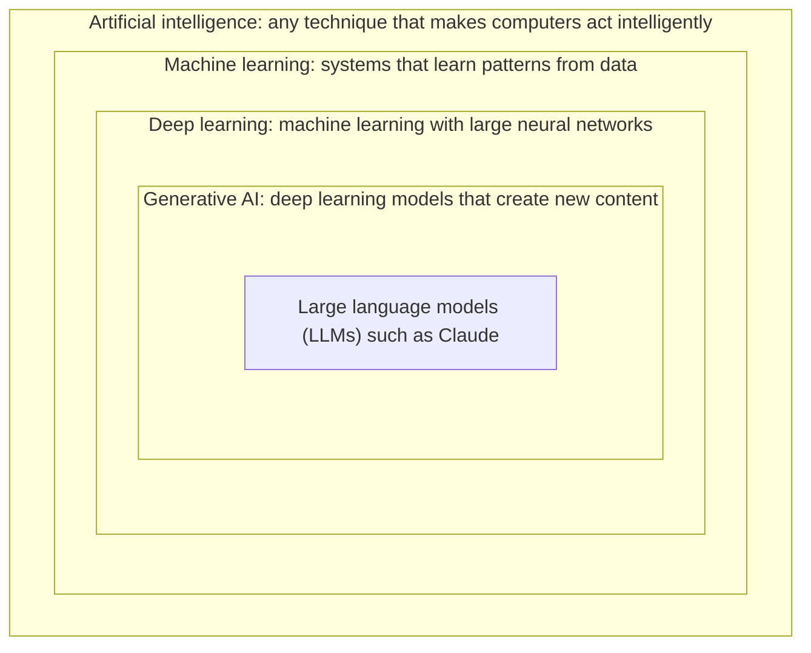
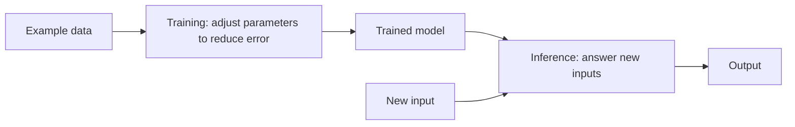

# What is AI?

> **Level:** Beginner · **Time:** ~25 min · **[Exam relevance](../00-getting-started/how-to-use-this-repo.md#objective-ids):** CCAO-F D4 (4.5), D6 (6.1) · CCAR-P D6 (6.2)

## In plain English

Artificial intelligence (AI) is the name for computer systems that do tasks we would normally say need human intelligence: recognising a face, translating a sentence, spotting a fraudulent payment, or writing a reply to an email.

Traditional software follows rules that a programmer wrote by hand: "if the invoice total is over 10,000, send it for approval". AI systems are different in one important way. Instead of being told the rules, most modern AI systems **learn patterns from examples**. Show a system a million photos labelled "cat" or "not cat" and it gradually works out, on its own, which visual patterns tend to mean "cat".

A useful analogy is learning to cook. A recipe book is traditional software: exact steps, followed exactly. An experienced cook who has made hundreds of meals is closer to AI: they have absorbed patterns ("this smells nearly done", "this needs salt") that they could not fully write down, and they can handle dishes they have never seen before. That flexibility is the power of AI. The fact that the cook cannot always explain *why* they did something, and occasionally makes a confident mistake, is the weakness.

## Why it matters

You are going to spend this whole repository learning to work with Claude, which is one kind of AI system. Knowing where it sits in the wider AI landscape helps you:

- **Set realistic expectations.** An AI that learned from examples behaves statistically. It is usually right, sometimes wrong, and does not "know" things the way a database does.
- **Talk to stakeholders.** Managers and customers use "AI" to mean anything from a spam filter to a chatbot. Being able to say precisely which kind you mean avoids confusion (CCAO-F objective 4.5, communicating value and limitations).
- **Choose the right tool.** Some problems are better solved by ordinary rules, a spreadsheet formula or a search index. Recognising those cases is part of using AI responsibly (CCAO-F objective 6.1).

## How it works

### The nested family of terms

The terms you will hear most often fit inside each other like Russian dolls.

| Term | Plain meaning | Everyday example |
|---|---|---|
| Artificial intelligence | The whole field of making machines perform "intelligent" tasks, including older rule-based approaches | A chess program from the 1990s |
| Machine learning (ML) | AI that learns from data instead of hand-written rules | A spam filter that improves as people mark emails as spam |
| Deep learning | ML that uses neural networks with many layers | Photo apps that recognise faces |
| Generative AI | Deep learning models that produce new text, images, audio or code | An image generator, a writing assistant |
| Large language model (LLM) | A generative model trained on huge amounts of text to predict and produce language | Claude |

### How machine learning learns

Almost all modern AI, including Claude, rests on the same basic loop:

1. **Data.** Collect many examples. For a spam filter, these are emails labelled "spam" or "not spam".
2. **Model.** Start with a mathematical structure with millions or billions of adjustable numbers, called *parameters* or *weights*. At first these are random, so the model's guesses are useless.
3. **Training.** Show the model an example, let it guess, measure how wrong the guess was, and nudge every parameter slightly in the direction that would have made the guess less wrong. Repeat this billions of times.
4. **Inference.** Once training is finished, freeze the parameters and use the model on new inputs it has never seen. When you chat with Claude you are using it at inference time; your conversation does not change its parameters.

That last point surprises many beginners. **Talking to a model does not teach it.** If you correct Claude in a chat, it can use the correction for the rest of that conversation because the correction is now in the text it is reading, but the underlying model has not learned anything permanent. You will see in [Module 02](../02-claude-fundamentals/01-how-claude-works.md) how products add features such as memory and Projects to carry information between conversations without retraining.

### Neural networks in one paragraph

A neural network is a large stack of simple arithmetic units. Each unit takes some numbers in, multiplies them by its weights, adds them up and passes the result on. One unit is trivial; billions of them, arranged in layers and tuned by training, can represent remarkably complex patterns such as grammar, the structure of a legal argument, or the style of a Python function. "Deep" learning simply means there are many layers.

### Narrow and general

Most AI systems in production are **narrow**: they do one job, such as reading number plates. LLMs are unusual because they are **general-purpose**. The same model can summarise a contract, write a SQL query and draft a birthday message. That generality is why LLMs spread so quickly, and also why they need careful evaluation: a model that can attempt anything can also fail at anything.

## Example

Consider three ways to sort incoming customer emails at a fictional company into "billing", "technical" and "other".

| Approach | How it works | Strength | Weakness |
|---|---|---|---|
| Rules | `if "invoice" in subject: billing` | Predictable, cheap, easy to audit | Breaks on wording it has not seen ("my bill looks wrong") |
| Classic ML classifier | Trained on 50,000 past emails labelled by staff | Handles varied wording well | Needs lots of labelled data; only does this one job |
| LLM | Asked in plain English to sort each email and explain why | Works with no training data; can explain its choice; handles new categories by changing the instruction | Costs more per email; can occasionally be inconsistent, so outputs need checking |

None of these is "the AI answer". Choosing between them is a design decision, and it is exactly the kind of trade-off later modules teach you to make.

## Enterprise use case

*Northwind Lending*, a fictional consumer lender, already runs a machine-learning model that scores loan applications for fraud. Its operations team wants to "add AI" to help staff answer customer letters. The head of operations asks whether the fraud model can do it.

Understanding the family of terms answers the question. The fraud model is a narrow classifier: it outputs a single risk score and has never seen language generation. Answering letters needs a generative language model. The team therefore evaluates an LLM for drafting replies, keeps the fraud model unchanged, and decides that every drafted reply will be reviewed by a staff member before it is sent, because lending decisions are high-risk and regulated.

## Common mistakes

- **Treating "AI" as one thing.** A fraud score and a chatbot are both AI but behave completely differently.
- **Assuming the model learns from your chat.** It does not retrain on your conversation in real time.
- **Assuming AI is always the best solution.** If a simple rule solves the problem reliably, the rule is often better: cheaper, faster and easier to audit.
- **Assuming the model "understands" like a person.** It has learned powerful statistical patterns. That produces behaviour that looks like understanding most of the time, but it can fail in ways a person would not.

## Security considerations

- Anything you type into an AI service is data leaving your hands. Before using any AI tool at work, check your organisation's AI policy and data-classification rules. [Responsible use](../02-claude-fundamentals/05-responsible-use.md) covers this in detail.
- Learned systems can be manipulated by carefully crafted inputs. For language models this is called *prompt injection*, covered in [Module 12](../12-ai-security/02-prompt-injection.md).

## Troubleshooting

| Symptom | Likely cause | What to do |
|---|---|---|
| A colleague says "the AI got it wrong, so AI doesn't work" | Expecting rule-like certainty from a statistical system | Explain that outputs need validation in proportion to their risk; see [Hallucinations](06-hallucinations.md) |
| Confusion over whether a tool "uses AI" | Marketing language | Ask: does it learn from data, and does it generate content or only classify it? |

## Check your understanding

1. What is the key difference between traditional software and machine learning?
2. Put these in order from broadest to narrowest: deep learning, AI, LLM, machine learning, generative AI.
3. When you correct Claude during a chat, does the underlying model learn the correction permanently?
4. Give one situation where a simple rule would be a better choice than an LLM.

Answers

1. Traditional software follows rules written by people; machine learning learns patterns from example data.
2. AI, machine learning, deep learning, generative AI, LLM.
3. No. The correction is available for the rest of that conversation because it is part of the text the model reads, but the model's parameters are not changed.
4. Any task with a precise, stable rule, for example routing every invoice above a fixed amount to an approver, or validating that a date field has the right format.

## Further reading

- [Intro to Claude](https://platform.claude.com/docs/en/intro) (Anthropic documentation)
- [Claude Academy](https://academy.claude.com/): free self-paced courses from Anthropic

<!-- page-nav:start -->
---

[Module overview](README.md) · [Next: Generative AI →](02-generative-ai.md)
<!-- page-nav:end -->
