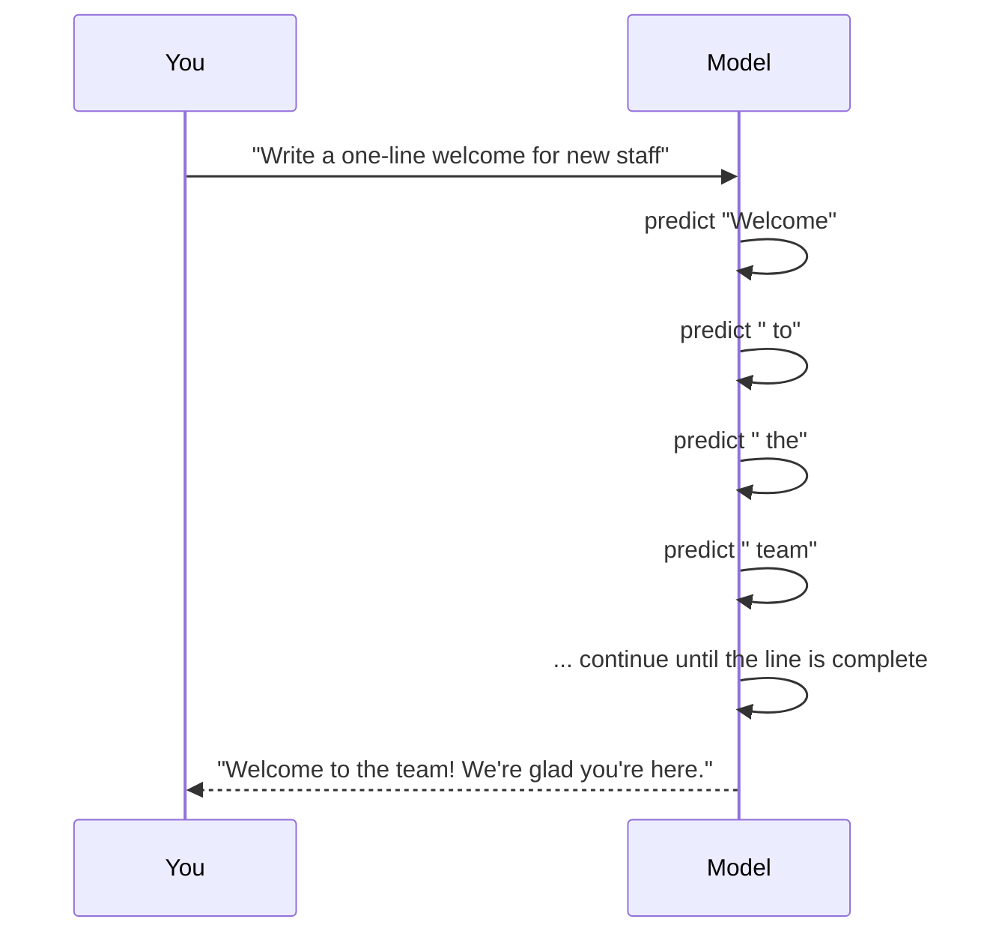

# Generative AI

> **Level:** Beginner · **Time:** ~25 min · **Exam relevance:** CCAO-F D1 (1.4), D4 (4.5), D6 (6.1) · CCAR-P D1 (1.1)

## In plain English

Most AI before about 2020 answered questions *about* existing things: "Is this email spam?", "What is in this photo?", "How much will this house sell for?" The output was a label or a number.

**Generative AI** produces *new* content: a paragraph, a poem, a slide outline, an image, a piece of code, a summary of a 40-page report. You describe what you want in ordinary language, and the model creates something that did not exist before.

Think of the difference between a librarian and a ghostwriter. A librarian (classic AI) finds and labels what already exists. A ghostwriter (generative AI) writes something new in the style and shape you ask for, drawing on everything they have ever read. A good ghostwriter is fast and versatile, but you still read the draft before putting your name on it.

## Why it matters

Generative AI changed who can use AI. Before, building an AI system meant collecting labelled data and training a model, which needed specialists. Now a marketing coordinator can type "draft three subject lines for our spring newsletter, friendly tone, under 50 characters" and get a useful result in seconds.

That accessibility is why both certifications exist. CCAO-F tests whether business users can direct generative AI well and judge its output. CCAR-P tests whether architects can build reliable systems around it.

## How it works

### Discriminative versus generative

| | Discriminative (classic) AI | Generative AI |
|---|---|---|
| Question it answers | "Which category does this belong to?" | "What should come next?" or "What would fit this description?" |
| Output | A label, score or number | New text, images, audio, code |
| Typical training | Labelled examples for one task | Very large, mostly unlabelled data, then refinement |
| Flexibility | One task per model | Many tasks from one model, chosen by your instructions |
| Main risk | Misclassification | Plausible-sounding but wrong content (hallucination) |

### Generation is repeated prediction

Every generative model works by learning the patterns in its training data well enough to produce *new samples that fit those patterns*. For text, the pattern is "what word-piece tends to come next, given everything so far". The model predicts one piece, adds it to the text, and predicts again, over and over, until the answer is complete. [Large language models](03-large-language-models.md) explains this in more depth.



Because the model is generating rather than retrieving, two important things follow:

1. **The output is new.** It is not copied from a stored document. This is why generative AI can adapt to your exact request.
2. **The output is not guaranteed to be true.** The model produces what is *plausible* given its patterns. Usually plausible and true coincide. Sometimes they do not, and that is a [hallucination](06-hallucinations.md).

### Kinds of generative models

| Modality | What it produces | Example uses |
|---|---|---|
| Text (LLMs) | Prose, code, structured data such as JSON | Drafting, summarising, analysis, coding |
| Images | Pictures from a text description | Illustrations, design mock-ups |
| Audio | Speech, music | Voice-overs, accessibility |
| Video | Short clips | Marketing, training content |
| Multimodal | Reads several kinds of input, such as text plus images | Reading a chart in a PDF and explaining it |

Claude is a text-generating model that can also *read* images and documents (it is multimodal on the input side). It produces text, including code and structured data, and in the Claude apps that text can be turned into documents, diagrams and small interactive tools called [Artifacts](../05-claude-products-and-models/05-artifacts-and-output-formats.md).

### What generative text AI is good at

A helpful way to think about tasks is by what you ask the model to do with information:

| Task type | You give it | It gives you | Example |
|---|---|---|---|
| Create | A goal and constraints | A first draft | "Draft a job advert for a data analyst" |
| Transform | Existing content | The same content in a new form | "Turn these meeting notes into an action list" |
| Condense | Long content | A shorter version | "Summarise this policy in five bullets" |
| Analyse | Content plus a question | Reasoning and a conclusion | "Which of these three vendor proposals has the weakest security section, and why?" |
| Brainstorm | A problem | Many options | "Give me ten names for an internal newsletter" |

CCAO-F objective 1.4 asks you to adapt your prompting to task types like these. You will practise this in [Module 03](../03-prompt-engineering/README.md).

## Example

Try this in any Claude app (see [Your first conversation](../02-claude-fundamentals/02-first-conversation.md) for how to get started). Paste these two requests separately and compare the results.

```text
Classify this customer comment as positive, negative or neutral:
"The delivery was late but the driver was very polite."
```

```text
Write a short, warm reply to this customer comment, acknowledging the late delivery
and thanking them for mentioning the driver:
"The delivery was late but the driver was very polite."
```

The first request uses the model in a *discriminative* way: one label out. The second is *generative*: new text that did not exist. The same model handles both; only your instruction changed.

## Enterprise use case

*Contoso Health*, a fictional regional healthcare provider, wants to reduce the time nurses spend writing discharge instructions. The team considers two ideas:

- **Idea A:** use generative AI to write discharge instructions from scratch for each patient.
- **Idea B:** use generative AI to *transform* the clinician's existing notes into plain-language instructions, which the clinician then reviews and signs.

They choose Idea B. Transformation keeps the clinical facts anchored in a source written by a professional, which reduces the chance of invented content, and the mandatory clinician review keeps a qualified human in the loop for a high-risk medical context. This reflects a broader pattern: generative AI is safest when it reshapes trusted input rather than inventing facts.

## Common mistakes

- **Treating generated text as retrieved fact.** The model writes what fits; it does not look things up unless it is given a tool such as web search or a document to read.
- **Expecting identical output every time.** Generation involves choices at every step, so running the same request twice can produce different wording. If you need consistency, use clear structure, examples and output formats (see [Module 03](../03-prompt-engineering/06-structured-output.md)).
- **Using generative AI for a pure lookup.** "What is our office's postcode?" is a database question, not a generation task.

## Security considerations

- Generated content can include confident errors, outdated information or biased framing. Review it in proportion to the stakes.
- Generated code can contain vulnerabilities. Treat it like code from an unknown contributor: review and test before use.
- Generated content is *untrusted output* from a software point of view. Never feed it directly into a system that executes it (a database, a shell, a web page) without validation. [Module 12](../12-ai-security/06-insecure-output-handling.md) covers this.

## Troubleshooting

| Symptom | Likely cause | What to do |
|---|---|---|
| Output is generic and bland | The request gave little context or constraint | Add audience, purpose, tone, length and an example |
| Output contains a "fact" you cannot find anywhere | The model generated something plausible but unsupported | Ask for sources, provide the source document, or verify independently |
| Output varies a lot between runs | Open-ended request | Specify structure and format; give an example of the desired output |

## Check your understanding

1. What is the difference between a discriminative and a generative task? Give one example of each.
2. Why can generated text be fluent but false?
3. Which is generally lower-risk: asking a model to invent content from nothing, or to transform a trusted source? Why?
4. Name the five task types in the table above.

<details>
<summary>Answers</summary>

1. A discriminative task assigns a label or score to existing input (classifying sentiment); a generative task produces new content (writing a reply).
2. Because the model generates what is statistically plausible given its training patterns, and plausible text is not always true.
3. Transforming a trusted source, because the facts come from the source rather than from the model's patterns, and they are easier to check.
4. Create, transform, condense, analyse, brainstorm.

</details>

## Further reading

- [Claude prompting best practices](https://platform.claude.com/docs/en/build-with-claude/prompt-engineering/claude-prompting-best-practices) (Anthropic documentation)
- Previous: [What is AI?](01-what-is-ai.md) · Next: [Large language models](03-large-language-models.md)
