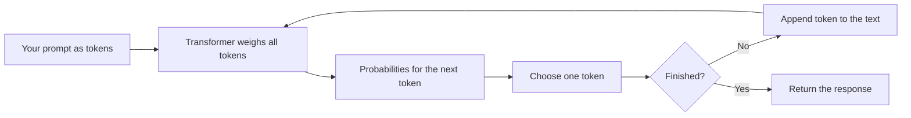

# Large Language Models

> **Level:** Beginner · **Time:** ~35 min · **Exam relevance:** CCAO-F D3 (3.2) · CCAR-P D2 (2.1), D5 (5.2)

## In plain English

A large language model (LLM) is a computer program that has read an enormous amount of text and, from it, learned to do one thing extremely well: **predict what text should come next**.

You have seen a tiny version of this on your phone. When you type "See you", the keyboard suggests "soon" or "tomorrow". An LLM is the same idea scaled up by many orders of magnitude. Instead of suggesting one word from the last two, it considers everything in the conversation (potentially hundreds of thousands of words) and predicts the next piece of text with enough skill that the result reads like a thoughtful answer.

It sounds too simple to produce something that can explain tax rules or debug code. The trick is that to predict text *well*, across billions of documents, a model has to capture a great deal about grammar, facts, reasoning patterns, styles and how ideas connect. Prediction is the task; a broad, useful model of language is the side effect.

## Why it matters

Knowing that an LLM is a next-text predictor explains most of its behaviour:

- Why it writes fluently: fluent text is what it was trained to predict.
- Why it can be wrong with confidence: it predicts plausible text, not verified text.
- Why your wording matters so much: your prompt is the start of the text it continues.
- Why bigger and more recent models behave differently: they learned richer patterns.

Model choice is examined directly. CCAO-F objective 3.2 asks you to tell Claude model families apart, and CCAR-P objective 2.1 asks you to select models based on trade-offs. Both build on understanding what a model is.

## How it works

### Step 1: text becomes tokens

The model does not see letters or whole words. It sees **tokens**, small chunks of text that are often a word or part of a word. "Unbelievable" might be split into "Un", "believ", "able". [Tokens and tokenisation](04-tokens-and-tokenisation.md) covers this in detail.

### Step 2: the transformer reads everything at once

Modern LLMs use an architecture called the **transformer**, introduced by researchers in 2017. Its key idea is *attention*: when processing each token, the model can look at every other token in the input and decide which ones matter for understanding it. In "The trophy did not fit in the suitcase because **it** was too big", attention helps the model link "it" to "trophy" rather than "suitcase".

You do not need the mathematics. The useful intuition is that the model weighs the whole context, not just the last few words, every time it predicts.

### Step 3: predict, choose, repeat

For each step the model produces a probability for every possible next token. One token is chosen, appended to the text, and the process repeats.



This loop is why responses appear word by word in chat apps (that is called *streaming*), and why longer answers take longer: each token is a separate step.

### Step 4: where the knowledge comes from

An LLM is built in stages.

| Stage | What happens | What it gives the model |
|---|---|---|
| **Pre-training** | The model predicts the next token across a very large collection of text (public web pages, books, code and other sources) | Broad knowledge of language, facts, and reasoning patterns. The result is a powerful text-continuer, but not yet a helpful assistant |
| **Fine-tuning** | The model is further trained on examples of good assistant behaviour: following instructions, answering helpfully, declining harmful requests | The ability to act as a conversational assistant |
| **Preference training** | People (and, at Anthropic, AI feedback guided by written principles) compare responses and the model is trained towards preferred ones | Better judgement about helpfulness, honesty and harmlessness |

Anthropic's approach to the last two stages, including reinforcement learning from human feedback (RLHF) and Constitutional AI, is explained conceptually in [How Claude works](../02-claude-fundamentals/01-how-claude-works.md).

### "Large" means parameters and data

"Large" refers to two things: the number of **parameters** (the adjustable numbers inside the network, now commonly in the billions or more) and the amount of **training data**. Larger models generally capture subtler patterns, but cost more to run and are slower. This is the root of the trade-off you will meet repeatedly: capability versus speed versus cost.

### The knowledge cutoff

Pre-training uses data up to a certain date, called the **training data cutoff**. The model has no built-in knowledge of events after that date. Anthropic publishes a "reliable knowledge cutoff" for each model on its [models overview page](https://platform.claude.com/docs/en/about-claude/models/overview). If you need current information, the model needs a tool (such as web search) or you need to supply the information in your prompt.

### Model families

Providers usually release models in **families** of different sizes trained in a similar way. Claude has three long-running lines: **Haiku** (smallest and fastest), **Sonnet** (balanced) and **Opus** (most capable of the three for complex work), plus newer frontier models. [Model families](../05-claude-products-and-models/02-model-families.md) gives the current line-up with dates and prices.

## Example

You can see next-token prediction in action by giving Claude an unfinished sentence with no instruction:

```text
The three primary colours of light are
```

A modern assistant will usually complete or explain it ("red, green and blue"), because predicting a helpful continuation is exactly what it was trained to do.

Now try the same idea with a request that relies on recent events:

```text
Who won yesterday's local football match in my town?
```

Without a web search tool and without knowing your town, the honest answer is "I don't know". A well-trained assistant should say so, which shows fine-tuning at work: the pre-trained pattern would be to produce a plausible-looking score, but preference training rewards admitting uncertainty.

If you want to try this programmatically, the snippet below uses this repository's lab helper, which runs offline by default (see [Environment setup](../00-getting-started/environment-setup.md)).

```python
import sys
sys.path.insert(0, "19-hands-on-labs/common")  # run from the repository root
from claude_lab import get_client, MODEL, text_of

client = get_client()  # mock mode by default: no API key, no cost
response = client.messages.create(
    model=MODEL,
    max_tokens=200,
    messages=[{"role": "user", "content": "The three primary colours of light are"}],
)
if response.stop_reason == "end_turn":
    print(text_of(response))
```

> **Cost:** requires API credits (live mode). In the default mock mode the script returns a canned reply and costs nothing.

## Enterprise use case

*Acme Logistics*, a fictional freight company, wants an internal assistant that answers questions about its shipping policies. A junior analyst proposes "training our own LLM on the policy documents".

An architect who understands how LLMs are built points out that pre-training a model is enormously expensive and unnecessary here. The pre-trained and fine-tuned model already understands language and logistics vocabulary; what it lacks is Acme's specific policies. Those can be provided at inference time by putting the relevant policy text into the context (a Project in the Claude apps, or retrieval-augmented generation in a custom application, covered in [Module 11](../11-rag-and-knowledge-systems/README.md)). This is cheaper, faster to update when policies change, and lets answers cite the source.

## Common mistakes

- **Thinking the model searches the internet by default.** It answers from learned patterns unless it has been given a search tool or documents.
- **Thinking the model has a database of facts.** Knowledge is spread across parameters as patterns, which is why recall of precise details (exact figures, citations, URLs) is less reliable than recall of general concepts.
- **Ignoring the knowledge cutoff.** Questions about recent events, prices or regulations need current sources.
- **Assuming bigger is always better.** A smaller, faster model is often the right choice for simple, high-volume tasks.

## Security considerations

- LLMs follow instructions found in their input. If untrusted text (an email, a web page) contains instructions, the model may follow them. This *prompt injection* risk is introduced in [Module 12](../12-ai-security/02-prompt-injection.md).
- Training data can contain biases, and the model can reproduce them. Review outputs that affect people, such as hiring or lending text, for fairness.
- Do not assume a model will keep secrets placed in its prompt. Anything in the context can potentially appear in output.

## Troubleshooting

| Symptom | Likely cause | What to do |
|---|---|---|
| Model gives outdated information | Knowledge cutoff | Provide current sources or enable web search |
| Model invents a specific statistic or citation | Precise details are weakly stored; plausible text is generated | Ask for sources, provide documents, verify ([Hallucinations](06-hallucinations.md)) |
| Model "forgets" something from an earlier chat | Each conversation starts fresh unless memory or Projects are used | Re-supply the information or use a Project ([Module 05](../05-claude-products-and-models/04-projects-and-knowledge.md)) |

## Check your understanding

1. In one sentence, what is the core task an LLM is trained to do?
2. What does the attention mechanism let the model do?
3. What is the difference between pre-training and fine-tuning?
4. What is a knowledge cutoff, and how can you work around it?
5. Why do longer answers take longer to generate?

<details>
<summary>Answers</summary>

1. Predict the next token of text given all the text so far.
2. Weigh every token in the input when processing each token, so it can connect related words and ideas across the whole context.
3. Pre-training teaches broad language and knowledge by predicting text across a huge corpus; fine-tuning (and preference training) shapes that model into a helpful, safe assistant.
4. The date after which the model has no training data. Work around it by supplying current information in the prompt or giving the model a search tool.
5. Because the model generates one token at a time, and each token is a separate prediction step.

</details>

## Further reading

- [Models overview](https://platform.claude.com/docs/en/about-claude/models/overview) (Anthropic documentation, includes knowledge cutoffs)
- [Anthropic Transparency Hub](https://www.anthropic.com/transparency)
- Previous: [Generative AI](02-generative-ai.md) · Next: [Tokens and tokenisation](04-tokens-and-tokenisation.md)
