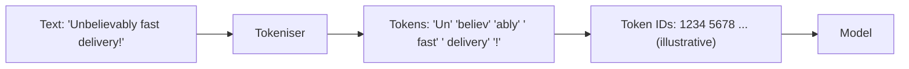

# Tokens and Tokenisation

> **Level:** Beginner · **Time:** ~30 min · **Exam relevance:** CCAO-F D3 (3.3, 3.4) · CCAR-P D2 (2.4), D4 (4.5)

## In plain English

Language models do not read letters or whole words. They read **tokens**: small chunks of text that are often a whole common word ("the", "invoice"), part of a longer word ("tokenis" + "ation"), a punctuation mark, or a space plus a word. **Tokenisation** is the process of splitting text into those chunks.

Think of tokens as the model's alphabet of building blocks. A child learning to read sounds out "ele-phant"; a model sees "ele" and "phant" as two familiar blocks. Common words are usually one block. Rare words, names, numbers and non-English text are often several.

Tokens are also the **unit of measurement** for almost everything practical about LLMs: how much text fits in a conversation, how fast a reply arrives and, if you use the API, what you pay.

## Why it matters

- **Cost.** API pricing is quoted per million tokens, with separate prices for input (what you send) and output (what the model writes). Output tokens cost more.
- **Limits.** The [context window](05-context-windows.md) is measured in tokens. So are maximum response lengths and API rate limits.
- **Speed.** The model generates output one token at a time, so long answers take longer.
- **Usage limits in the apps.** Claude subscription plans have usage limits. Long documents, long conversations and research tasks consume more of them because they involve more tokens.

CCAO-F objective 3.3 (match model choice to cost, speed and quality) and CCAR-P objectives 2.4 and 4.5 (optimise token usage and cost) all depend on thinking in tokens.

## How it works

### Splitting text into tokens

Tokenisers are built by analysing a large amount of text and finding the chunks that appear most often. Frequent sequences become single tokens; rare ones are built from smaller pieces. Each token maps to a number (an ID), and it is these numbers the model actually processes.



The split above is illustrative. Real token boundaries depend on the specific tokeniser, and different models can use different tokenisers.

### Rules of thumb (as of 2026-10-24)

Anthropic's [models overview](https://platform.claude.com/docs/en/about-claude/models/overview) gives these conversions for the current tokeniser, introduced with Claude Opus 4.7 and used by current models:

| Quantity | Approximate equivalent |
|---|---|
| 1,000,000 tokens (current tokeniser) | about 555,000 English words, or about 2.5 million characters |
| 1,000,000 tokens (models before Claude Opus 4.7) | about 750,000 English words |
| 200,000 tokens | about 150,000 words |

From the first row you can derive a working estimate for current models of roughly **1.8 tokens per English word**, or about **2.5 characters per token**. Treat this as an estimate only:

- Code, tables, JSON and numbers usually use more tokens per character than prose.
- Languages other than English often use more tokens for the same meaning.
- Images and PDF pages are also converted into tokens and can be expensive.

For exact numbers, count rather than estimate. The Claude API has a token-counting endpoint, and every API response reports the tokens it used in its `usage` field.

### Input tokens and output tokens

Every request has two sides:

| Side | What it includes | Billing |
|---|---|---|
| **Input tokens** | System prompt, the entire conversation history so far, documents, images, tool definitions, and your new message | Input price per million tokens |
| **Output tokens** | Everything the model generates in reply, including any internal reasoning ("thinking") | Output price per million tokens, typically five times the input price |

The conversation history is resent with every message (see [How Claude works](../02-claude-fundamentals/01-how-claude-works.md)), so a long chat grows more expensive per turn as it goes on. This is one of the most important practical facts in this whole module.

### A worked cost estimate

Prices as of 2026-10-24 for Claude Opus 5.5 on the Claude API are $4 per million input tokens and $20 per million output tokens (check the live [pricing page](https://platform.claude.com/docs/en/about-claude/pricing) before relying on them).

Suppose you send a 3,000-word report (about 5,400 tokens with the estimate above) plus a 100-token instruction, and receive a 500-word summary (about 900 tokens):

```text
Input:  5,500 tokens x $4  / 1,000,000 = $0.022
Output:   900 tokens x $20 / 1,000,000 = $0.018
Total per summary                       ≈ $0.04
```

That looks tiny, but a team summarising 20,000 reports a month spends about $800, and the model choice changes it a lot. Claude Haiku 5.5 is listed at $0.10 input and $0.50 output per million tokens (for prompts up to 100,000 tokens), which would bring the same job to about $20. Whether Haiku's quality is good enough for the task is the trade-off you learn to evaluate in [Model selection](../05-claude-products-and-models/03-model-selection.md).

## Example

Paste this into a Python session to see how rough estimates compare to real text. It uses only the standard library.

```python
def estimate_tokens(text: str, chars_per_token: float = 2.5) -> int:
    """Very rough estimate for current Claude models. Use the API's count_tokens for real numbers."""
    return max(1, round(len(text) / chars_per_token))

samples = {
    "prose": "Thank you for your order. Your parcel will arrive on Tuesday.",
    "code": "def total(xs): return sum(x['amount'] for x in xs if x['ok'])",
    "number-heavy": "INV-2026-000481, 14/03/2026, GBP 12,904.55, VAT 2,580.91",
}
for name, text in samples.items():
    words = len(text.split())
    print(f"{name:13} chars={len(text):3} words={words:2} est_tokens={estimate_tokens(text)}")
```

If you have API access, get an exact count with the official SDK (see [Module 06](../06-claude-api/08-token-counting-and-cost.md)):

```python
import anthropic

client = anthropic.Anthropic()  # reads ANTHROPIC_API_KEY from the environment
count = client.messages.count_tokens(
    model="claude-opus-5-5",
    messages=[{"role": "user", "content": "Thank you for your order."}],
)
print(count.input_tokens)
```

> **Cost:** token counting needs an API key but is not billed as a model request; check the [pricing page](https://platform.claude.com/docs/en/about-claude/pricing) for current terms.

## Enterprise use case

*Northwind Lending* wants Claude to summarise every customer complaint email. A pilot uses a long system prompt that pastes the entire 60-page complaints-handling manual into every request. Each email is short, but every request carries about 40,000 tokens of manual, so 98% of the input cost is the same manual repeated.

The team applies three token-aware fixes:

1. It moves the manual into a reusable, cached prefix, so repeated input is billed at a reduced rate ([Prompt caching](../04-context-engineering/03-prompt-caching.md)).
2. It cuts the manual down to the four pages that matter for summarisation.
3. It tests whether a smaller model produces acceptable summaries.

Cost per email falls by more than 90% with no measurable loss in quality on their evaluation set (an evaluation set is a fixed collection of test cases, covered in [Module 14](../14-evaluation-and-testing/README.md)).

## Common mistakes

- **Estimating tokens as words.** On current Claude models a word is closer to two tokens than one.
- **Forgetting that history is re-sent.** Turn 30 of a chat includes the tokens of turns 1 to 29.
- **Forgetting output costs more.** Asking for "a detailed, exhaustive answer" when you need three bullet points multiplies cost.
- **Comparing token counts across different models' tokenisers.** The same text can produce different counts on different tokenisers.
- **Pasting whole documents when a section would do.** Relevance beats volume.

## Security considerations

- Token limits are a control: setting a sensible maximum output length (`max_tokens` in the API) limits runaway cost if something goes wrong in an automated system.
- Very large inputs can be used to exhaust budgets (a form of denial-of-wallet attack). Production systems should cap input size and monitor usage ([Module 15](../15-production-operations/03-cost-optimisation.md)).

## Troubleshooting

| Symptom | Likely cause | What to do |
|---|---|---|
| Response cut off mid-sentence | Output reached the maximum token limit (`stop_reason` is `max_tokens` in the API) | Raise the limit, ask for a shorter answer, or split the task |
| Bill or usage much higher than expected | Long histories, large documents, verbose outputs | Measure tokens per request; trim context; summarise and restart long chats |
| Usage limit reached quickly in the app | Long conversations, large files, research mode | Start fresh chats for new topics; use Projects so only relevant content loads |

## Check your understanding

1. Roughly how many tokens is a 1,000-word English document on current Claude models?
2. Which costs more per token, input or output?
3. Why does a long conversation become more expensive per message?
4. Name two kinds of content that usually use more tokens than plain prose.

<details>
<summary>Answers</summary>

1. About 1,800 tokens, using the published conversion of roughly 555,000 words per million tokens. Count with the API for an exact figure.
2. Output. On current Claude models the output price is five times the input price.
3. Because the whole conversation history is sent as input with every new message, so input tokens grow each turn.
4. Any two of: code, JSON or tables, numbers and identifiers, non-English text, images, PDF pages.

</details>

## Further reading

- [Pricing](https://platform.claude.com/docs/en/about-claude/pricing) (Anthropic documentation)
- [Token counting](https://platform.claude.com/docs/en/build-with-claude/token-counting) (Anthropic documentation)
- [Models overview](https://platform.claude.com/docs/en/about-claude/models/overview) (token-to-word conversions)
- Previous: [Large language models](03-large-language-models.md) · Next: [Context windows](05-context-windows.md)
