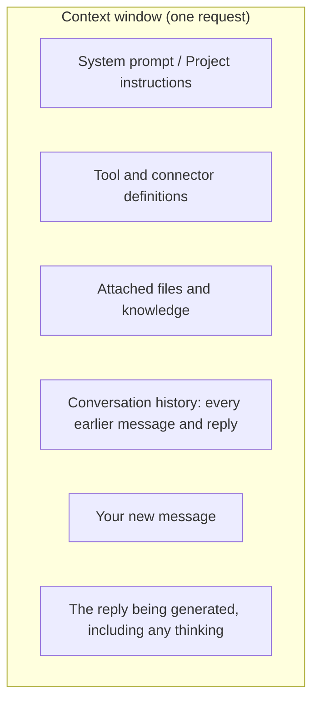
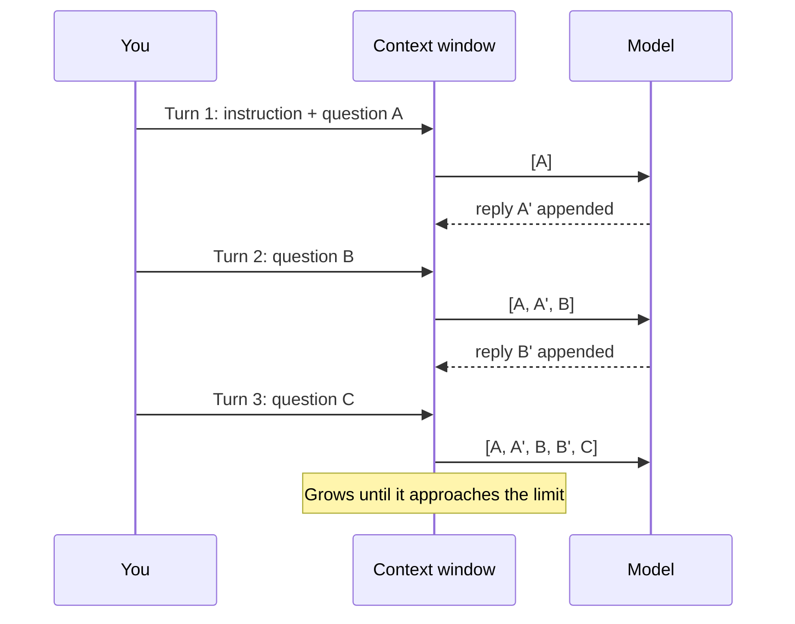
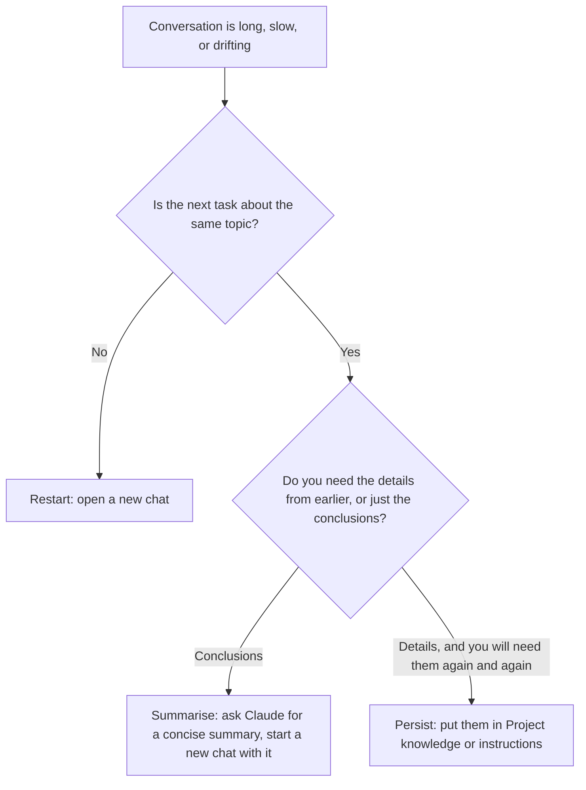

# Context Windows

> **Level:** Beginner · **Time:** ~30 min · **Exam relevance:** CCAO-F D3 (3.4), D5 (5.1) · CCAR-P D2 (2.4), D3 (3.8)

## In plain English

The **context window** is everything the model can "see" at one moment: your instructions, the conversation so far, any documents you attached, and the reply it is writing. It is the model's working memory, measured in [tokens](04-tokens-and-tokenisation.md).

Picture a desk. Whatever is on the desk, the model can read and use. Anything not on the desk does not exist for it, no matter how important. The desk is large (current Claude models have a desk that holds about a million tokens, roughly 555,000 words), but it is not infinite, and a cluttered desk makes it harder to find the right page.

Importantly, the context window is **not** the model's training. What the model learned during training is like the cook's experience; the context window is the recipe and ingredients in front of them right now.

## Why it matters

- If information is not in the context window, the model cannot use it. This is why it "forgets" earlier chats.
- If the context window fills up, something has to give: old material is summarised or dropped, or the request fails.
- More context is not automatically better. Anthropic's documentation notes that as token count grows, accuracy and recall can degrade, which it calls *context rot*.
- Every token in the window is processed (and, on the API, paid for) on every turn.

CCAO-F objective 3.4 is explicitly about managing context limits and memory: knowing when to restart, summarise or persist. CCAR-P objective 2.4 is about optimising context and token usage, and 3.8 about choosing progressive discovery versus loading everything at once.

## How it works

### What fills the window

Anthropic's [context windows guide](https://platform.claude.com/docs/en/build-with-claude/context-windows) lists everything that counts:



In the Claude apps you rarely see these pieces separately, but they are all there: Project instructions, enabled connectors, uploaded files, and the chat so far.

### Context window sizes (as of 2026-10-24)

| Where | Size | Source |
|---|---|---|
| Current models on the Claude API (Claude Fable 5.1, Opus 5.5, Sonnet 5.5, Haiku 5.5 and others) | 1M tokens; up to 128K output tokens per request | [Context windows](https://platform.claude.com/docs/en/build-with-claude/context-windows) |
| Some older models still offered (for example Claude Haiku 4.5) | 200K tokens | Same page |
| Claude apps on paid plans | Depends on the model selected: 1M for several current models, smaller for some older ones | [Support article on context window size](https://support.claude.com/en/articles/8606394-how-large-is-the-context-window-on-paid-claude-plans) |

These figures change. Always check the linked pages.

### The conversation grows every turn

Each time you send a message, the whole history goes back into the window along with your new message. The model's reply is then added to the history for next time.



### What happens near the limit

Behaviour depends on where you are using Claude:

| Surface | What happens as the window fills |
|---|---|
| Claude apps (paid plans with code execution enabled) | Automatic context management summarises earlier messages so the chat can continue. Long chats that trigger this use more of your usage limit. In rare cases you can still hit the limit (for example, a very large first message) |
| Claude API | If the input alone exceeds the window, the request fails with an error ("prompt is too long"). If generation reaches the limit, the response stops with a specific stop reason. Developers can enable server-side *compaction* to summarise automatically |
| Claude Code | Uses compaction to summarise long sessions; see [Module 09](../09-claude-code/README.md) |

Even when automatic summarisation keeps a chat going, a summary is lossy. Details from early in the conversation may be compressed or lost.

### Restart, summarise or persist

This is the core skill for business users (CCAO-F 3.4), so it is worth memorising as a decision:



| Strategy | When to use it | How, in the Claude apps |
|---|---|---|
| **Restart** | New, unrelated task; the chat has gone off track; earlier mistakes keep resurfacing | Start a new chat. Nothing carries over unless memory or a Project is in use |
| **Summarise** | Same task, but the history is long and mostly no longer needed | Ask: "Summarise the decisions, open questions and key facts so far in under 300 words." Paste that into a new chat |
| **Persist** | Information you reuse across many chats: style guides, product facts, reference documents | Add to a Project's knowledge or instructions, or rely on memory where appropriate ([Projects and knowledge](../05-claude-products-and-models/04-projects-and-knowledge.md)) |

### Lost in the middle

Even inside the limit, models can pay less attention to material buried in the middle of very long inputs. Practical tactics:

- Put the most important instructions clearly, and restate the actual question at the end when the input is long.
- Give long documents clear titles and structure (Anthropic's guidance suggests wrapping documents in tags, covered in [Module 03](../03-prompt-engineering/02-structure-with-xml-tags.md)).
- Include only the parts that are relevant.

## Example

You have been chatting with Claude for an hour while planning a team offsite. The chat now covers venues, budget, three agenda drafts and a dietary-requirements tangent. Answers are getting slower and Claude keeps mixing up agenda version 2 and version 3.

A good move is to summarise and restart:

```text
Please summarise this conversation for a fresh start. Include:
- the decisions we have made (venue, date, budget)
- the final agenda (version 3 only)
- open questions
Keep it under 250 words and use headings.
```

Copy the summary, open a new chat, paste it, and continue. You have kept the conclusions and dropped the clutter.

## Enterprise use case

*Contoso Health*'s policy team uses Claude to draft answers to staff questions about HR policies. At first, each team member uploads the 300-page policy handbook into every new chat. Chats are slow, usage limits are hit by midday, and answers sometimes quote the wrong section.

The team lead makes three changes:

1. **Persist:** the handbook goes into a shared Project's knowledge, with Project instructions that say which audience to write for and to cite the section number. On paid plans, Projects can switch to retrieval mode when knowledge approaches the context limit, so only relevant parts are loaded.
2. **Restart:** staff are asked to open a new chat in the Project for each new question rather than one endless thread.
3. **Summarise:** for long drafting sessions, staff ask for a summary before switching topics.

Answers become faster and more accurate, and usage drops. This is the pattern CCAO-F Domains 3 and 5 test.

## Common mistakes

- **One chat for everything.** Unrelated topics in one thread waste tokens and confuse the model.
- **Assuming a big window means "paste everything".** Irrelevant content dilutes attention and adds cost.
- **Assuming the model remembers previous chats.** It does not, unless memory, chat search or a Project supplies that information.
- **Trusting automatic summarisation for critical details.** If an exact figure from early in a chat matters, restate it.

## Security considerations

- Everything in the context window can influence the output, including instructions hidden in an uploaded document or a web page. Treat third-party content as untrusted ([Indirect prompt injection](../12-ai-security/03-indirect-prompt-injection.md)).
- Information you paste into a chat stays in that chat's context and history. Do not paste data you are not permitted to share with an AI service.
- Connected tools and connectors also occupy context. Enable only those you need, which reduces both clutter and the attack surface.

## Troubleshooting

| Symptom | Likely cause | What to do |
|---|---|---|
| Claude contradicts an earlier decision | Earlier detail summarised away or buried | Restate the decision, or summarise and restart |
| Replies become slow late in a chat | Large and growing context | Restart or summarise |
| "Prompt is too long" error (API) | Input exceeds the window | Trim, split, or retrieve only relevant parts |
| Answers ignore part of a long document | Lost-in-the-middle effect | Point to the section; restate the question at the end; send only relevant parts |

## Check your understanding

1. Name four things that take up space in the context window.
2. What is the difference between the context window and the model's training?
3. You have finished one task and want to start an unrelated one. Restart, summarise or persist?
4. You reuse the same 20-page style guide in every chat. Restart, summarise or persist?
5. Why is "just paste everything, the window is huge" not good advice?

<details>
<summary>Answers</summary>

1. Any four of: system prompt or Project instructions, tool or connector definitions, attached files and knowledge, the conversation history, your new message, the reply being generated.
2. Training is what the model learned permanently from data before release; the context window is the text it can see in the current request.
3. Restart: open a new chat.
4. Persist: put it in a Project's knowledge (or instructions, if short).
5. Irrelevant content costs tokens, slows responses, uses up limits, and can reduce accuracy because attention is spread over more material (context rot).

</details>

## Further reading

- [Context windows](https://platform.claude.com/docs/en/build-with-claude/context-windows) (Anthropic documentation)
- [How large is the context window on paid Claude plans?](https://support.claude.com/en/articles/8606394-how-large-is-the-context-window-on-paid-claude-plans) (Claude Help Center)
- [Effective context engineering for AI agents](https://www.anthropic.com/engineering/effective-context-engineering-for-ai-agents) (Anthropic engineering blog)
- Deeper treatment: [Module 04: Context engineering](../04-context-engineering/README.md)
- Previous: [Tokens and tokenisation](04-tokens-and-tokenisation.md) · Next: [Hallucinations](06-hallucinations.md)
