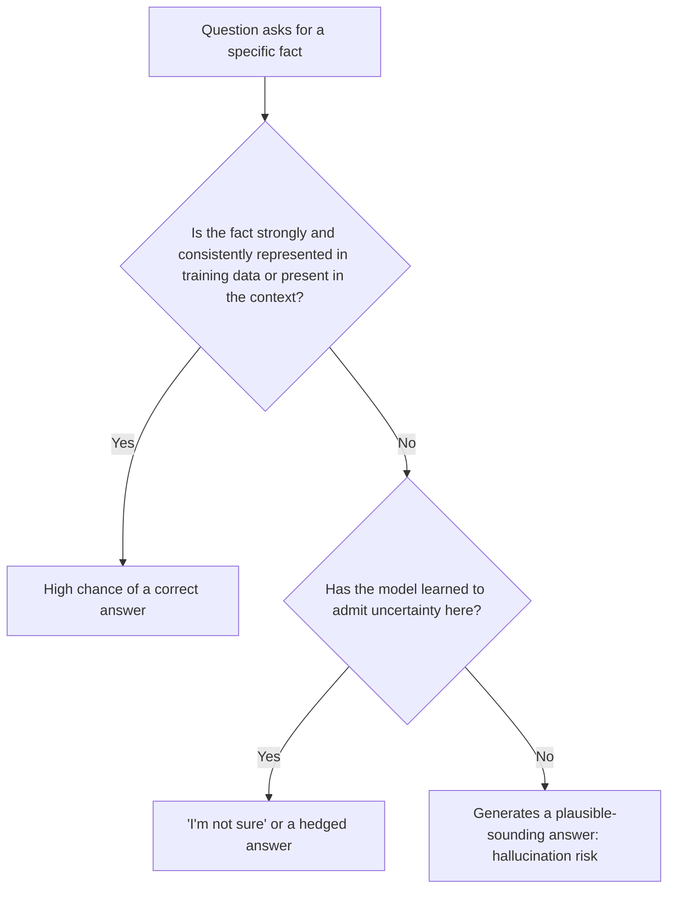
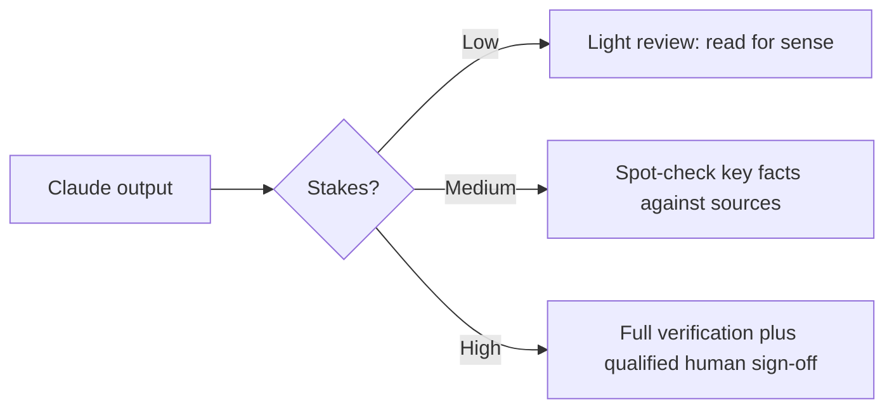

# Hallucinations

> **Level:** Beginner · **Time:** ~35 min · **[Exam relevance](../00-getting-started/how-to-use-this-repo.md#objective-ids):** CCAO-F D2 (2.1, 2.2, 2.3, 2.4) · CCAR-P D4 (4.4), D5 (5.2, 5.3)

## In plain English

A **hallucination** is when an AI model states something false, unsupported or invented as though it were true. It might cite a report that does not exist, give a confident but wrong figure, attribute a quote to the wrong person, or describe a software function that was never written.

The word is a little misleading: the model is not "seeing things". It is doing exactly what it was built to do, generating text that is *plausible*, and in that moment plausible and true have come apart. Imagine a well-read colleague who, rather than saying "I'm not sure", fills a gap in their memory with something that sounds right. They are not lying; they genuinely produced the most likely-sounding answer. You still would not want it in a board paper.

Modern models, Claude included, are trained to say when they are uncertain and hallucinate far less than early models. But no current model eliminates hallucination entirely, so catching it is a core skill.

## Why it matters

Output evaluation is the single heaviest domain in the CCAO-F exam (Domain 2, Output Evaluation and Validation; see [`registry.yaml`](../16-certification-tracks/registry.yaml) for weights). CCAR-P tests diagnosing hallucination (4.4), identifying failure modes (5.2) and designing human review (5.3).

In practice, the damage from a hallucination depends on where it lands:

| Context | Consequence of an invented fact |
|---|---|
| Brainstorming slogan ideas | Negligible; you were going to edit anyway |
| An internal meeting summary | Confusion, wasted time |
| A customer letter | Loss of trust, complaints |
| Legal, medical, financial or credit content | Regulatory breach, real harm to people |

The higher the stakes, the more verification you need.

## How it works

### Why models hallucinate



Common causes:

1. **Gaps in knowledge.** Rare facts, niche topics, internal company information and events after the knowledge cutoff are weakly represented or absent.
2. **Precise details.** Exact numbers, dates, citations, URLs, version numbers and quotations are stored less reliably than general concepts.
3. **Leading questions.** "Why did the 2019 policy change increase costs?" presumes a change happened. The model may go along with the false premise.
4. **Pressure to answer.** Instructions like "always give a definitive answer" or "never say you don't know" push the model to fill gaps.
5. **Long or messy context.** Important details buried in a long input can be missed or blended with others ([Context windows](05-context-windows.md)).
6. **Ambiguous instructions.** If the request is unclear, the model guesses what you meant and may fill in the rest.

### Kinds of hallucination

| Type | Example |
|---|---|
| Fabricated source | A citation to a journal article or court case that does not exist |
| Wrong detail | Correct concept, wrong figure, date or name |
| Unsupported claim | A statement presented as fact with no basis in the supplied document |
| Misattribution | The right quote assigned to the wrong person or document |
| Invented capability | Describing a product feature or API parameter that does not exist |
| Faulty reasoning | Each step sounds fine, but the arithmetic or logic is wrong |

### Techniques that reduce hallucination

Anthropic's documentation on [reducing hallucinations](https://platform.claude.com/docs/en/test-and-evaluate/strengthen-guardrails/reduce-hallucinations) describes several techniques. In your own words and practice, they come down to these:

| Technique | What you do | Why it helps |
|---|---|---|
| **Give permission to say "I don't know"** | "If the document does not answer this, say so." | Removes pressure to fill gaps |
| **Ground in sources** | Provide the document and ask Claude to answer *only* from it | Facts come from the source, not from memory |
| **Ask for quotes first** | "First extract the exact sentences that support your answer, then answer." | Forces each claim to be tied to text you can check |
| **Ask for citations** | "Cite the section number for each claim." In the API, the citations feature returns exact source locations | Makes verification fast |
| **Verify, then retract** | "Review your answer. For any claim you cannot support with a quote, remove it." | Second pass catches unsupported claims |
| **Use tools for current or precise facts** | Enable web search, connect a data source, or use code to calculate | Retrieves or computes instead of recalling |
| **Narrow the task** | Smaller, specific questions instead of one broad one | Fewer gaps to fill |

### Techniques that catch hallucination

Reducing is not enough; you also verify. CCAO-F objective 2.3 asks you to apply fact-checking techniques, and 2.4 asks you to decide when human review is needed.

- **Check against the source.** For any claim that matters, find it in the original. If you cannot, treat it as unverified.
- **Spot-check precise details.** Numbers, names, dates, legal references and URLs first.
- **Ask a different way.** Rephrase the question in a new chat. Inconsistent answers are a warning sign.
- **Look for warning signals:** very specific details you did not provide, references you cannot click, suspiciously round or convenient figures, confident claims about recent events.
- **Use a second reviewer for high-stakes content.** A qualified person reviews before anything reaches a customer or a decision.



## Example

Here is a prompt pattern for grounded question answering that combines several techniques. Paste a document where indicated.

```text
You will answer a question using only the document below.

<document>
[paste the policy text here]
</document>

Instructions:
1. Find the sentences in the document that are relevant to the question and quote them exactly.
2. Answer the question using only those quotes.
3. If the document does not contain the answer, reply "The document does not say." Do not use outside knowledge.

Question: How many days do employees have to submit an expense claim?
```

Then verify: does the quoted sentence really appear in your document, word for word? Does the answer follow from it?

Lab practice: [Lab 04: Document-grounded Q&A](../19-hands-on-labs/lab-04-document-grounded-qa/README.md) builds this pattern in code and checks that every quote actually appears in the source.

## Enterprise use case

*Northwind Lending*'s marketing team asks Claude to draft a blog post about "five statistics every first-time borrower should know". The draft is fluent and persuasive, and includes a figure attributed to a national statistics office.

The reviewer, following the team's AI policy, checks every statistic. Two cannot be found in any official publication. The team changes its process:

- Drafts that contain statistics must be generated from a supplied, approved data sheet, not from the model's general knowledge.
- The prompt instructs Claude to mark any claim not supported by the data sheet with "[NEEDS SOURCE]".
- Because content about borrowing is financial and regulated, the compliance team signs off before publication.

This is the pattern to remember: ground, flag, verify, and scale the human review to the risk.

## Common mistakes

- **Trusting fluency.** Well-written text feels authoritative. Fluency says nothing about accuracy.
- **Asking the model whether it hallucinated, and accepting "no".** Self-review helps but is not proof. Check sources yourself for anything important.
- **Clicking nothing.** If a reference has a URL or title, confirm it exists.
- **Banning "I don't know".** Instructions that forbid uncertainty increase invention.
- **Uniform review.** Treating a brainstorm and a credit decision with the same level of checking wastes effort on one and under-protects the other.

## Security considerations

- Hallucinated package names in generated code can be dangerous: attackers have registered packages with names that models commonly invent, so installing a suggested dependency without checking can pull in malicious code. Verify that every dependency is real and trusted ([Supply-chain risks](../12-ai-security/07-supply-chain-risks.md)).
- In automated systems, a hallucinated tool argument (a wrong account number, a wrong file path) can cause real actions. Validate model output before acting on it ([Insecure output handling](../12-ai-security/06-insecure-output-handling.md)).
- For high-risk uses (legal, medical, financial, employment and similar), Anthropic's Usage Policy requires qualified human review. See [Anthropic's safety approach](../02-claude-fundamentals/04-anthropic-safety-approach.md).

## Troubleshooting

| Symptom | Likely cause | What to do |
|---|---|---|
| Invented references or links | Asking for sources from memory | Provide the sources, or use web search and check every link |
| Answer contradicts the attached document | Model blended general knowledge with the document | Instruct "answer only from the document"; ask for quotes first |
| Confident answer about a recent event | Knowledge cutoff | Enable web search or provide current material |
| Arithmetic errors | Calculation done "in the head" | Ask Claude to show working, or use code execution or a spreadsheet |
| Different answers to the same question | Gap in knowledge; the model is guessing | Treat as unverified; ground with a source |

## Check your understanding

1. Why do models hallucinate even though they are not trying to deceive?
2. Name three instructions you can add to a prompt to reduce hallucination.
3. Which details should you spot-check first?
4. A generated answer will be sent to a customer about their loan. What level of review is appropriate?
5. Why is "never say you don't know" a risky instruction?

<details>
<summary>Answers</summary>

1. They generate the most plausible continuation of the text, and plausible text is sometimes false, especially where knowledge is thin or precise details are required.
2. Any three of: permission to say "I don't know"; answer only from the supplied document; extract quotes before answering; cite a source for each claim; review and retract unsupported claims.
3. Numbers, dates, names, citations, legal or regulatory references, and URLs.
4. High: verify against sources and have a qualified person review before sending, because lending is a high-risk, regulated context.
5. It removes the model's option to express uncertainty, which pushes it to fill gaps with invented content.

</details>

## Further reading

- [Reduce hallucinations](https://platform.claude.com/docs/en/test-and-evaluate/strengthen-guardrails/reduce-hallucinations) (Anthropic documentation)
- [Citations](https://platform.claude.com/docs/en/build-with-claude/citations) (Anthropic documentation)
- Related: [Grounding and citations](../11-rag-and-knowledge-systems/05-grounding-and-citations.md), [Diagnosing failures](../14-evaluation-and-testing/06-diagnosing-failures.md)

<!-- page-nav:start -->
---

[← Previous: Context Windows](05-context-windows.md) · [Module overview](README.md) · [Next: Capabilities and Limitations →](07-capabilities-and-limitations.md)
<!-- page-nav:end -->
