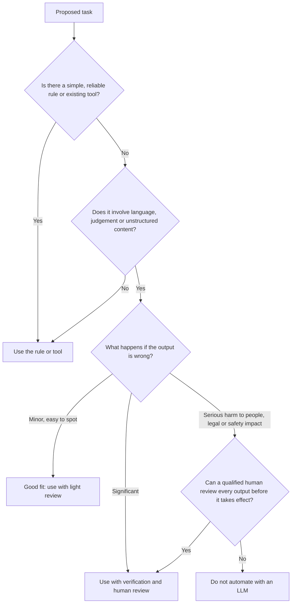

# Capabilities and Limitations

> **Level:** Beginner · **Time:** ~30 min · **Exam relevance:** CCAO-F D4 (4.5), D6 (6.1, 6.4) · CCAR-P D5 (5.2), D6 (6.2, 6.3)

## In plain English

Large language models are remarkably capable and surprisingly fallible, often in the same conversation. They can draft a solid project plan in seconds and then get a simple date calculation wrong. Neither the hype ("it can do anything") nor the dismissal ("it just makes things up") is useful.

The practical skill is **calibration**: knowing which tasks an LLM does well, which it does poorly, and which it should not do at all without a human in charge. A good analogy is a very fast, very well-read new colleague with no access to your systems unless you grant it, no memory of last week's meetings, and an occasional habit of filling gaps with guesses. You would give that colleague plenty of drafting and analysis work. You would not let them sign contracts.

## Why it matters

- CCAO-F objective 4.5 asks you to communicate Claude's value *and* limitations to stakeholders; 6.1 asks you to distinguish appropriate from inappropriate use cases.
- CCAR-P objective 5.2 asks architects to identify the risks, limitations and failure modes of LLM systems, and 6.3 to manage stakeholder expectations.
- Projects fail more often from mismatched expectations than from technology. A pilot sold as "fully automated" that needs human review on every output looks like a failure, even if it saves hours.

## How it works

### Strengths

| Capability | What it looks like in practice |
|---|---|
| Writing and editing | First drafts, rewriting for tone or audience, tightening prose |
| Summarisation | Condensing long documents, meeting notes, threads |
| Transformation | Notes into tables, prose into JSON, one format or language into another |
| Analysis and reasoning | Comparing options, finding gaps in an argument, explaining trade-offs |
| Coding | Writing, explaining, reviewing and debugging code across many languages |
| Brainstorming | Many varied options quickly |
| Reading images and documents | Interpreting charts, screenshots, scanned forms and PDFs |
| Following structured instructions | Producing consistent formats when given clear structure and examples |
| Using tools (when configured) | Searching the web, querying connected apps, running code, taking actions through connectors |
| Multilingual work | Working in many languages, with quality varying by language |

### Limitations

| Limitation | What it means | Mitigation |
|---|---|---|
| Hallucination | Can state false things confidently | Ground in sources, verify ([Hallucinations](06-hallucinations.md)) |
| Knowledge cutoff | No built-in knowledge of recent events | Web search, supplied documents |
| No persistent learning | Does not learn from your chats; each conversation starts fresh | Projects, memory, re-supplying context |
| Finite context | Can only consider what fits in the context window | Restart, summarise, persist ([Context windows](05-context-windows.md)) |
| Variable output | Same request can give different wording | Clear structure, examples, output formats |
| Precise calculation | Can slip on arithmetic, counting and dates when working "in its head" | Code execution, spreadsheets, showing working |
| No access to your systems by default | Cannot see your files, email or databases unless connected | Connectors, uploads, APIs, with appropriate permissions |
| Sensitivity to wording | Small prompt changes can change results | Iterate and test ([Iterating on prompts](../03-prompt-engineering/08-iterating-on-prompts.md)) |
| Bias | Can reflect biases present in training data | Review outputs affecting people; diverse test cases |
| Susceptibility to manipulation | Can be steered by instructions hidden in content | Treat external content as untrusted ([Module 12](../12-ai-security/README.md)) |
| Accountability | A model cannot be held responsible for a decision | Keep humans accountable for consequential decisions |

### A decision aid: should an LLM do this?



### Augment versus automate

Most successful business uses **augment** people: Claude drafts, a person decides. Full **automation** is appropriate only where errors are low-impact or reliably caught by checks. [Module 10](../10-agentic-ai/05-human-in-the-loop.md) covers human-in-the-loop design for more autonomous systems.

| Pattern | Example | Typical review |
|---|---|---|
| Assist | Claude suggests three reply drafts; an agent picks and edits one | The person is the reviewer |
| Augment with checkpoints | Claude extracts invoice fields; mismatches with the purchase order go to a person | Rule-based checks plus exception review |
| Automate | Claude tags internal support tickets by topic for reporting | Periodic sampling and evaluation |

## Example

A short exercise you can do in any Claude app. Ask:

```text
I'm a team lead. Give me an honest list of five tasks in a typical week of mine that you could
help with well, and three where I should not rely on you. For each of the three, say why.
```

Compare the answer with the tables above. A well-calibrated response should mention verification, lack of access to your systems unless connected, and decisions that need human accountability.

## Enterprise use case

*Acme Logistics*' operations director asks an architect: "Can Claude replace our dispatch team?" The architect prepares a one-page assessment for stakeholders (CCAR-P 6.2, communicating trade-offs):

- **Strong fit:** drafting shipment exception emails, summarising driver incident reports, answering staff questions about procedures from the operations manual.
- **Fit with checkpoints:** extracting data from scanned delivery notes, with validation against the order system and human review of mismatches.
- **Not a fit:** final decisions on driver safety incidents, and real-time route control of vehicles. Errors there could cause physical harm, and safety limits must be enforced by independent controls, not by model output.

The recommendation is "augment the dispatch team", with measurable goals (time saved per exception email, accuracy of extraction) rather than "replace". The pilot is approved because expectations are realistic.

## Common mistakes

- **Overclaiming in a pitch.** "Fully automated" and "100% accurate" set a pilot up to fail.
- **Underclaiming after one bad result.** One hallucination does not mean the tool is useless; it means the workflow needs a check.
- **Ignoring the cost of review.** If every output must be checked line by line, measure whether the overall process is still faster.
- **Forgetting that limitations change.** Models improve and features are added. Revisit assessments when you change models.

## Security considerations

- More capability means more potential for misuse. Giving a model tools (email, file access, payments) increases what can go wrong; grant the minimum needed ([Tool misuse and excessive agency](../12-ai-security/05-tool-misuse-and-excessive-agency.md)).
- Appropriate use is also a policy question. Anthropic's Usage Policy sets out prohibited uses and extra requirements for high-risk ones; your organisation will have its own AI policy too. See [Responsible use](../02-claude-fundamentals/05-responsible-use.md).

## Troubleshooting

| Symptom | Likely cause | What to do |
|---|---|---|
| Stakeholders disappointed with a pilot | Expectations set too high | Reset with measured results; frame as augmentation |
| Team refuses to use the tool after errors | No verification process; trust broken | Introduce grounding, checks and clear review responsibilities |
| An LLM is used for a task a rule could do | Novelty bias | Re-run the decision aid above |

## Check your understanding

1. Name three tasks LLMs do well and three limitations.
2. What is the difference between augmenting and automating?
3. Using the decision aid, what should happen if errors could seriously harm people and no human can review each output?
4. Why is "Claude can't learn from our chats" relevant when planning a rollout?

<details>
<summary>Answers</summary>

1. Strengths include writing, summarisation, transformation, analysis, coding, brainstorming and reading documents. Limitations include hallucination, the knowledge cutoff, no persistent learning, finite context, variable output and weak precise calculation.
2. Augmenting means the model assists and a person decides or reviews; automating means outputs take effect without a person in the loop.
3. Do not automate that task with an LLM.
4. Because organisational knowledge has to be supplied each time, through Projects, knowledge, connectors or retrieval. Correcting it in a chat will not improve future chats.

</details>

## Further reading

- [Intro to Claude](https://platform.claude.com/docs/en/intro) (Anthropic documentation)
- [Usage Policy](https://www.anthropic.com/legal/aup) (Anthropic)
- Next module: [Module 02: Claude fundamentals](../02-claude-fundamentals/README.md)
- Previous: [Hallucinations](06-hallucinations.md)
