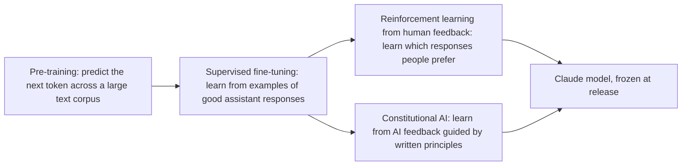
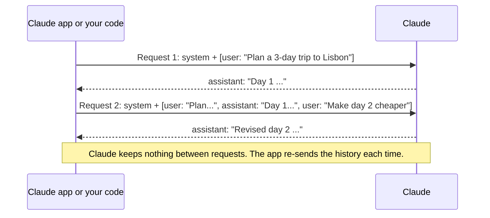

# How Claude Works

> **Level:** Beginner · **Time:** ~40 min · **Exam relevance:** CCAO-F D3 (3.4), D5 (5.3) · CCAR-P D2 (2.2)

## In plain English

Claude is a family of large language models made by Anthropic. Like every LLM (see [Module 01](../01-ai-and-llm-fundamentals/03-large-language-models.md)), it generates text by predicting one token at a time. What makes Claude *Claude* is how Anthropic shapes that raw ability into an assistant that aims to be helpful, honest and harmless.

Two ideas on this page will save you a lot of confusion later:

1. **Claude is shaped by training, then frozen.** The model you talk to was trained before release. Your chats do not retrain it.
2. **Every conversation is stateless underneath.** Claude does not "remember" your conversation between messages. Each time you send a message, the whole conversation so far is sent again, and Claude reads it fresh. Apps add features (memory, Projects, chat search) that supply earlier information, but the model itself starts from scratch on every request.

An analogy: imagine a brilliant consultant who has no memory from one meeting to the next, but who reads the complete meeting transcript, and any briefing pack you hand over, before saying anything. As long as the transcript and briefing pack contain what matters, the consultant is excellent. Leave something out, and as far as they are concerned it never happened.

## Why it matters

- **Statelessness explains "forgetting".** If Claude seems to forget something, the information was not in what it was sent.
- **Roles explain configuration.** The *system* role is where standing instructions go. In the apps, Project instructions play this part; in the API, it is the `system` parameter. CCAO-F objective 5.3 (write effective system-level instructions) and CCAR-P objective 2.2 (design system prompts) depend on this.
- **Training explains behaviour.** Claude's tendency to ask clarifying questions, admit uncertainty or decline some requests comes from how it was trained, not from a hidden rule you can switch off.

## How it works

### How Claude is trained (conceptual view)



**Pre-training.** The model learns language, facts and reasoning patterns by predicting text across a very large dataset. Anthropic's model pages describe the training data sources in general terms; see the [Transparency Hub](https://www.anthropic.com/transparency) for current details.

**Supervised fine-tuning.** The model is trained on examples of the behaviour wanted from an assistant: following instructions, answering clearly, refusing clearly harmful requests.

**Reinforcement learning from human feedback (RLHF).** People compare pairs of model responses and pick the better one. Those preferences train a *reward model*, which then guides further training so the assistant produces more of what people prefer. This is how qualities that are hard to write down as rules (helpful, clear, appropriately cautious) are learned.

**Constitutional AI.** Anthropic developed this method to reduce reliance on human labelling for harmlessness. The model is given a written set of principles (a "constitution"), and AI feedback guided by those principles is used to critique and improve responses. This makes the values that shape training explicit and inspectable. Anthropic has since published a much fuller document, [Claude's constitution](https://www.anthropic.com/constitution), which it describes as the final authority on its vision for Claude's values and behaviour. [Anthropic's safety approach](04-anthropic-safety-approach.md) covers it.

You do not need the technical details for either exam. You do need the conclusion: Claude's behaviour reflects deliberate training towards being helpful, honest and harmless, and that training is fixed by the time you use the model.

### Stateless conversations

When you chat in a Claude app, it looks like a continuous conversation. Under the surface, each turn is a separate request that contains everything Claude needs.



Consequences you will meet throughout this repository:

| Consequence | Practical effect |
|---|---|
| History is re-sent every turn | Long chats cost more tokens and use more of your plan's limits ([Tokens](../01-ai-and-llm-fundamentals/04-tokens-and-tokenisation.md)) |
| Nothing carries between separate chats by default | A new chat starts blank unless memory, chat search or a Project supplies context |
| The app (or your code) controls what Claude sees | This is why Projects, connectors and retrieval are so powerful: they decide what goes into the request |
| Editing an earlier message creates a new branch | Claude sees the edited history, not the original |

### Memory features are context, not learning

The Claude apps offer features that make Claude *seem* to remember:

- **Memory** saves topics from your chats and supplies them to future conversations. Each Project has its own separate memory.
- **Chat search** lets Claude look through your earlier conversations (paid plans).
- **Projects** attach instructions and knowledge to every chat in the Project.

All of these work the same way: they put relevant information into the context of a new request. None of them change the model. You can view, edit, pause or reset memory in settings, and use incognito chats that are not saved to memory or history. Details are in [Projects and knowledge](../05-claude-products-and-models/04-projects-and-knowledge.md).

### The three roles: system, user, assistant

Every request is a structured conversation with labelled parts:

| Role | Who writes it | Purpose | Where you see it |
|---|---|---|---|
| **System** | The application builder or configurer | Standing instructions, persona, rules, background that apply to the whole conversation | Project instructions and settings in the apps; the `system` parameter in the API |
| **User** | The person (or a program) asking | Each request, question or piece of content | Your messages |
| **Assistant** | Claude | Claude's replies | Claude's messages |

In the API, the conversation must start with a user message and alternate user and assistant turns. The system prompt sits outside that list. A minimal request with this repository's lab helper looks like this:

```python
import sys
sys.path.insert(0, "19-hands-on-labs/common")  # run from the repository root
from claude_lab import get_client, MODEL, text_of

client = get_client()  # offline mock by default; CLAUDE_LAB_MODE=live calls the real API
response = client.messages.create(
    model=MODEL,  # claude-opus-5-5 unless you override CLAUDE_LAB_MODEL
    max_tokens=1024,
    system="You are a friendly onboarding assistant for new staff at Acme Logistics. "
           "Answer in plain English and keep replies under 120 words.",
    messages=[
        {"role": "user", "content": "What should I do on my first morning?"},
    ],
)
if response.stop_reason == "end_turn":
    print(text_of(response))
else:
    print(f"Stopped early: {response.stop_reason}")
```

> **Cost:** requires API credits (live mode). The default mock mode is free and offline.

To continue the conversation, your code appends Claude's reply as an `assistant` message and then a new `user` message, and sends the whole list again. That is statelessness in code.

### Why the system role matters

Instructions in the system role apply to every turn without being repeated, and they are where the person configuring Claude sets boundaries. In the Claude apps you rarely write a raw system prompt, but **Project instructions** serve the same purpose for all chats in a Project. Writing them well is a CCAO-F skill (objective 5.3); [System prompts and roles](../03-prompt-engineering/07-system-prompts-and-roles.md) teaches it in depth.

## Example

Try this in a Claude app to see statelessness for yourself.

1. In a new chat, write: "My favourite colour is teal. Please remember it."
2. Claude will acknowledge it.
3. Open a **new incognito chat** and ask: "What is my favourite colour?"

Claude will not know, because nothing from the first chat was sent. (In a normal, non-incognito chat with memory switched on, the answer may differ, because the memory feature may have saved the fact and inserted it into the new conversation. That difference is the whole point: memory is supplied context.)

## Enterprise use case

*Contoso Health* builds an internal assistant using the Claude API to answer staff questions about leave policy. In testing, a nurse asks a follow-up ("And what about part-time staff?") and the assistant answers as if the earlier question never happened.

The developer finds the bug: the application sent only the latest message, not the history. Because Claude is stateless, it had no idea what "what about" referred to. The fix is to send the conversation history with each request, trimmed or summarised once it gets long, and to keep the policy rules in the system prompt so they apply to every turn.

## Common mistakes

- **Believing Claude learns from corrections permanently.** It uses them in that conversation only.
- **Putting standing rules in the first user message instead of the system role or Project instructions.** They may get lost as the chat grows, and they are mixed with user content.
- **Assuming a new chat knows what an old chat knew.** Use Projects or paste a summary.
- **Forgetting that apps and code decide what Claude sees.** When an answer is wrong, first ask: did Claude actually receive the information it needed?

## Security considerations

- **System instructions are not secret storage.** Do not put passwords, keys or confidential data in a system prompt or Project instructions on the assumption that users cannot see it.
- **Roles are not a security boundary on their own.** User content (and documents or web pages it includes) can contain instructions that try to override the system role. Defences are covered in [Prompt injection](../12-ai-security/02-prompt-injection.md).
- **Conversation history is data.** It may contain personal or confidential information. Know how your organisation's plan handles retention, and use the controls available (incognito chats, memory settings, retention settings on Team and Enterprise plans).

## Troubleshooting

| Symptom | Likely cause | What to do |
|---|---|---|
| Claude "forgot" something from earlier in the same chat | Very long chat, earlier content summarised or buried | Restate it, or summarise and restart |
| Claude doesn't know something from a different chat | Statelessness; nothing carried over | Paste a summary, use a Project, or check memory settings |
| API follow-up questions are answered out of context | History not sent with the request | Include previous user and assistant messages |
| Claude ignores a rule given early on | Rule placed in a user message far back in history | Move it to Project instructions or the system prompt |

## Check your understanding

1. What does "stateless" mean for a Claude conversation?
2. What is the purpose of the system role, and what plays that part in a Claude Project?
3. In one sentence each, what do RLHF and Constitutional AI contribute to training?
4. If memory is switched on and Claude recalls something from last week, has the model learned it? Explain.
5. Why do long conversations cost more?

<details>
<summary>Answers</summary>

1. Claude keeps nothing between requests; each request must contain all the context, so the app or your code re-sends the history every turn.
2. It holds standing instructions and background that apply to every turn. Project instructions play that part in a Project.
3. RLHF trains the model towards responses that people prefer, using their comparisons; Constitutional AI trains the model using AI feedback guided by a written set of principles.
4. No. The memory feature stored the information and supplied it as context to the new conversation; the model's parameters are unchanged.
5. Because the whole history is sent as input on every turn, so the input grows with each message.

</details>

## Further reading

- [Messages API overview](https://platform.claude.com/docs/en/build-with-claude/working-with-messages) (Anthropic documentation)
- [Claude's constitution](https://www.anthropic.com/constitution) (Anthropic)
- [Constitutional AI: Harmlessness from AI Feedback](https://www.anthropic.com/research/constitutional-ai-harmlessness-from-ai-feedback) (Anthropic research)
- [Using chat search and memory](https://support.claude.com/en/articles/11817273-using-claude-s-chat-search-and-memory-to-build-on-previous-context) (Claude Help Center)
- Next: [Your first conversation](02-first-conversation.md)
