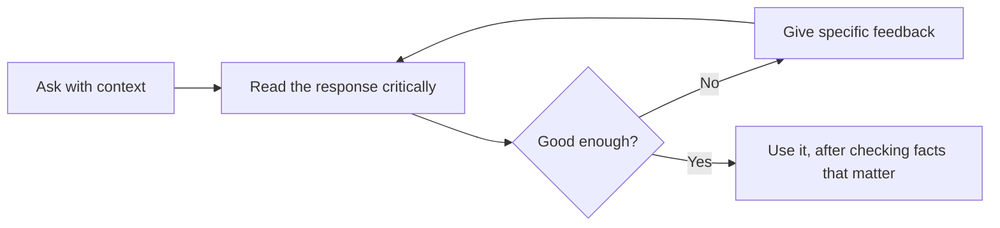

# Your First Conversation

> **Level:** Beginner · **Time:** ~40 min · **[Exam relevance](../00-getting-started/how-to-use-this-repo.md#objective-ids):** CCAO-F D1 (1.3), D3 (3.1, 3.4)

## In plain English

This page walks you through your first real conversation with Claude, step by step. You will ask a question, improve the answer by giving feedback, attach a file, and learn when to start a fresh chat. Nothing here requires technical knowledge.

Think of it like your first day with a capable new assistant. You will get much better results if you explain what you need, look at the first draft, and say what to change, rather than expecting perfection from a one-line request.

> Product screens change often. The steps below describe the Claude apps as of 2026-10-24; if a button has moved, the [Claude Help Center](https://support.claude.com/) has current instructions.

## Why it matters

The CCAO-F exam is aimed at people who use Claude regularly, and its guide recommends hands-on experience (see [`registry.yaml`](../16-certification-tracks/registry.yaml)). Many questions describe a realistic situation and ask what you would do next. You answer those far more confidently if you have actually iterated on outputs (objective 1.3), picked the right feature for a task (3.1) and decided when to start a new chat (3.4).

## How it works

### Step 1: get access

You can use Claude in three main places, all with the same account:

| Where | How to get it | Good for |
|---|---|---|
| Web | Go to [claude.ai](https://claude.ai) in a browser | Getting started anywhere |
| Desktop app | Download for macOS or Windows (a Linux build is in beta as of 2026-10-24) from [claude.com/download](https://claude.com/download) | Daily work, desktop extensions, keyboard shortcuts |
| Mobile app | iOS and Android app stores | Quick questions, voice, photos of documents |

Sign up with an email address or a supported single sign-on option. A **Free** plan is enough for this page. If your employer provides Claude through a **Team** or **Enterprise** plan, use that account for work and follow your organisation's AI policy. Plans are compared in [The Claude product ecosystem](../05-claude-products-and-models/01-product-ecosystem.md).

### Step 2: know the screen

The main areas you will use:

- **Message box:** where you type. The **+** button next to it lets you attach files and turn on features such as web search or research (availability depends on your plan).
- **Model selector:** lets you choose which Claude model answers. The default is a sensible starting point; [Model selection](../05-claude-products-and-models/03-model-selection.md) explains when to change it.
- **Sidebar:** your previous chats, Projects and Artifacts.
- **Incognito option:** chats that are not saved to your history or memory.

### Step 3: ask, read, refine

A good first conversation follows a loop:



The most important habit is **specific feedback**. "Make it better" gives Claude little to work with. "Shorter, warmer, and drop the second paragraph" tells it exactly what to change.

### Step 4: attach a file

Claude can read documents (such as PDFs, Word files and spreadsheets), images and screenshots. Attach with the **+** button or drag and drop. Then ask your question about it. Remember the [context window](../01-ai-and-llm-fundamentals/05-context-windows.md): large files use a lot of it.

### Step 5: know when to start fresh

Start a new chat when you change topic, when a conversation has gone off track, or when it has become very long. If you need to keep the important parts, ask for a summary first and paste it into the new chat.

## Example

Work through this guided exercise. It takes about 20 minutes.

**1. A vague first request.** Type:

```text
Write an email about the office move.
```

Claude will produce something generic, or ask you questions. Either way, notice how much it had to guess.

**2. Add context.** Start a new chat and type:

```text
I'm the office manager at a 40-person design studio. We're moving from the 3rd floor to the
5th floor of the same building on Friday 14 November. Please draft a short email to all staff
that tells them:
- desks must be cleared into the provided crates by 4pm Thursday
- IT will move computers overnight
- the new floor plan is attached to the email
Tone: friendly and practical. Length: under 150 words.
```

Compare. The second draft should be far closer to usable because Claude no longer has to guess the audience, facts, tone or length.

**3. Iterate with specific feedback.** Reply:

```text
Good. Two changes: put the deadline in bold at the top, and add one line saying who to contact
with questions (Priya Shah, ext. 204). Keep everything else.
```

**4. Ask Claude to critique its own draft.**

```text
Read the email as a busy employee who skims. What might they miss? Suggest one improvement.
```

This is a useful habit: Claude is often good at spotting weaknesses when asked directly.

**5. Attach a file.** Take a photo or screenshot of any printed notice or form (with no personal information on it), attach it, and ask:

```text
Summarise this notice in three bullet points for someone who has 10 seconds to read it.
```

**6. Practise restarting.** Ask Claude: "Summarise the decisions in this chat in five bullets." Copy the summary, open a new chat, paste it, and continue with a different request about the move. You have just practised the *summarise and restart* strategy from [Context windows](../01-ai-and-llm-fundamentals/05-context-windows.md).

If you prefer to try the API instead of an app, [Lab 01: First Claude interaction](../19-hands-on-labs/lab-01-first-claude-interaction/README.md) does the same thing in Python and runs offline in mock mode.

## Enterprise use case

*Acme Logistics* rolls out Claude Team to its 60-person customer-service department. Early feedback is mixed: some staff love it, others say "it just writes waffle".

The team lead watches a few sessions and sees the difference. Staff who get good results give context (customer situation, policy, desired tone) and iterate with specific feedback. Staff who are disappointed type one line and accept the first answer. The lead runs a 30-minute session based on the exercise above and creates a shared Project with the department's tone guide and common policies, so everyone starts with the right context. Satisfaction rises without any change of model.

## Common mistakes

- **One-line requests for important work.** The less context, the more Claude guesses.
- **Vague feedback.** "Better" and "more professional" mean different things to different people. Say what to change.
- **Never starting a new chat.** One long chat for every topic wastes usage and muddles answers.
- **Uploading sensitive files without checking policy.** See [Responsible use](05-responsible-use.md).
- **Skipping the check.** Even a great-looking draft can contain an error. Check facts, names, dates and figures before sending.

## Security considerations

- Before attaching a work document, check its classification and your organisation's AI policy. Personal data, customer data and confidential information may be restricted.
- Use incognito chats for one-off questions you do not want saved to history or memory, but remember that incognito does not make prohibited data acceptable to share.
- On Team and Enterprise plans, administrators control features such as connectors, memory and data retention. If a feature is missing, it may be switched off deliberately.

## Troubleshooting

| Symptom | Likely cause | What to do |
|---|---|---|
| Answer is generic | Not enough context | Add audience, purpose, facts, tone and length |
| Claude asks lots of questions instead of answering | Request is ambiguous | Answer them, or include the details up front next time |
| File won't upload | Unsupported type or too large | Convert to PDF or text, or split the file |
| A feature (web search, research) is missing | Not on your plan, or disabled by an admin | Check your plan or ask your administrator |
| Message about usage limits | Plan limit reached for now | Wait for the limit to reset; use shorter chats and smaller files |

## Check your understanding

1. Name three things you can add to a request to make Claude's first answer more useful.
2. What makes feedback "specific"? Give an example.
3. When should you start a new chat?
4. Why should you check a document's classification before attaching it?

<details>
<summary>Answers</summary>

1. Any three of: who you are, who the audience is, the purpose, the key facts, the tone, the length, the format.
2. It names exactly what to change. For example: "Cut it to 100 words and move the deadline to the first line."
3. When you change topic, when the chat has gone off track, or when it has become very long (summarise first if you need to keep the conclusions).
4. Because it may contain personal, customer or confidential data that your organisation's AI policy does not allow you to share with an AI service.

</details>

## Further reading

- [Claude Help Center](https://support.claude.com/) (official product help)
- [Get started with Claude](https://support.claude.com/en/collections/4078531-claude) (Claude Help Center collection)

<!-- page-nav:start -->
---

[← Previous: How Claude Works](01-how-claude-works.md) · [Module overview](README.md) · [Next: Prompt Fundamentals →](03-prompt-fundamentals.md)
<!-- page-nav:end -->
