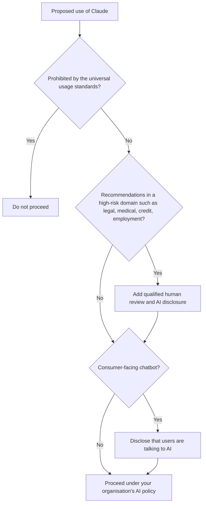

# Anthropic's Safety Approach

> **Level:** Beginner · **Time:** ~35 min · **Exam relevance:** CCAO-F D6 (6.1, 6.4) · CCAR-P D5 (5.1, 5.2, 5.5)

## In plain English

Anthropic, the company that makes Claude, describes itself as an AI safety and research company. Safety shows up in three layers you should know about:

1. **How Claude is shaped.** Training aims for a model that is helpful, honest and avoids harm, guided by a published document called **Claude's constitution**.
2. **What people may use Claude for.** The **Usage Policy** sets out what is prohibited for everyone and what extra safeguards apply to high-risk uses.
3. **How Anthropic manages risk as models get more capable.** The **Responsible Scaling Policy** (RSP) commits Anthropic to stronger safeguards as models cross defined capability thresholds.

A rough analogy is a car. The engineering (constitution and training) makes the car behave safely. The highway code (Usage Policy) tells drivers what they may and may not do. And the manufacturer's safety programme (RSP) commits to adding better brakes and airbags before releasing faster models.

None of these removes your responsibility as a user or builder. [Responsible use](05-responsible-use.md) covers that.

## Why it matters

- CCAO-F objectives 6.1 and 6.4 ask you to tell appropriate from inappropriate uses and understand ethical implications. The Usage Policy is the authoritative reference for "appropriate".
- CCAR-P objective 5.1 asks architects to implement guardrails and safety controls; 5.2 to know failure modes; 5.5 to address bias, fairness and transparency. Knowing what the model provider already does tells you what you must add.
- Understanding why Claude sometimes declines a request helps you rephrase legitimate requests and recognise when a refusal is the right outcome.

## How it works

### Layer 1: Claude's constitution

Anthropic publishes [Claude's constitution](https://www.anthropic.com/constitution), a long document describing the values, knowledge and judgement it wants Claude to have. Anthropic describes it as the final authority on its vision for Claude, says it plays a central role in training, and notes that it is a work in progress that will be revised.

As of 2026-10-24, the constitution says Claude should be, in order of priority when they genuinely conflict:

| Priority | Property | In plain terms |
|---|---|---|
| 1 | **Broadly safe** | Not undermining appropriate human oversight of AI during the current period of development |
| 2 | **Broadly ethical** | Honest, acting on good values, avoiding inappropriate or harmful actions |
| 3 | **Compliant with Anthropic's guidelines** | Following Anthropic's more specific guidance where relevant |
| 4 | **Genuinely helpful** | Benefiting the operators and users it works with |

Two points are easy to misread:

- The ordering is **holistic, not strict**. Higher priorities generally dominate, but all are weighed together. It tells you what wins in a conflict, not how often conflicts happen. Most everyday tasks involve no conflict at all.
- The constitution prefers **good judgement over rigid rules**. That is why Claude may handle similar-looking requests differently depending on context, purpose and likely harm.

The constitution also describes different *principals*: Anthropic, **operators** (companies and individuals who build on Claude, for example by writing a system prompt) and **users** (people interacting in the conversation). This is why a system prompt or Project instructions can legitimately shape Claude's behaviour within the limits Anthropic sets.

The method behind using written principles in training, Constitutional AI, is introduced in [How Claude works](01-how-claude-works.md).

### Layer 2: the Usage Policy

The [Usage Policy](https://www.anthropic.com/legal/aup) (also called the Acceptable Use Policy) applies to everyone who uses Anthropic's products: people using the Claude apps and Claude Code, developers and businesses using the API, customers reaching Claude through cloud platforms, and end users of products built on Claude.

> **Note on versions:** when this page was checked on 2026-10-24, the published policy showed an effective date of 12 November 2026. Always read the live page; the summary below is in our own words and is not a substitute.

It has three main parts:

**Universal usage standards** that prohibit, for every user, uses such as:

- illegal activity, fraud, scams and phishing
- compromising critical infrastructure, or unauthorised access to computer systems and malware
- developing weapons, including biological, chemical, nuclear and explosive weapons
- inciting violence or hateful behaviour, harassment, and self-harm promotion
- privacy violations and unauthorised collection of personal data
- child sexual exploitation in any form
- disinformation, deceptive campaigns and undermining elections
- unlawful surveillance and certain law-enforcement uses
- platform abuse, such as unauthorised jailbreaking or evading bans
- generating sexually explicit content

**High-risk use case requirements** that apply when Claude is used to make recommendations in areas such as legal, medical, financial, credit, insurance, housing, employment, education and public benefits:

- **Human in the loop:** a qualified person must meaningfully review the output, with authority to change it, before it reaches the affected person or is used in a decision. That person stays responsible for the result.
- **Disclosure:** people who receive AI-informed advice or decisions must be told that AI was used.

**Additional guidelines** for particular situations, for example consumer chatbots must disclose that they are AI, plus rules for products used by minors and for agentic uses.

### Layer 3: the Responsible Scaling Policy

The [Responsible Scaling Policy](https://www.anthropic.com/responsible-scaling-policy) is Anthropic's framework for managing catastrophic risks from increasingly capable models. As of 2026-10-24, the published version is 3.4, effective 8 July 2026; it was first released in September 2023.

The core idea is **proportional safeguards**:

- Anthropic defines **capability thresholds**, for example in AI research and development and in chemical, biological, radiological and nuclear (CBRN) weapons.
- It uses **AI Safety Levels (ASL)**, standards for security and deployment safeguards. ASL-2 is the baseline; ASL-3 security and deployment standards are required when models reach certain thresholds.
- Deployment safeguards described for ASL-3 include layered defences such as access controls, real-time classifiers on prompts and completions, asynchronous monitoring, and jailbreak detection with rapid response.
- Security measures protect model weights from theft.
- Anthropic publishes risk reports and other transparency material.

For you as a user, the visible effect is that some requests in high-risk technical areas may be declined by safety classifiers even when your intent is legitimate. In the API, these appear as a response with `stop_reason` set to `refusal`, which your application should handle (see [Module 06](../06-claude-api/02-messages-api.md)).

### Other transparency resources

- **System cards** for each model describe evaluations and safety testing.
- The [Transparency Hub](https://www.anthropic.com/transparency) collects information on models, training data cutoffs and platform safeguards.

### What this means for builders

The provider's safeguards are a foundation, not a complete solution. You still need controls suited to your use case:

| Provided by Anthropic | You add |
|---|---|
| Safety-trained model, guided by the constitution | System prompts and Project instructions that define scope and tone |
| Usage Policy and enforcement | Your organisation's AI policy, acceptable-use rules, training |
| Safety classifiers for high-risk areas | Input validation, output checks, prompt-injection defences ([Module 12](../12-ai-security/README.md)) |
| Model evaluations in system cards | Evaluations of *your* use case ([Module 14](../14-evaluation-and-testing/README.md)) |
| | Human review for high-risk decisions, as the Usage Policy requires |

## Example

You are deciding whether three proposed uses at your organisation are appropriate. Using the flowchart above:

| Proposal | Assessment |
|---|---|
| Draft first versions of internal training materials | Not prohibited, not high-risk. Proceed under your AI policy, with normal review |
| Recommend which loan applications to approve | High-risk (credit). A qualified human must review every recommendation with authority to change it, and applicants must be told AI was used |
| Generate fake customer reviews for a product page | Prohibited (deceptive content and fraud). Do not proceed |

## Enterprise use case

*Contoso Health* plans a patient-facing chatbot to answer questions about appointment logistics, and staff ask whether it could also advise on medication doses.

The governance group maps both against the Usage Policy. Appointment logistics is a consumer chatbot: the bot must clearly disclose that patients are talking to AI. Medication advice is a high-risk medical recommendation: it would require qualified clinician review of each answer before the patient sees it, which defeats the purpose of an instant chatbot. The group approves the logistics bot with an AI disclosure and an easy route to a human, and rejects the medication use case for the chatbot. Clinicians may still use Claude internally to draft materials that they review.

## Common mistakes

- **Assuming the model's safety training makes your application safe.** It does not cover your specific risks, data or users.
- **Treating the constitution as a list of rules you can configure.** It describes values and priorities; operators can customise behaviour only within the limits Anthropic sets.
- **Ignoring the high-risk requirements because "a human looks at it eventually".** Review must be meaningful, by a qualified person, before the output takes effect.
- **Paraphrasing the Usage Policy from memory.** It changes. Check the live version.
- **Trying to "jailbreak" around a refusal.** Unauthorised jailbreaking is itself prohibited. Rephrase legitimately, add genuine context, or accept the refusal.

## Security considerations

- Safety classifiers can produce false positives on legitimate security, medical or research work. Plan for refusals in production systems: detect them, log them and route to a human or alternative process.
- Your own guardrails should not depend on the model refusing. Enforce critical rules (permissions, data access, spending limits) in code and configuration, not only in prompts.
- Disclosure requirements are a transparency control. Build them into user interfaces from the start.

## Troubleshooting

| Symptom | Likely cause | What to do |
|---|---|---|
| Claude declines a legitimate request | Ambiguous phrasing, missing context, or a safety classifier | Explain the legitimate purpose and context; narrow the request; if it still declines, use another route |
| API returns `stop_reason: "refusal"` | Safety classifier declined the request | Handle it explicitly; do not retry blindly; review whether the use case fits the policy |
| Unsure whether a use is allowed | Policy ambiguity | Read the live Usage Policy and ask your governance or legal team |

## Check your understanding

1. Name the three layers of Anthropic's safety approach described on this page.
2. What are the four core properties in Claude's constitution, in priority order?
3. What two requirements does the Usage Policy add for high-risk recommendations?
4. What is the main idea of the Responsible Scaling Policy?
5. Why are the provider's safeguards not enough on their own for an enterprise application?

Answers

1. Claude's constitution (how the model is shaped), the Usage Policy (what it may be used for) and the Responsible Scaling Policy (how risk is managed as capability grows).
2. Broadly safe, broadly ethical, compliant with Anthropic's guidelines, genuinely helpful. The prioritisation is holistic rather than strict.
3. Meaningful review by a qualified human before the output takes effect, and disclosure to affected people that AI was used.
4. Safeguards must scale with capability: as models cross defined capability thresholds, stronger security and deployment standards (AI Safety Levels) apply.
5. Because they do not know your data, users, permissions or business risks. You need your own policies, guardrails, evaluations and human review.

## Further reading

- [Claude's constitution](https://www.anthropic.com/constitution) (Anthropic)
- [Usage Policy](https://www.anthropic.com/legal/aup) (Anthropic)
- [Responsible Scaling Policy](https://www.anthropic.com/responsible-scaling-policy) (Anthropic)
- [Transparency Hub](https://www.anthropic.com/transparency) (Anthropic)
- Related: [AI governance](../12-ai-security/12-ai-governance.md), [Human oversight](../12-ai-security/13-human-oversight.md)
- Previous: [Prompt fundamentals](03-prompt-fundamentals.md) · Next: [Responsible use](05-responsible-use.md)
