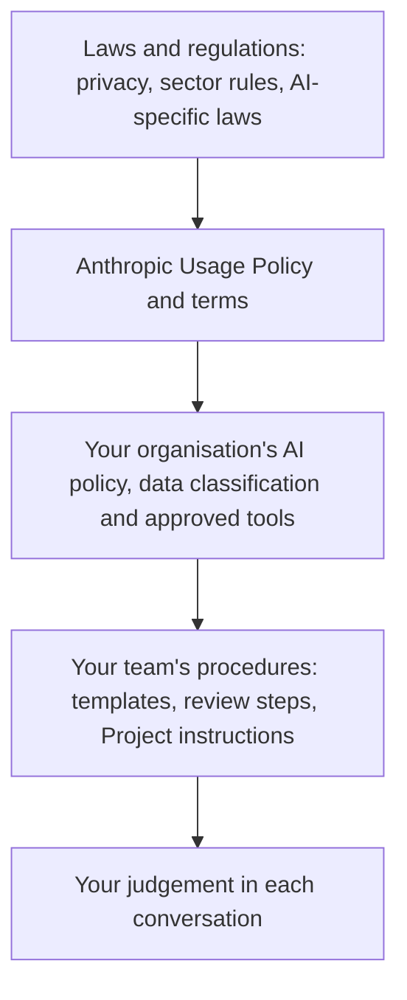

# Responsible Use

> **Level:** Beginner · **Time:** ~35 min · **Exam relevance:** CCAO-F D2 (2.4), D6 (6.1, 6.2, 6.3, 6.4) · CCAR-P D5 (5.3, 5.4, 5.5)

## In plain English

Using Claude responsibly comes down to five habits:

1. **Protect data.** Only share what you are allowed to share.
2. **Verify.** Check outputs in proportion to the stakes.
3. **Keep humans accountable.** People, not models, own decisions that affect other people.
4. **Be transparent.** Tell people when AI shaped something they rely on, where it matters or is required.
5. **Follow the rules.** Anthropic's Usage Policy, the law, and your organisation's AI policy.

Think of Claude as a powerful power tool. Most of the time it saves effort and does fine work. But you wear the safety glasses, you check the cut before you fit the part, and you do not hand it to someone untrained without supervision.

## Why it matters

- CCAO-F Domain 6 (Governance, Risk, and Responsible Use) covers exactly these habits: appropriate versus inappropriate use (6.1), data sensitivity, regulation and privacy (6.2), organisational policy (6.3) and ethics (6.4). Objective 2.4 adds deciding when human review is needed.
- CCAR-P Domain 5 asks architects to design human-in-the-loop validation (5.3), regulatory compliance (5.4) and fairness and transparency (5.5) into systems.
- Most AI incidents in organisations are not exotic attacks. They are ordinary people pasting the wrong data, trusting an unchecked output or using a tool outside policy.

## How it works

### 1. Protect data

Before you paste or upload anything, classify it. Organisations typically use levels like these (yours may differ):

| Classification | Examples | Typical rule for AI tools |
|---|---|---|
| Public | Published marketing copy, public web pages | Generally fine |
| Internal | Internal process documents, meeting notes | Allowed in approved, organisation-managed tools |
| Confidential | Contracts, financials, unreleased product plans | Only in approved tools with appropriate contractual protections, and only if policy allows |
| Restricted / regulated | Customer personal data, health records, payment card data, credentials | Usually prohibited unless a specific, approved process exists |

Practical rules:

- **Never paste credentials** (passwords, API keys, tokens) into any chat.
- **Minimise personal data.** Remove names, account numbers and contact details where the task does not need them. "Customer A" works as well as a real name for drafting a reply.
- **Use the right account.** Work data belongs in your organisation's managed plan (Team, Enterprise or an approved API integration), not a personal account.
- **Know your settings.** On consumer plans (Free, Pro, Max), Anthropic's privacy centre explains when chats may be used to improve models, including a Model Improvement setting you control, and that incognito chats are not used for this (as of 2026-10-24; see [Is my data used for model training?](https://privacy.claude.com/en/articles/10023580-is-my-data-used-for-model-training)). Commercial plans and the API are governed by separate commercial terms. Check the current pages rather than relying on memory.
- **Mind connectors.** When you connect Google Drive, email or other services, Claude acts with *your* permissions in those services. Connect only what the task needs ([Connectors and integrations](../05-claude-products-and-models/06-connectors-and-integrations.md)).

### 2. Verify in proportion to risk

Use the review levels from [Hallucinations](../01-ai-and-llm-fundamentals/06-hallucinations.md):

| Stakes | Example | Review |
|---|---|---|
| Low | Brainstormed ideas, a personal to-do list | Read for sense |
| Medium | Internal report, team email | Check key facts, figures and names against sources |
| High | Customer communications, legal, financial, medical, HR, anything published | Full verification plus sign-off by a qualified person |

### 3. Keep humans accountable

A model cannot be held responsible. For any decision that materially affects a person (hiring, lending, medical care, discipline, access to services):

- A **qualified** person reviews the output **before** it takes effect.
- That person has the **authority and time** to change or reject it.
- The organisation can **explain** the decision without saying "the AI decided".

Anthropic's Usage Policy makes human review a requirement for high-risk recommendations (see [Anthropic's safety approach](04-anthropic-safety-approach.md)), and some regulations impose similar duties.

### 4. Be transparent

- Disclose AI involvement where policy or law requires it, for example customer-facing chatbots and AI-informed decisions about people.
- Inside your organisation, be honest about how a document was produced when it matters to how others rely on it.
- Do not present AI output as independent human expert opinion.

### 5. Follow the rules: a layered view



Each layer narrows what is acceptable. Your organisation's AI policy usually answers the practical questions: which tools are approved, which data classes are allowed, who must review what, and how to report a problem.

### Fairness and bias

Models can reflect biases present in their training data. Be especially careful when output describes or affects people:

- Review hiring, performance, lending and similar text for stereotyped language or unequal treatment.
- Test with varied examples (different names, genders, ages, backgrounds) and compare outputs.
- Do not use AI to infer sensitive characteristics (health, ethnicity, religion, sexuality) about individuals.

### A quick pre-flight checklist

Before using Claude for a work task, ask:

1. Is this use allowed by my organisation's AI policy and the Usage Policy?
2. Am I using an approved account and tool?
3. Have I removed data I don't need to share?
4. What happens if the output is wrong, and how will I check it?
5. Does a qualified person need to review this before it takes effect?
6. Does anyone need to be told AI was involved?

## Example

A recruiter asks Claude to help shortlist candidates:

```text
Here are 40 CVs. Rank them and tell me which 5 to interview.
```

Responsible version:

```text
I'm preparing for a shortlisting meeting for a junior data analyst role. I've removed names,
photos, ages and addresses from these CVs and replaced them with IDs (C01 to C40).

For each CV, list evidence (with quotes) against these three published criteria only:
1. SQL experience
2. Experience presenting data to non-technical audiences
3. Degree or equivalent experience in a quantitative field

Do not rank or recommend candidates. I and two colleagues will make the shortlisting decision
using your evidence summary and our own reading of the CVs.

<cvs>
[anonymised CVs here]
</cvs>
```

The second version minimises personal data, ties the output to job-related criteria, asks for evidence rather than judgements, and keeps the decision with accountable humans. Employment is a high-risk area under the Usage Policy, so this is the shape responsible use needs to take.

## Enterprise use case

*Acme Logistics* is about to give 500 staff access to Claude Enterprise. The governance lead drafts a one-page AI policy covering:

- **Approved tools:** the company's Claude Enterprise workspace; no personal accounts for work.
- **Data rules:** a table like the one above, with examples from Acme's own data.
- **Prohibited uses:** anything in the Usage Policy's universal standards, plus automated decisions about staff discipline or driver safety.
- **Review rules:** customer-facing and HR content needs human sign-off; high-risk recommendations need qualified review.
- **Connectors:** only administrator-enabled connectors; members authenticate individually; read-only where possible.
- **Disclosure:** the customer chatbot says it is AI and offers a human.
- **Reporting:** how to report a mistake, data leak or suspicious output.

Every user completes a 20-minute training session before access is granted, and the policy is reviewed every six months as features change (CCAO-F 6.3).

## Common mistakes

- **"It's only a draft, so data rules don't apply."** The data has still been shared.
- **Rubber-stamp review.** A reviewer with no time or authority to change the output is not a human in the loop.
- **Using personal accounts for work.** Data then sits outside organisational controls.
- **Assuming the vendor handles compliance.** Your organisation remains responsible for how it uses the tool.
- **Over-correcting into avoidance.** Banning all use pushes people to unapproved tools. Clear, practical policy works better.

## Security considerations

- Treat outputs from documents, emails and web pages as potentially influenced by hidden instructions ([Indirect prompt injection](../12-ai-security/03-indirect-prompt-injection.md)), especially when connectors give Claude the ability to act.
- Apply least privilege to connectors and tools: grant access to what the task needs, and prefer read-only.
- Report suspected data leaks or misuse through your organisation's incident process; [Module 12](../12-ai-security/README.md) covers technical controls in depth, including [secrets management](../12-ai-security/10-secrets-management.md) and [logging and auditability](../12-ai-security/11-logging-and-auditability.md).

## Troubleshooting

| Symptom | Likely cause | What to do |
|---|---|---|
| You pasted data you shouldn't have | Missed the pre-flight check | Follow your incident process promptly; do not try to "delete it quietly" |
| Unsure if a use is allowed | Policy gap | Ask your governance or security team before proceeding |
| Output contains biased wording about people | Bias in patterns | Edit it, test with varied examples, and tighten the prompt to job-related criteria |
| Colleagues use unapproved AI tools | Policy too restrictive or unclear | Raise it with governance; propose an approved alternative |

## Check your understanding

1. Name the five habits of responsible use.
2. What three conditions make human review meaningful?
3. You want help drafting a reply to a customer complaint that includes their account number. What should you do with the account number?
4. Why should work tasks use an organisation-managed account rather than a personal one?
5. Give two ways to reduce bias when Claude produces content about people.

<details>
<summary>Answers</summary>

1. Protect data, verify, keep humans accountable, be transparent, follow the rules.
2. The reviewer is qualified, reviews before the output takes effect, and has the authority and time to change or reject it.
3. Remove or replace it with a placeholder, because the draft does not need it, and personal financial data is usually restricted.
4. Because organisational accounts come with the organisation's contractual protections, administrator controls and retention settings; personal accounts sit outside them.
5. Any two of: restrict to job-related or task-related criteria; ask for evidence rather than judgements; test with varied examples and compare; review language for stereotypes; never infer sensitive characteristics.

</details>

## Further reading

- [Usage Policy](https://www.anthropic.com/legal/aup) (Anthropic)
- [Anthropic Privacy Center](https://privacy.claude.com/) (Anthropic)
- [Claude Help Center](https://support.claude.com/) for plan-specific data and admin settings
- Related: [AI governance](../12-ai-security/12-ai-governance.md), [Data governance and compliance](../13-enterprise-ai-architecture/05-data-governance-and-compliance.md)
- Previous: [Anthropic's safety approach](04-anthropic-safety-approach.md) · Next module: [Module 03: Prompt engineering](../03-prompt-engineering/README.md)
