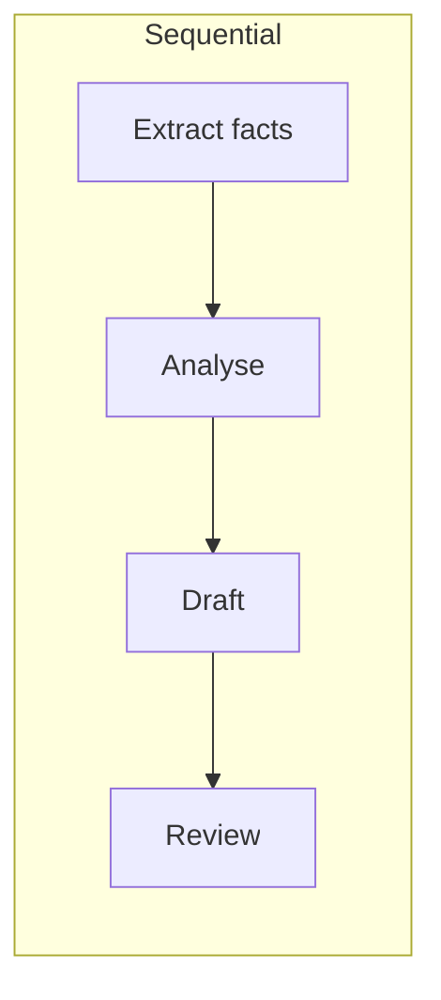
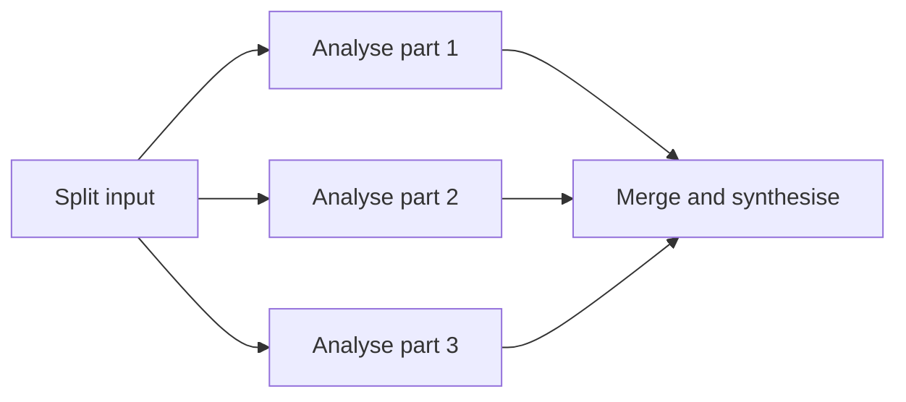

# Task Decomposition and Prompt Chaining

> **Level:** Intermediate · **Time:** ~45 min · **Exam relevance:** CCAO-F D1, D4 · CCAR-P D1, D2

## In plain English

Big jobs go better in stages. A report writer gathers facts, then outlines, then drafts, then edits. Asking for all
of that in one breath tends to produce a rushed result where some stages are skipped.

**Task decomposition** means breaking a complex request into smaller sub-tasks. **Prompt chaining** means running
those sub-tasks as separate prompts (or separate API calls), feeding the output of one into the next. In the Claude
apps you do this by working through steps in a conversation; in code you do it with a pipeline.

## Why it matters

- **Each step gets Claude's full attention**, with instructions and context tailored to that step.
- **You can inspect, test and fix one step at a time.** If the final report is wrong, you can see whether the facts,
  the outline or the drafting went astray.
- **You can mix models and settings.** A cheap, fast model can do extraction; a more capable model at higher effort
  can do the judgement step.
- **You can add checks between steps**, such as schema validation, business rules or a human approval.
- Decomposition is an explicit objective in both exams: CCAO-F-1.2 (decompose complex requests) and CCAR-P-1.5
  (apply decomposition techniques to complex problems).

## How it works

### When to chain, and when not to

Current Claude models handle a lot of multi-step reasoning internally, especially with
[adaptive thinking](04-reasoning-and-thinking.md). As of 2026-10-24, Anthropic's guidance reserves explicit chaining
for two situations: when you want to **look at each step's output** yourself, or when the steps **must run in a fixed order**.

| Chain it | Keep it as one prompt |
|---|---|
| Steps need different inputs, tools, models or reviewers | The task is coherent and the steps share all context |
| You must validate or log intermediate results | Intermediate results have no independent value |
| A step is risky and needs a gate (approval, policy check) | Latency matters more than inspectability |
| Quality has plateaued on the single prompt | The single prompt already meets your quality bar |

### How to decompose

1. **Write down the end deliverable** and who uses it.
2. **List the distinct thinking jobs** inside it: gather, classify, analyse, decide, write, check.
3. **Define each step's input and output.** Give outputs a clear shape, ideally a schema, so the next step can rely on
   them (see [structured output](06-structured-output.md)).
4. **Decide what runs in sequence and what can run in parallel.** Independent sub-tasks, such as analysing five
   documents separately, can run at the same time.
5. **Put checks between steps.** Validate schemas, apply business rules, and stop the chain on failure.

### Common chain shapes





| Pattern | Description | Typical use |
|---|---|---|
| Sequential pipeline | Each step feeds the next | Extract → analyse → write |
| Parallel fan-out, then merge | Independent analyses combined at the end | Many documents, many perspectives |
| Self-correction loop | Draft → critique against criteria → revise | Quality-sensitive writing, code |
| Routing | A classifier step picks which specialised prompt runs next | Mixed inbound requests |
| Gate | A check (code, rule or human) decides whether to continue | Risky or regulated actions |

These are the prompt-level versions of the workflow patterns covered in
[Module 10 — workflow patterns](../10-agentic-ai/02-workflow-patterns.md).

### The self-correction chain

Anthropic highlights a common and effective chain: **generate → review → refine**. Each step is a separate call, so you
can log or branch on the review. The reviewer prompt should have explicit criteria; "make it better" is too vague.

### Decomposition in the Claude apps

Without code, you can still chain:

1. Ask Claude to propose a breakdown of the task and agree it.
2. Work through one sub-task per message, pasting or referencing the previous output.
3. Start a fresh conversation for a step when the old one is long and cluttered; carry over only a summary of the
   decisions (see [managing long context](../04-context-engineering/02-managing-long-context.md)).

## Example

*Contoso Health* (fictional) writes a monthly digest of clinical-operations incidents for its quality committee. The
pipeline below has three steps: extract structured facts from each incident report (in parallel), synthesise themes,
then review the draft against criteria and revise once.

```python
import json
from concurrent.futures import ThreadPoolExecutor
from pathlib import Path

import anthropic
from pydantic import BaseModel

client = anthropic.Anthropic()  # API key from ANTHROPIC_API_KEY


class IncidentFacts(BaseModel):
    incident_id: str
    category: str
    severity: str
    contributing_factors: list[str]
    actions_taken: list[str]


def extract(report_text: str) -> IncidentFacts:
    """Step 1: structured extraction, one call per report."""
    response = client.messages.parse(
        model="claude-sonnet-5-5",
        max_tokens=2000,
        output_config={"effort": "low"},
        messages=[{"role": "user", "content": f"Extract the incident facts.\n<report>\n{report_text}\n</report>"}],
        output_format=IncidentFacts,
    )
    if response.stop_reason != "end_turn" or response.parsed_output is None:
        raise ValueError(f"Extraction failed: {response.stop_reason}")
    return response.parsed_output


def call(prompt: str, effort: str) -> str:
    response = client.messages.create(
        model="claude-opus-5-5",
        max_tokens=8000,
        output_config={"effort": effort},
        messages=[{"role": "user", "content": prompt}],
    )
    if response.stop_reason != "end_turn":
        raise RuntimeError(f"Step stopped early: {response.stop_reason}")
    return next(b.text for b in response.content if b.type == "text")


reports = [p.read_text(encoding="utf-8") for p in sorted(Path("data/incidents").glob("*.txt"))]

# Step 1 runs in parallel: the reports are independent.
with ThreadPoolExecutor(max_workers=4) as pool:
    facts = list(pool.map(extract, reports))

facts_json = json.dumps([f.model_dump() for f in facts], indent=2, sort_keys=True)

# Step 2: synthesis.
draft = call(
    f"<incidents>\n{facts_json}\n</incidents>\n\n"
    "Write a one-page digest for the quality committee: top three themes, each with the "
    "incident IDs that support it, and one recommended focus area per theme.",
    effort="high",
)

# Step 3: review against explicit criteria, then revise.
criteria = (
    "1. Every theme cites at least two incident IDs.\n"
    "2. No patient-identifying details appear.\n"
    "3. Recommendations are specific and within the committee's remit.\n"
    "4. The digest fits on one page (about 400 words)."
)
review = call(
    f"<draft>\n{draft}\n</draft>\n<criteria>\n{criteria}\n</criteria>\n\n"
    "For each criterion, say pass or fail with a one-line reason. List required changes.",
    effort="medium",
)
final = call(
    f"<draft>\n{draft}\n</draft>\n<review>\n{review}\n</review>\n\n"
    "Revise the draft to address every required change. Return only the revised digest.",
    effort="medium",
)
print(final)
```

> **Cost:** requires API credits (live mode). Each step is a separate billed call.

Points to notice: extraction uses a schema so step 2 receives clean data; `sort_keys=True` keeps the serialised facts
deterministic; each step checks `stop_reason`; and the review uses explicit, checkable criteria.

## Enterprise use case

*Fabrikam Insurance* (fictional) built a vendor due-diligence assistant. A single prompt that read a vendor's security
questionnaire, policies and audit report and produced a risk rating gave plausible but unverifiable results.

They decomposed it into: (1) extract each control claim with a source quote; (2) map claims to their control
framework; (3) flag gaps and contradictions between documents; (4) draft the assessment; (5) human analyst review
before the rating is recorded. Steps 1 and 2 run on a faster model at low effort; step 3 runs at high effort because
it requires cross-document judgement. The analyst now reviews a list of quoted, mapped claims instead of a black-box
score, which made the rating defensible to auditors.

## Common mistakes

- **Over-decomposing.** Ten tiny steps add latency, cost and hand-off errors. Merge steps that share all context.
- **Loose interfaces between steps.** Free text passed between steps drifts. Use schemas for anything the next step
  parses.
- **Losing context across steps.** A later step may need the original question or constraints, not only the previous
  output. Pass what each step needs.
- **No failure handling.** One failed call should stop or retry the chain, not feed an error message into the next
  step as if it were data.
- **Self-review with vague criteria.** "Check this is good" produces vague reviews. Give specific, testable criteria.

## Security considerations

- **Errors and injections propagate.** If step 1 processes an untrusted document, its output is untrusted too.
  Validate between steps and do not let a later step take actions based solely on earlier model output.
- **Least privilege per step.** Give tools and data access only to the steps that need them. A summarisation step
  should not have write access to a ticketing system.
- **Gate consequential actions** with code-level checks or human approval (see
  [human-in-the-loop](../10-agentic-ai/05-human-in-the-loop.md)).
- **Log each step** with inputs, outputs and versions so incidents can be traced (see
  [logging and auditability](../12-ai-security/11-logging-and-auditability.md)).

## Troubleshooting

| Symptom | Likely cause | Fix |
|---|---|---|
| Final output wrong but you cannot tell why | Single monolithic prompt | Split into steps and inspect each output |
| Step 2 fails to parse step 1 | Unstructured hand-off | Use structured outputs for step 1 |
| Chain is slow | Sequential steps that are independent | Run independent steps in parallel; merge trivial steps |
| Later steps contradict the brief | Original constraints not passed on | Include the brief or a constraints block in every step |
| Review step always passes | Criteria vague or reviewer sees no evidence | Make criteria testable; give the reviewer the source material |

## Check your understanding

1. According to Anthropic's current guidance, when is explicit prompt chaining most useful?
2. What is the self-correction chain, and why run its steps as separate calls?
3. Give one reason to run a step on a different model or effort level from the others.
4. Why should outputs passed between steps usually be structured?

<details>
<summary>Answers</summary>

1. When you need to inspect intermediate outputs or enforce a particular pipeline structure. Otherwise, current models
   with adaptive thinking often handle multi-step reasoning in a single call.
2. Generate a draft, review it against explicit criteria, then refine. Separate calls let you log, evaluate or branch
   on the review, and give each step a focused prompt.
3. Cost and latency: simple extraction can run on a faster model at low effort, while a judgement-heavy step can use a
   more capable model or higher effort.
4. Structured outputs (for example JSON validated against a schema) give the next step a reliable interface, and let
   code validate the hand-off before continuing.

</details>

## Further reading

- [Prompting best practices: chain complex prompts](https://platform.claude.com/docs/en/build-with-claude/prompt-engineering/claude-prompting-best-practices) (Anthropic docs)
- [Building effective agents](https://www.anthropic.com/engineering/building-effective-agents) (Anthropic engineering)
- [Workflows vs agents](../10-agentic-ai/01-workflows-vs-agents.md) in this repository
- Next page: [Structured output](06-structured-output.md)
