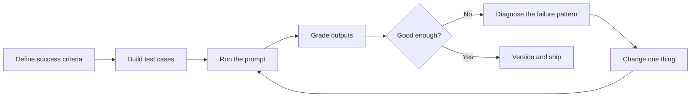

# Iterating on Prompts

> **Level:** Intermediate · **Time:** ~45 min · **Exam relevance:** CCAO-F D1, D2, D7 · CCAR-P D4

## In plain English

Almost nobody writes the best prompt on the first try. Prompting is closer to editing than to coding by
specification: you write a draft, see what it produces, work out *why* the output fell short, change one thing, and
check again.

The difference between guessing and engineering is **evidence**. Instead of trying a prompt on one example and
declaring victory, you keep a small set of test inputs, define what a good answer looks like, and compare versions
fairly.

## Why it matters

- A prompt that looks great on the example you tried can fail on the cases you did not.
- Changes have side effects. Fixing tone can break format; adding a rule for one edge case can cause over-refusal
  elsewhere.
- Model upgrades change behaviour. Without a test set, you cannot tell whether an upgrade helped or hurt.
- Both exams test this skill: iterating on prompts and diagnosing poor outputs (CCAO-F-1.3, CCAO-F-7.1, CCAO-F-7.2)
  and diagnosing prompt failure (CCAR-P-4.4), with A/B testing and evaluation design covered in
  [Module 14](../14-evaluation-and-testing/README.md).

## How it works

### The iteration loop



Anthropic's prompt engineering overview starts from the same place: before prompt engineering, have clear success
criteria, a way to test against them, and a first draft.

### Step 1: define success criteria

Make criteria **specific and measurable**. "Good summaries" is not testable. Better:

- Contains every decision and owner mentioned in the source.
- No facts that are absent from the source.
- 150 words or fewer.
- Readable by a non-specialist.

Some criteria are checkable by code (length, schema, required phrases); others need a human or a model-based grader
with a rubric (see [grading methods](../14-evaluation-and-testing/04-grading-methods.md)).

### Step 2: build a small test set

Start with 10 to 30 inputs that cover:

- **Typical cases** in their normal messiness.
- **Edge cases**: very short or very long inputs, missing data, unusual formats, other languages if relevant.
- **Adversarial cases**: inputs containing instructions, attempts to extract the system prompt, off-topic requests.
- **Known failures**: every bug report becomes a test case.

Use synthetic or anonymised data. Grow the set over time.

### Step 3: diagnose before you change

Look at failures as a group and name the pattern. Typical patterns and the usual lever:

| Failure pattern | Likely root cause | First thing to try |
|---|---|---|
| Wrong format or length | Output not specified, or no examples | State format and length; add examples; structured outputs |
| Misses part of the task | Several tasks in one sentence | Number the steps; decompose into a chain |
| Generic, shallow answer | Missing context, audience or purpose | Add context and the reason for the task |
| Invented facts | No grounding; required fields with no "missing" option | Provide sources; ask for quotes; allow "not stated" |
| Inconsistent across runs | Ambiguous instructions or criteria | Clarify criteria; add boundary-case examples |
| Ignores a rule | Rule buried, contradicted, or unexplained | Consolidate; explain the reason; remove contradictions |
| Over-applies a rule | Absolute, emphatic wording | Soften to an explained instruction with alternatives |
| Wrong on hard reasoning cases | Not enough reasoning | Raise effort; ask for analysis before answer |
| Slow or expensive | Too much reasoning or context for the task | Lower effort; trim context; cache stable parts |

Also consider whether the problem is the prompt at all. Some failures are better fixed by a different model, better
retrieval, a tool, or a change to the process. Anthropic's guidance notes that not every failing criterion is best
solved with prompt engineering; latency and cost, for example, are often easier to fix by choosing a different model.

### Step 4: change one thing at a time

If you change the role, the examples and the effort level at once and results improve, you will not know which change
helped, or whether one of them hurt. Make a single, deliberate change per iteration and re-run the whole test set,
not just the failing case.

### Step 5: compare fairly

- Run old and new versions on the **same** test set.
- Grade **blind** where humans are involved (graders do not know which version produced which output).
- Look at **regressions**, not only improvements: a version that fixes three cases and breaks two needs a closer look.
- For variable outputs, run each case more than once.
- Track cost and latency alongside quality.

### Step 6: version and record

Store each prompt version with an ID, the model and effort it was tested with, the test-set results and a short note
of what changed and why. This makes rollback, audits and model upgrades manageable (see
[model upgrades and change management](../15-production-operations/08-model-upgrades-and-change-management.md)).

### Using Claude to help iterate

Claude can help: ask it to critique a prompt against the colleague test, propose test cases, or explain why an output
missed a criterion. The Console also offers prompt-improvement and evaluation tools. Treat suggestions as hypotheses
to test, not as improvements by default.

### Iterating in the Claude apps

Without code, the loop still works:

1. Keep a short document of test inputs and what good looks like.
2. When editing Project instructions, re-run the same inputs in fresh chats.
3. Note what changed and whether results improved.
4. If a conversation goes off track, it is often faster to edit your earlier message or start a fresh chat with a
   better prompt than to correct the model repeatedly.

### Knowing when to stop

Stop when the prompt meets your success criteria on the test set with acceptable cost and latency. Chasing the last
few percent through ever-longer prompts often makes them brittle. If you are stuck, change the approach: decompose the
task, add retrieval, change the model or add a human review step.

## Example

A minimal comparison harness. Each test case has an input and simple code-checkable criteria; two prompt versions run
on the same cases and the script reports pass rates and token use. In practice you would add model-graded or human
rubrics (see [Lab 16](../19-hands-on-labs/lab-16-evaluation-framework/README.md)).

```python
import json
from dataclasses import dataclass

import anthropic

client = anthropic.Anthropic()  # API key from ANTHROPIC_API_KEY


@dataclass
class Case:
    case_id: str
    source: str
    must_mention: list[str]
    max_words: int = 150


PROMPTS = {
    "v1": "Summarise this meeting.\n<notes>\n{notes}\n</notes>",
    "v2": (
        "Summarise these meeting notes for a team member who missed the meeting.\n"
        "Include every decision and its owner. Use only information in the notes; if no "
        "decision was made, say so. Maximum 150 words.\n<notes>\n{notes}\n</notes>"
    ),
}


def run(prompt_template: str, case: Case) -> tuple[bool, int]:
    response = client.messages.create(
        model="claude-opus-5-5",
        max_tokens=1000,
        output_config={"effort": "low"},
        messages=[{"role": "user", "content": prompt_template.format(notes=case.source)}],
    )
    if response.stop_reason != "end_turn":
        return False, response.usage.output_tokens
    text = next(b.text for b in response.content if b.type == "text")
    passed = (
        len(text.split()) <= case.max_words
        and all(term.lower() in text.lower() for term in case.must_mention)
    )
    return passed, response.usage.input_tokens + response.usage.output_tokens


with open("tests/summary_cases.json", encoding="utf-8") as f:
    cases = [Case(**c) for c in json.load(f)]

for version, template in PROMPTS.items():
    results = [run(template, c) for c in cases]
    pass_rate = sum(ok for ok, _ in results) / len(results)
    tokens = sum(t for _, t in results)
    print(f"{version}: pass rate {pass_rate:.0%}, total tokens {tokens}")
```

> **Cost:** requires API credits (live mode). The run cost scales with the number of cases and versions.

## Enterprise use case

*Northwind Lending* (fictional) runs a Claude-based assistant that drafts responses to broker questions about product
criteria. After a policy update, brokers reported that answers about self-employed applicants were out of date.

The team added the reported questions to their 60-case test set, then diagnosed: the knowledge file was updated, but
the system prompt still contained an older example answer that contradicted it. They removed the example (one change),
re-ran all 60 cases, saw the self-employed cases pass and no regressions elsewhere, and shipped version 14 of the
prompt with a changelog entry. The incident led to a new rule: any knowledge update triggers a test-set run, because
examples and instructions can conflict with new knowledge.

## Common mistakes

- **Testing on one example.** One good output proves very little.
- **Changing several things at once.** You lose track of cause and effect.
- **Only looking at the failing case.** Fixes often cause regressions elsewhere.
- **Moving the goalposts.** Redefining "good" to match what the prompt produces.
- **Endless prompt growth.** Each fix adds a rule until the prompt contradicts itself. Periodically consolidate.
- **Ignoring cost and latency.** A small quality gain may not justify doubling tokens.
- **Prompt-only thinking.** Some problems need data, tools, model choice or process change instead.

## Security considerations

- Include **adversarial test cases** (injection attempts, requests to reveal instructions, out-of-scope asks) in every
  regression run, so a helpful prompt change does not weaken defences. See
  [safety and red-team evals](../14-evaluation-and-testing/07-safety-and-red-team-evals.md).
- Keep **test data synthetic or anonymised**; test sets are copied, shared and logged.
- Require **review and approval** for prompt changes in production, as for code changes.
- Record which prompt version produced which output, so incidents can be investigated.

## Troubleshooting

| Symptom | Likely cause | Fix |
|---|---|---|
| Improvements do not hold in production | Test set not representative | Add real-shaped (synthetic) cases from production patterns |
| Results vary between runs of the same version | Natural variability; ambiguous criteria | Run cases several times; tighten criteria and rubrics |
| Every change seems to break something | Prompt has grown contradictory | Consolidate into principles; remove outdated examples |
| Model upgrade changed behaviour | Calibration differs between models | Re-run the test set; re-tune effort and wording |
| Cannot tell which version is live | No versioning | Prompt registry with IDs and changelogs |

## Check your understanding

1. What three things should you have before you start prompt engineering, according to Anthropic's overview?
2. Why should you change only one thing per iteration?
3. A prompt fix makes three failing cases pass and one previously passing case fail. What should you do?
4. Give two examples of failures better fixed outside the prompt.

<details>
<summary>Answers</summary>

1. Clear success criteria, a way to test against them empirically, and a first draft prompt.
2. So you can attribute the change in results to a specific cause, and spot changes that hurt.
3. Investigate the regression before shipping: understand why it broke, try an alternative change that keeps all
   cases passing, and decide explicitly whether the trade-off is acceptable.
4. Examples: high latency or cost (choose a different model or lower effort), missing knowledge (add retrieval or
   documents), actions that must never happen (enforce in code), or tasks needing verification (add a human review
   step).

</details>

## Further reading

- [Prompt engineering overview](https://platform.claude.com/docs/en/build-with-claude/prompt-engineering/overview) (Anthropic docs)
- [Define success criteria and build evaluations](https://platform.claude.com/docs/en/test-and-evaluate/develop-tests) (Anthropic docs)
- [Why evaluate](../14-evaluation-and-testing/01-why-evaluate.md) and [diagnosing failures](../14-evaluation-and-testing/06-diagnosing-failures.md) in this repository
- [Lab 02 — Prompt improvement](../19-hands-on-labs/lab-02-prompt-improvement/README.md)

<!-- page-nav:start -->
---

[← Previous: System Prompts, Roles, Templates and Guardrails](07-system-prompts-and-roles.md) · [Module overview](README.md) · [Next module: Module 04 — Context Engineering →](../04-context-engineering/README.md)
<!-- page-nav:end -->
