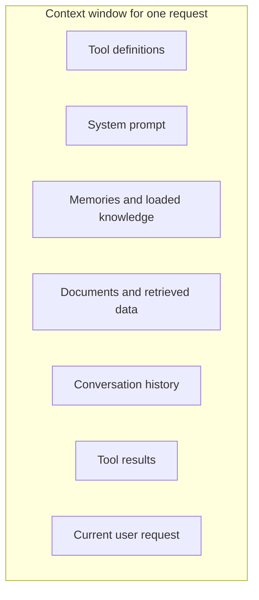

# What Is Context Engineering?

> **Level:** Intermediate · **Time:** ~40 min · **Exam relevance:** CCAO-F D3 · CCAR-P D2, D3

## In plain English

Everything Claude knows about your task at a given moment sits in its **context window**: the system prompt, the
conversation so far, any documents, tool definitions, tool results and memories you have loaded. Claude does not
remember anything outside that window between requests unless you put it back in.

**Context engineering** is the discipline of deciding what goes into that window, in what order and form, and how it
changes as a task unfolds. Think of a surgeon's instrument tray: the right tools, laid out in order, and nothing that
gets in the way. A tray piled with every instrument in the hospital is not "more helpful"; it slows everything down.

Anthropic's engineering team describes it as curating the smallest set of high-signal tokens that makes the desired
outcome likely, and as a natural progression from prompt engineering once you build systems that run over many turns
(*Effective context engineering for AI agents*, anthropic.com/engineering, published 2025-09-29, checked 2026-10-24).

## Why it matters

- **Context is finite and not free.** Current Claude models offer context windows of up to 1M tokens (as of
  2026-10-24; check the [models overview](https://platform.claude.com/docs/en/about-claude/models/overview)), but every
  token costs money and latency, and every request re-sends the context.
- **More is not always better.** Anthropic describes "context rot": as the number of tokens grows, the model's ability
  to recall and use any particular piece of information gradually degrades. Each token draws on a limited attention
  budget, so irrelevant material dilutes the relevant.
- **Agents fill their own context.** A long-running agent accumulates tool results and history. Without management,
  it gets slower, costlier and less accurate as it works.
- **It is examined.** The Professional exam covers optimising context windows and token usage (CCAR-P-2.4), reuse
  through caching and Skills (CCAR-P-2.5) and progressive discovery versus monolithic context (CCAR-P-3.8). The
  Foundations exam covers managing context limits and memory in the apps (CCAO-F-3.4).

## How it works

### Prompt engineering versus context engineering

| | Prompt engineering | Context engineering |
|---|---|---|
| Unit of work | One prompt | Everything in the window, across many turns |
| Main question | How should I phrase this? | What should be present right now, and what should not? |
| Typical artefacts | Instructions, examples, templates | Retrieval, memory, caching, compaction, tool design, sub-agents |
| When it dominates | Single-turn tasks | Long conversations, agents, document-heavy systems |

Prompt engineering is a subset: the instructions are part of the context, and everything in
[Module 03](../03-prompt-engineering/README.md) still applies.

### The components of context



In the API, the rendered order is tools, then system, then messages. That order matters for
[prompt caching](03-prompt-caching.md).

| Component | Engineering questions |
|---|---|
| System prompt | Is it at the "right altitude": clear guidance without brittle if-then rules? Is it stable? |
| Tools | Are there only the tools this task needs? Are descriptions clear and non-overlapping? Are results concise? |
| Examples | A few diverse, canonical examples, not every edge case |
| Documents | Only relevant sections? Placed before the question? Tagged with sources? |
| History | Is old material still needed verbatim, or can it be summarised or cleared? |
| Tool results | Can large results be trimmed, paged or replaced by a reference? |
| Memory | What must survive beyond this window, and where is it stored? |

### Core strategies

Anthropic's article groups the techniques roughly as follows; this module covers each.

1. **Write good static context.** Lean system prompts, well-designed tools and a small set of canonical examples.
2. **Retrieve just in time.** Instead of loading everything up front, keep lightweight references (file paths,
   queries, links) and let Claude load content with tools when it needs it. Hybrid designs pre-load a little and fetch
   the rest. See [progressive disclosure and Skills](06-progressive-disclosure-and-skills.md) and
   [Module 11 — RAG](../11-rag-and-knowledge-systems/README.md).
3. **Reuse stable context cheaply** with [prompt caching](03-prompt-caching.md).
4. **Persist what matters outside the window** with structured notes or the
   [memory tool](04-memory-and-persistence.md).
5. **Shrink what accumulates** with [compaction and context editing](05-compaction-and-context-editing.md).
6. **Isolate context in sub-agents.** A sub-agent explores in its own clean window and returns a condensed result, so
   the lead agent's context stays focused. See
   [multi-agent architecture](../10-agentic-ai/04-multi-agent-architecture.md).

### Monolithic versus progressive context

A **monolithic** design loads everything the model might need into every request: the whole handbook, every tool,
all history. A **progressive** design starts small and lets the model discover and load more as needed.

| | Monolithic | Progressive (just-in-time) |
|---|---|---|
| Simplicity | Simple to build | Needs tools, indexes, Skills or retrieval |
| Latency per step | One call, but large inputs | Smaller inputs, but extra discovery steps |
| Cost | High input tokens (mitigated by caching) | Lower input tokens, more calls |
| Accuracy risk | Context rot and distraction | Missed information if discovery is poor |
| Fits when | Small, stable, mostly relevant corpus | Large or changing corpus; many tools; long tasks |

Neither is always right. A 20-page policy that is relevant to every question can simply be loaded and cached. A
50,000-page document estate or 200 tools cannot. Page 6 develops this trade-off for CCAR-P-3.8.

### The apps view

In the Claude apps you engineer context with everyday actions:

- Start a **new chat** when a conversation is long and has drifted; bring a short summary of decisions with you.
- Use **Projects** to hold stable instructions and knowledge files, rather than pasting them each time.
- Use **memory** features deliberately and review what is remembered (see
  [memory and persistence](04-memory-and-persistence.md)).
- Attach only the documents that matter to the current question.

## Example

A context budget review for one agent step. The script counts how many tokens each component contributes, using the
token-counting endpoint (counts are model-specific, so use the same model you will call).

```python
import json
from pathlib import Path

import anthropic

client = anthropic.Anthropic()  # API key from ANTHROPIC_API_KEY
MODEL = "claude-opus-5-5"

system_prompt = Path("prompts/agent_system.md").read_text(encoding="utf-8")
tools = json.loads(Path("config/tools.json").read_text(encoding="utf-8"))
history = json.loads(Path("logs/conversation_snapshot.json").read_text(encoding="utf-8"))


def count(**kwargs) -> int:
    return client.messages.count_tokens(model=MODEL, **kwargs).input_tokens


probe = [{"role": "user", "content": "x"}]
baseline = count(messages=probe)
report = {
    "system prompt": count(system=system_prompt, messages=probe) - baseline,
    "tool definitions": count(tools=tools, messages=probe) - baseline,
    "conversation history": count(messages=history),  # history must start with a user turn
}
total = sum(report.values())
for part, tokens in sorted(report.items(), key=lambda kv: -kv[1]):
    print(f"{part:22} {tokens:>8} tokens  ({tokens / total:.0%})")
```

> **Cost:** token counting is free to call but rate-limited (as of 2026-10-24); see the
> [token counting docs](https://platform.claude.com/docs/en/build-with-claude/token-counting).

Typical findings from a review like this: tool results dominate the history; a handful of tools are never used; the
system prompt repeats material already in a knowledge document. Each finding maps to a technique in this module.

## Enterprise use case

*Acme Logistics* (fictional) built a dispatch-planning agent. In week one it worked well on short tasks but degraded
over a working day: answers slowed, costs rose and the agent began referring to stale depot statuses.

A context review showed three problems: every request carried 40 tool definitions although a typical task used five;
raw JSON tool results of several thousand tokens each stayed in history for the whole session; and the agent re-read
the full depot handbook on every turn. The team (1) grouped tools and loaded rarely used ones on demand, (2) trimmed
tool outputs to the fields the agent needs and turned on tool-result clearing, (3) cached the handbook as a stable
prefix and (4) had the agent keep a short structured notes file of open decisions. Accuracy at the end of the day
matched the start, and per-task cost fell substantially.

## Common mistakes

- **Treating the context window as storage.** A bigger window is room to work, not a reason to load everything.
- **Equating more context with better answers.** Irrelevant material distracts and costs money.
- **Ignoring tool results.** In agents they often become the largest part of the context.
- **Rebuilding context non-deterministically.** Shuffled tools or timestamps in the prefix break caching.
- **Summarising away the essentials.** Over-aggressive compression loses details that later steps need; decide what
  must be preserved.

## Security considerations

- **Everything in context can influence the output**, including untrusted documents and tool results. More context
  means more attack surface for [indirect prompt injection](../12-ai-security/03-indirect-prompt-injection.md).
- **Minimise sensitive data in context.** Load only the records a step needs; context is logged, cached and sometimes
  summarised into memory.
- **Isolation is a security tool too.** Sub-agents with narrow context and narrow tools limit what an injected
  instruction can reach.
- **Persistent context persists mistakes.** A poisoned memory or note keeps influencing future sessions; review and
  expire it.

## Troubleshooting

| Symptom | Likely cause | Fix |
|---|---|---|
| Quality degrades as a session grows | Context rot from accumulated history | Compaction, context editing, or a fresh session with notes |
| Model uses outdated information | Stale tool results or documents left in context | Clear old tool results; re-fetch current data |
| High input-token cost | Large static context re-sent every call | Prompt caching; trim; progressive loading |
| Agent picks the wrong tool | Too many overlapping tools | Fewer, distinct tools; tool search for large sets |
| Answers ignore a key document | Buried in a large context | Put documents first and question last; ask for quotes first |

## Check your understanding

1. In your own words, how does context engineering differ from prompt engineering?
2. What is "context rot", and what does it imply for system design?
3. Name four techniques for keeping an agent's context small and relevant over a long task.
4. When is a monolithic context design reasonable?

<details>
<summary>Answers</summary>

1. Prompt engineering focuses on writing the instructions for a task. Context engineering manages the whole contents of
   the context window (instructions, tools, documents, history, tool results, memory) over many turns, deciding what
   should be present at each step.
2. The gradual decline in a model's ability to recall and use specific information as the context grows. It implies
   curating context to the smallest high-signal set rather than filling the window.
3. Any four of: just-in-time retrieval, prompt caching for stable parts, memory or structured notes, compaction,
   context editing (clearing old tool results), sub-agents with isolated context, trimming tool outputs, loading tools
   on demand.
4. When the corpus is small, stable and relevant to most requests, so loading it every time (ideally cached) is simpler
   and does not distract the model.

</details>

## Further reading

- [Effective context engineering for AI agents](https://www.anthropic.com/engineering/effective-context-engineering-for-ai-agents) (Anthropic engineering, 2025-09-29)
- [Context windows](https://platform.claude.com/docs/en/build-with-claude/context-windows) (Anthropic docs)
- [Token counting](https://platform.claude.com/docs/en/build-with-claude/token-counting) (Anthropic docs)
- [RAG versus long context](../11-rag-and-knowledge-systems/07-rag-vs-long-context.md) in this repository
- Next page: [Managing long context](02-managing-long-context.md)
