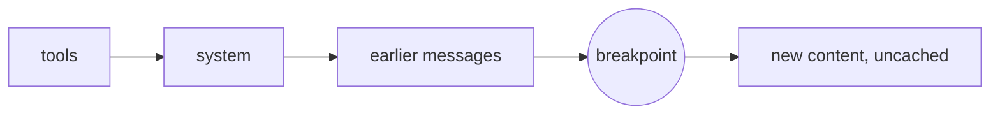

# Prompt Caching

> **Level:** Intermediate → Advanced · **Time:** ~60 min · **Exam relevance:** CCAR-P D2, D3, D4

## In plain English

Many applications send the same large block of text with every request: a long system prompt, a product manual, a
set of tool definitions, a codebase summary. Without caching, Claude processes that block from scratch every time, and
you pay full price for it every time.

**Prompt caching** lets the API remember the processed form of the beginning of your prompt for a short while. When
the next request starts with exactly the same content, the API reuses it: the request is cheaper and the first token
arrives sooner.

The one rule to remember: **caching is a prefix match.** The cached part must be byte-for-byte identical from the very
start of the prompt up to the cache point. Change one character early on, and everything after it misses the cache.

## Why it matters

- **Cost.** As of 2026-10-24, a cache read is billed at a small fraction of the normal input price: about 0.1x on most
  models, and 0.05x on Claude Opus 5.5. Writing to the cache costs a premium (1.25x for the 5-minute lifetime, 2x for
  the 1-hour lifetime). For prompts with a large shared prefix, savings are large. Always confirm current rates on the
  [pricing page](https://platform.claude.com/docs/en/about-claude/pricing).
- **Latency.** Cached prefixes do not need to be processed again, which shortens time to first token.
- **Throughput.** On the Claude API, cache reads do not count toward input-token rate limits on most models (as of
  2026-10-24; see the rate-limits documentation for exceptions).
- **It is examined.** Reusing prompts through caching is part of CCAR-P-2.5, and token and cost optimisation is
  CCAR-P-4.5. Expect questions on prefix ordering, what breaks a cache and how to verify hits.

## How it works

### What gets cached, in what order

The API renders a request in a fixed order: **tools → system → messages**. A cache entry covers everything from the
start of that sequence up to a **breakpoint**, a block marked with `cache_control`.



A breakpoint on the last system block therefore caches the tools and the system prompt together. A breakpoint on the
last block of the latest user turn caches the whole conversation so far.

### Marking cache points

Two options:

**Explicit breakpoints.** Add `cache_control` to specific content blocks. Use these when you need control, for example
to cache a shared prefix but not the per-request question after it.

```python
system=[
    {"type": "text", "text": STABLE_INSTRUCTIONS},
    {"type": "text", "text": REFERENCE_MANUAL, "cache_control": {"type": "ephemeral"}},
]
```

**Automatic caching.** Put `cache_control` at the top level of the request. The API places the breakpoint on the last
cacheable block and moves it forward as a conversation grows. This is the simplest choice for multi-turn chat.

```python
client.messages.create(
    model="claude-opus-5-5",
    max_tokens=2000,
    cache_control={"type": "ephemeral"},   # automatic breakpoint on the last cacheable block
    system=SYSTEM_PROMPT,
    messages=conversation,
)
```

Rules (as of 2026-10-24):

- At most **4 breakpoints** per request (an automatic breakpoint uses one of them).
- Breakpoints can go on system text blocks, tool definitions and message content blocks (text, images, documents,
  tool use and tool results).
- There is a **minimum cacheable length**, which varies by model: 512 tokens on the newest models such as Claude Opus
  5.5, Claude Sonnet 5.5 and Claude Haiku 5.5, and 1,024 to 4,096 tokens on some older models. Shorter prefixes simply
  do not cache, with no error.
- Each breakpoint looks back at most **20 content positions** for an earlier cache entry. In very long single turns,
  add an intermediate breakpoint.

### Lifetimes (TTL)

| TTL | How to request | Write cost | Choose when |
|---|---|---|---|
| 5 minutes (default) | `{"type": "ephemeral"}` | 1.25x base input | Requests sharing the prefix start less than 5 minutes apart |
| 1 hour | `{"type": "ephemeral", "ttl": "1h"}` | 2x base input | Gaps of 5 to 60 minutes between requests |

Every cache read refreshes the timer at no extra cost, so steady traffic keeps a 5-minute entry alive indefinitely.
The lifetime counts from the *start* of the request that wrote or read the entry. When mixing TTLs, longer-TTL
breakpoints must come before shorter ones.

### Verifying that caching works

The response `usage` object is the ground truth:

| Field | Meaning |
|---|---|
| `cache_creation_input_tokens` | Tokens written to the cache on this request (write premium) |
| `cache_read_input_tokens` | Tokens served from the cache (discounted) |
| `input_tokens` | Tokens after the last breakpoint, billed at the normal rate |

Total prompt size is the **sum** of all three. A healthy multi-turn loop shows `cache_read_input_tokens` growing each
turn, small `cache_creation_input_tokens` (roughly the newest turn) and small `input_tokens`.

If `cache_read_input_tokens` stays at zero across repeated requests that should share a prefix, something is changing
the prefix. Do not check once and forget: caching often breaks silently months later when someone changes how the
prompt is assembled. Add an automated check, such as an integration test asserting that a second identical request
reads from the cache, or monitoring on the usage fields.

### Silent invalidators

| Pattern in the code that builds the prompt | Why it breaks caching | Fix |
|---|---|---|
| Current date or time in the system prompt | Prefix changes every request | Move it to the latest user message |
| Request IDs or UUIDs early in the prompt | Every request is unique | Remove, or move after the last breakpoint |
| `json.dumps(obj)` without `sort_keys=True`, or iterating a set | Byte order can change between runs | Serialise deterministically |
| Per-user details interpolated into the system prompt | No sharing across users | Keep the shared prefix generic; put user details later |
| Optional system sections switched by flags | Each combination is a different prefix | Keep sections fixed; express modes as message content |
| Tool list built per user or per request | Tools render first, so everything misses | Fixed, sorted tool list |
| Switching model mid-conversation | Caches are per model | Keep one model per conversation; use sub-agents for other models |
| Changing thinking or effort settings between requests | Invalidates the messages cache (and on some models more) | Pin these per route |

On models that support it (Claude Opus 5.5, Claude Sonnet 5.5 and several others, as of 2026-10-24), an operator
instruction that arrives mid-conversation can be appended as a `{"role": "system", ...}` message instead of editing the
top-level system prompt, which preserves the cached history.

To find an invalidator, log two consecutive request bodies, remove the `cache_control` markers, and diff them: the
first difference inside the shared region is the culprit. On the first-party API, a beta cache-diagnostics feature can
report where two requests diverged.

### Other behaviours worth knowing

- **Scope.** Caches are isolated per workspace on the Claude API (per organisation on some cloud platforms) and are
  never shared between organisations. Splitting the same traffic across workspaces splits the cache.
- **Parallel requests.** A cache entry becomes readable once the first response starts streaming. If you fire 20
  identical-prefix requests at the same moment, all 20 pay for a write. Send one, wait for its first token, then send
  the rest.
- **Pre-warming.** To remove the cold-start delay before user traffic arrives, you can send a request with
  `max_tokens=0`: the API writes the cache and returns immediately with no output tokens billed. Put the breakpoint on
  the last *shared* block, and match the real traffic's thinking and effort settings.

### The cost arithmetic

For a prefix of `P` tokens reused across `N` requests within the TTL, at base input price `p` per token:

- Without caching: `N × P × p`
- With 5-minute caching: about `P × p × 1.25` (one write) `+ (N − 1) × P × p × r`, where `r` is the read multiplier
  (0.1 on most models; 0.05 on Claude Opus 5.5).

Worked example (illustrative, prices as of 2026-10-24): a 60,000-token prefix on Claude Opus 5.5 (base input
USD 4 per million tokens) used by 1,000 requests a day with continuous traffic.

| | Calculation | Daily prefix cost |
|---|---|---|
| No caching | 1,000 × 60,000 × 4 / 1,000,000 | about USD 240 |
| Cached | one write (60,000 × 4 × 1.25 / 1M ≈ 0.30) + 999 reads (999 × 60,000 × 0.20 / 1M ≈ 12.0) | about USD 12 |

With a 5-minute TTL, two requests already break even. With the 1-hour TTL, you need at least three. If traffic is
continuous, the 1-hour TTL only adds cost.

## Example

*Fabrikam Software* (fictional) runs a code-review assistant. Every request carries the same tool definitions and a
long engineering-standards document; only the diff changes. The breakpoint sits after the standards, so the diff is
never part of the cached prefix.

```python
import json
from pathlib import Path

import anthropic

client = anthropic.Anthropic()  # API key from ANTHROPIC_API_KEY

STANDARDS = Path("config/engineering_standards.md").read_text(encoding="utf-8")
# Deterministic tool list: loaded from a file and sorted by name, never built per request.
TOOLS = sorted(json.loads(Path("config/review_tools.json").read_text(encoding="utf-8")),
               key=lambda t: t["name"])

SYSTEM = [
    {"type": "text", "text": "You review pull requests against Fabrikam's engineering standards. "
                             "Report findings with file, line and the standard they relate to."},
    {"type": "text", "text": f"<standards>\n{STANDARDS}\n</standards>",
     "cache_control": {"type": "ephemeral"}},   # breakpoint: tools + system are cached together
]


def review(diff: str) -> anthropic.types.Message:
    return client.messages.create(
        model="claude-opus-5-5",
        max_tokens=8000,
        output_config={"effort": "high"},       # pinned per route: changing it would invalidate caches
        tools=TOOLS,
        system=SYSTEM,
        messages=[{"role": "user", "content": f"<diff>\n{diff}\n</diff>\nReview this change."}],
    )


for path in sorted(Path("data/diffs").glob("*.diff"))[:3]:
    msg = review(path.read_text(encoding="utf-8"))
    u = msg.usage
    total = u.input_tokens + u.cache_creation_input_tokens + u.cache_read_input_tokens
    print(f"{path.name}: total={total} write={u.cache_creation_input_tokens} "
          f"read={u.cache_read_input_tokens} uncached={u.input_tokens} stop={msg.stop_reason}")
```

Expected pattern: the first request shows a large `write`; the following requests (within five minutes) show a large
`read` and a small `uncached` value equal to the diff and question.

The same breakpoint in a raw HTTP request:

```bash
curl https://api.anthropic.com/v1/messages \
  -H "x-api-key: $ANTHROPIC_API_KEY" \
  -H "anthropic-version: 2023-06-01" \
  -H "content-type: application/json" \
  -d @- <<'JSON'
{
  "model": "claude-opus-5-5",
  "max_tokens": 2000,
  "system": [
    {"type": "text", "text": "You answer questions about the attached standards."},
    {"type": "text", "text": "<standards>... long, stable text ...</standards>",
     "cache_control": {"type": "ephemeral", "ttl": "1h"}}
  ],
  "messages": [{"role": "user", "content": "What is our rule on logging personal data?"}]
}
JSON
```

> **Cost:** requires API credits (live mode). Cache writes cost more than normal input; caching pays off only when the
> prefix is reused.

## Enterprise use case

*Woodgrove Bank* (fictional) noticed its internal policy assistant's input-token bill had doubled in a quarter with no
traffic growth. The usage logs showed `cache_read_input_tokens` near zero since a release six weeks earlier.

A payload diff found the cause: a developer had added "Today's date is …" to the top of the system prompt so the
assistant could answer date-relative questions. That one line made every request's prefix unique. The fix moved the
date into the user turn, restored cache hits the same day, and added two guards: a CI test that sends two identical
requests and asserts a cache read on the second, and a dashboard alert when the cache-read share of input tokens drops
below its normal band. The incident review classed it as a cost incident, with the same follow-up process as an
availability incident (see [observability](../15-production-operations/02-observability.md)).

## Common mistakes

- **Breakpoint after the variable part.** If the breakpoint sits after the per-request question, every request writes
  a new entry and nothing is read. Put the breakpoint at the end of the *shared* portion.
- **Dynamic content at the top.** Timestamps, user names and request IDs in the system prompt.
- **Non-deterministic serialisation.** Unsorted JSON, sets, or tool lists assembled in varying order.
- **Assuming a prompt is long enough.** Below the model's minimum, nothing caches and no error tells you.
- **Choosing the 1-hour TTL for continuous traffic.** It doubles the write price for no benefit.
- **Fanning out in parallel before the cache exists.** Every parallel request pays the write.
- **Checking once.** Caching regressions are silent; monitor the usage fields.

## Security considerations

- **Isolation boundaries.** Caches are not shared across organisations, and on the Claude API are isolated per
  workspace. Use separate workspaces where separation between environments or business units is required.
- **Do not cache per-user secrets as shared prefixes.** Shared prefixes should contain only content that every caller
  may see. Per-user data belongs after the breakpoint.
- **Data retention.** Cached content is held for the TTL; check how caching interacts with your data-retention
  agreements (for example zero-data-retention arrangements) in the official
  [prompt caching docs](https://platform.claude.com/docs/en/build-with-claude/prompt-caching).
- **Cost as an attack surface.** An attacker who can inject varying content early in your prompt (for example via a
  user-controlled field in the system prompt) can destroy your cache hit rate and raise costs. Keep untrusted content
  after the cached prefix.

## Troubleshooting

| Symptom | Likely cause | Fix |
|---|---|---|
| `cache_read_input_tokens` always 0 | Prefix changes between requests | Diff two request bodies; remove the dynamic content or move it after the breakpoint |
| `cache_creation_input_tokens` is 0 and reads are 0 | Prefix shorter than the model minimum | Check the minimum for your model; cache a larger stable block |
| Writes on every request, reads never cover the shared part | Breakpoint after unique content (often automatic caching on unique tails) | Use an explicit breakpoint at the end of the shared portion |
| Cache misses after idle periods | TTL expired | Use the 1-hour TTL for 5–60 minute gaps, or pre-warm |
| Misses when traffic bursts | Parallel requests before the first one streams | Send one request first, then the rest |
| 400 error about breakpoints or TTL order | More than 4 breakpoints, or a shorter TTL before a longer one | Reduce breakpoints; put 1-hour entries before 5-minute ones |
| Hit rate halves after a deployment change | Traffic split across workspaces | Route traffic for the same prefix through one workspace |

## Check your understanding

1. Why does putting the current timestamp at the top of a system prompt defeat caching?
2. In what order does the API render tools, system and messages, and why does that matter?
3. Which usage field tells you a cache hit occurred, and how do you compute the total prompt size?
4. Traffic arrives continuously, several requests a minute. Which TTL should you choose, and why?
5. A team fires 50 parallel requests with the same 30,000-token prefix at start-up and sees 50 cache writes. Why, and
   what would you change?

<details>
<summary>Answers</summary>

1. Caching matches exact prefixes. A timestamp at the start makes every request's prefix different, so nothing after
   it can be read from the cache.
2. Tools, then system, then messages. A change in an earlier section (for example the tool list) invalidates
   everything after it, so the most stable content should come first.
3. `cache_read_input_tokens` greater than zero. Total prompt size is `input_tokens + cache_creation_input_tokens +
   cache_read_input_tokens`.
4. The default 5-minute TTL. Each read refreshes the timer, so continuous traffic keeps the entry alive; the 1-hour
   TTL would only double the write cost.
5. A cache entry only becomes readable once the first response starts streaming, so simultaneous requests all write.
   Send one request first (or pre-warm with `max_tokens=0`), wait for it to start streaming, then send the rest.

</details>

## Further reading

- [Prompt caching](https://platform.claude.com/docs/en/build-with-claude/prompt-caching) (Anthropic docs)
- [Pricing](https://platform.claude.com/docs/en/about-claude/pricing) (Anthropic docs)
- [Rate limits](https://platform.claude.com/docs/en/api/rate-limits) (Anthropic docs)
- [Cost optimisation](../15-production-operations/03-cost-optimisation.md) and [token counting and cost](../06-claude-api/08-token-counting-and-cost.md) in this repository
- [Lab 17 — Cost optimisation](../19-hands-on-labs/lab-17-cost-optimisation/README.md)
- Next page: [Memory and persistence](04-memory-and-persistence.md)
