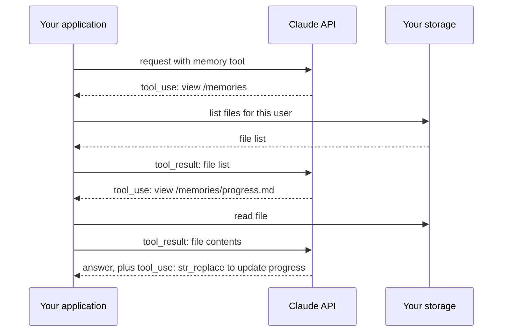

# Memory and Persistence

> **Level:** Intermediate · **Time:** ~50 min · **Exam relevance:** CCAO-F D3, D5 · CCAR-P D2, D3

## In plain English

A Claude model has no memory of its own between requests. Each API call, and each new chat, starts from whatever is
placed in the context window. Anything that should carry over, such as your preferences, a project's decisions or an
agent's progress, has to be **stored somewhere outside the model and brought back** at the right time.

There are several places that "somewhere" can be:

- **In the Claude apps:** memory features that remember facts from your chats, and **Projects**, which hold standing
  instructions and knowledge files, each with its own separate memory space.
- **In Claude Code:** `CLAUDE.md` files and related memory files that load at the start of a session (see
  [Claude Code memory](../09-claude-code/03-claude-md-and-memory.md)).
- **In the API:** the **memory tool**, which lets Claude read and write files in a memory directory that *your*
  application stores, plus anything your own code persists (databases, notes files).

## Why it matters

- **Continuity.** Users should not have to re-explain themselves; agents should not have to rediscover their own
  progress after a restart.
- **Smaller context.** Memory supports just-in-time retrieval: an agent writes down what it learned and reads back only
  what it needs, instead of carrying everything in its context window.
- **Governance.** Memory is stored data. It can contain personal or confidential information, can go stale, and can be
  poisoned. It needs the same controls as any other data store.
- **Exam relevance.** Managing context limits and memory, including when to persist, is CCAO-F-3.4; configuring and
  maintaining Projects is CCAO-F-5.1 and 5.4; context and token optimisation is CCAR-P-2.4.

## How it works

### Memory in the Claude apps (as of 2026-10-24)

Feature details and plan availability change often; confirm them in the Claude Help Center article
[on memory and chat search](https://support.claude.com/en/articles/11817273). As documented on 2026-10-24:

| Feature | What it does | Notes |
|---|---|---|
| **Memory** | Claude saves facts about you and your work as you chat; you can also say "remember this" | On by default for Free, Pro and Max users; on Team and Enterprise plans it depends on the organisation owner enabling it and each member turning it on |
| **Project memory** | Each Project has its own memory space | Inside a Project, Claude uses that Project's memory plus your non-project memory, not other Projects' memory. A Project setting can stop it using account memory |
| **Chat search** | Claude can search your past conversations when asked; it appears as a tool call | Paid plans; searches do not cross Project boundaries |
| **Incognito chats** | Chats not saved to history or memory | Available on all plans |
| **Controls** | View, edit or delete remembered items in settings; pause or reset memory; ask Claude in chat to forget something | Organisation owners on Enterprise can enable or disable memory for the organisation |

**Project knowledge and instructions** are a different kind of persistence: you deliberately upload reference files
and write standing instructions, and they apply to every chat in the Project. Use them for stable, curated context; let
memory handle the incidental facts that build up as you work. See
[Projects and knowledge](../05-claude-products-and-models/04-projects-and-knowledge.md).

Choosing in the apps:

| Need | Use |
|---|---|
| A preference you want everywhere ("I write in British English") | Memory, or personal preferences |
| Standing instructions and reference documents for one body of work | Project instructions and knowledge |
| Keep one client's context strictly separate from another's | Separate Projects, with account memory turned off for the Project if needed |
| A sensitive one-off conversation | Incognito chat |
| Continue yesterday's work in a fresh chat | A summary of decisions, Project knowledge, or chat search |

### The memory tool in the API

The memory tool gives Claude six file operations on a virtual `/memories` directory: `view`, `create`,
`str_replace`, `insert`, `delete` and `rename`. It is a **client-side** tool:

1. You add `{"type": "memory_20250818", "name": "memory"}` to `tools`. No schema is needed; it is an
   Anthropic-defined tool. It is available on Claude 4 and later models (as of 2026-10-24).
2. When the tool is present, the API adds a short instruction telling Claude to check its memory directory before
   starting and to record progress as it works, because its context might be reset.
3. Claude returns `tool_use` blocks such as `{"command": "view", "path": "/memories"}`.
4. **Your application** performs the operation against storage you control (files, a database, object storage, one
   directory per user) and returns a `tool_result`.



Because the memory lives in your infrastructure, you decide where it is stored, how it is encrypted, who can read
it, and when it expires.

The Python and TypeScript SDKs include helpers: a base class (`BetaAbstractMemoryTool` in Python) for plugging in your
own storage, and a ready-made local-filesystem implementation for experiments. They are used with the SDK's tool
runner. The [memory tool documentation](https://platform.claude.com/docs/en/agents-and-tools/tool-use/memory-tool) has
the full command reference and expected return strings.

### Memory works with compaction and context editing

Memory and context-reduction features are complementary:

- [Compaction](05-compaction-and-context-editing.md) summarises the conversation when it gets long; memory holds
  the facts that must survive summarisation word for word.
- Context editing clears old tool results; memory keeps the conclusions drawn from them.

A recommended pattern for long multi-session work: an **initialiser session** creates a progress log and a task
checklist in memory; every later session starts by reading them and ends by updating them; a task is marked done only
after it has been verified.

### What to store, and how

| Store | Avoid storing |
|---|---|
| Decisions and the reasons for them | Raw transcripts (summarise instead) |
| Progress state: done, in progress, next | Secrets, credentials, tokens |
| Stable user or project preferences | Sensitive personal data the task does not need |
| Lessons learned ("tool X times out on large exports; page the request") | Unverified claims presented as facts |

Use structured formats (JSON, checklists) for state that code or Claude must parse, and short prose for notes.

## Example

A minimal memory-tool loop for *Acme Logistics* (fictional) planners. The handler maps `/memories` onto a per-user
directory and **validates every path**, because a path such as `/memories/../../etc/passwd` must never escape the
memory root.

```python
import shutil
from pathlib import Path

import anthropic

client = anthropic.Anthropic()  # API key from ANTHROPIC_API_KEY
MEMORY_ROOT = Path("memory_store").resolve()
MAX_FILE_CHARS = 20_000


def resolve(user_id: str, virtual_path: str) -> Path:
    """Map /memories/... onto this user's directory, refusing anything that escapes it."""
    if not virtual_path.startswith("/memories"):
        raise ValueError("Paths must start with /memories")
    user_root = (MEMORY_ROOT / user_id).resolve()
    user_root.mkdir(parents=True, exist_ok=True)
    target = (user_root / virtual_path.removeprefix("/memories").lstrip("/")).resolve()
    target.relative_to(user_root)  # raises ValueError on traversal
    return target


def handle(user_id: str, cmd: dict) -> str:
    c = cmd["command"]
    if c == "rename":
        src, dst = resolve(user_id, cmd["old_path"]), resolve(user_id, cmd["new_path"])
        if dst.exists():
            return f"Error: The destination {cmd['new_path']} already exists"
        src.rename(dst)
        return f"Successfully renamed {cmd['old_path']} to {cmd['new_path']}"
    path = resolve(user_id, cmd["path"])
    if c == "view":
        if path.is_dir():
            entries = "\n".join(f"{p.stat().st_size}\t/memories/{p.relative_to(path)}"
                                for p in sorted(path.rglob("*")) if p.is_file())
            return f"Here're the files and directories up to 2 levels deep in {cmd['path']}:\n{entries}"
        if not path.exists():
            return f"The path {cmd['path']} does not exist. Please provide a valid path."
        lines = path.read_text(encoding="utf-8").splitlines()
        return "\n".join(f"{i:6d}\t{line}" for i, line in enumerate(lines, 1))
    if c == "create":
        if len(cmd["file_text"]) > MAX_FILE_CHARS:
            return "Error: file too large; summarise before saving"
        path.parent.mkdir(parents=True, exist_ok=True)
        path.write_text(cmd["file_text"], encoding="utf-8")
        return f"File created successfully at: {cmd['path']}"
    if c == "str_replace":
        text = path.read_text(encoding="utf-8") if path.is_file() else ""
        if text.count(cmd["old_str"]) != 1:
            return "No replacement was performed: old_str must appear exactly once."
        path.write_text(text.replace(cmd["old_str"], cmd.get("new_str", "")), encoding="utf-8")
        return "The memory file has been edited."
    if c == "insert":
        lines = path.read_text(encoding="utf-8").splitlines()
        lines.insert(cmd["insert_line"], cmd["insert_text"].rstrip("\n"))
        path.write_text("\n".join(lines) + "\n", encoding="utf-8")
        return f"The file {cmd['path']} has been edited."
    if c == "delete":
        if path == resolve(user_id, "/memories"):
            return "Error: cannot delete the memory root"
        shutil.rmtree(path) if path.is_dir() else path.unlink()
        return f"Successfully deleted {cmd['path']}"
    return f"Error: unknown command {c}"


def run(user_id: str, request: str) -> str:
    messages = [{"role": "user", "content": request}]
    while True:
        response = client.messages.create(
            model="claude-opus-5-5",
            max_tokens=4000,
            tools=[{"type": "memory_20250818", "name": "memory"}],
            messages=messages,
        )
        messages.append({"role": "assistant", "content": response.content})
        if response.stop_reason != "tool_use":
            return next((b.text for b in response.content if b.type == "text"), "")
        results = []
        for block in response.content:
            if block.type == "tool_use":
                try:
                    results.append({"type": "tool_result", "tool_use_id": block.id,
                                    "content": handle(user_id, block.input)})
                except (ValueError, OSError) as exc:
                    results.append({"type": "tool_result", "tool_use_id": block.id,
                                    "content": f"Error: {exc}", "is_error": True})
        messages.append({"role": "user", "content": results})


print(run("planner-017", "Remember that depot Leeds closes at 18:00 on Saturdays."))
```

> **Cost:** requires API credits (live mode). Each memory operation is an extra round trip.

In production, add size quotas, expiry of untouched files, encryption at rest and an audit log of writes.

## Enterprise use case

*Contoso Health* (fictional) runs an internal research assistant for its analytics team. Analysts wanted it to
remember dataset quirks ("the 2024 admissions table double-counts transfers") across sessions.

The team used the API memory tool with per-team storage, not per-user, because the lessons are shared knowledge. They
set three rules: memory may contain dataset notes and methods, never patient-level data (an output filter blocks
writes that match identifier patterns); every write is logged with the session and analyst; and a data steward reviews
new memory files weekly and deletes or corrects wrong ones. The steward review caught an early incorrect "fact" that
would otherwise have been repeated to every analyst. For individual preferences, analysts use the Claude app's own
memory, which Contoso enabled organisation-wide after its privacy review.

## Common mistakes

- **Assuming Claude remembers.** Without memory or Project knowledge, each new chat or request starts fresh.
- **Using memory as a dump.** Unbounded, unorganised memory becomes another source of context rot.
- **No path validation.** A memory tool handler without traversal checks can expose or overwrite arbitrary files.
- **Storing secrets or unnecessary personal data.**
- **Never reviewing memory.** Wrong or outdated memories keep influencing answers.
- **Mixing clients or contexts.** One shared memory for unrelated clients leaks context between them; use separate
  Projects or stores.

## Security considerations

- **Path traversal.** Validate that every path stays under the memory root: resolve to a canonical path and check it,
  reject `..` sequences including URL-encoded forms. This is your application's responsibility.
- **Memory poisoning.** If untrusted content (a web page, an email) can lead Claude to write a memory, that memory can
  steer future sessions. Restrict what may be written, review writes, and treat memory as untrusted input when read.
- **Privacy and retention.** Memory is personal or business data. Apply retention limits, deletion on request, access
  controls and encryption; check legal requirements such as data-subject rights (see
  [data governance and compliance](../13-enterprise-ai-architecture/05-data-governance-and-compliance.md)).
- **Tenant isolation.** Key storage by user or tenant, and never let one tenant's memory load into another's context.
- **Admin controls in the apps.** Organisation owners decide whether memory is available; individuals can view, edit,
  pause or reset theirs.

## Troubleshooting

| Symptom | Likely cause | Fix |
|---|---|---|
| Claude "forgot" something from last week | Memory off, incognito chat, or different Project | Check memory settings and which Project you are in; use Project knowledge for durable facts |
| Context leaks between clients | Shared memory or Project | Separate Projects; turn off account memory for sensitive Projects |
| Memory tool returns errors on every call | Handler return format or path mapping wrong | Follow the documented return strings; log the raw `tool_use` input |
| Memory files grow without limit | No size caps or consolidation | Enforce quotas; instruct Claude to keep memory organised; expire old files |
| Agent repeats a wrong "fact" | Poisoned or stale memory | Review and correct memory; add write filters |

## Check your understanding

1. Where does the API memory tool actually store data, and who is responsible for securing it?
2. Inside a Claude Project, which memories can Claude use (as documented on 2026-10-24)?
3. Why should a memory handler resolve paths to canonical form before using them?
4. How do memory and compaction complement each other in a long-running agent?

<details>
<summary>Answers</summary>

1. In storage your application controls. The memory tool is client-side: Claude requests operations and your code
   executes them, so your application is responsible for access control, encryption, retention and path validation.
2. That Project's own memory plus the user's non-project memory, but not the memory of other Projects. A Project
   setting can stop it using account memory.
3. To stop directory traversal, for example `/memories/../../secrets.env`, from reading or writing files outside the
   memory directory.
4. Compaction keeps the active context small by summarising older turns; memory preserves the specific facts and state
   that must survive that summarisation and future sessions.

</details>

## Further reading

- [Memory tool](https://platform.claude.com/docs/en/agents-and-tools/tool-use/memory-tool) (Anthropic docs)
- [Memory and chat search in the Claude apps](https://support.claude.com/en/articles/11817273) (Claude Help Center)
- [Effective harnesses for long-running agents](https://www.anthropic.com/engineering/effective-harnesses-for-long-running-agents) (Anthropic engineering)
- [Claude Code memory and CLAUDE.md](../09-claude-code/03-claude-md-and-memory.md) in this repository
- Next page: [Compaction and context editing](05-compaction-and-context-editing.md)
