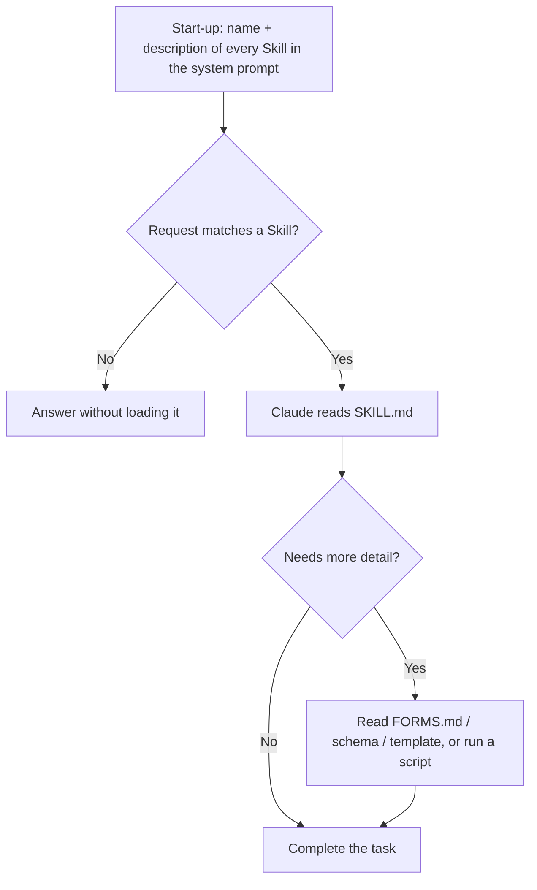

# Progressive Disclosure and Agent Skills

> **Level:** Advanced · **Time:** ~55 min · **Exam relevance:** CCAO-F D5 · CCAR-P D2, D3

## In plain English

A good onboarding guide does not make a new hire read every manual on day one. It gives them a table of contents and
tells them where to look when a topic comes up. **Progressive disclosure** applies that idea to Claude's context: show
a short index of what is available, and load the details only when the task needs them.

**Agent Skills** are Anthropic's packaged form of this idea. A Skill is a folder containing a `SKILL.md` file
(instructions with a short name and description at the top) and optionally scripts, templates and reference files.
Claude sees only each Skill's name and description until a request matches it; then it reads the instructions; and it
opens the extra files or runs the scripts only if they are needed.

The opposite approach, **monolithic context**, puts everything into every request: all the instructions, every
reference document, every tool definition.

## Why it matters

- **Scale.** You can make dozens of Skills, hundreds of tools or a large document estate available without paying for
  all of it on every request.
- **Focus.** Less irrelevant material in context means less distraction and less context rot.
- **Reuse.** A Skill packages a procedure once and makes it available across conversations, instead of repeating long
  instructions in every prompt.
- **Exam relevance.** The Professional exam asks you to evaluate progressive discovery versus monolithic context
  (CCAR-P-3.8) and to reuse prompts through caching, modular prompts and Skills (CCAR-P-2.5). Tool sprawl is also
  assessed as "capability bloat" (CCAR-P-3.1).

## How it works

### The three loading levels of a Skill

As documented on 2026-10-24 in the
[Agent Skills overview](https://platform.claude.com/docs/en/agents-and-tools/agent-skills/overview):

| Level | When loaded | Approximate token cost | Content |
|---|---|---|---|
| 1. Metadata | Always, at start-up | About 100 tokens per Skill | `name` and `description` from the YAML front matter |
| 2. Instructions | When a request matches the Skill | Under 5,000 tokens recommended | The body of `SKILL.md` |
| 3. Resources and code | Only when referenced | Nothing until accessed | Extra Markdown files, templates, schemas; scripts run with only their output entering context |



Scripts are particularly efficient: when Claude runs `validate.py`, the code itself never enters the context; only
its output does.

### Anatomy of a Skill

```text
expense-report-review/
├── SKILL.md            # required: front matter + instructions
├── POLICY_DETAILS.md   # loaded only when needed
├── schemas/
│   └── report.json
└── scripts/
    └── check_totals.py # run by Claude; only output enters context
```

```markdown
---
name: expense-report-review
description: Review employee expense reports against the travel and expense policy. Use when the user
  uploads or mentions an expense report, receipt bundle, or reimbursement claim.
---

# Expense report review

1. Run `scripts/check_totals.py` on the uploaded file and report any arithmetic mismatches.
2. Check each line against the limits in POLICY_DETAILS.md (read it only for categories present).
3. Produce a table: line, category, amount, verdict, policy reference.
4. Never approve or reject a claim; flag items for the finance reviewer.
```

Front matter rules (as of 2026-10-24): `name` up to 64 characters, lowercase letters, numbers and hyphens, without the
reserved words "anthropic" or "claude"; `description` non-empty, up to 1,024 characters. Neither may contain XML tags.
The description is what Claude matches requests against, so it must say **what the Skill does and when to use it**.

### Where Skills work

| Surface | Pre-built Skills | Custom Skills | Sharing |
|---|---|---|---|
| Claude apps (claude.ai) | Yes (Word, Excel, PowerPoint, PDF) | Upload as a zip in settings on eligible plans with code execution enabled | Individual user |
| Claude API | Yes, by `skill_id` | Upload through the Skills API (`/v1/skills`) | Workspace-wide |
| Claude Code | Not the document Skills | Folders in `~/.claude/skills/` or `.claude/skills/` | Personal, project, or via plugins |

Custom Skills do not sync between surfaces. On the API, Skills run inside the code execution container, which has no
network access and no runtime package installation (as of 2026-10-24). Check the overview page for current platform
availability, which differs on Amazon Bedrock, Google Vertex AI and Microsoft Foundry.

### Other forms of progressive disclosure

Skills are one mechanism. The same principle shows up elsewhere:

| Mechanism | What is disclosed progressively | Covered in |
|---|---|---|
| Just-in-time retrieval | Documents fetched by tools or search when needed, with lightweight references kept in context | [Module 11 — RAG](../11-rag-and-knowledge-systems/README.md) |
| Tool search | Tool definitions marked `defer_loading: true` are discovered through a search tool instead of being loaded up front | [Server tools](../07-tool-use-and-function-calling/04-server-tools.md) |
| Sub-agents | Detailed exploration happens in a separate context; only a summary returns | [Multi-agent architecture](../10-agentic-ai/04-multi-agent-architecture.md) |
| MCP resources and prompts | Servers expose resources that clients load on request | [Module 08 — MCP](../08-model-context-protocol/README.md) |
| File-system exploration | Agents in Claude Code read files on demand rather than receiving the repository | [Module 09 — Claude Code](../09-claude-code/README.md) |
| Memory | Notes read back only when relevant | [Memory and persistence](04-memory-and-persistence.md) |

### Monolithic versus progressive: making the call

| Factor | Favours monolithic | Favours progressive |
|---|---|---|
| Size of relevant knowledge | Small (fits comfortably, mostly relevant) | Large, or mostly irrelevant to any one request |
| Stability | Stable (cache it) | Changes often, or per tenant |
| Number of tools | A handful | Dozens to hundreds |
| Latency budget | Tight; no room for discovery round trips | Can afford an extra step |
| Predictability | Must always apply (core rules, safety policy) | Applies only to some tasks |
| Failure mode you fear most | Missing a rule because it was not loaded | Distraction, cost, context rot |

A practical hybrid:

1. **Always in context:** core role, safety rules, output contracts, and the small set of tools used on most requests.
   Cache this prefix (see [prompt caching](03-prompt-caching.md)).
2. **Progressively disclosed:** specialised procedures as Skills, rarely used tools behind tool search, large reference
   material behind retrieval.
3. **Measure:** track how often each Skill or tool is used, the token cost per request, and failures where the model
   did not load something it needed.

Note the caching interaction: progressive disclosure keeps the stable prefix small and cacheable, but anything loaded
mid-conversation sits after the cached prefix and is billed at normal rates on first use.

## Example

Using a pre-built Skill through the API: the Skill runs in the code execution container, which the request declares
with the code execution tool. As of 2026-10-24 the Skills and Files APIs are generally available, so the regular
`client.messages.create` works without a beta header. Use the newest code execution tool version your model supports
(the Skills guide shows `code_execution_20250825`; newer models accept `code_execution_20260521`).

```python
import anthropic

client = anthropic.Anthropic()  # API key from ANTHROPIC_API_KEY

response = client.messages.create(
    model="claude-opus-5-5",
    max_tokens=16000,
    container={"skills": [{"type": "anthropic", "skill_id": "xlsx", "version": "latest"}]},
    tools=[{"type": "code_execution_20260521", "name": "code_execution"}],
    messages=[{
        "role": "user",
        "content": "Create a spreadsheet of Q3 depot volumes for Acme Logistics (synthetic data, "
                   "6 depots x 3 months) with a totals row and a bar chart.",
    }],
)
print(response.stop_reason)
for block in response.content:
    if block.type == "text":
        print(block.text)
    elif block.type == "bash_code_execution_tool_result" and block.content.type == "bash_code_execution_result":
        for output in block.content.content:          # generated files arrive as file IDs
            meta = client.files.retrieve_metadata(file_id=output.file_id)
            client.files.download(file_id=output.file_id).write_to_file(meta.filename)
            print("Downloaded", meta.filename)
```

Progressive tool loading with tool search: most tools are marked `defer_loading`, so only their names are searchable
until Claude needs them. The search tool itself, and at least one other tool, must not be deferred.

```python
tools = [
    {"type": "tool_search_tool_bm25_20251119", "name": "tool_search_tool_bm25"},
    {"name": "get_shipment", "description": "Look up one shipment by tracking number.",
     "input_schema": {"type": "object", "properties": {"tracking_number": {"type": "string"}},
                      "required": ["tracking_number"]}},
    # ...many specialised tools, each deferred:
    {"name": "recalculate_customs_duty", "description": "Recalculate customs duty for a consignment.",
     "defer_loading": True,
     "input_schema": {"type": "object", "properties": {"consignment_id": {"type": "string"}},
                      "required": ["consignment_id"]}},
]
```

> **Cost:** requires API credits (live mode). Code execution may carry additional charges; see the pricing page.

## Enterprise use case

*Woodgrove Bank* (fictional) built an internal analyst assistant. The first version's system prompt held every
procedure the analysts used: credit memo format, sanctions-screening checklist, board-paper style, expense rules,
model-validation checklist and more, about 45,000 tokens. Answers to simple questions were slow, and analysts noticed
the assistant applying board-paper style to quick internal notes.

The redesign kept a 3,000-token core (role, confidentiality rules, escalation rules) in the system prompt, cached, and
moved each procedure into a Skill with a precise description, such as "Use when drafting a credit memo for a new
facility or a renewal". Deterministic checks (totals, date formats) became scripts inside the Skills. Usage telemetry
showed most requests loaded no Skill at all, and style bleed between tasks disappeared. One failure mode appeared: a
vague description meant the sanctions Skill did not load for a request phrased as "screen this counterparty", so the
team rewrote descriptions with the vocabulary analysts actually use and added those phrasings to their eval set.

## Common mistakes

- **Vague descriptions.** "Helps with documents" will not trigger reliably. Say what and when, using users' words.
- **Huge `SKILL.md` files.** Keep the main instructions concise and move detail into referenced files.
- **Putting must-always-apply rules in a Skill.** Safety and compliance rules that apply to every request belong in
  the always-loaded core.
- **Deferring every tool.** Tool search needs at least one non-deferred tool, and frequently used tools should load up
  front.
- **Not measuring discovery failures.** Add tests where the right Skill or tool must be found.
- **Installing Skills from unknown sources** without review.

## Security considerations

Anthropic's guidance (as of 2026-10-24) is to use Skills only from trusted sources, such as ones you wrote or obtained
from Anthropic, and to treat installing a Skill like installing software.

- **Audit every file** in a Skill, including scripts and images, for unexpected network calls, file access or
  behaviour that does not match the description.
- **External content is risky.** Skills that fetch data from URLs can pull in malicious instructions, and trusted
  Skills can be compromised if their dependencies change.
- **Least privilege.** A Skill can direct Claude to use whatever tools the environment provides; restrict those tools.
- **Supply-chain controls.** Version, review and sign off Skills like code. See
  [supply-chain risks](../12-ai-security/07-supply-chain-risks.md).
- **Data retention.** Check whether Skills are covered by your data-retention arrangements; as of 2026-10-24 the docs
  state Agent Skills are not covered by zero-data-retention arrangements.

## Troubleshooting

| Symptom | Likely cause | Fix |
|---|---|---|
| Skill never triggers | Description too vague or uses different vocabulary | Rewrite the description with what, when, and users' terms |
| Wrong Skill triggers | Overlapping descriptions | Make descriptions distinct; merge overlapping Skills |
| Skill script fails on the API | No network or missing package in the container | Use only pre-installed packages; remove network calls |
| Custom Skill missing in another surface | Skills do not sync between apps, API and Claude Code | Upload or install separately per surface |
| 400 error: all tools deferred | Every tool has `defer_loading: true` | Keep the search tool and at least one other tool non-deferred |
| Core rule ignored on some tasks | Rule lived in a Skill that did not load | Move must-always-apply rules into the system prompt |

## Check your understanding

1. Describe the three loading levels of an Agent Skill and roughly what each costs in context.
2. Why must a Skill's description say both what it does and when to use it?
3. Give two situations where a monolithic context is the better design.
4. A team defers 150 tools behind tool search. What two failure modes should their evaluation cover?

<details>
<summary>Answers</summary>

1. Metadata (name and description, about 100 tokens per Skill, always loaded); instructions (the `SKILL.md` body,
   ideally under 5,000 tokens, loaded when triggered); resources and code (loaded or run only when referenced, costing
   nothing until then, with scripts contributing only their output).
2. Claude decides whether to load a Skill by matching the request against the description. Without the "when", Claude
   cannot reliably recognise matching requests.
3. When the knowledge is small, stable and relevant to most requests (load it and cache it), and when rules must apply
   to every request (safety, compliance, output contracts), or when latency cannot accommodate discovery steps.
4. Discovery failures (the right tool is not found, or a wrong one is chosen) and latency or cost from extra search
   round trips. They should also check that frequently used tools are not deferred unnecessarily.

</details>

## Further reading

- [Agent Skills overview](https://platform.claude.com/docs/en/agents-and-tools/agent-skills/overview) (Anthropic docs)
- [Skill authoring best practices](https://platform.claude.com/docs/en/agents-and-tools/agent-skills/best-practices) (Anthropic docs)
- [Equipping agents for the real world with Agent Skills](https://www.anthropic.com/engineering/equipping-agents-for-the-real-world-with-agent-skills) (Anthropic engineering)
- [Effective context engineering for AI agents](https://www.anthropic.com/engineering/effective-context-engineering-for-ai-agents) (Anthropic engineering, 2025-09-29)
- [Commands, Skills and subagents in Claude Code](../09-claude-code/05-commands-skills-subagents.md) in this repository
- Next module: [Module 05 — Claude Products and Models](../05-claude-products-and-models/README.md)
