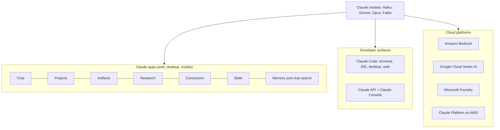
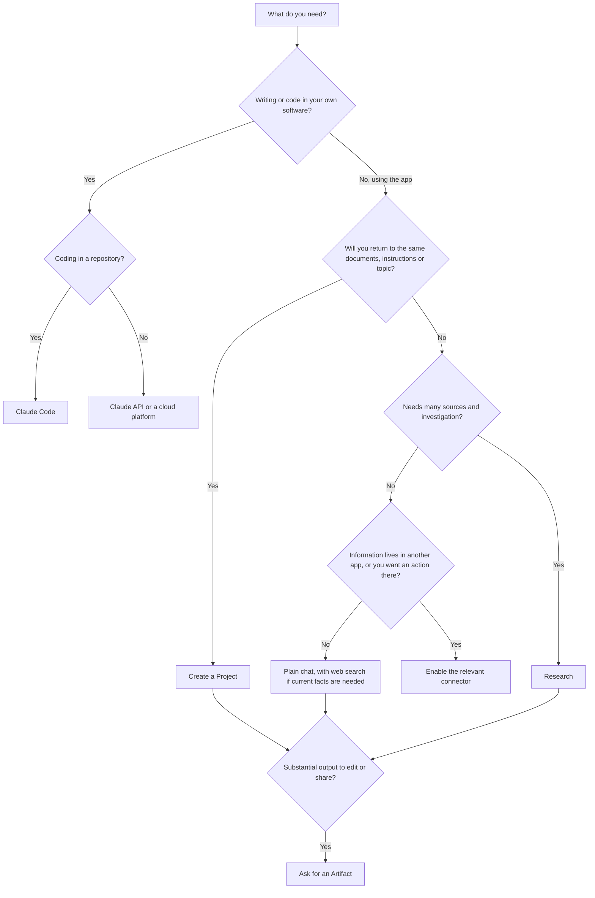

# The Claude Product Ecosystem

> **Level:** Beginner · **Time:** ~45 min · **Exam relevance:** CCAO-F D3 (3.1), D4 (4.4) · CCAR-P D3 (3.7), D7 (7.1)

## In plain English

"Claude" can mean several different things depending on who is talking:

- A **marketing manager** usually means the Claude app at claude.ai or on their laptop or phone.
- A **software developer** might mean Claude Code, the coding tool that works in a terminal or editor.
- An **application developer** usually means the Claude API: sending requests from their own software.
- A **cloud architect** might mean Claude running inside Amazon Bedrock, Google Cloud Vertex AI or Microsoft Foundry.

Underneath all of these sit the same **Claude models** (covered in [Model families](02-model-families.md)). The products are different doors into the same building, each with its own furniture: Projects, Artifacts, research, connectors, Skills and so on.

This page is a map. Each feature gets one or two paragraphs here and a full page elsewhere.

> Facts on this page are as of 2026-10-24 and were checked against [support.claude.com](https://support.claude.com/), [claude.com/pricing](https://claude.com/pricing), [platform.claude.com](https://platform.claude.com/docs/en/intro) and [code.claude.com](https://code.claude.com/docs/en/overview). Plans and features change; check those pages before relying on a detail.

## Why it matters

CCAO-F objective 3.1 asks you to choose the right Claude product feature for a task (Projects, research, chat, Artifacts). Picking the wrong one wastes time and usage: running a quick question through research, or re-uploading the same handbook into every chat instead of using a Project.

For architects, CCAR-P objective 3.7 asks you to choose an integration mechanism, and 7.1 to configure Claude tools for teams. Knowing which surface fits which need, and what each one costs and controls, is the starting point for both.

## How it works

### The map

### The Claude apps

The consumer and business apps are where most CCAO-F work happens.

| Surface | Where | Notes |
|---|---|---|
| Web | [claude.ai](https://claude.ai) | Full feature set; nothing to install |
| Desktop | macOS and Windows (Linux in beta), from [claude.com/download](https://claude.com/download) | Adds desktop extensions (local integrations) and includes Claude Code in a Code tab on paid plans |
| Mobile | iOS and Android | Chat, voice, photos of documents; some features behave differently (for example, research started on mobile searches only the web) |

The same account, chats and Projects follow you across all three.

### Plans

| Plan | Who it is for | Notable differences (as of 2026-10-24) |
|---|---|---|
| **Free** | Trying Claude | Chat, web search, up to five Projects, memory, connectors; no research; no Claude Code |
| **Pro** | Individuals using Claude regularly | More usage, research, Claude Code, access to Opus models, larger Project knowledge via retrieval |
| **Max** | Heavy individual users | Several times Pro's usage, priority at busy times |
| **Team** | Groups of colleagues (minimum seats apply) | Central billing, single sign-on, admin controls for connectors, shared Projects |
| **Enterprise** | Larger organisations | Team features plus role-based access, SCIM provisioning, audit logs, compliance API, custom data retention and other controls |

There are also education plans. See [claude.com/pricing](https://claude.com/pricing) for prices and the full comparison.

> **Unverified:** the exact feature split per plan changes often, and some features are in beta or available to selected users only. Treat the table as orientation and confirm on the pricing page and in the Help Center.

### App features

| Feature | What it does | Use it when | Details |
|---|---|---|---|
| **Chat** | A single conversation | Quick questions, one-off drafts | [Your first conversation](../02-claude-fundamentals/02-first-conversation.md) |
| **Projects** | A workspace with its own instructions, knowledge files and chat history | You return to the same topic, documents or style repeatedly | [Projects and knowledge](04-projects-and-knowledge.md) |
| **Artifacts** | Standalone outputs (documents, code, diagrams, small interactive tools) that open beside the chat and can be edited and shared | The output is substantial and you will edit, reuse or share it | [Artifacts and output formats](05-artifacts-and-output-formats.md) |
| **Research** | Claude runs a series of searches, each informed by the last, across the web and enabled connectors, and reports back | Questions that need many sources and some digging | Below |
| **Web search** | Claude searches the web during a normal chat | Current information, quick fact-finding | Toggle in the chat menu |
| **Connectors** | Let Claude read from and act in other apps (Google Drive, Gmail, Calendar, Slack, and many others) with your permissions | The information lives in another tool, or you want Claude to take an action there | [Connectors and integrations](06-connectors-and-integrations.md) |
| **Skills** | Folders of instructions, scripts and resources that Claude loads only when relevant | Repeatable specialised tasks (branded documents, a company analysis workflow) | Below |
| **Memory and chat search** | Carry context from earlier chats into new ones | You want continuity without re-explaining | [Projects and knowledge](04-projects-and-knowledge.md) |
| **Incognito chats** | Chats not saved to history or memory | One-off questions you don't want kept | [Responsible use](../02-claude-fundamentals/05-responsible-use.md) |

**Research** in more detail. You turn it on from the **+** menu; web search must also be on. Claude plans a line of enquiry, searches, reads, and decides what to look for next, which takes longer and uses more of your plan's limits than a normal chat. As of 2026-10-24, the Help Center says research is available on Pro, Max, Team and Enterprise plans, runs on an Opus model regardless of the model selected for the chat, and on web and desktop can use Google Workspace and other enabled connectors automatically, without asking for approval each time ([Using research](https://support.claude.com/en/articles/11088861-using-research-on-claude)). That last point matters for data governance: enable only the connectors you are happy for research to search.

**Skills** in more detail. A Skill is a folder containing instructions (written in Markdown) and optionally scripts and resources. Claude checks which Skills are available, loads only the ones relevant to the current task, and applies them, a pattern called *progressive disclosure* that keeps the context window uncluttered. Anthropic provides built-in Skills (for example, for working with Excel, Word, PowerPoint and PDF files); individuals and organisations can create custom Skills; Team and Enterprise owners can provision Skills to everyone. Skills need code execution to be enabled. See [What are Skills?](https://support.claude.com/en/articles/12512176-what-are-skills) and, for the developer view, [Progressive disclosure and Skills](../04-context-engineering/06-progressive-disclosure-and-skills.md).

### Claude Code

[Claude Code](https://code.claude.com/docs/en/overview) is an agentic coding tool: it reads a codebase, edits files, runs commands and works with tools such as git, all under permissions you control. It runs in the terminal, in IDEs (VS Code and JetBrains), in the desktop app and on the web, and most surfaces need a paid Claude subscription or a Claude Console account. It is covered in [Module 09](../09-claude-code/README.md).

### The Claude API and Claude Console

Developers call Claude from their own software through the **Claude API** (the Messages API and related endpoints), using official SDKs for Python, TypeScript, Java, Go, Ruby, C#, PHP and others. The **Claude Console** at [platform.claude.com](https://platform.claude.com/) is where you create API keys, manage workspaces, test prompts and view usage and billing. API usage is billed per token, separately from app subscriptions. [Module 06](../06-claude-api/README.md) covers the API.

### Claude on cloud platforms

Organisations that already run on a major cloud can use Claude through that provider, which keeps billing, identity, networking and data-residency controls in one place.

| Platform | Notes (as of 2026-10-24) |
|---|---|
| **Amazon Bedrock** | AWS-operated. Model IDs carry an `anthropic.` prefix (for example `anthropic.claude-opus-5-5`). Pricing set by AWS |
| **Google Cloud Vertex AI** | Google-operated (listed in Anthropic's docs as Claude Models on Google Cloud, Google managed). Uses the plain model IDs. Pricing set by Google Cloud |
| **Microsoft Foundry** | Billed through the Microsoft Marketplace at Anthropic's standard API rates |
| **Claude Platform on AWS** | Anthropic-operated, using Claude API model IDs and features, accessed through AWS |

Feature availability differs between the Claude API and each cloud platform: some newer or beta features reach the Claude API first. Architects should check per-feature availability before committing. See [Cloud platforms](../06-claude-api/07-cloud-platforms.md) and the [models overview](https://platform.claude.com/docs/en/about-claude/models/overview) for platform IDs.

### Choosing the right feature

These choices combine: a research task inside a Project that produces an Artifact is common.

## Example

Five tasks and the best starting point for each:

| Task | Best feature | Why |
|---|---|---|
| "Reword this sentence to sound less formal" | Plain chat | One-off, small |
| Weekly status reports in the same format, using the same project charter | Project with the charter as knowledge and the format in instructions | Reused context and format every week |
| "What are competitors saying publicly about their pricing changes this quarter?" | Research | Many sources, current information, investigation |
| "Find last month's email from the supplier about delivery dates and draft a reply" | Gmail connector | The information lives in email |
| A one-page interactive budget calculator to share with the team | Artifact | Substantial, reusable, shareable output |

## Enterprise use case

*Contoso Health* is planning its Claude rollout. Different groups need different doors:

- **Administrative and communications staff** use Claude Enterprise apps, with shared Projects for the style guide and policy library and the Google Drive connector enabled read-only for policy folders.
- **The software team** uses Claude Code for internal tools, configured with organisation settings and permissions (CCAR-P 7.1).
- **The patient-portal team** builds a scheduling assistant on the Claude API, accessed through the cloud platform the organisation already uses, so identity, logging and data residency follow existing controls.

One decision record explains the split, so later teams know which door to use (CCAO-F 4.4, integrating Claude into existing workflows).

## Common mistakes

- **Using one feature for everything.** A single endless chat instead of Projects; research for simple lookups.
- **Assuming every feature is on every plan or platform.** Research, chat search, larger Project knowledge and some connectors depend on plan; API features vary across cloud platforms.
- **Confusing subscriptions with API billing.** A Pro or Team subscription does not pay for API calls from your own software (Claude Code usage on paid plans is the exception; it shares the plan's usage).
- **Ignoring admin controls.** On Team and Enterprise, owners decide which connectors, Skills and features members can use.

## Security considerations

- Each surface has different controls. Enterprise apps offer audit logs and retention settings; the API offers workspace-level keys and usage monitoring; cloud platforms integrate with existing identity and network controls. Choose the surface whose controls match the data.
- Connectors and research can reach into other systems with the user's permissions. Least privilege applies ([Connectors and integrations](06-connectors-and-integrations.md)).
- Custom Skills and custom connectors are code and configuration from someone else. Review them before enabling, just as you would a browser extension.

## Troubleshooting

| Symptom | Likely cause | What to do |
|---|---|---|
| A feature mentioned here is missing | Plan, region, beta access or an admin setting | Check the Help Center article for that feature; ask your administrator |
| Research didn't search your Google Drive | Started on mobile, or connector not enabled | Start research on web or desktop with the connector enabled |
| API feature works on the Claude API but not in your cloud account | Feature not yet available on that platform | Check the platform availability notes in the API docs |

## Check your understanding

1. Name the three app surfaces and two developer surfaces for Claude.
2. You produce the same monthly board summary from the same three reference documents. Which feature should you use first?
3. What does research do differently from a normal chat with web search?
4. Why might an organisation use Claude through a cloud platform rather than the Claude API directly?
5. What is progressive disclosure in the context of Skills?

Answers

1. Apps: web, desktop, mobile. Developer surfaces: Claude Code and the Claude API (with the Claude Console).
2. A Project, with the reference documents as knowledge and the summary format in the instructions.
3. It runs a series of searches, each shaped by what it found so far, across the web and enabled connectors, and compiles a report. It takes longer and uses more of your limits.
4. To keep billing, identity, networking, logging and data-residency controls inside the cloud environment it already uses.
5. Claude loads only the Skills relevant to the current task, rather than all of them, which keeps the context window focused.

## Further reading

- [Claude Help Center](https://support.claude.com/) (official product help)
- [Plans and pricing](https://claude.com/pricing)
- [Intro to Claude](https://platform.claude.com/docs/en/intro) (developer documentation)
- [Claude Code overview](https://code.claude.com/docs/en/overview)
- [Using research on Claude](https://support.claude.com/en/articles/11088861-using-research-on-claude)
- [What are Skills?](https://support.claude.com/en/articles/12512176-what-are-skills)
- Next: [Model families](02-model-families.md)
