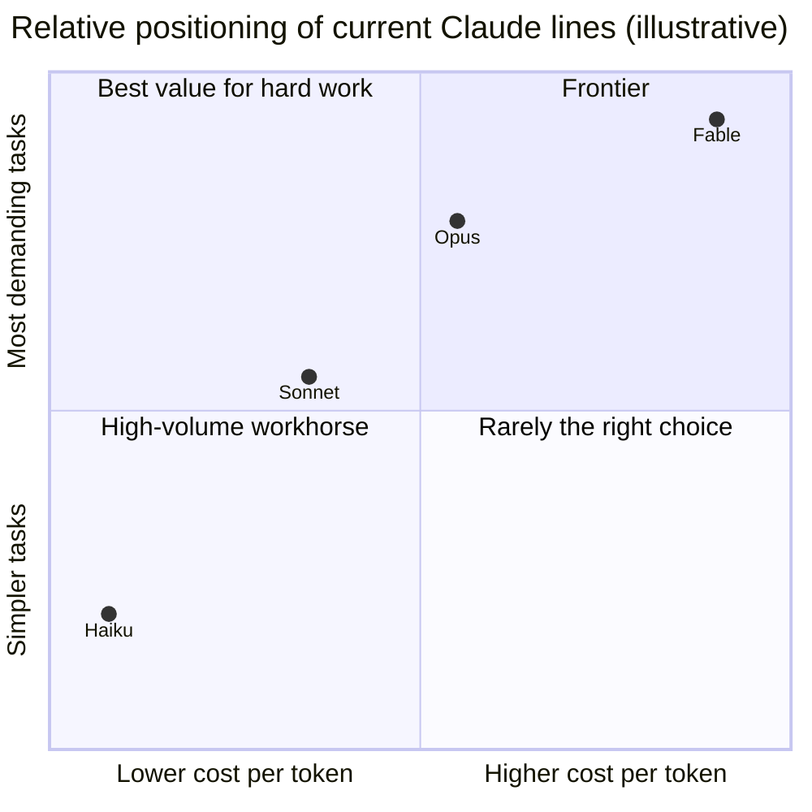

# Model Families and Current Models

> **Level:** Beginner · **Time:** ~35 min · **Exam relevance:** CCAO-F D3 (3.2) · CCAR-P D2 (2.1)

## In plain English

Anthropic releases Claude models in **families** (also called lines). Each line is a size and speed class, and each new generation of a line replaces the previous one:

- **Haiku**: the smallest and fastest. Good for simple, high-volume work.
- **Sonnet**: the balance of speed and intelligence. A strong everyday choice.
- **Opus**: highly capable, for complex, long-running knowledge work and coding.
- **Fable**: Anthropic's frontier line, for the most demanding reasoning and long-horizon agentic work, at a higher price.

An analogy: a company's travel options. Haiku is the bicycle courier: quick, cheap, perfect for short routine trips. Sonnet is the company car: handles most journeys well. Opus is the experienced driver for long, complicated trips. Fable is the specialist charter for the hardest missions. You do not book a charter to post a letter.

The names stay the same across generations; the version number tells you the generation. "Claude Sonnet 5.5" is the 5.5 generation of the Sonnet line.

## Why it matters

CCAO-F objective 3.2 asks you to differentiate the Claude model families, and CCAR-P objective 2.1 to select models based on trade-offs. Exams test the *pattern* (smaller is faster and cheaper; larger is more capable on complex work), not memorised prices. But in practice you also need to know where to find current facts, because model line-ups change several times a year.

## How it works

### Current models (as of 2026-10-24)

These figures come from Anthropic's [models overview](https://platform.claude.com/docs/en/about-claude/models/overview) and [pricing](https://platform.claude.com/docs/en/about-claude/pricing) pages, checked on 2026-10-24. Prices are for the Claude API, per million tokens (MTok).

| | Claude Haiku 5.5 | Claude Sonnet 5.5 | Claude Opus 5.5 | Claude Fable 5.1 |
|---|---|---|---|---|
| Positioning | High-volume, latency-sensitive tasks such as classification, extraction and routing | Best combination of speed and intelligence | Long-running agentic coding and knowledge work; Anthropic's suggested starting point for most workloads | Demanding reasoning and long-horizon agentic work |
| Relative latency | Fastest | Fast | Moderate | Slower |
| API model ID | `claude-haiku-5-5` | `claude-sonnet-5-5` | `claude-opus-5-5` | `claude-fable-5-1` |
| Input price | From $0.10 / MTok | $2 / MTok | $4 / MTok | $10 / MTok |
| Output price | From $0.50 / MTok | $10 / MTok | $20 / MTok | $50 / MTok |
| Context window | 1M tokens | 1M tokens | 1M tokens | 1M tokens |
| Maximum output | 128K tokens | 128K tokens | 128K tokens | 128K tokens |
| Reliable knowledge cutoff | June 2026 | June 2026 | June 2026 | June 2026 |

Notes on the table:

- Claude Haiku 5.5's listed price applies to prompts up to 100,000 tokens; longer prompts cost more ($0.50 input and $2.50 output per MTok as of 2026-10-24).
- The [Message Batches API](../06-claude-api/05-batch-processing.md) is 50% cheaper for work that can wait. Reading from the prompt cache costs a fraction of the base input price ([Prompt caching](../04-context-engineering/03-prompt-caching.md)).
- All current models accept text and image input, produce text output, are multilingual, and support tool use.
- Thinking is *adaptive*: the model decides how much to reason, steered by an **effort** setting (`low`, `medium`, `high`, `xhigh`, `max`). Effort is a second dial alongside model choice, covered in [Model selection](03-model-selection.md).
- Prices on Amazon Bedrock and Google Cloud Vertex AI are set by those providers; Microsoft Foundry is billed at Anthropic's standard API rates.

Older models remain available for a while as **legacy models** (as of 2026-10-24 these include Claude Fable 5, Claude Opus 5, Claude Opus 4.8, 4.7, 4.6 and 4.5, Claude Sonnet 5 and 4.6, and Claude Haiku 4.5). Each model has a published retirement commitment on the [model deprecations](https://platform.claude.com/docs/en/about-claude/model-deprecations) page. Anthropic also runs some models under restricted access programmes; those are outside the scope of this repository.

### Model IDs

In the API you select a model by its **ID**, such as `claude-opus-5-5`. From the 4.6 generation onwards, IDs have no date suffix, and each ID is a pinned snapshot: the model behind it does not silently change. On Amazon Bedrock the same models carry an `anthropic.` prefix (for example `anthropic.claude-opus-5-5`).

In the Claude apps you choose from a model menu by name, and which models appear depends on your plan (for example, Opus models are not included on the Free plan as of 2026-10-24).

### How the families relate



The chart is illustrative, not a benchmark. Real performance depends on the task, the prompt and the effort setting. The only reliable way to know which model is best for *your* task is to test, which [Model selection](03-model-selection.md) explains.

### Generations improve every line

A newer Haiku can outperform an older Sonnet on some tasks; a newer Opus at lower effort may match an older model at higher effort. When a new generation arrives:

1. Read the release notes and migration guide for behavioural changes.
2. Re-run your evaluation set ([Module 14](../14-evaluation-and-testing/README.md)).
3. Re-check costs, because prices and tokenisers can change between generations.

[Model upgrades and change management](../15-production-operations/08-model-upgrades-and-change-management.md) covers this for production systems.

### Finding current facts yourself

| You need | Go to |
|---|---|
| Current models, IDs, context windows, cutoffs | [Models overview](https://platform.claude.com/docs/en/about-claude/models/overview) |
| Prices, batch and caching discounts | [Pricing](https://platform.claude.com/docs/en/about-claude/pricing) |
| Retirement dates | [Model deprecations](https://platform.claude.com/docs/en/about-claude/model-deprecations) |
| Guidance on choosing | [Choosing a model](https://platform.claude.com/docs/en/about-claude/models/choosing-a-model) |
| What's in the apps on your plan | [claude.com/pricing](https://claude.com/pricing) and the model menu in the app |
| Programmatic list of models and limits | The Models API (`client.models.list()`), which reports each model's context window and capabilities |

## Example

Listing the available models from code is a good way to avoid hardcoding stale assumptions. With the official Python SDK:

```python
import anthropic

client = anthropic.Anthropic()  # reads ANTHROPIC_API_KEY from the environment
for model in client.models.list():
    # max_input_tokens is the context window; max_tokens is the output cap
    print(model.id, model.display_name, model.max_input_tokens, model.max_tokens)
```

> **Cost:** listing models needs an API key but does not run the model.

## Enterprise use case

*Acme Logistics* runs three Claude workloads:

| Workload | Volume | Needs | Model chosen |
|---|---|---|---|
| Tagging inbound shipment emails by type | 40,000 per day | Fast, cheap, simple categories | Claude Haiku 5.5 |
| Drafting customer replies to delivery complaints | 1,500 per day | Good tone and accuracy, moderate speed | Claude Sonnet 5.5 |
| Monthly analysis of carrier contract performance across hundreds of pages | A few per month | Deep reasoning over long documents | Claude Opus 5.5 at high effort |

The architect documents each choice with the evaluation results that justified it, and schedules a re-evaluation when new generations are released.

## Common mistakes

- **Memorising prices for the exam or for planning.** Learn the pattern; look up the numbers.
- **Assuming the biggest model is always best.** For simple, high-volume tasks, a smaller model is often equally accurate and far cheaper and faster.
- **Hardcoding old model IDs and forgetting them.** Legacy models are eventually retired; track deprecations.
- **Comparing models on one example.** Compare on a representative set of tasks.
- **Ignoring effort.** On current models, adjusting effort can change cost and quality as much as switching model.

## Security considerations

- Model choice can affect safety behaviour: different models and generations may respond differently to borderline requests and to prompt-injection attempts. Include security test cases in evaluations when switching models ([Safety and red-team evals](../14-evaluation-and-testing/07-safety-and-red-team-evals.md)).
- Restrict which models teams can use where cost or data-handling commitments differ (for example, some models have specific data-retention requirements). Check the model's page before using it with sensitive data.

## Troubleshooting

| Symptom | Likely cause | What to do |
|---|---|---|
| "Model not found" error in the API | Wrong ID, retired model, or model not enabled on your platform | Check the models overview and your platform's model access settings |
| A model is missing from the app menu | Not included in your plan, or disabled by an admin | Check your plan and organisation settings |
| Costs jumped after switching model | Higher per-token price or different tokeniser | Re-measure tokens and cost per task |

## Check your understanding

1. Name the four current Claude lines from fastest to most capable.
2. Which line does Anthropic suggest as the starting point for most workloads, as of 2026-10-24?
3. Where would you check the current context window and price for a model?
4. Why can a newer, smaller model sometimes beat an older, larger one?
5. Besides choosing a model, what other setting changes the cost-quality balance on current models?

<details>
<summary>Answers</summary>

1. Haiku, Sonnet, Opus, Fable.
2. Opus (Claude Opus 5.5).
3. The models overview and pricing pages in Anthropic's documentation (or the Models API for context windows).
4. Because each generation improves every line; a newer generation's training and techniques can outweigh an older model's size advantage on some tasks.
5. The effort level, which steers how much the model thinks.

</details>

## Further reading

- [Models overview](https://platform.claude.com/docs/en/about-claude/models/overview) (Anthropic documentation)
- [Pricing](https://platform.claude.com/docs/en/about-claude/pricing) (Anthropic documentation)
- [Choosing a model](https://platform.claude.com/docs/en/about-claude/models/choosing-a-model) (Anthropic documentation)
- [Model deprecations](https://platform.claude.com/docs/en/about-claude/model-deprecations) (Anthropic documentation)

<!-- page-nav:start -->
---

[← Previous: The Claude Product Ecosystem](01-product-ecosystem.md) · [Module overview](README.md) · [Next: Model Selection →](03-model-selection.md)
<!-- page-nav:end -->
