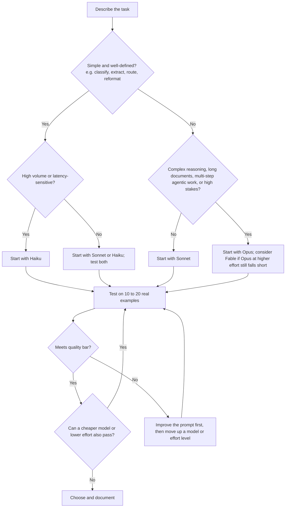

# Model Selection

> **Level:** Beginner to Intermediate · **Time:** ~40 min · **Exam relevance:** CCAO-F D3 (3.2, 3.3) · CCAR-P D2 (2.1), D3 (3.3), D4 (4.5)

## In plain English

Choosing a model is a balancing act between three things:

- **Quality:** how good the answer needs to be.
- **Speed:** how quickly it needs to arrive.
- **Cost:** how much you can spend per task, and how many tasks there are.

You rarely get the best of all three. The skill is to find the *least expensive, fastest* option that still meets your quality bar, and to prove it with a few tests rather than a hunch.

A useful mental model is hiring for a job. You would not hire a senior partner to file paperwork, and you would not ask a first-week intern to negotiate a merger. Match the expertise to the task, then check the work.

## Why it matters

- CCAO-F objective 3.3 asks you to match model choice to cost, speed and quality needs; 3.2 to know the families.
- CCAR-P objective 2.1 asks you to select models on trade-offs, 3.3 to evaluate accuracy–latency trade-offs and justify configuration, and 4.5 to optimise token usage, latency and cost-performance.
- Getting this wrong is expensive in both directions: overspending on simple, high-volume tasks, or underperforming on hard ones and paying for rework.

## How it works

### The three levers

On current Claude models you have more than one lever:

| Lever | What it changes | Where |
|---|---|---|
| **Model** | Underlying capability, speed and price per token | Model menu in the apps; `model` in the API |
| **Effort** | How much the model reasons before answering. Lower effort is faster and uses fewer tokens; higher effort helps on hard problems | `output_config={"effort": ...}` in the API (`low`, `medium`, `high`, `xhigh`, `max`). In the apps, any reasoning or effort controls depend on the app version |
| **Prompt and context** | How much the model has to read and write | Shorter, focused context and output reduce cost and time on any model |

As of 2026-10-24, the default effort is `medium` on Claude Opus 5.5 and Claude Haiku 5.5 and `high` on Claude Sonnet 5.5 and Claude Fable 5.1 ([models overview](https://platform.claude.com/docs/en/about-claude/models/overview)). Anthropic's API guidance suggests measuring the most capable model at a *lower* effort before building complicated multi-model setups, because lower effort on a newer model often matches older models at higher effort.

### A practical decision guide



### Matching tasks to models (starting points, not rules)

| Task characteristics | Typical starting point | Why |
|---|---|---|
| Classification, tagging, routing, simple extraction at scale | Haiku | Fast and very cheap; simple tasks rarely need more |
| Everyday drafting, summarising, customer replies, coding help | Sonnet | Strong quality at moderate cost and speed |
| Complex analysis, long contracts or reports, multi-step agents, difficult coding | Opus | More reliable reasoning over long, complex inputs |
| Hardest reasoning, long autonomous tasks where Opus falls short | Fable | Highest capability at the highest price and latency |
| Interactive chat where users wait | Faster model or lower effort | Perceived speed matters; stream responses |
| Overnight batch jobs | Any model via the Batch API | 50% discount when you can wait |

### Cost per task, not cost per token

Compare models on **cost per successful task**. A cheaper model that needs two retries, or produces outputs a human must fix, may cost more overall. Track:

- tokens in and out per task (from the API's `usage` field),
- success rate on your test set,
- time to first token and total time,
- human correction time.

### A worked comparison

Suppose a team summarises 10,000 support tickets a month. Each request is about 2,000 input tokens and 300 output tokens. Using API prices as of 2026-10-24:

| Model | Input cost | Output cost | Monthly total |
|---|---|---|---|
| Claude Haiku 5.5 | 20M x $0.10/M = $2 | 3M x $0.50/M = $1.50 | about $3.50 |
| Claude Sonnet 5.5 | 20M x $2/M = $40 | 3M x $10/M = $30 | about $70 |
| Claude Opus 5.5 | 20M x $4/M = $80 | 3M x $20/M = $60 | about $140 |

If Haiku's summaries pass the team's quality checks, it is the obvious choice. If they miss important details 15% of the time and each miss costs ten minutes of staff time, the picture changes completely. This is why you test. (Thinking tokens, if the model reasons, are billed as output and add to these figures; measure real usage.)

## Example

This script compares two models on the same small task and reports output, time and token usage. It uses the repository's lab helper, so it runs offline in mock mode by default. Run it from the repository root.

```python
"""Compare two Claude models on the same task. Mock mode by default."""
import sys
import time

sys.path.insert(0, "19-hands-on-labs/common")
from claude_lab import get_client, MODEL, FAST_MODEL, text_of, banner

TICKET = (
    "Order 5521 arrived with a cracked screen. I contacted support twice and nobody replied. "
    "I want a replacement, not a refund, and I need it before my exam on Friday."
)
PROMPT = (
    "Summarise this support ticket for a team lead in at most two sentences. "
    "Include what the customer wants and any deadline.\n\n<ticket>\n" + TICKET + "\n</ticket>"
)

def run(client, model: str, effort: str) -> None:
    start = time.perf_counter()
    response = client.messages.create(
        model=model,
        max_tokens=300,
        output_config={"effort": effort},
        messages=[{"role": "user", "content": PROMPT}],
    )
    elapsed = time.perf_counter() - start
    if response.stop_reason not in ("end_turn", "max_tokens"):
        print(f"{model}: stopped with {response.stop_reason}")
        return
    usage = response.usage
    print(f"--- {model} (effort={effort}) in {elapsed:.2f}s, "
          f"{usage.input_tokens} in / {usage.output_tokens} out tokens")
    print(text_of(response), "\n")

if __name__ == "__main__":
    banner("Model comparison")
    client = get_client()
    run(client, FAST_MODEL, "low")   # claude-haiku-5-5 by default
    run(client, MODEL, "medium")     # claude-opus-5-5 by default
```

> **Cost:** requires API credits (live mode). Set `CLAUDE_LAB_MODE=live` and `ANTHROPIC_API_KEY` to call the real models; in mock mode the replies are canned and free.

Judge the summaries against the instruction: did each include the replacement request and the Friday deadline? [Lab 06: Model comparison](../19-hands-on-labs/lab-06-model-comparison/README.md) extends this to a scored test set.

In the Claude apps, do the equivalent by running the same prompt in two chats with different models selected and comparing the results against a checklist.

## Enterprise use case

*Northwind Lending* wants to extract twelve fields (applicant reference, income type, employer, and so on) from scanned payslips. The project lead assumes Opus is needed "because it's financial".

The architect runs a structured test on 100 anonymised payslips:

| Option | Field accuracy | Median time | Cost per 1,000 payslips |
|---|---|---|---|
| Haiku, low effort | 96.1% | Fastest | Lowest |
| Sonnet, medium effort | 98.7% | Fast | Moderate |
| Opus, medium effort | 98.9% | Moderate | Highest |

Errors cluster in two handwritten fields. The team chooses Sonnet, adds validation rules (income must be numeric and within a plausible range), and routes low-confidence extractions to a human. The decision, numbers and re-test date go into an architecture decision record ([Module 13](../13-enterprise-ai-architecture/07-architecture-decision-records.md)), which is the kind of justification CCAR-P 3.3 expects.

(The figures above are illustrative for this fictional scenario, not benchmark results.)

## Common mistakes

- **Choosing by reputation instead of testing.** Run a small evaluation on your own tasks.
- **Testing on one or two examples.** Use a representative set that includes hard and edge cases.
- **Moving up a model before fixing the prompt.** A clearer prompt often closes the gap more cheaply.
- **Ignoring latency for interactive use.** Users notice waits; consider faster models, lower effort and streaming.
- **One model for everything.** Different steps of a workflow can use different models (for example, Haiku to route, Opus to analyse).
- **Forgetting batch and caching discounts.** For repeated context and non-urgent work, they can matter more than model choice.

## Security considerations

- Smaller models may be easier to manipulate with prompt injection in some scenarios; larger models are not immune either. Test security cases for whichever model you choose.
- Do not downgrade model or effort on safety-critical checks just to save cost without re-running safety evaluations.
- Log which model and effort produced each output in production, so incidents can be investigated ([Observability](../15-production-operations/02-observability.md)).

## Troubleshooting

| Symptom | Likely cause | What to do |
|---|---|---|
| Good quality but too slow | Large model or high effort for the task | Try lower effort, a faster model, or streaming |
| Cheap model misses details | Task too complex for that model, or unclear prompt | Improve the prompt; then move up one level |
| Costs higher than estimated | Thinking tokens, long context, retries | Measure `usage` per request; trim context; lower effort |
| Results vary between runs | Open-ended prompt | Tighten instructions and format; evaluate on a set, not one run |

## Check your understanding

1. Name the three things you balance when choosing a model.
2. Besides the model, name two other levers that affect cost and speed.
3. Which model line would you start with for tagging 50,000 emails a day? Why?
4. Why compare cost per successful task rather than cost per token?
5. A cheaper model's output is not quite good enough. What should you try before moving to a larger model?

<details>
<summary>Answers</summary>

1. Quality, speed and cost.
2. Effort level, and the size of the prompt, context and output (also batch processing and prompt caching).
3. Haiku, because the task is simple and high-volume, so speed and cost dominate. Then test that it meets the accuracy bar.
4. Because retries, failures and human corrections add hidden cost; a cheaper model that fails more can cost more overall.
5. Improve the prompt (clearer instructions, examples, format) and possibly raise the effort level.

</details>

## Further reading

- [Choosing a model](https://platform.claude.com/docs/en/about-claude/models/choosing-a-model) (Anthropic documentation)
- [Effort](https://platform.claude.com/docs/en/build-with-claude/effort) (Anthropic documentation)
- [Pricing](https://platform.claude.com/docs/en/about-claude/pricing) (Anthropic documentation)
- Related: [Cost optimisation](../15-production-operations/03-cost-optimisation.md), [Latency optimisation](../15-production-operations/04-latency-optimisation.md), [Model selection cheat sheet](../22-cheat-sheets/model-selection.md)
- Previous: [Model families](02-model-families.md) · Next: [Projects and knowledge management](04-projects-and-knowledge.md)
