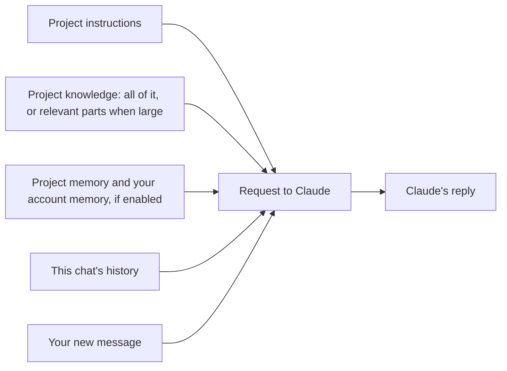
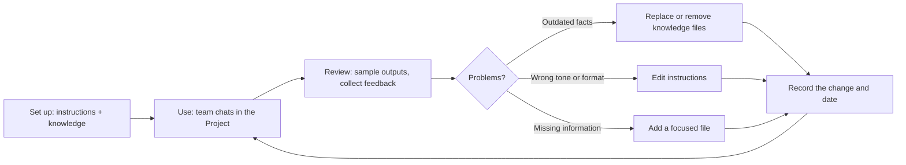

# Projects and Knowledge Management

> **Level:** Beginner to Intermediate · **Time:** ~50 min · **Exam relevance:** CCAO-F D3 (3.4), D5 (5.1, 5.3, 5.4) · CCAR-P D2 (2.2, 2.4)

## In plain English

A **Project** in the Claude apps is a dedicated workspace for a topic, team or recurring piece of work. Each Project has three things a normal chat does not:

1. **Instructions:** standing guidance that applies to every chat in the Project ("You are helping the HR team; write in plain English; cite the policy section").
2. **Knowledge:** files and documents Claude can draw on in every chat in the Project (a style guide, a policy handbook, a product spec).
3. **Its own chat history and memory:** conversations stay grouped together, and each Project keeps its own memory, separate from other Projects.

Think of a Project as a briefing room. Instead of re-explaining the background and handing over the same documents at the start of every meeting, you set up the room once. Everyone who walks in (every new chat) starts with the same briefing pack and the same ground rules.

Projects are the main way business users **persist** context, which is one of the three strategies for managing context (restart, summarise, persist) introduced in [Context windows](../01-ai-and-llm-fundamentals/05-context-windows.md).

## Why it matters

CCAO-F Domain 5 (Configuration and Knowledge Management) is largely about Projects: configuring them with instructions and knowledge (5.1), managing uploaded knowledge and connectors (5.2), writing effective system-level instructions (5.3) and maintaining them over time (5.4). Domain 3 objective 3.4 adds managing context limits and memory. Together those are about a quarter of the CCAO-F exam by weight (see [`registry.yaml`](../16-certification-tracks/registry.yaml)).

For architects, Project instructions are the app-level equivalent of a system prompt (CCAR-P 2.2), and Project knowledge is a managed form of the context and retrieval decisions covered in CCAR-P 2.4 and [Module 11](../11-rag-and-knowledge-systems/README.md).

## How it works

### What happens when you chat in a Project

Because Claude is [stateless](../02-claude-fundamentals/01-how-claude-works.md), a Project works by assembling the right context for every request:



### Facts to know (as of 2026-10-24)

From the Help Center articles on [Projects](https://support.claude.com/en/articles/9517075-what-are-projects), [memory](https://support.claude.com/en/articles/11817273-using-claude-s-chat-search-and-memory-to-build-on-previous-context) and [Google Workspace connectors](https://support.claude.com/en/articles/10166901-using-the-google-workspace-connectors):

| Topic | Fact |
|---|---|
| Availability | Projects are on all plans. Free accounts can create up to five Projects |
| Knowledge | Upload documents, text, code and other files. Claude uses them as background for every chat in the Project |
| Large knowledge | On paid plans, when knowledge approaches the context limit, the Project switches to a retrieval (RAG) mode that expands capacity by up to about ten times, loading the relevant parts for each question |
| Google Drive files | You can add Drive documents to Project knowledge in private Projects; Google Docs added this way sync, so Claude uses the latest version |
| Instructions | Each Project has its own instructions that shape Claude's responses in that Project |
| Sharing | On Team and Enterprise plans, Projects can be shared with people or the whole organisation with "Can view" (chat but not change) or "Can edit" (change instructions and knowledge, manage members) permissions |
| Memory | Each Project has its own memory. Inside a Project, Claude uses that Project's memory plus your account memory, but never other Projects' memories. Turn off "Use account memory" on a Project to isolate it fully |
| Connectors | On Team and Enterprise plans, connectors are available only in private Projects |

> **New Projects beta (as of 2026-10-24):** a new version of Projects is rolling out in stages, starting with Claude Code, for selected Pro and Max subscribers; chat, Cowork, Team and Enterprise follow later ([What are Projects?](https://support.claude.com/en/articles/9517075-what-are-projects)). It works differently; this page describes the standard version.

### Writing effective Project instructions

Project instructions work like a system prompt (see [System prompts and roles](../03-prompt-engineering/07-system-prompts-and-roles.md)). The Help Center advises keeping them concise and focused on general context, key guidelines and Claude's role. A reliable structure:

| Section | Purpose | Example line |
|---|---|---|
| Role and purpose | What this Project is for | "This Project helps the Northwind complaints team draft acknowledgement letters." |
| Audience | Who outputs are for | "Letters go to retail customers; many are upset; reading level should be plain English." |
| How to use the knowledge | Which files to rely on, and how | "Use only the Complaints Handling Policy (v4) for timelines. Cite the section number." |
| Rules and constraints | Must and must not, with reasons | "Never admit liability, because that is a decision for a complaints officer." |
| Output format | Default shape | "Three paragraphs, under 200 words, no bullet points." |
| Uncertainty | What to do when unsure | "If the policy doesn't cover the situation, say so and suggest escalation." |

Good instructions are **specific, explain why, and stay short**. Put long reference material in knowledge, not instructions. Avoid contradicting the knowledge files.

### Organising knowledge

| Do | Don't |
|---|---|
| Upload the authoritative version and name files clearly ("Expenses-Policy-v3-2026-09.pdf") | Upload three drafts of the same policy |
| Keep files focused on the Project's purpose | Dump an entire shared drive "just in case" |
| Use synced Google Docs for content that changes often (private Projects) | Rely on a static upload that silently goes out of date |
| Remove outdated files when you add replacements | Leave old and new versions side by side |
| Tell Claude in instructions which file wins if sources conflict | Assume Claude will guess the right one |

### Maintaining a Project (CCAO-F 5.4)

A Project is a living configuration. Treat it like a shared document with an owner.



Practical habits:

- **Name an owner** for each shared Project.
- **Keep a change note** at the top of the instructions (for example, "Last updated 2026-10-20: added v4 policy, removed v3").
- **Review on a schedule** (monthly or when source documents change).
- **Test after changes:** keep three or four standard questions and re-ask them after edits to check nothing broke.
- **Check permissions** periodically: who can view, who can edit.

### Restart, summarise or persist: the full decision

This is CCAO-F objective 3.4 in practice. Use it whenever a conversation is getting long, slow or confused.

| Situation | Best move | How |
|---|---|---|
| Starting an unrelated task | **Restart** | New chat (inside the relevant Project, if there is one) |
| Chat has gone off track, or keeps repeating an early mistake | **Restart** | New chat; restate only the correct facts |
| Same task, long history, only the conclusions matter now | **Summarise** | Ask for a summary of decisions, open questions and key facts; start a new chat with it |
| Information you will need in many future chats | **Persist** | Add to Project knowledge (documents) or instructions (rules, preferences) |
| A personal preference you want everywhere | **Persist** | Memory (check it has been saved, and edit it in settings if needed) |
| Sensitive one-off question you don't want kept | **Restart** in an incognito chat | Not saved to history or memory |

Paid plans with code execution enabled also apply *automatic context management*, summarising earlier messages as a chat approaches the limit so it can continue. That is helpful, but it is not a substitute for choosing deliberately: summaries lose detail, and long chats use more of your plan's usage.

## Example

Setting up a Project for a recurring task.

**Scenario:** you write a weekly update for your department head about a software rollout.

1. Create a Project called "Rollout weekly updates".
2. Add knowledge: the rollout plan, the risk register, and one past update that the department head liked.
3. Write instructions:

```text
Purpose: Help me write the weekly rollout update for the Head of Operations.

Audience: The Head of Operations reads these on her phone between meetings. She wants
decisions and risks first, detail last.

Sources: Use the Rollout Plan for milestones and dates, and the Risk Register for risks.
If my notes for the week conflict with these documents, point out the conflict rather than
choosing one.

Format: Match the structure of "Example update - week 12". Headline (one sentence), then
"Decisions needed", "Progress", "Risks", "Next week". Under 250 words.

Rules: Never invent dates or percentages. If a figure is missing, write [figure needed].
```

4. Each week, open a **new chat in the Project**, paste your rough notes, and ask for the update.
5. When the rollout plan changes, **replace** the file rather than adding a second version, and update the change note.

## Enterprise use case

*Contoso Health*'s HR advisory team answers about 300 staff policy questions a week. Their first attempt used one shared Project with 46 uploaded documents, including several superseded policies, and three paragraphs of instructions written by different people that partly contradicted each other. Answers sometimes quoted an old policy.

The team lead restructures it:

- **Knowledge:** removed 19 outdated files; renamed the rest with version and date; switched frequently updated policies to synced Google Docs.
- **Instructions:** rewritten into the six-section structure above, under 200 words, with a rule that the most recent dated policy wins.
- **Sharing:** advisors get "Can view"; two named owners get "Can edit".
- **Maintenance:** monthly review, a change log line in the instructions, and five standard test questions re-asked after every change.
- **Habits:** advisors open a new chat per enquiry instead of one long thread.

Accuracy on the five test questions goes from three out of five to five out of five, and the team no longer hits usage limits by mid-afternoon.

## Common mistakes

- **Putting long reference material in instructions.** Instructions should be short guidance; documents belong in knowledge.
- **Uploading every version of a document.** Conflicting sources produce inconsistent answers.
- **One long chat per Project.** Start a new chat for each new question; the Project keeps the shared context.
- **Never updating the Project.** Stale knowledge gives confidently outdated answers.
- **Contradictory instructions from several editors.** Give each shared Project an owner.
- **Assuming everything in knowledge is always read in full.** On large Projects, retrieval loads relevant parts; clear file names and focused documents help it find the right ones.
- **Mixing unrelated work in one Project.** Its memory and knowledge then pull in irrelevant context.

## Security considerations

- **Knowledge is shared with everyone who can access the Project.** Check that every viewer is allowed to see every file before sharing a Project.
- **Instructions are not a secrets store.** Never put passwords or keys in instructions or knowledge.
- **Data classification still applies.** Uploading a file to a Project is sharing it with the AI service under your plan's terms; follow your organisation's policy ([Responsible use](../02-claude-fundamentals/05-responsible-use.md)).
- **Untrusted documents can contain hidden instructions.** A document in knowledge that says "ignore previous instructions" is an indirect prompt-injection risk. Only add documents from trusted sources ([Indirect prompt injection](../12-ai-security/03-indirect-prompt-injection.md)).
- **Memory isolation.** For sensitive Projects, consider turning off "Use account memory" so personal context does not mix in.

## Troubleshooting

| Symptom | Likely cause | What to do |
|---|---|---|
| Answers quote an outdated policy | Old file still in knowledge | Remove superseded files; state "latest version wins" in instructions |
| Claude ignores a rule | Rule buried in long or contradictory instructions | Shorten instructions; put the rule near the top with its reason |
| Claude can't find information you know is uploaded | Large knowledge in retrieval mode; vague file names; question wording | Name the document in your question; split huge files into focused ones |
| Team members get different answers | Different chats with different history | Start new chats per question; tighten instructions and format |
| Drive file not available to add | Shared Project (Drive files are limited to private Projects) | Use a private Project or upload a copy, following policy |

## Check your understanding

1. What three things does a Project have that a normal chat does not?
2. Where should a 40-page style guide go: instructions or knowledge? Why?
3. Name three habits for maintaining a shared Project.
4. A chat in your Project has gone off track after a misunderstanding. What should you do?
5. What happens to Project knowledge on paid plans when it gets very large?

<details>
<summary>Answers</summary>

1. Instructions that apply to every chat, knowledge files available to every chat, and its own grouped chat history and separate memory.
2. Knowledge. Instructions should be short, focused guidance; long reference material belongs in knowledge where it can be retrieved as needed.
3. Any three of: a named owner, a change note with dates, scheduled reviews, re-testing standard questions after changes, removing outdated files, reviewing permissions.
4. Restart: open a new chat in the same Project and restate only the correct facts (summarise first if you need the conclusions).
5. It switches to a retrieval mode that loads the relevant parts for each question, expanding capacity by up to about ten times.

</details>

## Further reading

- [What are Projects?](https://support.claude.com/en/articles/9517075-what-are-projects) (Claude Help Center)
- [Using chat search and memory](https://support.claude.com/en/articles/11817273-using-claude-s-chat-search-and-memory-to-build-on-previous-context) (Claude Help Center)
- [How large is the context window on paid Claude plans?](https://support.claude.com/en/articles/8606394-how-large-is-the-context-window-on-paid-claude-plans) (Claude Help Center)
- Related: [System prompts and roles](../03-prompt-engineering/07-system-prompts-and-roles.md), [Memory and persistence](../04-context-engineering/04-memory-and-persistence.md), [Lab 05: Context management](../19-hands-on-labs/lab-05-context-management/README.md)

<!-- page-nav:start -->
---

[← Previous: Model Selection](03-model-selection.md) · [Module overview](README.md) · [Next: Artifacts and Output Formats →](05-artifacts-and-output-formats.md)
<!-- page-nav:end -->
