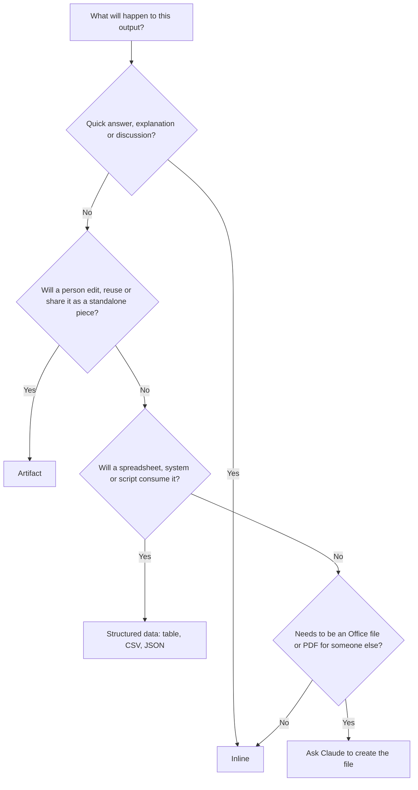

# Artifacts and Output Formats

> **Level:** Beginner · **Time:** ~35 min · **Exam relevance:** CCAO-F D2 (2.5, 2.6), D3 (3.1)

## In plain English

When Claude answers, the result can take different shapes:

- **Inline:** ordinary text in the conversation. Best for short answers and discussion.
- **An Artifact:** a standalone piece of content that opens in its own panel beside the chat, such as a document, a block of code, a diagram, a small website or an interactive tool. You can edit it, come back to it and share it.
- **Structured data:** a table, a list in a fixed layout, or machine-readable formats like JSON or CSV that another tool or person can process.
- **Files:** with code execution enabled, Claude can create files such as spreadsheets, documents and presentations for you to download.

Choosing the right shape is like choosing between telling a colleague something, sending them a document, or filling in a form. The content might be the same; the right container depends on what happens next.

## Why it matters

CCAO-F objective 2.6 asks you to curate information and choose output formats (Artifacts, inline, structured data). Objective 2.5 asks you to edit and adapt outputs for an audience, and 3.1 to choose the right feature, Artifacts included. In real work, the wrong format causes friction: a long policy draft lost in a chat scroll, or a table that someone has to retype into a spreadsheet.

## How it works

### When Claude creates an Artifact

As of 2026-10-24, the Help Center says Claude creates an Artifact when the content is substantial and self-contained (typically more than about 15 lines), you are likely to edit or reuse it, and it makes sense on its own without the rest of the chat ([What are Artifacts?](https://support.claude.com/en/articles/9487310-what-are-artifacts-and-how-do-i-use-them)). You can also simply ask for one: "Put this in an Artifact."

Artifacts can include:

- documents, code snippets and single-page websites,
- images rendered as code (such as SVG), diagrams and flowcharts,
- dashboards and small interactive tools,
- content built from templates for documents, slides and designs (some templates are in beta or limited to certain plans).

Key behaviours:

- Artifacts open beside the conversation and are saved to an **Artifacts** area you can return to.
- You can ask Claude to change an Artifact, and edit some template-based Artifacts directly.
- Artifacts start **private to you**; you choose whether to share or publish them.
- Some Artifacts can call Claude themselves, so people using a shared Artifact interact with it under their own accounts and plan limits.
- Artifacts require the "code execution and file creation" capability to be enabled in settings.

Feature availability varies by plan (for example, connecting apps to Artifacts and some templates are paid-plan features as of 2026-10-24). Check the Help Center for your plan.

### Choosing a format



| Format | Best for | Watch out for |
|---|---|---|
| Inline prose | Explanations, short drafts, back-and-forth refinement | Long content gets lost in the scroll |
| Inline table | Comparisons a person will read | Copying into tools can lose formatting |
| Artifact (document) | Policies, reports, letters you will edit and reuse | Remember to check facts before sharing |
| Artifact (code or interactive) | Calculators, prototypes, diagrams, small web pages | Test it; treat it as unreviewed code |
| Structured data (CSV, JSON) | Feeding a spreadsheet, database or another tool | Validate the structure before importing |
| Generated files | Spreadsheets, decks and documents to distribute | Open and review before sending |

### Asking for a specific format

Be explicit about format in your prompt or in [Project instructions](04-projects-and-knowledge.md):

```text
Return the result as a table with these columns, in this order:
Supplier | Contract end date (YYYY-MM-DD) | Annual value (GBP) | Renewal owner
Use "unknown" where the document doesn't say. No other text before or after the table.
```

For developers, the Claude API's structured outputs feature can guarantee that a response matches a JSON schema; see [Structured output](../03-prompt-engineering/06-structured-output.md) and [Lab 03: Structured outputs](../19-hands-on-labs/lab-03-structured-outputs/README.md).

### Adapting for the audience (CCAO-F 2.5)

The same content often needs several forms. Ask Claude to adapt rather than starting again:

| Audience | Adaptation |
|---|---|
| Executive | One-paragraph summary with the decision needed first |
| Team | Action list with owners and dates |
| Customer | Plain language, no internal jargon, clear next step |
| System | CSV or JSON with fixed field names |

Comparing two versions side by side ("Give me two versions: one formal, one conversational") is a quick way to choose.

## Example

Try this sequence in a Claude app:

1. Paste a few paragraphs of meeting notes (no personal or confidential data) and ask: "Summarise the key decisions in three bullets." The answer appears **inline**, which suits a quick check.
2. Ask: "Now turn these notes into a one-page meeting summary document with headings for Decisions, Actions (with owner and due date) and Open questions. Put it in an Artifact." A **document Artifact** opens beside the chat.
3. Ask: "Change the Actions section to a table and make the tone more formal." The Artifact updates; earlier versions remain available.
4. Ask: "Give me the actions only, as CSV with columns action,owner,due_date." You get **structured data** ready to paste into a tracker.
5. Ask: "Create a simple interactive checklist from the actions where I can tick items off." You get an **interactive Artifact**.

Same source, four formats, each suited to a different next step.

## Enterprise use case

*Acme Logistics*' procurement team reviews 30 supplier contracts each quarter. Their workflow in a Project:

- **Inline** for questions about individual clauses during review.
- **Structured data** (a CSV with fixed columns) for key dates and values, imported into the contract tracker after a person checks ten random rows against the source contracts.
- **Document Artifact** for the quarterly summary to the finance director, edited by the procurement lead before sharing.
- **Interactive Artifact** for a renewal-calendar view used in the team meeting, shared privately with the team.

The format rules live in the Project instructions, so everyone gets consistent outputs. Because outputs feed financial decisions, the human checks are written into the procedure (CCAO-F 2.4).

## Common mistakes

- **Leaving important documents inline.** If you will edit or reuse it, put it in an Artifact or file.
- **Asking for "a table" without columns.** Specify column names, order and value formats.
- **Importing structured data without checking it.** Validate a sample against the source.
- **Sharing an Artifact without reviewing it.** Shared content carries your name; check facts and data first.
- **Using an interactive Artifact as a production system.** It is a quick prototype, not a governed application.

## Security considerations

- **Review before sharing or publishing.** Shared Artifacts can expose any data you included. Remove personal or confidential information first, and follow your organisation's rules on publishing.
- **Treat generated code as untrusted.** Interactive Artifacts and code snippets should be reviewed before anyone relies on them, and never pasted into production systems unreviewed.
- **Validate structured data.** Malformed or manipulated CSV or JSON can break or mislead downstream tools. Check structure and values before import ([Insecure output handling](../12-ai-security/06-insecure-output-handling.md)).
- **Artifacts that call Claude** use the viewer's account; make sure the people you share with understand what the Artifact does with their input.

## Troubleshooting

| Symptom | Likely cause | What to do |
|---|---|---|
| Claude answers inline when you wanted an Artifact | Output judged short, or not requested | Ask explicitly: "Put this in an Artifact" |
| Artifacts don't appear at all | Code execution and file creation setting is off, or disabled by an admin | Turn it on in settings, or ask your administrator |
| Table won't paste cleanly into a spreadsheet | Formatting rather than data | Ask for CSV instead |
| JSON has extra text around it | Format not strictly specified | Say "Return only JSON, no other text"; in the API, use structured outputs |

## Check your understanding

1. Name four output formats Claude can produce.
2. When does Claude typically create an Artifact?
3. Which format would you choose for data that will be imported into a tracker?
4. What should you do before sharing an Artifact outside your team?

<details>
<summary>Answers</summary>

1. Inline text, Artifacts (documents, code, diagrams, interactive tools), structured data (tables, CSV, JSON) and generated files (spreadsheets, documents, presentations).
2. When the content is substantial and self-contained (typically more than about 15 lines), likely to be edited or reused, and makes sense without the rest of the chat, or when you ask for one.
3. Structured data such as CSV, with specified columns, validated against the source before import.
4. Review it for accuracy and remove any personal or confidential data, following your organisation's sharing rules.

</details>

## Further reading

- [What are Artifacts and how do I use them?](https://support.claude.com/en/articles/9487310-what-are-artifacts-and-how-do-i-use-them) (Claude Help Center)
- [Structured outputs](https://platform.claude.com/docs/en/build-with-claude/structured-outputs) (Anthropic documentation)
- Related: [Structured output](../03-prompt-engineering/06-structured-output.md)
- Previous: [Projects and knowledge management](04-projects-and-knowledge.md) · Next: [Connectors and integrations](06-connectors-and-integrations.md)
