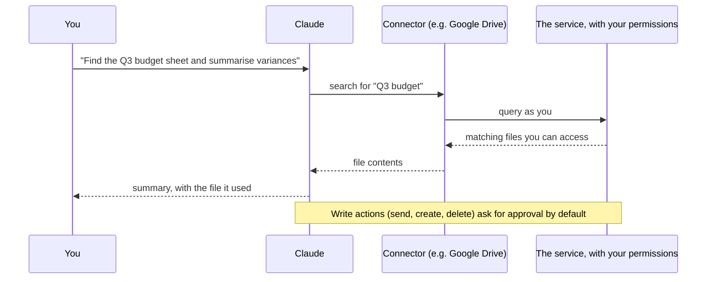

# Connectors and Integrations

> **Level:** Beginner to Intermediate · **Time:** ~40 min · **Exam relevance:** CCAO-F D5 (5.2), D6 (6.2) · CCAR-P D3 (3.2, 3.7)

## In plain English

On its own, Claude only knows what is in its training and what you type or upload. **Connectors** let Claude reach into other tools you use, such as Google Drive, Gmail, Google Calendar, Slack or a project tracker, to find information and, in some cases, take actions there: draft an email, create a calendar event, file a ticket.

A helpful picture is a personal assistant who has been given keys to some of your filing cabinets. They can fetch documents and do errands without you carrying everything to them. But they can only open the cabinets you gave them keys to, and anything they do is done in your name. So you choose the keys carefully.

## Why it matters

- CCAO-F objective 5.2 asks you to manage uploaded knowledge and connectors (for example Google Drive and Gmail). Objective 6.2 asks you to apply data-sensitivity and privacy considerations, which connectors make very concrete.
- CCAR-P objective 3.7 asks architects to choose integration mechanisms, and 3.2 to analyse authentication and authorisation for security gaps.
- Connectors remove copy-and-paste, keep information current, and enable real workflow automation. They also extend what can go wrong, so they need deliberate configuration.

## How it works

### Types of connector (as of 2026-10-24)

From the Help Center article on [connectors](https://support.claude.com/en/articles/11176164-use-connectors-to-extend-claude-s-capabilities):

| Type | What it is | Where |
|---|---|---|
| **Directory connectors** | Pre-built connectors listed in the Connectors Directory (for example Google Drive, Slack, Linear) | Web, desktop and mobile apps |
| **Desktop extensions** | Integrations installed into the desktop app that can work with local resources | Claude desktop app |
| **Custom connectors** | Remote MCP servers that you add by URL. Claude connects to them from Anthropic's cloud, so they must be reachable over the internet | Paid and free plans (Free is limited to one custom connector) |

MCP is the **Model Context Protocol**, an open standard for connecting AI applications to tools and data. Many connectors are built on it. [Module 08](../08-model-context-protocol/README.md) covers MCP in depth.

### How connectors work



Key principles:

- **Claude inherits your permissions.** It can reach only what your account can reach in that service, and nothing more.
- **You authenticate individually.** Even when an organisation enables a connector, each member signs in with their own account.
- **Approval for actions.** For Google Workspace, as of 2026-10-24, sending email and sharing, moving or trashing Drive files ask for approval by default. Organisation owners can set tool permissions to always allow, needs approval, or blocked.
- **Connector content enters the context window.** Search results and file contents use tokens like anything else ([Context windows](../01-ai-and-llm-fundamentals/05-context-windows.md)). The Help Center notes that limiting active connectors also saves context.

### Google Workspace connectors

As of 2026-10-24, the [Google Workspace connectors](https://support.claude.com/en/articles/10166901-using-the-google-workspace-connectors) are available to all users on web and desktop (Team and Enterprise need an owner to enable them first):

| Service | Read | Write (approval by default for higher-impact actions) |
|---|---|---|
| Gmail | Search and read email, including attachment metadata (not attachment content) | Draft, send, reply, forward |
| Google Calendar | View calendars and events you can access | Create, update and delete events; manage attendees; respond to invitations |
| Google Drive | Search and read Docs, Sheets, Slides, PDFs and Office files; view permissions and recent changes | Share, move or trash files; upload files; create folders; save generated files |
| Docs, Sheets, Slides | | Create and live-edit documents in a pane beside the chat (separate connectors) |

You can also add Drive documents to **Project knowledge** in private Projects, where Google Docs stay in sync ([Projects and knowledge](04-projects-and-knowledge.md)).

### Admin controls on Team and Enterprise

| Control | Purpose |
|---|---|
| Enable connectors for the organisation | Nothing is available to members until an owner enables it |
| Allow or block member requests for new connectors | Governs how new integrations are adopted |
| Org-wide tool permissions: always allow, needs approval, blocked | Enforce approval for write actions; users cannot override |
| Enterprise-managed authentication (beta) | Authorise a connector once for the organisation |
| Restrict connectors to the organisation's own accounts (Enterprise) | Prevent connecting work tools to personal Claude accounts |

On Team and Enterprise plans, connectors work only in private Projects, and chats containing synced content cannot be shared.

### Knowledge versus connectors

| | Project knowledge (uploads) | Connectors |
|---|---|---|
| Freshness | Static copy (except synced Google Docs) | Live data from the service |
| Scope | Exactly the files you chose | Anything your account can reach in that service |
| Actions | Read only | Can read and, for some, write |
| Best for | Stable reference material | Current, changing information and workflow actions |
| Governance effort | Lower | Higher: permissions, approvals, admin enablement |

### When research meets connectors

Research can use enabled connectors automatically, without asking for approval for each search ([Using research](https://support.claude.com/en/articles/11088861-using-research-on-claude)). Before starting research, check which connectors are on, and disable any you don't want searched.

## Example

A safe first connector exercise with Google Drive:

1. Open the connector settings (from the **+** menu or the Connectors area) and enable Google Drive. Sign in with your Google account and review the permissions requested.
2. In a new chat, ask: "Search my Drive for the most recent document with 'onboarding' in the title and list its headings." Check that Claude cites the file it used.
3. Ask a follow-up that needs reasoning: "Which onboarding steps have no named owner?"
4. Turn the connector off when you are done if you don't need it for other chats.

A good prompt with connectors names the source and the scope:

```text
Using only my Google Calendar for next week, list meetings longer than one hour that have
no agenda in the description. Don't change any events.
```

The final sentence matters: it makes clear you want a read-only task.

## Enterprise use case

*Northwind Lending* is enabling connectors for its operations team on Claude Enterprise. The security architect runs a short review (CCAR-P 3.2):

| Question | Decision |
|---|---|
| Which connectors does the use case need? | Google Drive (policy folders) and Calendar. Gmail is not enabled for now because customer emails contain personal financial data |
| Read or write? | Drive: read and save generated files only; sharing, moving and trashing set to blocked. Calendar: create events needs approval |
| Who gets them? | Operations team only, through role-based access |
| Personal accounts? | Connectors restricted to the organisation's own accounts |
| Custom connectors? | Member requests off; any custom connector needs a security review of the MCP server first |
| Research? | Staff trained that research uses enabled connectors automatically |
| Review cadence | Quarterly review of enabled connectors and permissions, logged in the AI governance register |

The result is useful automation with a clear boundary, documented for auditors.

## Common mistakes

- **Enabling every connector "to see what it can do".** Each one widens what Claude can reach. Enable what the task needs.
- **Forgetting that Claude acts as you.** If your account can delete a file, so can a connector-driven action approved by you.
- **Approving actions without reading them.** Read the email draft or event details before approving.
- **Using a custom connector from an unknown source.** Custom connectors are not verified by Anthropic.
- **Assuming connector data stays in one region.** Each connected service handles your data in its own systems, governed by its own terms and locations.

## Security considerations

- **Least privilege:** enable the fewest connectors, with read-only where possible, for the fewest people.
- **Approval gates for write actions:** keep "needs approval" for sending, sharing, deleting and similar actions ([Human-in-the-loop](../10-agentic-ai/05-human-in-the-loop.md)).
- **Trust only reputable servers:** the Help Center advises connecting only to servers from trusted organisations and reviewing authentication permissions carefully. Review custom MCP servers before use ([MCP server security](../12-ai-security/08-mcp-server-security.md)).
- **Indirect prompt injection:** content fetched by a connector (an email, a shared document) can contain instructions written by someone else. A malicious email could try to get Claude to forward data elsewhere. Approval gates and least privilege are the main defences ([Indirect prompt injection](../12-ai-security/03-indirect-prompt-injection.md)).
- **Data residency and terms:** connected services keep their own data-handling terms; settings that control where Claude processes data do not change where those services operate.

## Troubleshooting

| Symptom | Likely cause | What to do |
|---|---|---|
| Connector not listed | Not enabled by your organisation's owner, or not on your plan | Ask your administrator |
| Claude can't find a file you can see | Search terms, file type, or the connector isn't enabled for this chat | Enable it for the chat; name the file or paste its link |
| Google Workspace authentication fails at work | Google admin hasn't marked Claude as a trusted app | Ask your Google Workspace administrator; changes can take a short time to apply |
| Connector unavailable inside a shared Project | On Team and Enterprise, connectors work only in private Projects | Use a private Project |
| Responses slow or context fills quickly | Many connectors active, large results | Disable connectors you aren't using; narrow the request |

## Check your understanding

1. What does "Claude inherits your permissions" mean for a connector?
2. Name the three types of connector.
3. When would you use Project knowledge instead of a connector?
4. Why is it important to know which connectors are enabled before starting research?
5. Give two admin controls that reduce connector risk on Team or Enterprise plans.

<details>
<summary>Answers</summary>

1. Claude can access only what your own account can access in that service, and any actions it takes are performed as you.
2. Directory connectors, desktop extensions and custom connectors (remote MCP servers).
3. For stable reference material where a fixed, chosen set of files is enough and no actions are needed.
4. Because research can use enabled connectors automatically, without asking for approval for each search.
5. Any two of: enabling connectors only for the organisation as needed; org-wide tool permissions (always allow, needs approval, blocked); controlling member requests; restricting connectors to organisation accounts; enterprise-managed authentication.

</details>

## Further reading

- [Use connectors to extend Claude's capabilities](https://support.claude.com/en/articles/11176164-use-connectors-to-extend-claude-s-capabilities) (Claude Help Center)
- [Using the Google Workspace connectors](https://support.claude.com/en/articles/10166901-using-the-google-workspace-connectors) (Claude Help Center)
- [Model Context Protocol](https://modelcontextprotocol.io/) (official site)
- Related: [What is MCP?](../08-model-context-protocol/01-what-is-mcp.md), [Using MCP with Claude](../08-model-context-protocol/04-using-mcp-with-claude.md)
- Previous: [Artifacts and output formats](05-artifacts-and-output-formats.md) · Back to [Module 05 overview](README.md)
