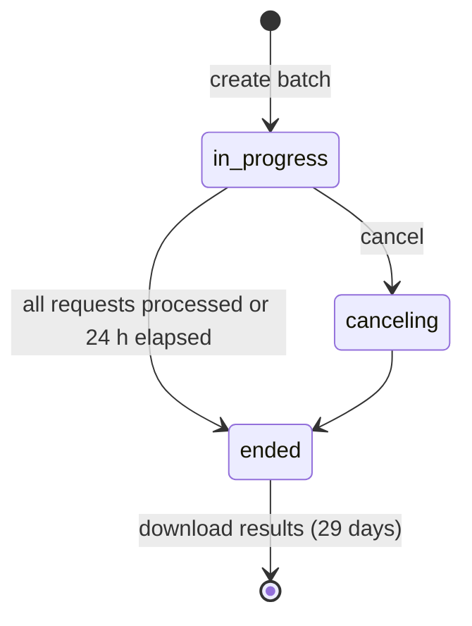

# Batch Processing

> **Level:** Intermediate · **Time:** ~40 min · **Exam relevance:** CCAR-P D1, D3, D4

## In plain English

Some work does not need an answer right now: classifying last month's support tickets, summarising 20,000 product
reviews, generating test data overnight. For that kind of work, the **Message Batches API** lets you submit a large set
of Messages API requests in one go. Anthropic processes them asynchronously, usually within an hour and always within
24 hours, and charges **half the normal price** (as of 2026-10-24).

Think of it as the difference between a taxi and a freight service: the taxi (a normal API call) leaves immediately;
freight is slower but much cheaper per item, and you can send a lot at once.

## Why it matters

- **Cost.** A 50% discount on all input and output tokens is one of the largest single cost levers available. It
  stacks with prompt caching discounts.
- **Throughput without rate-limit engineering.** You do not need to build your own queue and throttling to push
  thousands of requests through.
- **Architecture choice.** Deciding which workloads are latency-sensitive and which can be batched is a core
  cost-performance decision (CCAR-P-4.5) and part of designing end-to-end architectures (CCAR-P-1.2, 3.3).

## How it works

### Key facts (as of 2026-10-24)

| Topic | Detail |
|---|---|
| Endpoint | `POST /v1/messages/batches`; SDK: `client.messages.batches` |
| Price | 50% of standard input and output token prices |
| Size | Up to 100,000 requests or 256 MB per batch, whichever comes first |
| Completion | Most batches finish within 1 hour; batches not finished within 24 hours expire |
| Results | Available for 29 days after the batch is created |
| Order | Results can come back in any order: match them by `custom_id` |
| Features | Most Messages API features work inside a batch: system prompts, vision, tools, structured outputs, caching |
| Not supported | Streaming; some parameters such as server-side `fallbacks` and `max_tokens=0` pre-warming are rejected inside batches |
| Platforms | Claude API and Claude Platform on AWS. The Message Batches API is not available on Amazon Bedrock, Vertex AI or Microsoft Foundry; those clouds offer their own batch inference options with their own pricing and limits |

### Lifecycle



1. **Create** the batch with a list of requests. Each has a unique `custom_id` and normal Messages API `params`.
2. **Poll** `retrieve(batch_id)` until `processing_status` is `ended` (or use a scheduled job; do not poll every
   second).
3. **Read results** by streaming `results(batch_id)`. Each result has a `custom_id` and a `result.type`:

| `result.type` | Meaning | Action |
|---|---|---|
| `succeeded` | Request completed | Read `result.message`; still check its `stop_reason` |
| `errored` | Request failed | If it is a validation error, fix and resubmit; if a server error, it is safe to retry |
| `canceled` | Batch was cancelled before this request ran | Resubmit if still needed |
| `expired` | Batch hit the 24-hour limit before this request ran | Resubmit, possibly in smaller batches |

A request inside a batch can succeed at the HTTP level but still end with `stop_reason` of `max_tokens` or `refusal`.
Handle those exactly as you would for a normal call.

### Batching and caching together

If all requests share a large prefix (the same instructions and reference document), put a `cache_control` breakpoint
on it. Because batch requests run over an extended period, cache hits are best-effort; the 1-hour TTL usually gives a
better hit rate than the 5-minute default for batch workloads. The discounts stack, but measure the actual
`cache_read_input_tokens` in results rather than assuming.

### Choosing batch versus real time

| Use the Batches API | Use normal (real-time) calls |
|---|---|
| Results needed in hours, not seconds | A user is waiting |
| Large volumes of independent requests | Each step depends on the previous answer (agents, chats) |
| Backfills, evaluations, nightly reports, data enrichment | Tool-use loops that need your code between turns |
| Cost matters more than latency | Latency SLA under 24 hours that cannot tolerate expiry |

An evaluation suite (see [Module 14](../14-evaluation-and-testing/README.md)) is a classic batch workload: hundreds of
test cases, no user waiting, and a 50% saving on every run.

## Example

*Fabrikam Insurance* (fictional) classifies the previous day's free-text claim notes into categories every night.
The job creates a batch, waits, and writes results keyed by `custom_id`.

```python
import json
import time
from pathlib import Path

import anthropic
from anthropic.types.message_create_params import MessageCreateParamsNonStreaming
from anthropic.types.messages.batch_create_params import Request

client = anthropic.Anthropic()  # API key from ANTHROPIC_API_KEY

SYSTEM = [{
    "type": "text",
    "text": "Classify insurance claim notes into exactly one category: water_damage, theft, "
            "vehicle, liability, other. Use 'other' when unsure.",
    # Caching only works once the shared prefix reaches the model's minimum (512 tokens on current
    # models). A two-line prompt like this one will not be cached; in real use, put your full
    # classification guidelines and examples here so the prefix is long enough to reuse.
    "cache_control": {"type": "ephemeral", "ttl": "1h"},
}]
SCHEMA = {
    "type": "object",
    "properties": {"category": {"type": "string",
                                "enum": ["water_damage", "theft", "vehicle", "liability", "other"]}},
    "required": ["category"],
    "additionalProperties": False,
}

notes = json.loads(Path("data/claim_notes_2026-10-23.json").read_text(encoding="utf-8"))

batch = client.messages.batches.create(requests=[
    Request(
        custom_id=note["claim_ref"],            # unique, lets you match results
        params=MessageCreateParamsNonStreaming(
            model="claude-sonnet-5-5",
            max_tokens=200,
            system=SYSTEM,
            output_config={"effort": "low", "format": {"type": "json_schema", "schema": SCHEMA}},
            messages=[{"role": "user", "content": f"<note>{note['text']}</note>"}],
        ),
    )
    for note in notes
])
print("batch", batch.id, batch.processing_status)

while (batch := client.messages.batches.retrieve(batch.id)).processing_status != "ended":
    time.sleep(120)   # a scheduler or webhook-style job is better than a tight loop

results, retry = {}, []
for item in client.messages.batches.results(batch.id):
    match item.result.type:
        case "succeeded":
            msg = item.result.message
            if msg.stop_reason == "end_turn":
                text = next(b.text for b in msg.content if b.type == "text")
                results[item.custom_id] = json.loads(text)["category"]
            else:
                retry.append(item.custom_id)          # max_tokens or refusal: review
        case "errored" | "expired" | "canceled":
            retry.append(item.custom_id)

Path("out/categories.json").write_text(json.dumps(results, indent=2, sort_keys=True), encoding="utf-8")
print(f"classified {len(results)}, needs attention {len(retry)}")
```

Creating a batch over raw HTTP (two requests shown):

```bash
curl https://api.anthropic.com/v1/messages/batches \
  -H "x-api-key: $ANTHROPIC_API_KEY" \
  -H "anthropic-version: 2023-06-01" \
  -H "content-type: application/json" \
  -d '{
    "requests": [
      {"custom_id": "note-001", "params": {"model": "claude-sonnet-5-5", "max_tokens": 200,
        "messages": [{"role": "user", "content": "Classify: pipe burst in kitchen"}]}},
      {"custom_id": "note-002", "params": {"model": "claude-sonnet-5-5", "max_tokens": 200,
        "messages": [{"role": "user", "content": "Classify: bicycle stolen from shed"}]}}
    ]
  }'
```

> **Cost:** requires API credits (live mode), billed at the batch rate (50% of standard prices as of 2026-10-24).

## Enterprise use case

*Riverbend Utilities* (fictional) analyses free-text comments from about 80,000 customer satisfaction surveys each
quarter. Running them through real-time calls needed a custom queue to stay within rate limits, took most of a day,
and cost twice the batch price.

The team moved the job to the Batches API: one batch per 50,000 requests, a shared cached instruction prefix, and a
JSON schema for sentiment, topic and a one-line summary. A scheduled job polls every ten minutes and loads results into
the analytics warehouse keyed by `custom_id`. Errored and expired items are resubmitted automatically once; anything
failing twice goes to an exceptions table. The quarterly run now finishes within a couple of hours at roughly half the
token cost, and the engineering team retired its home-grown queue.

## Common mistakes

- **Matching results by position.** Results can arrive in any order. Always key by `custom_id`.
- **Non-unique `custom_id` values.** Make them unique and meaningful (record IDs).
- **Treating `succeeded` as "correct".** Still check `stop_reason` and validate the content.
- **Batching dependent steps.** If step 2 needs step 1's answer, you need two batches or real-time calls.
- **Polling aggressively.** Poll every few minutes, or run a scheduled job.
- **Forgetting expiry.** Very large or complex batches may not finish in 24 hours; split them.
- **Assuming every Messages API option is accepted.** Streaming, server-side fallbacks and some other options are not
  supported inside batches.

## Security considerations

- **Data lifecycle.** Results are retained for 29 days; download what you need and follow your retention policy for
  local copies. Treat batch inputs and outputs with the same data classification as the source data.
- **Bulk exposure.** A batch can contain a large volume of personal data in one submission. Minimise fields, redact
  where possible, and confirm the processing is permitted (see
  [data governance and compliance](../13-enterprise-ai-architecture/05-data-governance-and-compliance.md)).
- **Untrusted inputs at scale.** One malicious record can contain injected instructions; structured outputs with
  enums limit the damage, and outputs should be validated before loading into downstream systems.
- **Access control.** Anyone with a key for the workspace can list batches and read results; isolate sensitive batch
  jobs in their own workspace.

## Troubleshooting

| Symptom | Likely cause | Fix |
|---|---|---|
| 400 on batch creation | A request's `params` is invalid, or the batch exceeds size limits | Validate each request; split into smaller batches |
| Many `errored` results of type invalid request | Shared bug in request construction | Fix the template; resubmit only failed `custom_id`s |
| Many `expired` results | Batch too large or complex to finish in 24 hours | Split into smaller batches |
| Results joined to the wrong records | Matched by position | Match by `custom_id` |
| Fewer cache hits than expected | Requests processed far apart; 5-minute TTL | Use the 1-hour TTL; verify with usage fields |
| Batch endpoint not available | Using a platform without the Batches API | Use the platform's own batch offering or the Claude API |

## Check your understanding

1. What discount does the Batches API give, and what do you give up for it?
2. Why must you use `custom_id` to match results?
3. A request's result type is `succeeded` but its message `stop_reason` is `max_tokens`. What do you do?
4. Give two workloads that suit batching and one that does not.

<details>
<summary>Answers</summary>

1. 50% off standard token prices (as of 2026-10-24). You give up immediacy: results arrive asynchronously, usually
   within an hour and at most 24 hours, and streaming is not available.
2. Results are not returned in submission order.
3. Treat the output as incomplete: increase `max_tokens` (or simplify the task) and resubmit that request.
4. Suitable: nightly classification of records, evaluation suites, bulk summarisation or data enrichment. Unsuitable:
   an interactive chat or an agent loop where each step depends on the previous answer.

</details>

## Further reading

- [Batch processing](https://platform.claude.com/docs/en/build-with-claude/batch-processing) (Anthropic docs)
- [Pricing](https://platform.claude.com/docs/en/about-claude/pricing) (Anthropic docs)
- [Cost optimisation](../15-production-operations/03-cost-optimisation.md) and [rate limits and capacity](../15-production-operations/06-rate-limits-and-capacity.md) in this repository
- [Lab 17 — Cost optimisation](../19-hands-on-labs/lab-17-cost-optimisation/README.md)

<!-- page-nav:start -->
---

[← Previous: Vision, Documents, the Files API and Citations](04-vision-documents-and-citations.md) · [Module overview](README.md) · [Next: Errors, Rate Limits and Retries →](06-errors-rate-limits-retries.md)
<!-- page-nav:end -->
