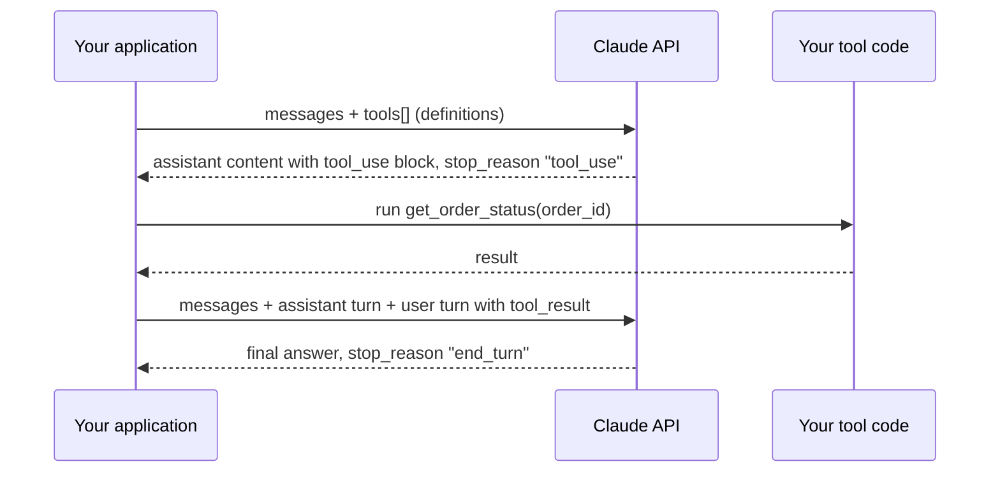

# Tool Use Fundamentals

> **Level:** Beginner · **Time:** ~25 min · **Exam relevance:** CCAR-P 3.1, 3.3

## In plain English

A language model on its own can only read text and write text. It cannot check today's exchange rate, look up an order, or add a row to a database. **Tool use** (often called *function calling*) closes that gap.

You describe a set of tools to Claude: their names, what they do and what inputs they accept. When Claude decides that one of those tools would help, it does not run the tool itself. It writes a structured request ("call `get_order_status` with `order_id = A-1042`") and stops. Your code runs the real function, sends the result back, and Claude carries on with the answer.

A helpful analogy is a skilled analyst working through a hatch in a wall. The analyst can reason and write, but cannot touch the systems on the other side. They pass a slip through the hatch ("please pull order A-1042"), you fetch the record, and pass it back. The analyst never holds your database password; you decide which slips you honour.

Some tools are different: Anthropic runs them on its own infrastructure. Web search is the common example. These **server tools** do their work inside the API call, so you see the request and the result in the response without running anything yourself.

## Why it matters

- **Fresh and private data.** The model's knowledge stops at its training cutoff and never included your private systems. Tools bring both into the conversation at the moment they are needed.
- **Actions, not just answers.** Creating a ticket, scheduling a meeting or running a test suite all need tools.
- **Reliability for exact work.** Arithmetic, date maths and lookups are better done by deterministic code than by next-token prediction.
- **The foundation of agents.** An agent is, at its core, a model calling tools in a loop until a goal is met. Module [10](../10-agentic-ai/README.md) builds on everything here.
- **Architecture decisions.** Which tools exist, who runs them and what they are allowed to touch are some of the most consequential choices an architect makes. The exam objective on capability bloat (CCAR-P-3.1) is about exactly this.

## How it works

### The request and response cycle

Everything happens through the Messages API (`POST /v1/messages`). There is no separate "functions" endpoint.



1. You send a request with a `tools` array alongside your `messages`.
2. Claude replies. If it wants a tool, the response contains one or more `tool_use` content blocks and `stop_reason` is `"tool_use"`.
3. Your code runs each requested tool.
4. You append Claude's reply as an `assistant` message, then a `user` message containing `tool_result` blocks, each matched to a `tool_use` block by `tool_use_id`.
5. You call the API again. Claude either calls more tools or writes its final answer (`stop_reason: "end_turn"`).

Steps 2 to 5 repeat as often as needed. That repetition is the **tool-use loop**, covered in [page 3](03-the-tool-use-loop.md).

### Content blocks you will meet

| Block | Appears in | Who creates it | Purpose |
|---|---|---|---|
| `tool_use` | assistant message | Claude | Request to run one of your client tools. Has `id`, `name`, `input` |
| `tool_result` | user message | Your code | Answer to a `tool_use`. Has `tool_use_id`, `content`, optional `is_error` |
| `server_tool_use` | assistant message | Claude | A call to a server tool Anthropic runs. Its `id` starts with `srvtoolu_` |
| `web_search_tool_result`, `web_fetch_tool_result`, and similar | assistant message | The API | The result of a server tool, paired by `tool_use_id` |
| `mcp_tool_use`, `mcp_tool_result` | assistant message | Claude and the API | Calls made through the API's MCP connector (see [Module 08](../08-model-context-protocol/04-using-mcp-with-claude.md)) |

The Claude API has no special `tool` or `function` role. Tool calls live inside ordinary `assistant` messages and tool results live inside ordinary `user` messages.

### Client tools versus server tools

| Aspect | Client tools | Server tools |
|---|---|---|
| Who executes | Your application | Anthropic's infrastructure |
| How you declare | Your own `name`, `description`, `input_schema`; or an Anthropic-schema client tool with a versioned `type` (for example the bash and text editor tools) | A versioned `type` such as `web_search_20260209`, plus a fixed `name` |
| What you return | A `tool_result` for every `tool_use` | Nothing; the result block is already in the response |
| Typical examples | Database lookups, internal APIs, sending email, file edits on your machine | Web search, web fetch, code execution, tool search |
| Data location | Stays in your environment until you put it in a `tool_result` | Processed by Anthropic; check data retention per tool |
| Control | Full: you can validate, log, rate-limit and refuse | Configured through tool parameters (`max_uses`, domain lists) and organisation settings |
| Typical stop reason when work remains | `tool_use` | `pause_turn` on long server-side loops |

Anthropic-schema client tools sit in between. Tools such as the bash tool (`bash_20250124`) and the text editor tool (`text_editor_20250728`) have a schema Anthropic defines and the model is trained on, but **your** code executes them. You declare them by `type` and `name`, without an `input_schema`.

> **Note:** As of 2026-10-24, the computer use and browser use tools are *client toolsets*: a single `tools` entry with no `name` that declares a fixed set of member tools. See the [tool reference](https://platform.claude.com/docs/en/agents-and-tools/tool-use/tool-reference) for current versions.

### How Claude decides to call a tool

When you send `tools`, the API builds a special system prompt that lists the tool definitions and explains how to call them. Claude then decides, turn by turn, whether a tool would help. Three things drive that decision:

1. **The tool description.** This is by far the most important input. Anthropic's documentation describes detailed descriptions as the main factor in tool performance.
2. **Your system prompt and user message.** "Use the order tool to check status" makes a call more likely.
3. **`tool_choice`.** `auto` (the default when tools are present) lets Claude decide; `none` forbids tools. The forcing options `any` and `tool` are rejected on the current models; see [page 2](02-defining-tools.md#controlling-when-claude-calls-a-tool).

Claude often writes a short sentence before a tool call ("I'll check that order for you"). Treat that text as ordinary output. Do not parse it to find out what Claude is doing: read the `tool_use` blocks.

## Example

A minimal request with one client tool. It shows the shape of the first round trip only; [page 3](03-the-tool-use-loop.md) completes the loop.

> **Cost:** requires API credits (live mode).

```python
import os
import anthropic

client = anthropic.Anthropic()  # reads ANTHROPIC_API_KEY from the environment

tools = [
    {
        "name": "get_order_status",
        "description": (
            "Look up the current fulfilment status of one customer order in the "
            "Acme Logistics order system. Call this when the user asks where an order "
            "is, whether it has shipped, or when it will arrive. Returns status, "
            "carrier and estimated delivery date. Does not return payment details."
        ),
        "input_schema": {
            "type": "object",
            "properties": {
                "order_id": {
                    "type": "string",
                    "description": "Order reference in the form A-1234.",
                }
            },
            "required": ["order_id"],
        },
    }
]

response = client.messages.create(
    model=os.environ.get("CLAUDE_MODEL", "claude-opus-5-5"),
    max_tokens=16000,
    tools=tools,
    messages=[{"role": "user", "content": "Has order A-1042 shipped yet?"}],
)

print("stop_reason:", response.stop_reason)
for block in response.content:
    if block.type == "tool_use":
        print("Claude wants:", block.name, block.input, "id:", block.id)
    elif block.type == "text":
        print("Text:", block.text)
```

A typical response has `stop_reason` of `"tool_use"`, a short text block and a `tool_use` block such as `{"name": "get_order_status", "input": {"order_id": "A-1042"}}`. Nothing has run yet. Your code must now execute the lookup and reply with a `tool_result`.

## Enterprise use case

*Northwind Lending* (fictional) runs a borrower help assistant. The first version answered questions only from a static FAQ, and complaints rose whenever borrowers asked about their own loan. The architecture team added three client tools:

| Tool | Executes in | Data touched |
|---|---|---|
| `loan_get_summary` | Northwind's API gateway, using the signed-in borrower's session token | Balance, next payment date, status |
| `loan_list_documents` | Same gateway | Statement metadata only |
| `support_create_ticket` | Ticketing system, through a service account limited to one queue | New ticket in the borrower-help queue |

They deliberately kept these as client tools rather than handing Claude a generic database tool: the gateway enforces that a borrower can see only their own loan, every call is logged with the session ID, and the ticket tool cannot close or reassign tickets. They also enabled the web search server tool, restricted with `allowed_domains` to Northwind's public help site and a regulator's consumer page, so Claude can quote current public guidance without the team maintaining a copy.

## Common mistakes

- **Expecting Claude to run the tool.** For client tools, nothing happens until your code runs the function and returns a `tool_result`.
- **Dropping the assistant turn.** You must append Claude's full `response.content` (including the `tool_use` blocks) before the `tool_result` message. Sending only the result produces a 400 error.
- **Treating text before the call as the call.** Read `tool_use` blocks, not prose.
- **Thin descriptions.** "Gets order" leaves Claude guessing when to call it and what it returns.
- **Giving the model a generic, powerful tool** (raw SQL, arbitrary HTTP) when a narrow tool would do. This is the root of capability bloat; see [page 6](06-tool-security.md).
- **Ignoring `stop_reason`.** Always branch on it before reading `content`. `max_tokens` can cut a `tool_use` block off mid-input, and `refusal` means the turn should not be executed.

## Security considerations

- **The model chooses the inputs.** Treat every `tool_use.input` as untrusted: validate it before execution, exactly as you would validate a web form.
- **Tool results are an injection channel.** A web page, email or ticket body returned in a `tool_result` can contain instructions aimed at Claude. Anthropic's documentation recommends keeping untrusted content inside `tool_result` blocks rather than moving it into the system prompt. See [indirect prompt injection](../12-ai-security/03-indirect-prompt-injection.md).
- **Credentials never go to the model.** Your tool code holds the API keys and session tokens; Claude sees only the inputs and the results.
- **Server tools move data.** Web fetch, for example, can be an exfiltration path when Claude has sensitive data in context. [Page 4](04-server-tools.md) covers the controls.

## Troubleshooting

| Symptom | Likely cause | Fix |
|---|---|---|
| Claude answers from memory instead of calling the tool | Description does not say when to use it | State the trigger conditions in the description; mention the tool in the prompt |
| 400: `tool_use` ids were found without `tool_result` blocks immediately after | Missing or misplaced `tool_result` | Reply to every `tool_use` id in the very next user message, results first |
| Claude calls the wrong tool | Overlapping names or descriptions | Make each tool's purpose and boundaries explicit; namespace names |
| `stop_reason` is `max_tokens` with a half-written tool input | `max_tokens` too low | Raise `max_tokens` and retry; do not run the partial call |

The [tools and agents troubleshooting page](../24-troubleshooting/tools-and-agents.md) has more cases.

## Check your understanding

1. In one sentence, what is the difference between a client tool and a server tool?
2. Which content block carries Claude's request to run your function, and which block carries your answer?
3. Why should you not parse Claude's text ("I'll look that up") to decide which tool to run?
4. Name two reasons an architect might prefer a narrow client tool over a broad one even when the broad one is easier to build.

<details>
<summary>Answers</summary>

1. Your application executes client tools and returns a `tool_result`; Anthropic executes server tools inside the API call and returns the result block itself.
2. `tool_use` (in the assistant message) and `tool_result` (in the next user message, matched by `tool_use_id`).
3. The text is free-form and can vary; the authoritative request is the structured `tool_use` block with a `name` and schema-shaped `input`.
4. Any two of: smaller blast radius if the model is manipulated; easier input validation; clearer audit logs; better tool selection accuracy; the downstream system can enforce per-user authorisation.

</details>

## Further reading

- [Tool use overview](https://platform.claude.com/docs/en/agents-and-tools/tool-use/overview) (Claude Docs)
- [Define tools](https://platform.claude.com/docs/en/agents-and-tools/tool-use/define-tools) (Claude Docs)
- [Handle tool calls](https://platform.claude.com/docs/en/agents-and-tools/tool-use/handle-tool-calls) (Claude Docs)
- [Tool reference](https://platform.claude.com/docs/en/agents-and-tools/tool-use/tool-reference) (Claude Docs)
- Next: [Defining tools](02-defining-tools.md)
