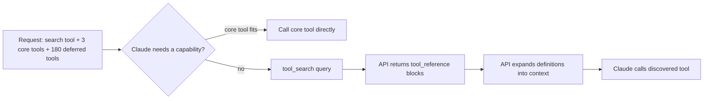

# Server Tools

> **Level:** Intermediate · **Time:** ~40 min · **Exam relevance:** CCAR-P 3.3, 3.8, 3.1

## In plain English

Some tools are so common that Anthropic runs them for you. Instead of building a web search integration, a page fetcher or a secure place to run Python, you add one line to your `tools` array and Claude can use the capability inside the same API call.

These are **server tools**. You do not write their code, you do not return `tool_result` blocks for them, and their results arrive already embedded in Claude's response. In exchange, you accept Anthropic's implementation, configure it through parameters rather than code, and pay any per-use charges.

This page covers the four server tools you are most likely to meet in design discussions and exam scenarios: **web search**, **web fetch**, **code execution** and **tool search**.

## Why it matters

- **Time to value.** Grounding answers in current web content or doing exact data analysis takes minutes to enable rather than weeks to build.
- **Accuracy and latency trade-offs (CCAR-P-3.3).** Server tools run their own loop inside the API call, can filter data before it reaches the context window, and save you round trips. They also add per-use cost and may lengthen a single turn.
- **Progressive discovery (CCAR-P-3.8).** Tool search lets an agent with hundreds of tools load only the few it needs, instead of putting every definition into every request.
- **Capability bloat (CCAR-P-3.1).** Enabling a server tool is easy, which makes it easy to over-provision. Each one widens what the model can reach.

## How it works

### Shared mechanics

- You declare a server tool by a **versioned `type`** and a fixed `name`, for example `{"type": "web_search_20260209", "name": "web_search"}`. Newer versions add features; older versions remain for older models.
- When Claude uses one, the response contains a `server_tool_use` block (id prefix `srvtoolu_`) followed by a result block such as `web_search_tool_result`. You **never** send a `tool_result` for a `srvtoolu_` id.
- **Errors do not raise.** A failed search returns HTTP 200 with an error object inside the result block (for example `error_code: "max_uses_exceeded"`). Branch on the shape before indexing.
- **Server-side loop and `pause_turn`.** The API may run several server tool calls in one turn. On a long turn it can stop with `stop_reason: "pause_turn"`. Send the assistant content back unchanged with the same `tools` and the API resumes. Cap the number of continuations.
- **Mixing with client tools.** If Claude calls a server tool and one of your client tools in the same turn, the API returns `stop_reason: "tool_use"` without running the server tool yet. Reply with **only** your `tool_result` blocks and the same `tools`; the server tool runs on that next request.

### Web search

Claude decides when to search, the API runs the queries, and Claude answers with citations.

| Version (as of 2026-10-24) | Adds |
|---|---|
| `web_search_20250305` | Basic search |
| `web_search_20260209` | **Dynamic filtering**: Claude writes code to filter results before they enter the context window (Claude 4.6 and later models) |
| `web_search_20260318` | `response_inclusion` control to drop nested search blocks from the response in agentic workflows |

Key parameters: `max_uses` (cap searches per request), `allowed_domains` **or** `blocked_domains` (not both; no scheme; subdomains included), and `user_location` for localised results. Citations are always on. Multi-turn conversations must pass back each result's `encrypted_content` unchanged.

Pricing (as of 2026-10-24): **$10 per 1,000 searches** plus normal token costs for the content that enters context. Failed searches are not billed. An organisation admin can disable web search or restrict domains in the Claude Console; request-level `allowed_domains` must then be a subset of the organisation list.

### Web fetch

Claude retrieves the full content of a specific web page or PDF.

| Version (as of 2026-10-24) | Adds |
|---|---|
| `web_fetch_20250910` | Basic fetch |
| `web_fetch_20260209` | Dynamic filtering |
| `web_fetch_20260309` | `use_cache: false` to bypass Anthropic's fetch cache |
| `web_fetch_20260318` | `response_inclusion` control |

Key parameters: `max_uses` (no default limit, so set one), domain lists, `citations` (off by default), `max_content_tokens` (truncate large pages), and `url_sources`.

The most important design fact: **Claude can only fetch URLs that already appeared in the conversation**: in user messages, in client tool results, or in earlier web search or fetch results. It cannot fetch a URL that appears only in its own output or only in the system prompt, and it refuses URLs that look like they contain credentials. This is an anti-exfiltration control. Anthropic still warns that enabling web fetch where Claude handles both untrusted input and sensitive data carries residual exfiltration risk. Use `url_sources` to stop specific tool results (for example a code runner that echoes model-written text) from counting as a URL source.

Web fetch has **no additional charge** beyond tokens. It does not render JavaScript-heavy pages.

### Code execution

Claude runs Bash commands and creates and edits files in a sandboxed container that Anthropic hosts.

| Version (as of 2026-10-24) | Notes |
|---|---|
| `code_execution_20250825` | Bash commands and file operations |
| `code_execution_20260120` | Adds REPL state persistence and [programmatic tool calling](https://platform.claude.com/docs/en/agents-and-tools/tool-use/programmatic-tool-calling) |
| `code_execution_20260521` | Latest; same runtime as `20260120`, and tells Claude about the 90-second limit per Python cell in programmatic tool calling |

None requires a beta header. Facts to know: the container has **no internet access**, so only pre-installed libraries are available (pandas, numpy, matplotlib, openpyxl, python-docx and others); containers can be reused across requests by passing the container ID; results arrive as `bash_code_execution_tool_result` and `text_editor_code_execution_tool_result` blocks.

Pricing (as of 2026-10-24): free when used alongside `web_search_20260209`/`web_fetch_20260209` or later; otherwise billed by execution time, with **1,550 free hours per organisation per month** and **$0.05 per container-hour** after that, with a 5-minute minimum per execution.

> **Note:** Do not add `code_execution` just to enable dynamic filtering on the `_20260209` web tools; the API provisions it automatically. Add it only when your application needs code execution for its own purposes.

**Programmatic tool calling** (with `code_execution_20260120` or later) lets Claude write a script that calls *your* tools from inside the container. Intermediate results stay in the script rather than flowing through Claude's context, which saves tokens and round trips when chaining many calls. You opt a tool in with `"allowed_callers": ["code_execution_20260120"]`.

### Tool search and deferred loading

Every tool definition costs input tokens on every request, and selection accuracy degrades as the catalogue grows. Anthropic's documentation reports accuracy dropping once you exceed roughly 30 to 50 available tools, and gives an example of a five-server setup consuming around 55,000 tokens of definitions before any work starts.

Tool search fixes this with **progressive discovery**:

1. Add a search tool: `tool_search_tool_regex_20251119` (Claude writes Python regex patterns, up to 200 characters) or `tool_search_tool_bm25_20251119` (natural-language queries, up to 500 characters).
2. Send **every** tool definition as usual, but mark most with `"defer_loading": true`.
3. Claude initially sees only the search tool and the non-deferred tools.
4. When it needs a capability, it searches. The API returns up to five matches by default as `tool_reference` blocks and expands them into full definitions automatically.
5. Claude calls the discovered tool as a normal client tool.

Rules (as of 2026-10-24): at least one tool must stay non-deferred (normally the search tool itself), or you get a 400; you can defer up to 10,000 tools per request; a deferred tool cannot also carry `cache_control`. Because discovered definitions are appended rather than swapped in, the prompt-cache prefix is preserved. For MCP connector servers, set `defer_loading` in the `mcp_toolset`'s `default_config` or `configs` instead of on each tool.

When to use it, per Anthropic's guidance: ten or more tools, definitions over about 10,000 tokens, falling selection accuracy, or several aggregated MCP servers. Keep your three to five most-used tools non-deferred so Claude can call them without searching. Namespaced names (`github_`, `jira_`) and keyword-rich descriptions make search work better.



## Example

A research request that combines web search and web fetch with conservative limits, plus correct `pause_turn` handling.

> **Cost:** requires API credits (live mode). Web search is billed per search in addition to tokens.

```python
import os
import anthropic

client = anthropic.Anthropic()
MODEL = os.environ.get("CLAUDE_MODEL", "claude-opus-5-5")

tools = [
    {"type": "web_search_20260209", "name": "web_search", "max_uses": 4,
     "allowed_domains": ["nist.gov", "owasp.org"]},
    {"type": "web_fetch_20260209", "name": "web_fetch", "max_uses": 3,
     "allowed_domains": ["nist.gov", "owasp.org"], "max_content_tokens": 20000,
     "citations": {"enabled": True}},
]

messages = [{"role": "user", "content":
             "Summarise the current OWASP guidance on LLM prompt injection in five bullets, with sources."}]

for _ in range(5):  # cap pause_turn continuations
    response = client.messages.create(model=MODEL, max_tokens=16000, tools=tools, messages=messages)
    if response.stop_reason != "pause_turn":
        break
    messages.append({"role": "assistant", "content": response.content})  # resend unchanged

if response.stop_reason == "end_turn":
    for block in response.content:
        if block.type == "web_search_tool_result" and not isinstance(block.content, list):
            print("Search error:", block.content.error_code)  # errors arrive as an object, not a list
        if block.type == "text":
            print(block.text)
    server_use = response.usage.server_tool_use  # None when no server tool ran
    print("Searches billed:", server_use.web_search_requests if server_use else 0)
else:
    print("Stopped with", response.stop_reason)
```

A tool-search request looks like this (definitions abbreviated):

```python
tools = [
    {"type": "tool_search_tool_bm25_20251119", "name": "tool_search_tool_bm25"},
    {"name": "crm_search_contacts", "description": "...", "input_schema": {...}},           # always loaded
    {"name": "billing_get_invoice", "description": "...", "input_schema": {...}, "defer_loading": True},
    {"name": "billing_issue_credit_note", "description": "...", "input_schema": {...}, "defer_loading": True},
    # ...hundreds more deferred tools
]
```

## Enterprise use case

*Tailspin Analytics* (fictional) built an internal "ops copilot" that aggregated five MCP servers and a set of in-house tools: around 240 tools in total. Every request carried tens of thousands of tokens of definitions, latency was high, and Claude regularly picked a similarly named tool from the wrong system.

The team made three changes. They renamed tools with service prefixes (`pagerduty_`, `grafana_`, `jira_`). They enabled BM25 tool search with all but four tools deferred, and added a system prompt line listing the tool categories available. They replaced a hand-built "run SQL against the metrics export" tool with the code execution server tool on uploaded CSV extracts, which gave analysts charts without granting the model database credentials. Input tokens per request fell sharply, and their tool-selection evaluation improved because Claude now chose among a handful of relevant definitions.

They also set `max_uses` on web search and an `allowed_domains` list of vendor status pages, after a review flagged that unrestricted web search in an incident channel could pull in attacker-controlled content.

## Common mistakes

- **Returning a `tool_result` for a `srvtoolu_` id.** The API rejects it; server tools need no result from you.
- **Treating `pause_turn` as the final answer**, or adding a "please continue" user message.
- **Indexing `content[0]` on a search result** without checking whether it is an error object.
- **Sending both `allowed_domains` and `blocked_domains`.** Choose one.
- **Expecting web fetch to retrieve URLs Claude made up.** It only fetches URLs already in the conversation.
- **Declaring `code_execution` alongside `_20260209` web tools "to enable filtering".** It is automatic, and an extra environment can confuse the model.
- **Deferring every tool.** At least one must be non-deferred.
- **Assuming code execution can `pip install` from the internet.** The container has no network access.

## Security considerations

- **Web content is untrusted.** Search and fetch results can carry indirect prompt injection. Keep them in tool results, constrain domains, and avoid pairing open web access with sensitive data and side-effecting tools in the same agent. See [indirect prompt injection](../12-ai-security/03-indirect-prompt-injection.md) and [data exfiltration](../12-ai-security/04-data-exfiltration-and-disclosure.md).
- **Use homograph-safe domain lists.** Anthropic warns that Unicode look-alike domains can bypass filters; keep entries ASCII-only.
- **Data retention differs by tool and version.** Basic web search and web fetch versions are eligible for zero data retention; the dynamic-filtering versions are not by default because they use code execution (set `"allowed_callers": ["direct"]` to disable filtering). Code execution and the MCP connector are not ZDR-eligible. Check the [API and data retention](https://platform.claude.com/docs/en/manage-claude/api-and-data-retention) page before processing regulated data.
- **Files written by code execution** should be downloaded with sanitised filenames (`os.path.basename`) into a dedicated directory.

## Troubleshooting

| Symptom | Likely cause | Fix |
|---|---|---|
| 400 saying web search or fetch is not enabled | An organisation admin disabled it in the Console | Ask the admin or remove the tool |
| `url_not_in_prior_context` from web fetch | URL appeared only in Claude's output or system prompt | Put the URL in the user message, or let web search find it |
| 400: all tools have `defer_loading` set | Every tool deferred | Leave the search tool (and a few core tools) non-deferred |
| Claude never finds a deferred tool | Name and description lack the words users use | Add keywords, namespace names, describe categories in the system prompt |
| Bills higher than expected | Unbounded `max_uses`; fetched pages large | Set `max_uses` and `max_content_tokens`; use dynamic filtering |

## Check your understanding

1. Why can't web fetch retrieve a URL that Claude invented in its own reply?
2. Your agent has 150 tools across four services and selection accuracy is falling. What server-side feature helps, and what two configuration rules must you follow?
3. Claude called `web_fetch` and your `run_command` client tool in the same turn. What do you send next?
4. When is code execution free, and how is it billed otherwise (as of 2026-10-24)?

<details>
<summary>Answers</summary>

1. Web fetch only retrieves URLs that already appeared in the conversation (user messages, client tool results, earlier search or fetch results). This limits the model's ability to exfiltrate data by constructing URLs.
2. Tool search with `defer_loading: true` on most tools. Keep at least one tool (normally the search tool) non-deferred, and send every tool's full definition in `tools` on each request. Keeping the most-used three to five tools non-deferred is also recommended.
3. A user message containing only the `tool_result` for `run_command`, with the same `tools` array. The API then runs the pending fetch and continues.
4. It is free when used with `web_search_20260209`/`web_fetch_20260209` or later. Otherwise each organisation gets 1,550 free hours per month, then $0.05 per container-hour, with a 5-minute minimum per execution.

</details>

## Further reading

- [Server tools](https://platform.claude.com/docs/en/agents-and-tools/tool-use/server-tools) (Claude Docs)
- [Web search tool](https://platform.claude.com/docs/en/agents-and-tools/tool-use/web-search-tool) and [web fetch tool](https://platform.claude.com/docs/en/agents-and-tools/tool-use/web-fetch-tool) (Claude Docs)
- [Code execution tool](https://platform.claude.com/docs/en/agents-and-tools/tool-use/code-execution-tool) (Claude Docs)
- [Tool search tool](https://platform.claude.com/docs/en/agents-and-tools/tool-use/tool-search-tool) (Claude Docs)
- [Progressive disclosure and Skills](../04-context-engineering/06-progressive-disclosure-and-skills.md) in Module 04

<!-- page-nav:start -->
---

[← Previous: The Tool-Use Loop](03-the-tool-use-loop.md) · [Module overview](README.md) · [Next: Tool Design Best Practices →](05-tool-design-best-practices.md)
<!-- page-nav:end -->
