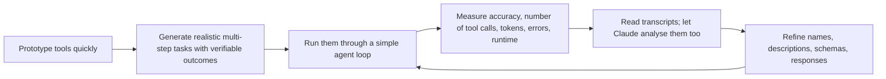

# Tool Design Best Practices

> **Level:** Intermediate · **Time:** ~40 min · **Exam relevance:** CCAR-P 3.1, 3.3, 3.8, 4.2

## In plain English

A normal API is written for programmers who read the documentation once and then call it the same way every time. A tool is written for a caller that is clever but unpredictable: Claude might call it with slightly different arguments each time, misread an ambiguous parameter, or pull a 2,000-row response into a limited context window and lose track of the task.

So designing a tool for an agent is less like publishing an API and more like designing a form for a busy colleague. Ask only for what you need, label every field clearly, give back an answer they can act on, and when something goes wrong, tell them exactly how to fix it.

Anthropic's engineering team summarised this approach in [Writing effective tools for agents](https://www.anthropic.com/engineering/writing-tools-for-agents) (published 2025-09-11). This page restates the main ideas in our own words, adds the related guidance from the Claude documentation, and shows how to apply them.

## Why it matters

- **Accuracy.** Most "the agent did something silly" incidents trace back to a confusing tool: overlapping purposes, vague parameters or noisy results.
- **Cost and latency (CCAR-P-3.3).** A tool that returns 40,000 tokens when 400 would do inflates every later turn of the loop.
- **Capability bloat (CCAR-P-3.1).** Wrapping every endpoint of every internal API produces a large, overlapping, risky tool surface. Fewer, better-chosen tools are both safer and more accurate.
- **Evaluation (CCAR-P-4.2).** Tool quality can only be judged against realistic tasks. Tool design is an evaluation discipline, not a one-off writing exercise.

## How it works

### Principle 1: Build fewer tools, around workflows

Do not mirror your API one endpoint at a time. Start from the tasks users actually need done and design the smallest set of tools that completes them.

| Instead of | Prefer | Why |
|---|---|---|
| `list_contacts` (returns everyone) | `crm_search_contacts(query, limit)` | The agent never needs everyone; listing wastes context |
| `get_customer`, `get_orders`, `get_tickets` called in sequence for every enquiry | `support_get_customer_context(customer_id)` returning the relevant summary | One call instead of three round trips |
| `create_pr`, `review_pr`, `merge_pr` with identical inputs | `github_pull_request(action, ...)` | Fewer, more capable tools reduce selection ambiguity (Claude Docs guidance) |

Consolidate when operations share inputs and context. Keep tools separate when their risk differs: a read tool and a destructive tool should not hide behind one `action` parameter if you need to gate or deny the destructive one independently.

### Principle 2: Namespace tool names

Prefix tools by service and resource: `jira_search_issues`, `jira_create_issue`, `slack_post_message`. Namespacing makes selection unambiguous as the catalogue grows, and it is especially important with [tool search](04-server-tools.md#tool-search-and-deferred-loading), where one query should surface a coherent group. Anthropic notes that naming schemes can affect performance, so test the one you choose.

### Principle 3: Return meaningful, high-signal context

- Return **what the agent needs for its next step**, not every column in the table.
- Prefer **meaningful identifiers** (names, slugs, readable references) over opaque internal IDs. Where an ID is needed for a follow-up call, return both.
- Offer a **`response_format`** parameter (for example `concise` or `detailed`) so the agent can request detail only when it needs it.
- Use natural-language field names: `due_date` beats `dd`.

### Principle 4: Be token-efficient by default

- **Paginate, filter and truncate** with sensible defaults (`limit=20`), and say in the response when results were truncated and how to get more.
- **Search over list.** Let the agent narrow results on the server side.
- **Know the host's limits.** Claude Code, for example, warns when an MCP tool result exceeds 10,000 tokens and defaults to a 25,000-token maximum (as of 2026-10-24). A tool that blows through that is a design problem.

### Principle 5: Write errors that teach

An error is a turn in the conversation. "Invalid input" gets you a guess; "`start_date` must be ISO 8601 (YYYY-MM-DD) and not in the past; received 31/12/2026" gets you a correct retry. Return errors as `tool_result` with `is_error: true` (see [the tool-use loop](03-the-tool-use-loop.md#reporting-failures-with-is_error)).

### Principle 6: Prompt-engineer the description

Describe the tool as you would to a capable new colleague: what it does, when to use it and when not, what each parameter means, what comes back and what it never does. Make parameter names unambiguous (`user_id` rather than `user`). Small description changes can produce large accuracy changes, which is why you measure them.

### Principle 7: Iterate with evaluations

Anthropic's recommended process is a loop:



- **Tasks should be realistic and multi-step**, drawn from real usage where possible, each with a checkable outcome.
- **Measure more than pass/fail.** Count tool calls per task, tokens consumed, error rate and wall-clock time. A tool that is accurate but triples the number of calls is a latency problem.
- **Read the transcripts.** Where did Claude hesitate, retry or pick the wrong tool? Feeding transcripts to Claude (for example in Claude Code) to propose improvements is part of the recommended workflow.
- **Hold out a test set** so you do not overfit descriptions to the tasks you iterate on.

Module [14](../14-evaluation-and-testing/README.md) covers evaluation design in depth.

## Example

A contact-search tool designed with these principles. The implementation is runnable offline: it uses synthetic data and does not call the API.

```python
"""crm_search_contacts: a token-efficient, agent-friendly tool (synthetic data)."""
from __future__ import annotations

import json
from typing import Literal

CONTACTS = [
    {"id": "c_001", "name": "Priya Raman", "company": "Woodgrove Bank", "role": "Head of Treasury",
     "email": "priya.raman@woodgrove.example", "last_contact": "2026-09-30", "notes": "Prefers email. " * 40},
    {"id": "c_002", "name": "Tom Okafor", "company": "Woodgrove Bank", "role": "Procurement Lead",
     "email": "tom.okafor@woodgrove.example", "last_contact": "2026-07-14", "notes": "Budget cycle in Q1."},
    {"id": "c_003", "name": "Lena Fischer", "company": "Litware", "role": "CTO",
     "email": "lena.fischer@litware.example", "last_contact": "2026-10-02", "notes": "Evaluating vendors."},
]

TOOL_DEFINITION = {
    "name": "crm_search_contacts",
    "description": (
        "Search the CRM for people by name, company or role. Call this before drafting outreach or when "
        "the user mentions a person or account you have not looked up. Returns at most `limit` matches, "
        "newest contact first. Use response_format='concise' (default) to choose a person, and 'detailed' "
        "only when you need notes or email for one specific contact. Does not return deal values."
    ),
    "strict": True,
    "input_schema": {
        "type": "object",
        "additionalProperties": False,
        "required": ["query", "limit", "response_format", "page"],
        "properties": {
            "query": {"type": "string", "description": "Words to match against name, company or role."},
            "limit": {"type": "integer", "description": "Maximum results, 1 to 20. Use 5 unless told otherwise."},
            "response_format": {"type": "string", "enum": ["concise", "detailed"]},
            "page": {"type": "integer", "description": "1-based page number for more results."},
        },
    },
}

def crm_search_contacts(query: str, limit: int = 5,
                        response_format: Literal["concise", "detailed"] = "concise",
                        page: int = 1) -> str:
    if not 1 <= limit <= 20:  # strict mode does not enforce numeric bounds; we do
        raise ValueError("limit must be between 1 and 20.")
    words = query.lower().split()
    if not words:
        raise ValueError("query is empty; pass a name, company or role, for example 'Woodgrove treasury'.")
    hits = [c for c in CONTACTS
            if all(w in f"{c['name']} {c['company']} {c['role']}".lower() for w in words)]
    hits.sort(key=lambda c: c["last_contact"], reverse=True)
    start = (page - 1) * limit
    window = hits[start:start + limit]
    if response_format == "concise":
        rows = [{"contact_id": c["id"], "name": c["name"], "company": c["company"], "role": c["role"]}
                for c in window]
    else:
        rows = [{**c, "notes": c["notes"][:500]} for c in window]  # cap free text
    result = {"results": rows, "total_matches": len(hits), "page": page}
    if start + limit < len(hits):
        result["next_step"] = f"More matches exist; call again with page={page + 1}."
    if not hits:
        result["next_step"] = "No matches. Try a shorter query, such as the company name alone."
    return json.dumps(result)

if __name__ == "__main__":
    print(crm_search_contacts("woodgrove"))
    print(crm_search_contacts("woodgrove treasury", response_format="detailed"))
```

What makes it agent-friendly:

- One search tool instead of a list tool; filtering happens server-side.
- `concise` results carry a readable name **and** the ID needed for a follow-up call.
- Long free text is capped; pagination and "what to do next" hints are explicit.
- Errors tell Claude how to correct the call.
- The description states when to use the tool, how to choose the format, and what it never returns.

## Enterprise use case

*Woodgrove Bank* (fictional) exposed its internal developer portal to an engineering assistant through an MCP server generated automatically from 63 OpenAPI endpoints. Evaluation on 120 realistic tasks (for example "Which services owned by the payments team failed their last deploy?") showed low success and many calls per task: Claude chained `list_services`, `get_service` and `get_deploys` dozens of times and regularly ran out of useful context.

The platform team rewrote the surface as nine workflow-level tools, including `portal_find_services(owner_team, status)` and `portal_get_deploy_history(service, limit)` with a `response_format` option. They namespaced everything with `portal_`, rewrote descriptions from the evaluation transcripts, and kept a held-out set of 40 tasks to check they had not overfitted. Success rose substantially, calls per task fell, and the security review got simpler because write operations were now two clearly named tools behind an approval gate.

## Common mistakes

- **Auto-generating one tool per API endpoint** and calling it done.
- **Returning raw database rows** with internal column names and opaque IDs.
- **No pagination or truncation**, so one call floods the context window.
- **Generic errors** ("failed", HTTP status codes only).
- **Overlapping tools** (`search_docs`, `find_documents`, `docs_lookup`) with no guidance on which to use.
- **Tuning descriptions by intuition only**, without an evaluation set, or tuning on the same tasks you report results on.
- **Hiding risky actions inside a consolidated tool**, which prevents denying or gating them separately.

## Security considerations

- **Design for least privilege from the start.** Workflow-level tools make it natural to expose exactly the operations a task needs (see [Tool security](06-tool-security.md)).
- **Keep risk boundaries visible.** Separate read and write tools so permission systems, allow-lists and approval gates can treat them differently.
- **Return minimal data.** Every field returned is a field that can leak through the model's output. Do not return secrets, tokens or unrelated personal data "just in case".
- **Treat descriptions as security-relevant content.** They instruct the model; review them like code.

## Troubleshooting

| Symptom | Likely cause | Fix |
|---|---|---|
| Many tool calls per task | Tools too granular | Consolidate into workflow-level tools |
| Claude picks a similar tool from another system | Unclear names | Namespace by service and resource |
| Context fills up mid-task | Verbose responses | Add `response_format`, pagination, truncation |
| Same parameter error repeats | Error message does not explain the fix | Return the expected format and an example |
| Accuracy improves on dev tasks but not in production | Overfitting to the evaluation set | Use a held-out test set and real transcripts |

## Check your understanding

1. Why does Anthropic suggest a search tool rather than a list tool for contacts?
2. What does a `response_format` parameter buy you?
3. You consolidated `issue_refund` and `get_refund_status` into one `refunds(action, ...)` tool. What security problem might you have created?
4. Name four metrics worth tracking when evaluating a tool set.

<details>
<summary>Answers</summary>

1. The agent rarely needs every contact. Searching filters on the server, returns fewer tokens, and avoids the agent scanning long lists in context.
2. It lets the agent request concise results by default and detailed results only when needed, saving tokens and keeping context focused.
3. You can no longer deny, rate-limit or require approval for the refund action independently of the harmless status lookup, because both share one tool name.
4. Any four of: task success or accuracy, number of tool calls per task, tokens consumed, tool error rate, wall-clock runtime.

</details>

## Further reading

- [Writing effective tools for agents](https://www.anthropic.com/engineering/writing-tools-for-agents) (Anthropic Engineering, 2025-09-11)
- [Define tools: best practices](https://platform.claude.com/docs/en/agents-and-tools/tool-use/define-tools) (Claude Docs)
- [Effective context engineering for AI agents](https://www.anthropic.com/engineering/effective-context-engineering-for-ai-agents) (Anthropic Engineering)
- [Building eval datasets](../14-evaluation-and-testing/03-building-eval-datasets.md) in Module 14
- Previous: [Server tools](04-server-tools.md) · Next: [Tool security](06-tool-security.md)
