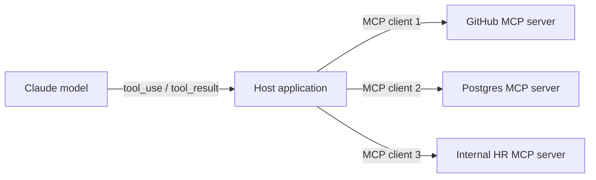

# What is MCP?

> **Level:** Beginner · **Time:** ~25 min · **Exam relevance:** CCAR-P 3.7; CCAO-F 5.2

## In plain English

Before USB, every printer, mouse and camera needed its own kind of port and its own driver for each computer. USB gave both sides one standard: a device maker builds to USB once, and it works with any computer that speaks USB.

The **Model Context Protocol (MCP)** does the same job for AI applications and the systems they need to reach. A team that owns a system (an issue tracker, a database, an internal document store) builds an **MCP server** once. Any AI application that speaks MCP (Claude Code, the Claude apps, Claude Desktop, IDEs and other agent frameworks) can then connect to it and use its tools and data.

Without MCP, if you have *M* AI applications and *N* systems, you can end up writing close to *M × N* custom integrations. With MCP you write *N* servers and each application implements one client. That is the whole idea.

## Why it matters

- **Reuse.** The same server serves a developer in Claude Code, an analyst in the Claude apps and an automated agent built on the Claude API.
- **Ownership.** The team that owns a system can publish and maintain its MCP server, including its access controls, rather than every AI project reimplementing them.
- **Ecosystem.** Many vendors publish official MCP servers, and directories such as the [Anthropic connectors directory](https://claude.ai/directory) list reviewed ones.
- **Architecture decisions.** "Should this integration be an MCP server, a direct API call, a CLI, or another agent?" is an exam objective in its own right (CCAR-P-3.7), covered in [page 6](06-mcp-vs-alternatives.md).
- **Risk.** A standard plug also standardises attack paths. Connecting an untrusted server is like installing an unvetted browser extension with access to your data; see [page 5](05-mcp-security.md).

## How it works

### The vocabulary in one table

| Term | Meaning | Example |
|---|---|---|
| **Host** | The AI application the user interacts with | Claude Code, Claude Desktop, an IDE, your own agent |
| **Client** | A connector inside the host; one client per server connection | The object Claude Code creates to talk to your Jira server |
| **Server** | A program that exposes capabilities over MCP | A GitHub server, a Postgres server, your in-house HR server |
| **Tools** | Functions the model can call | `create_issue`, `search_orders` |
| **Resources** | Data the application can read and give the model as context | A file, a database schema, a record, addressed by URI |
| **Prompts** | Reusable templates a user can choose, often surfaced as slash commands | `/review_code` |
| **Transport** | How messages travel | **stdio** for a local subprocess; **Streamable HTTP** for remote servers |

All messages use **JSON-RPC 2.0**. [Page 2](02-architecture.md) covers the architecture in depth.

### How MCP relates to tool use

MCP does not replace Claude's tool-use mechanism; it feeds it. When a host connects to an MCP server, it asks the server for its tools (`tools/list`), turns each into a tool definition Claude understands, and when Claude emits a `tool_use` for one of them, the host's MCP client sends `tools/call` to the server and returns the result as a `tool_result`.



So everything from [Module 07](../07-tool-use-and-function-calling/README.md) still applies: descriptions drive selection, results are untrusted input, and side effects need gates. MCP adds a standard way to **package, discover, authenticate and share** those tools, plus two primitives (resources and prompts) that plain tool use does not have.

### A short history and governance (as of 2026-10-24)

- **November 2024:** Anthropic released MCP as an open specification with SDKs and reference servers.
- **2025:** Adoption spread across AI applications, IDEs and agent frameworks. The specification added the Streamable HTTP transport (replacing the earlier HTTP+SSE transport) and an OAuth-based authorisation framework.
- **2025-12-09:** MCP moved to neutral stewardship: Anthropic handed it to the **Agentic AI Foundation (AAIF)**, which sits under the Linux Foundation and which Anthropic set up together with Block and OpenAI. According to Anthropic's announcement, the way MCP is governed does not change and Anthropic keeps investing in it.
- **2026-07-28:** The current specification revision. Requests became stateless and self-describing (protocol version and capabilities travel with every request), with an optional `server/discover` request in place of the older `initialize` handshake. Sampling and protocol-level logging were deprecated.

The specification lives at [modelcontextprotocol.io/specification](https://modelcontextprotocol.io/specification/latest), and official SDKs exist for Python, TypeScript and several other languages.

> **Note:** Because the protocol evolves quickly, always check which specification version a client and server support. The official Python SDK v2 serves both the current revision and older `initialize`-era clients from the same server.

### Where Claude uses MCP

| Surface | How MCP is used | Covered in |
|---|---|---|
| Claude apps (claude.ai, Desktop, Cowork) | **Connectors**: remote MCP servers added from the directory or as custom connectors | [Page 4](04-using-mcp-with-claude.md), [Module 05](../05-claude-products-and-models/06-connectors-and-integrations.md) |
| Claude Desktop | Also local servers configured in `claude_desktop_config.json` | [Page 3](03-building-an-mcp-server.md) |
| Claude Code | `claude mcp add`, `.mcp.json`, managed MCP policy | [Page 4](04-using-mcp-with-claude.md), [Module 09](../09-claude-code/07-mcp-in-claude-code.md) |
| Claude API | The **MCP connector** (`mcp_servers` plus `mcp_toolset`, beta) for remote servers; or SDK helpers when you run your own MCP client | [Page 4](04-using-mcp-with-claude.md) |
| Claude Agent SDK and Managed Agents | MCP servers configured on the agent | [Module 10](../10-agentic-ai/06-managed-agents-and-agent-sdk.md) |

## Example

A user of Claude Code at a fictional company adds the team's ticket server and uses it in plain language:

```bash
# Add a remote MCP server over Streamable HTTP, shared with the team via .mcp.json
claude mcp add --transport http tickets --scope project https://mcp.tickets.example.com/mcp

# Inside a Claude Code session
> /mcp            # check the server is connected and authenticate if prompted
> Find open P1 tickets assigned to the payments team and summarise them.
```

Behind the scenes Claude Code's MCP client listed the server's tools, Claude chose `tickets_search` with suitable arguments, and the client relayed `tools/call` to the server. The same server could be added to the Claude apps as a custom connector without any code changes.

## Enterprise use case

*Tailwind Traders* (fictional) had four AI projects (a support assistant on the Claude API, Claude Code for engineers, a Claude Enterprise rollout for operations staff, and a vendor's service-desk bot), and each had built its own integration to the same inventory system. Each integration had different field mappings, different bugs and, worse, different access rules: one used a shared admin key.

The platform team replaced them with one internally hosted MCP server, `inventory`, behind the company's identity provider. It exposes six tools, two resources (the product taxonomy and warehouse list) and one prompt (`/stock_report`). Every consumer now gets the same behaviour, the inventory team owns the server, authorisation is enforced once using each user's own token, and the shared admin key was retired. The security team's review focused on one codebase instead of four.

## Common mistakes

- **Thinking MCP is a model feature.** It is a protocol between applications and servers. Claude only ever sees tools, resources and prompts the host chooses to pass on.
- **Assuming any MCP server is safe because it uses a standard.** The standard says nothing about whether a particular server is trustworthy.
- **Wrapping an entire REST API in an MCP server endpoint by endpoint.** The [tool design advice](../07-tool-use-and-function-calling/05-tool-design-best-practices.md) applies equally to MCP tools.
- **Using MCP where a direct call is simpler.** A single, private, latency-critical integration in one application may not need a protocol layer; see [page 6](06-mcp-vs-alternatives.md).
- **Ignoring versions.** Mixing a client and server that support different specification revisions without checking causes confusing failures.

## Security considerations

- Treat every MCP server as **third-party code with access to your data**: verify its source, review its tools, and pin its version.
- Tool descriptions from a server are **instructions to the model**; a malicious server can embed hidden instructions (tool poisoning).
- Remote servers should use OAuth with tokens bound to that server; local servers run with your user's privileges.
- See [MCP security](05-mcp-security.md) and [MCP server security](../12-ai-security/08-mcp-server-security.md) in Module 12.

## Troubleshooting

| Symptom | Likely cause | Fix |
|---|---|---|
| Host shows the server but no tools | Server failed discovery or listed none; or the host filtered them | Check the server logs and the host's MCP status view (`/mcp` in Claude Code) |
| Works in Claude Desktop, not in claude.ai | Local stdio server; claude.ai only reaches remote servers from Anthropic's cloud | Deploy the server over Streamable HTTP, reachable from Anthropic's IPs |
| Client errors mentioning protocol version | Client and server support different revisions | Upgrade the SDK; the Python SDK v2 serves both eras |

More in [MCP troubleshooting](../24-troubleshooting/mcp.md).

## Check your understanding

1. In the USB analogy, what corresponds to the "device" and what to the "computer"?
2. Name the three server primitives and say who typically decides to use each.
3. How does an MCP tool reach Claude as something it can call?
4. Who governs MCP as of 2026-10-24?

<details>
<summary>Answers</summary>

1. The MCP server is the device; the host application (with its MCP client) is the computer.
2. Tools (the model decides to call them), resources (the application decides to load them as context), prompts (the user chooses them, often as slash commands).
3. The host's MCP client lists the server's tools, presents them to Claude as tool definitions, and relays Claude's `tool_use` requests to the server as `tools/call`, returning results as `tool_result` blocks.
4. The Agentic AI Foundation, a directed fund under the Linux Foundation, to which Anthropic donated MCP on 2025-12-09.

</details>

## Further reading

- [What is the Model Context Protocol?](https://modelcontextprotocol.io/docs/getting-started/intro) (modelcontextprotocol.io)
- [MCP specification, latest](https://modelcontextprotocol.io/specification/latest) (modelcontextprotocol.io)
- [Donating the Model Context Protocol and establishing the Agentic AI Foundation](https://www.anthropic.com/news/donating-the-model-context-protocol-and-establishing-of-the-agentic-ai-foundation) (Anthropic, 2025-12-09)
- [MCP cheat sheet](../22-cheat-sheets/mcp.md)

<!-- page-nav:start -->
---

[Module overview](README.md) · [Next: MCP Architecture →](02-architecture.md)
<!-- page-nav:end -->
