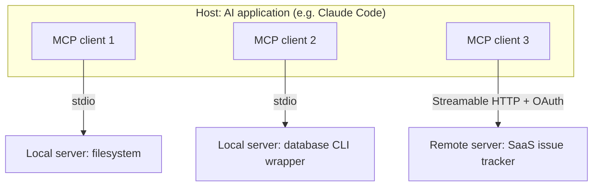

# MCP Architecture

> **Level:** Intermediate · **Time:** ~45 min · **Exam relevance:** CCAR-P 3.2, 3.7, 3.8

## In plain English

MCP has a small number of moving parts:

- An AI application (the **host**) opens one **client** connection per **server**.
- Client and server exchange JSON messages over a **transport**: either the standard input and output of a local process (**stdio**) or HTTP (**Streamable HTTP**).
- The server offers three kinds of things: **tools** the model can call, **resources** the application can read, and **prompts** the user can pick.
- Each side tells the other what it supports (**capabilities**), so neither attempts something the other cannot do.
- Remote servers protect themselves with **OAuth 2.1** access tokens issued specifically for them.

Think of a restaurant. The host is the front-of-house team, each client is a waiter assigned to one kitchen station, the server is the station, and the menu the station publishes lists its dishes (tools), the ingredients you can inspect (resources) and its set menus (prompts). The waiter checks what the station can do before ordering, and a station in a secure area only accepts orders carrying a valid pass made out to that station.

## Why it matters

- **Integration choices (CCAR-P-3.7).** Transport and hosting decide where a server runs, who can reach it and how it scales.
- **Security analysis (CCAR-P-3.2).** Most serious MCP vulnerabilities are authorisation mistakes: tokens accepted for the wrong audience, tokens passed through to downstream APIs, or local servers exposed without authentication.
- **Context efficiency (CCAR-P-3.8).** Discovery is dynamic. Hosts can list tools on demand and defer them, rather than loading every definition into every request.

## How it works

### Participants



| Participant | Responsibility |
|---|---|
| Host | Owns the user interface and the model conversation; decides which servers to connect, which tools to expose to the model, and when to ask the user for consent |
| Client | One per server. Speaks the protocol, tracks the server's capabilities, relays requests and notifications |
| Server | Exposes tools, resources and prompts; enforces its own authorisation; talks to the underlying system |

Local stdio servers usually serve one client. Remote Streamable HTTP servers usually serve many.

### Two layers

1. **Data layer**: JSON-RPC 2.0 messages that define discovery, the primitives, notifications and utilities (progress, cancellation, errors).
2. **Transport layer**: how those messages travel, how connections are set up, and how authorisation works.

### Transports

| Transport | How it works | Use it for | Authentication |
|---|---|---|---|
| **stdio** | The host launches the server as a subprocess and exchanges newline-delimited JSON-RPC messages on its standard input and output | Local tools, developer machines, anything that needs local files or binaries | Credentials come from the environment (the spec says stdio implementations should **not** use the HTTP authorisation flow) |
| **Streamable HTTP** | A single HTTP endpoint (commonly `/mcp`). Each client message is an HTTP POST; the server replies with a JSON object or a request-scoped SSE stream. The per-request `_meta` fields are mirrored into HTTP headers so proxies can route without parsing the body (the body remains the source of truth) | Remote and shared servers, SaaS integrations, anything used by the Claude apps or the Claude API connector | OAuth 2.1 bearer tokens (recommended), or other HTTP auth such as API keys in headers |
| HTTP+SSE (legacy) | The older two-endpoint transport, superseded by Streamable HTTP in the 2025-03-26 revision | Only for clients that have not migrated | As above |

Two practical rules follow:

- A **stdio server must never write anything except protocol messages to stdout**. Log to stderr. A stray `print()` corrupts the stream.
- A server on Streamable HTTP is a **web service**. It needs TLS, authentication, rate limits, request size limits and DNS-rebinding protection if it listens on localhost.

### Server primitives

| Primitive | Controlled by | Discovery | Use | Example |
|---|---|---|---|---|
| **Tools** | The model | `tools/list` | `tools/call` | `orders_search(query)` |
| **Resources** | The application | `resources/list` (and URI templates) | `resources/read` | `schema://warehouse/tables` |
| **Prompts** | The user | `prompts/list` | `prompts/get` | `/incident_postmortem` |

Each tool has a `name`, optional `title`, `description` and `inputSchema` (JSON Schema), and optional **annotations** such as `readOnlyHint`, `destructiveHint`, `idempotentHint` and `openWorldHint`. Annotations help hosts decide when to ask for confirmation, but the specification is explicit that hosts should treat tool descriptions and annotations as **untrusted** unless the server itself is trusted.

Tool results return a `content` array (text, images, embedded resources and so on), optionally `structuredContent`, and an `isError` flag for errors the model should see and recover from. Protocol-level failures (unknown method, invalid parameters) are JSON-RPC errors instead.

### Client primitives

Servers can also need things from the host:

- **Elicitation** (`elicitation/create`): the server needs extra input or confirmation from the user mid-operation, for example "Which of these three accounts did you mean?".
- **Roots**: the client tells the server which directories or locations are in scope.
- **Sampling** (`sampling/createMessage`): the server asks the host's model for a completion. **Deprecated** as of protocol version 2026-07-28; new servers should call a model API directly.
- Server-to-client **logging** is also discouraged in 2026-07-28 in favour of stderr (stdio) or OpenTelemetry.

In the 2026-07-28 revision, **servers never initiate JSON-RPC requests**. When a tool needs user input, the server answers the original request with a result whose `resultType` is `"input_required"`, and the client gathers the input and retries with it. The specification calls this the **Multi Round-Trip Request (MRTR)** pattern. In the handshake era, servers could send requests such as `elicitation/create` to the client directly over the session.

### Capability discovery: two protocol eras

> **Verified against:** MCP specification revision **2026-07-28** (the revision served at `modelcontextprotocol.io/specification/latest` on 2026-10-24): the base protocol overview, transports, and authorisation pages.

Both sides must know what the other supports. How that happens changed in 2026. The current revision is described first; the older handshake is history you will still meet in deployed clients.

**Stateless era (2026-07-28, current).** There is no `initialize` handshake and no protocol-level session. The specification states that "all the information needed to process a request is contained in the request itself": every request carries `io.modelcontextprotocol/protocolVersion` and `io.modelcontextprotocol/clientCapabilities` (both required) and, normally, `io.modelcontextprotocol/clientInfo` in its `_meta` field. A request missing a required field is rejected with `-32602`. Servers must implement `server/discover`, which returns supported versions, capabilities and server identity; clients may call it first or simply send requests and handle an `UnsupportedProtocolVersion` error (`-32022`). A server that needs a capability the client did not declare returns `MissingRequiredClientCapability` (`-32021`). Change notifications such as `notifications/tools/list_changed` are opt-in through a long-lived `subscriptions/listen` request. State that spans requests must be an explicit identifier passed on each request (for example a cart ID), bound to the authenticated user.

**Handshake era (history, up to 2025-11-25).** The client opened a session with an `initialize` request carrying its protocol version, `capabilities` and `clientInfo`. The server replied with its own version, capabilities and `serverInfo`, then the client sent `notifications/initialized`. Streamable HTTP sessions were tracked with an `Mcp-Session-Id` header, and servers could send requests to clients over the session. Implementations that interoperate with these revisions detect the counterpart's era and fall back, as the specification's versioning page describes.

A discovery request in the current revision looks like this:

```json
{
  "jsonrpc": "2.0",
  "id": 1,
  "method": "server/discover",
  "params": {
    "_meta": {
      "io.modelcontextprotocol/protocolVersion": "2026-07-28",
      "io.modelcontextprotocol/clientInfo": {"name": "acme-agent", "version": "0.4.0"},
      "io.modelcontextprotocol/clientCapabilities": {"elicitation": {}}
    }
  }
}
```

and the server advertises, for example, `"capabilities": {"tools": {"listChanged": true}, "resources": {}}`. In practice you rarely write these messages yourself: SDKs handle discovery, and the Python SDK v2 serves both eras from one server.

### A tool call on the wire

```json
{"jsonrpc": "2.0", "id": 7, "method": "tools/call",
 "params": {"name": "orders_search", "arguments": {"query": "late deliveries Leeds", "limit": 5},
            "_meta": {"io.modelcontextprotocol/protocolVersion": "2026-07-28"}}}
```

```json
{"jsonrpc": "2.0", "id": 7,
 "result": {"resultType": "complete",
            "content": [{"type": "text", "text": "3 orders found: A-1042, A-1077, A-1103"}],
            "isError": false}}
```

### Authorisation for HTTP servers

MCP authorisation is optional, but any remote server handling real data needs it. The specification builds on **OAuth 2.1** and related standards:

| Role | In MCP |
|---|---|
| Resource server | The **MCP server**. It validates access tokens on every request |
| Client | The **MCP client** in the host, acting for the user |
| Authorisation server | Issues tokens; may be the server's own or your identity provider |

The flow, simplified:

1. The client calls the server without a token and receives **401** with a `WWW-Authenticate` header pointing to the server's **Protected Resource Metadata** (RFC 9728). MCP servers must publish this metadata.
2. The client reads which authorisation server to use and fetches its metadata (RFC 8414 or OpenID Connect Discovery).
3. The client obtains a client ID through **Client ID Metadata Documents** (recommended), pre-registration, or **Dynamic Client Registration** (RFC 7591, now deprecated in the spec and kept for compatibility).
4. The user signs in. The client uses **PKCE** and includes a **`resource` parameter** (RFC 8707 resource indicators) naming the MCP server's canonical URI in both the authorisation and token requests.
5. The client sends `Authorization: Bearer <token>` on every request. Tokens never go in query strings.
6. The server validates the token **and checks it was issued for this server as audience**. It must not accept tokens meant for other resources, and must not pass the client's token through to downstream APIs.
7. If an operation needs more permission, the server returns **403** with `error="insufficient_scope"` and the required `scope`, and the client performs **step-up** authorisation.

The scope guidance follows least privilege: start with minimal scopes and request more only when an operation needs them.

## Example

A host's view of connecting to a remote server, as a sequence diagram you can reuse in architecture documents:

```mermaid
sequenceDiagram
    participant H as Host (MCP client)
    participant S as MCP server (resource server)
    participant A as Authorisation server
    H->>S: POST /mcp server/discover (no token)
    S-->>H: 401 WWW-Authenticate: resource_metadata=...
    H->>S: GET /.well-known/oauth-protected-resource
    S-->>H: authorization_servers, scopes_supported
    H->>A: Discover AS metadata; authorise with PKCE + resource=https://mcp.example.com/mcp
    A-->>H: access token (aud = MCP server)
    H->>S: POST /mcp server/discover + Bearer token
    S-->>H: capabilities {tools, resources, prompts}
    H->>S: tools/list
    S-->>H: tool definitions
    Note over H: Host shows tools to Claude as tool definitions
    H->>S: tools/call orders_search
    S-->>H: content + isError=false
```

## Enterprise use case

*Adventure Works Cycles* (fictional) planned an MCP server in front of its dealer-pricing API. The first design had the server accept the user's corporate identity-provider token and forward it unchanged to the pricing API, which already trusted that identity provider. The security architect rejected it for two reasons drawn straight from the specification: the MCP server would accept tokens not issued for it (no audience check), and passing the token through would let any compromised MCP client call the pricing API directly, bypassing the MCP server's rate limits and logging.

The approved design registered the MCP server as its own protected resource. Clients obtain tokens with `resource=https://pricing-mcp.adventure-works.example/mcp`; the server validates audience and scopes (`pricing:read` by default, `pricing:quote` by step-up), then calls the pricing API using a token-exchange flow for a downstream token scoped to that user. Local developers use a separate stdio build of the server that reads a personal API key from an environment variable.

## Common mistakes

- **Logging to stdout in a stdio server.** It breaks the protocol stream.
- **Exposing a localhost HTTP server without authentication.** Other processes and malicious web pages (via DNS rebinding) can reach it.
- **Token passthrough**: accepting a token issued for something else and forwarding it downstream. The spec forbids it.
- **Skipping audience validation**, so any valid token from the same identity provider works.
- **Requesting every scope up front.** Use minimal scopes and step-up.
- **Trusting tool annotations** such as `readOnlyHint` from an unknown server.
- **Assuming sessions exist** in the current revision; state must be explicit and bound to the user.

## Security considerations

- The specification's principles: users must consent to data access and tool invocations; hosts must not send user data to servers without consent; tools are arbitrary code execution and must be treated with caution.
- Implement the authorisation rules exactly: PRM, PKCE, resource indicators, audience validation, no passthrough, HTTPS everywhere except loopback during development.
- Validate redirect URIs exactly and use the `state` parameter correctly if you build an OAuth proxy.
- [Page 5](05-mcp-security.md) covers threats in detail.

## Troubleshooting

| Symptom | Likely cause | Fix |
|---|---|---|
| Client cannot parse server output (stdio) | Non-protocol text on stdout | Send logs to stderr |
| 401 loop on a remote server | Token audience or resource parameter mismatch | Use the server's canonical URI as `resource`; check the server's audience check |
| 403 `insufficient_scope` | Operation needs a higher scope | Let the client perform step-up; confirm the scope is grantable |
| Older client fails against a new server, or vice versa | Protocol era mismatch | Use an SDK that serves both eras, or upgrade the client |
| Tool list in the host is stale | Notifications not subscribed or not supported | Re-list tools; implement `listChanged` |

## Check your understanding

1. Why does a host create one client per server rather than one client for all servers?
2. Which transport would you choose for a server used by claude.ai custom connectors, and why?
3. What replaced the `initialize` handshake in the 2026-07-28 revision?
4. What two token checks does the specification require of an MCP server acting as an OAuth resource server, beyond basic validity?
5. Who controls each of the three server primitives?

<details>
<summary>Answers</summary>

1. Each connection has its own transport, capabilities, credentials and lifecycle; isolating them keeps servers independent and limits the blast radius of a failure or compromise.
2. Streamable HTTP, because claude.ai connects from Anthropic's cloud to remote servers and cannot launch local stdio processes.
3. Per-request `_meta` fields carrying the protocol version, client capabilities and client identity, plus the `server/discover` request for servers to advertise their versions and capabilities.
4. It must validate that the token was issued for this server (audience), and it must not accept or pass through tokens issued for other resources.
5. Tools: the model. Resources: the application. Prompts: the user.

</details>

## Further reading

- [Architecture overview](https://modelcontextprotocol.io/docs/learn/architecture) (modelcontextprotocol.io)
- [Specification: latest](https://modelcontextprotocol.io/specification/latest) and [Authorization](https://modelcontextprotocol.io/specification/latest/basic/authorization) (modelcontextprotocol.io)
- [RFC 9728: OAuth 2.0 Protected Resource Metadata](https://datatracker.ietf.org/doc/html/rfc9728) and [RFC 8707: Resource Indicators](https://www.rfc-editor.org/rfc/rfc8707.html) (IETF)
- [Agent identity and permissions](../12-ai-security/09-agent-identity-and-permissions.md) in Module 12
- Previous: [What is MCP?](01-what-is-mcp.md) · Next: [Building an MCP server](03-building-an-mcp-server.md)
