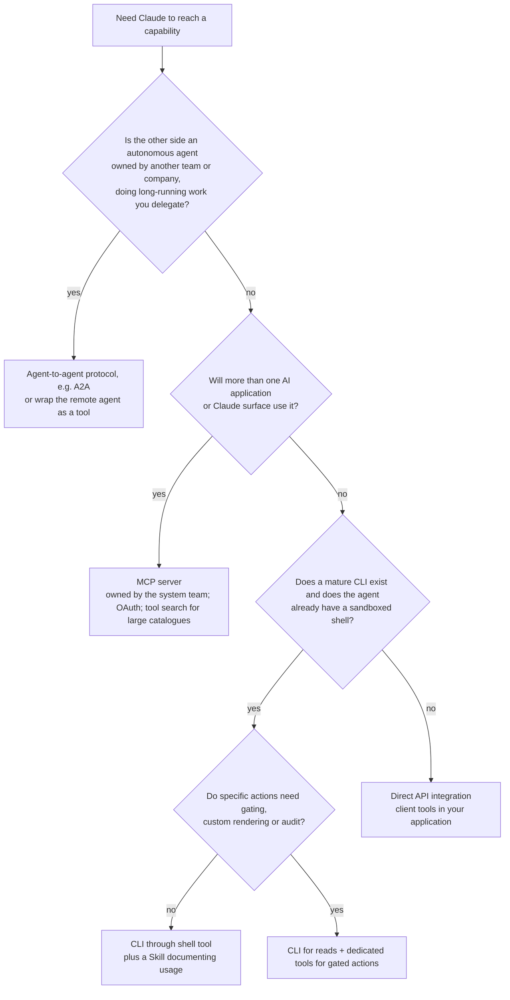

# MCP versus Alternatives

> **Level:** Advanced · **Time:** ~40 min · **Exam relevance:** CCAR-P 3.7, 3.3, 3.8, 1.4

## In plain English

MCP is one way to connect Claude to the outside world. It is not always the best one. There are at least four common patterns:

1. **Direct API integration**: your application defines client tools that call your API directly (Module 07).
2. **Command-line tools (CLI)**: the agent runs existing command-line programs such as `git`, `gh`, `aws` or `kubectl` through a shell tool.
3. **MCP server**: the integration is packaged once and shared with any MCP host.
4. **Agent-to-agent protocol**: you hand a whole task to another **agent**, possibly owned by a different team or company, and get results back. The Agent2Agent (A2A) protocol is the main open standard here.

A useful way to tell them apart is to ask **what is on the other side of the connection**:

- A **function** you call (direct API, CLI, MCP tool), or
- A **colleague** you delegate to, who plans and works independently and reports back (agent-to-agent).

And, for functions, **how many different AI applications need it** and **where it has to run**.

## Why it matters

- **CCAR-P-3.7** asks you to choose the integration mechanism and justify it. Expect scenarios with constraints such as "three different AI products need the same data", "the agent already has a shell", "a partner company exposes its own claims agent".
- **Latency and cost (CCAR-P-3.3)** differ: each extra hop and each loaded tool definition costs time and tokens.
- **Context strategy (CCAR-P-3.8)**: CLIs and Skills load knowledge progressively; large MCP catalogues need tool search to avoid monolithic context.
- **Multi-agent design (CCAR-P-1.4)**: agent-to-agent protocols are one way to orchestrate across organisational boundaries.

## How it works

### The options compared

| Criterion | Direct API (client tools) | CLI via shell tool | MCP server | Agent-to-agent (A2A) |
|---|---|---|---|---|
| Other side is | A function in your code | An existing program | A function behind a standard protocol | An autonomous agent (opaque) |
| Reuse across AI applications | Low: built into one app | Medium: CLIs are universal, but each agent needs shell access | **High**: any MCP host | High for agents that speak the protocol |
| Setup effort | Lowest for one app | Very low if a good CLI exists | Moderate (server, hosting, auth) | Highest (agent, Agent Card, task lifecycle) |
| Context cost | Only the tools you define | Very low (one shell tool; the model often knows popular CLIs; `--help` on demand) | Each tool definition, unless deferred with tool search | One delegation interface |
| Control and auditability | Highest: typed arguments, your gates | Lowest: opaque command strings, harder to gate per action | High at the server; depends on host for gating | Contract-level; the remote agent's internals are hidden |
| Where it runs | Your application | Wherever the shell runs (needs sandboxing) | Local (stdio) or remote (HTTP) | Remote agent's infrastructure |
| Long-running or stateful work | You build it | Process-bound | Explicit handles; Tasks extension | **Built in**: tasks with lifecycle, streaming, push notifications |
| Typical fit | A single product's core integration, latency-critical paths | Developer and ops agents (Claude Code), mature CLIs | Shared enterprise systems used from several Claude surfaces and tools | Cross-team or cross-company delegation of whole tasks |

### Direct API integration

You write tool definitions and the code behind them inside one application. It is the simplest, fastest and most controllable option when only one application needs the integration. Because each action is a dedicated, typed tool, your harness can gate, render, audit and parallelise it precisely. The cost is duplication when a second application needs the same thing.

### CLI through a shell tool

An agent with a shell (Claude Code's Bash tool, the Anthropic-schema bash tool, or code execution) can use any installed CLI. Claude already knows many popular CLIs, and it can read `--help` output only when needed, so the context cost is small. Anthropic's agent-design guidance captures the trade-off: **start with bash for breadth, and promote an action to a dedicated tool when you need to gate, render, audit or parallelise it**. A `send_email` tool is easy to gate; a `curl -X POST` hidden in a shell command is not. CLIs also need credentials on the machine and a sandbox (see [Claude Code permissions and sandboxing](../09-claude-code/04-permissions-and-settings.md)).

### MCP server

MCP is the right default when **several hosts** need the same integration, when the **system owner** should maintain it, or when you want **standard discovery and OAuth**. It adds a protocol hop and, without tool search, every tool definition consumes context. MCP is about tools and data (agent-to-tool); it does not define how one agent delegates a goal to another.

### Agent-to-agent protocols (A2A)

The [Agent2Agent (A2A) protocol](https://a2a-protocol.org/latest/) is an open standard for communication between agents. As of 2026-10-24, its site describes it as originally developed by Google and donated to the Linux Foundation, maintained by a technical steering committee with members from several large technology companies, licensed Apache 2.0, with a v1.0 release; a site banner also announces that A2A is joining the Agentic AI Foundation (the same foundation that hosts MCP). Its core concepts:

- **Agent Card**: JSON metadata advertising an agent's identity, endpoint, capabilities, skills and authentication requirements.
- **Task**: a stateful unit of work with an ID and lifecycle.
- **Message** and **Part**: conversational turns whose parts hold text, files, URLs or structured data.
- **Artifact**: the outputs a task produces.
- Interaction by request/response with polling, **streaming over SSE**, or **push notifications** to a webhook, using JSON-RPC 2.0 over HTTP(S).

The A2A project positions itself as **complementary** to MCP: MCP connects an agent to its tools and data; A2A connects agents to each other. Use agent-to-agent delegation when the other party owns the reasoning (for example a supplier's claims-adjudication agent), when work is long-running, or when you must not see the other side's internals or data.

> **Unverified:** whether any Claude product supports A2A natively. As of 2026-10-24, A2A does not appear in the documentation indexes of [platform.claude.com](https://platform.claude.com/llms.txt) or [code.claude.com](https://code.claude.com/docs/llms.txt), but absence from an index does not prove there is no support. To call or expose an A2A agent from a Claude-based system you would typically wrap it as a tool (an MCP tool or a client tool) or build an A2A server around your Claude agent with an A2A SDK. Search those docs and Anthropic's announcements for "A2A" before designing around native support.

### Related building blocks that are not integration protocols

- **Agent Skills** package instructions, scripts and reference files that load only when relevant. Use them to teach Claude *how* to do something (for example how to use your internal CLI correctly); combine with any integration above. See [Progressive disclosure and Skills](../04-context-engineering/06-progressive-disclosure-and-skills.md).
- **Subagents** inside one system (Claude Code subagents, Agent SDK subagents, Managed Agents multi-agent sessions) split work across agents you control without any cross-organisation protocol. See [Multi-agent architecture](../10-agentic-ai/04-multi-agent-architecture.md).

## Example

### A decision guide

### Worked scenarios

| Scenario | Choice | Justification |
|---|---|---|
| A bank's mortgage app calls one pricing API on every request; strict latency budget | Direct API client tool | One consumer, latency-critical, needs precise gating and logging; MCP adds a hop with no reuse benefit |
| Engineers want Claude Code to manage pull requests and CI | CLI (`gh`) through Claude Code's Bash tool, with permission rules; optionally the vendor's MCP server | Mature CLI, model already knows it, low context; permission rules gate `gh pr merge` |
| The HR system must be usable from Claude Enterprise, Claude Code and an internal agent | MCP server owned by the HR platform team | Three hosts, central OAuth and auditing, one implementation |
| A logistics firm needs a partner carrier to quote and book shipments, and the carrier runs its own pricing agent | Agent-to-agent protocol (or the carrier's API wrapped as a tool if it offers one) | The carrier owns the reasoning and data; long-running booking task with status updates |
| An internal agent needs 200 tools from six systems | MCP servers plus tool search with deferred loading | Reuse plus progressive discovery to keep context small |

## Enterprise use case

*Wide World Importers* (fictional) ran an architecture review of five proposed integrations for its customer-operations platform. The board used the decision guide and recorded each choice in an architecture decision record:

- **Order management** became an **MCP server**, because the support assistant (Claude API), the operations team (Claude Enterprise connectors) and engineers (Claude Code) all needed it.
- **Payments refunds** stayed a **direct client tool** in the support assistant only, behind a human approval gate, because no other application should ever issue refunds.
- **Cloud infrastructure** queries in the SRE agent used the cloud provider's **CLI** in a sandbox, with read-only credentials and a Skill documenting safe commands; write commands were denied by permission rules.
- **Customs clearance** was delegated to a broker's agent through an **agent-to-agent** integration, because the broker would not expose its internal systems and clearance takes hours, with status updates.
- **Product catalogue search** was initially proposed as a sixth MCP server, then folded into the order-management server's tool set to avoid duplicated authentication and a second deployment.

## Common mistakes

- **"Everything should be MCP."** A single-application, latency-critical integration rarely benefits.
- **"Everything should be a CLI."** Opaque shell commands are hard to gate, audit and parallelise for sensitive actions.
- **Using MCP to delegate entire goals to another organisation's agent.** MCP tools are functions; agent-to-agent protocols model tasks, status and artifacts.
- **Ignoring context cost** of large MCP catalogues; use tool search and deferred loading.
- **Choosing by fashion rather than ownership.** The team that owns the system should usually own the integration.
- **Not recording the decision.** Integration choices are architecture decisions; capture them in [ADRs](../13-enterprise-ai-architecture/07-architecture-decision-records.md).

## Security considerations

| Mechanism | Main risk | Key control |
|---|---|---|
| Direct API | Over-broad tool code or credentials | Least privilege in your code; validation; gates |
| CLI | Arbitrary command execution; credentials on the host | Sandboxing; permission rules; read-only credentials; deny destructive commands |
| MCP | Untrusted servers, tool poisoning, token misuse | Server allow-lists, pinning, OAuth audience checks ([MCP security](05-mcp-security.md)) |
| Agent-to-agent | Trusting another agent's output; cross-boundary data sharing; impersonation | Authenticate Agent Cards and endpoints; minimise shared data; validate returned artifacts; contractual controls |

In every case, output from the other side is untrusted input to Claude.

## Troubleshooting

| Symptom | Likely cause | Fix |
|---|---|---|
| High token usage after adding integrations | Many MCP tool definitions loaded upfront | Tool search with `defer_loading`; fewer, consolidated tools |
| Agent misuses a CLI | No guidance on safe usage | Add a Skill with examples; deny dangerous subcommands; promote risky actions to dedicated tools |
| Duplicate integrations drift apart | Same system wrapped separately in several apps | Consolidate into one MCP server owned by the system team |
| Delegated partner tasks time out | Synchronous tool call for long-running work | Use an asynchronous task model (agent-to-agent protocol or MCP Tasks extension) |

## Check your understanding

1. Give the one-line distinction between MCP and an agent-to-agent protocol.
2. Why might a CLI be cheaper in context than an MCP server for a developer agent?
3. When should you promote a CLI action to a dedicated tool?
4. Three different Claude surfaces need access to the same CRM. Which mechanism do you choose, and what two controls do you add?

Answers

1. MCP connects an agent to tools and data (functions); an agent-to-agent protocol connects agents to each other so one can delegate tasks to another.
2. The agent needs only one shell tool, Claude already knows popular CLIs, and it can read help text on demand, instead of loading many tool definitions upfront.
3. When you need to gate it (especially irreversible or external actions), render it specially, audit it with typed arguments, or run it in parallel safely.
4. An MCP server owned by the CRM team, with per-user OAuth (audience-validated, minimal scopes) and allow-lists of servers and tools on each surface; tool search if the catalogue is large.

## Further reading

- [Agent2Agent (A2A) protocol](https://a2a-protocol.org/latest/) and its [key concepts](https://a2a-protocol.org/latest/topics/key-concepts/) (a2a-protocol.org)
- [MCP specification](https://modelcontextprotocol.io/specification/latest) (modelcontextprotocol.io)
- [Writing effective tools for agents](https://www.anthropic.com/engineering/writing-tools-for-agents) (Anthropic Engineering)
- [Integration patterns](../13-enterprise-ai-architecture/04-integration-patterns.md) in Module 13
- [CCAR-P domain 3 study guide](../16-certification-tracks/ccar-p/study-guide/domain-3.md)

<!-- page-nav:start -->
---

[← Previous: MCP Security](05-mcp-security.md) · [Module overview](README.md) · [Next module: Module 09: Claude Code →](../09-claude-code/README.md)
<!-- page-nav:end -->
