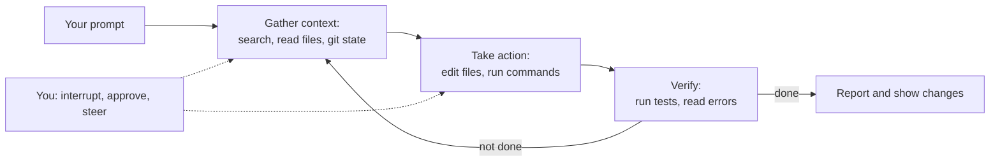

# What is Claude Code?

> **Level:** Beginner · **Time:** ~25 min · **Exam relevance:** CCAR-P 7.1, 7.2

## In plain English

Claude Code is Claude with hands in your development environment. Instead of copying code into a chat window and pasting answers back, you start Claude Code in your project and describe what you want: "the checkout tests are failing, find out why and fix it". Claude Code then reads the relevant files, runs the tests, edits code, runs the tests again, and shows you what changed. You stay in charge: you approve risky actions, steer it mid-task, and can undo its edits.

If a chat assistant is like asking a knowledgeable colleague a question over the phone, Claude Code is like that colleague sitting at your keyboard, with you watching and able to say "stop" or "not that file".

## Why it matters

- **Developer productivity (CCAR-P-7.2).** It handles multi-file changes, test fixing, refactors, code review, git operations and documentation, not just single-file completions.
- **Team enablement (CCAR-P-7.1).** Because it runs commands and edits files with the developer's access, teams need shared configuration and guardrails. Most of this module is about that.
- **A reference agent.** Claude Code is a production agent harness: a model, tools, context management, permissions and hooks. The same harness is available as a library, the [Claude Agent SDK](09-headless-ci-and-agent-sdk.md). Understanding it makes [Module 10](../10-agentic-ai/README.md) concrete.

## How it works

### The agentic loop

Claude Code works in three blended phases that repeat until the task is done: **gather context** (search and read files, check git state), **take action** (edit files, run commands) and **verify results** (run tests, type checks, read output). You can interrupt at any point.



Anthropic's documentation calls the layer around the model, which provides tools and manages context, the **agentic harness**. Claude Code is that harness.

### Built-in tools

Claude Code ships with tools in five broad categories (names as listed in the [tools reference](https://code.claude.com/docs/en/tools-reference) on 2026-10-24):

| Category | Example tools | Needs permission by default? |
|---|---|---|
| File operations | `Read`, `Edit`, `Write`, `NotebookEdit` | Reads no (inside working directories); edits yes |
| Search | `Glob`, `Grep` (on macOS, Linux and WSL these are absent by default and searching goes through the shell) | No |
| Execution | `Bash`, `PowerShell`, `Monitor` | Yes, except a built-in set of read-only commands |
| Web | `WebFetch`, `WebSearch` | Yes (some documentation domains are pre-approved for fetch) |
| Code intelligence | `LSP` (with code intelligence plugins) | No |

It also has orchestration tools, for example `Agent` (spawn a subagent), `Skill` (run a skill), `AskUserQuestion`, `EnterPlanMode`/`ExitPlanMode`, and task-list tools. You extend this set with **Skills**, **MCP servers**, **hooks**, **subagents** and **plugins**, covered in pages 5 to 7.

### What Claude Code can access

When you run `claude` in a directory it can use:

- **Your project files**, plus other paths you grant.
- **Your terminal**: anything you could run, subject to permissions and the optional sandbox.
- **Your git state**: branch, uncommitted changes, recent history.
- **Instructions**: `CLAUDE.md` files and auto memory ([page 3](03-claude-md-and-memory.md)).
- **Extensions** you configure.

This is powerful and is exactly why permissions, sandboxing and managed settings exist ([page 4](04-permissions-and-settings.md)).

### Where it runs

| Interface | Notes |
|---|---|
| Terminal CLI (`claude`) | The reference interface; everything in this module applies |
| VS Code and JetBrains extensions | IDE-integrated sessions with diffs in the editor |
| Claude desktop app | Code sessions alongside the Claude apps |
| Web (claude.ai/code) and cloud sessions | Runs on Anthropic-managed VMs or self-hosted environments; useful for repositories you do not have locally |
| Remote Control, mobile, Slack | Drive a session from elsewhere |
| CI/CD | `claude -p`, the Claude Code GitHub Action, GitLab CI/CD ([page 9](09-headless-ci-and-agent-sdk.md)) |

The loop, tools and configuration model are the same across interfaces; what changes is where code executes.

### Sessions, context and safety nets

- **Sessions are saved locally** as JSONL under `~/.claude/projects/`. Resume with `claude --continue` or `claude --resume`; fork with `--fork-session` or `/branch`.
- **Each session starts with a fresh context window.** Persistent knowledge belongs in `CLAUDE.md` or auto memory.
- **Context management is automatic**: older tool outputs are cleared first, then the conversation is summarised (compaction). `/compact` lets you compact with a focus; `/context` shows what is using space. MCP tool definitions are deferred and loaded through tool search by default.
- **Checkpoints**: before editing a file, Claude Code snapshots it. Press `Esc` twice or run `/rewind` to roll back. Checkpoints cover local file edits only, not databases, deployments or other remote effects.
- **Permission modes** control what runs without asking ([page 4](04-permissions-and-settings.md)).

### Models and authentication

You choose models with `/model` or `claude --model <alias-or-id>`, using aliases such as `opus`, `sonnet`, `haiku` and `fable` or full model IDs. Effort is set with `/effort` or `--effort`.

Claude Code can authenticate through (as of 2026-10-24):

| Option | Typical use |
|---|---|
| Claude subscription (Pro, Max, Team, Enterprise) | Individuals and organisations; Anthropic recommends Team or Enterprise for organisations, combining Claude Code and the Claude apps under per-seat plans |
| Claude Console (API key, pay as you go) | API-first teams |
| Amazon Bedrock, Google Cloud (Vertex AI / Agent Platform), Microsoft Foundry | Organisations that want to inherit existing cloud compliance controls and billing |
| LLM gateway or Claude apps gateway | Central routing, logging or spend control |

Some features, such as cloud sessions and Code Review, require a claude.ai account.

## Example

A short first interaction in a repository (more in [page 2](02-setup-and-first-session.md)):

```text
$ cd ~/src/acme-checkout
$ claude
> give me a two-paragraph overview of this codebase and how to run its tests
> the test "applies loyalty discount" fails; find the cause and propose a fix. Don't edit yet.
> go ahead and make the fix, then run the full test suite
> /diff
```

Claude reads files and runs read-only commands to answer the first two prompts, then asks before editing and before running commands that are not pre-approved (depending on your permission mode), and `/diff` shows the resulting changes.

## Enterprise use case

*Contoso Health* (fictional) piloted Claude Code with 25 engineers in its patient-portal team. The architecture team's first questions were not about productivity but about boundaries: which repositories may it touch, can it read `.env` files, may it push to `main`, which MCP servers are allowed, where do prompts and code go, and how will costs be tracked? Those questions map directly onto pages 3 to 8 of this module. The pilot ran on Claude Enterprise with server-managed settings that denied reading secrets files, blocked `git push` to protected branches, enabled sandboxing and restricted MCP servers to an approved list, with OpenTelemetry exporting usage to the existing observability stack.

## Common mistakes

- **Treating it as autocomplete.** Claude Code is most effective when given goals and verification criteria ("make the tests pass", "match the style in `src/api`"), not keystroke-level instructions.
- **Skipping exploration.** Asking for changes before letting it read the codebase (or using plan mode) produces shallower fixes.
- **Assuming checkpoints undo everything.** They undo local file edits only.
- **Long sessions across unrelated tasks.** Context fills with noise; use `/clear` between tasks.
- **Rolling out to a team with no shared configuration**, so every developer has different permissions and behaviour.

## Security considerations

- Claude Code acts with **your** credentials and filesystem access. Permission rules, sandboxing and managed settings are the controls ([page 4](04-permissions-and-settings.md)).
- Repositories can contain configuration (`.claude/settings.json`, hooks, `.mcp.json`) that runs code. Workspace trust exists for this reason; be careful with untrusted repositories, especially in headless mode.
- Content Claude reads (issues, web pages, files) can contain prompt injection. Keep destructive and external actions behind prompts or denies.
- See Anthropic's [Claude Code security](https://code.claude.com/docs/en/security) page and [enterprise deployment controls](../12-ai-security/14-enterprise-deployment-controls.md).

## Troubleshooting

| Symptom | Likely cause | Fix |
|---|---|---|
| Claude ignores project conventions | No or weak `CLAUDE.md` | Run `/init`, then refine ([page 3](03-claude-md-and-memory.md)) |
| Quality drops in a long session | Context full of unrelated history | `/clear` between tasks; `/compact` with a focus |
| Too many permission prompts | Default rules too narrow for your workflow | Add allow rules for safe commands, or use an appropriate permission mode |
| Something seems misconfigured | Settings or install issue | `/doctor` in a session or `claude doctor` in the shell |

See [Claude Code troubleshooting](../24-troubleshooting/claude-code.md).

## Check your understanding

1. What are the three phases of Claude Code's agentic loop?
2. Name two things checkpoints cannot undo.
3. Why does Claude Code need permission controls when a chat assistant does not?
4. Where should a rule Claude must follow in every session live: the conversation, or somewhere else?

<details>
<summary>Answers</summary>

1. Gather context, take action, verify results.
2. Any two remote side effects, for example database changes, deployments, API calls, pushed commits or messages sent.
3. Claude Code can run commands and edit files with the user's own access; actions have real effects on systems, so what it may do without asking must be controlled.
4. In `CLAUDE.md` (or a rule file), because each session starts with a fresh context window and compaction can drop early conversation details.

</details>

## Further reading

- [Claude Code overview](https://code.claude.com/docs/en/overview) (Claude Code Docs)
- [How Claude Code works](https://code.claude.com/docs/en/how-claude-code-works) (Claude Code Docs)
- [Tools reference](https://code.claude.com/docs/en/tools-reference) (Claude Code Docs)
- [Claude Code cheat sheet](../22-cheat-sheets/claude-code.md)
- Next: [Setup and first session](02-setup-and-first-session.md)
