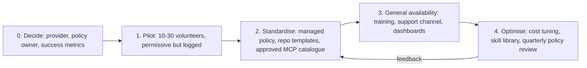

# Team Rollout

> **Level:** Advanced · **Time:** ~60 min · **Exam relevance:** CCAR-P 7.1, 7.2, 7.3, 4.6, 5.1, 6.5

## In plain English

Rolling Claude Code out to a team is less about installing software and more about agreeing, and then enforcing, how it should behave:

- **What everyone shares**: project instructions, skills, hooks and MCP servers committed to repositories.
- **What the organisation enforces**: managed settings that no developer can override (no reading secrets, sandbox on, approved MCP servers only, bypass mode off).
- **What you measure**: adoption, cost and outcomes, so you can show value and catch problems.
- **How people get help**: diagnostics, support paths and a feedback loop that improves the shared configuration.

This page brings together everything from pages 1 to 7 into a rollout plan an architect could present to an engineering leadership team.

## Why it matters

- **CCAR-P-7.1** asks you to configure Claude tools and environments for teams. That is managed settings plus shared repository configuration.
- **CCAR-P-7.2** is about improving developer workflows: shared skills, hooks and subagents make good practice the default.
- **CCAR-P-7.3** covers supporting debugging and operational issues: diagnostics, telemetry and support processes.
- **Monitoring (CCAR-P-4.6)** and **lifecycle (CCAR-P-6.5)**: a rollout is a programme with phases, metrics and iteration, not a one-off install.

## How it works

### Rollout phases



### Step 1: Choose the provider and sign-in model

| Provider (as of 2026-10-24) | Choose when |
|---|---|
| Claude for Teams / Enterprise | Default recommendation: Claude Code and the Claude apps under one per-seat subscription, server-managed settings from the admin console, analytics dashboard |
| Claude Console (API) | API-first organisations wanting pay-as-you-go billing and workspace spend limits |
| Amazon Bedrock, Google Cloud, Microsoft Foundry | You want to inherit existing cloud compliance controls, billing and data-residency arrangements |
| LLM gateway / Claude apps gateway | Central routing, logging or per-user spend limits across providers |

Single sign-on, SCIM user provisioning and seat allocation are all managed in your organisation's Claude account settings, not in Claude Code itself. Some features (cloud sessions, Code Review, Remote Control) require claude.ai accounts. Enforce the chosen sign-in with `forceLoginMethod` and `forceLoginOrgUUID`, and restrict providers with `allowedProviders`.

### Step 2: Decide how policy reaches devices

| Mechanism | Notes |
|---|---|
| Server-managed settings | From the claude.ai admin console (Teams, Enterprise) or a Claude apps gateway; highest priority; fetched at startup and refreshed hourly; no device tooling needed |
| macOS plist / Windows HKLM registry | Admin-only write, tamper-resistant; works with any provider |
| `managed-settings.json` file | Deployed by MDM, Group Policy, Ansible or similar to the system path for each OS |
| Windows HKCU registry | User-writable; a convenience default, not enforcement |

Mixed-provider organisations often use server-managed settings for claude.ai users plus a file or OS policy fallback for others. Developers can check what applies with `/status` (the `Setting sources` line).

### Step 3: Define the baseline policy

A starting point for managed settings, to adapt to your risk appetite:

| Control | Key settings |
|---|---|
| Protect secrets | `permissions.deny` for `Read(./.env)`, `Read(./.env.*)`, `Read(./secrets/**)`, credential paths |
| Shell isolation | `sandbox.enabled: true`, `sandbox.failIfUnavailable: true`, `allowUnsandboxedCommands: false`, managed `sandbox.network.allowedDomains` with `allowManagedDomainsOnly: true` |
| No bypass | `permissions.disableBypassPermissionsMode: "disable"` (and optionally `disableAutoMode`) |
| Permission lockdown (stricter organisations) | `allowManagedPermissionRulesOnly: true` |
| MCP | `allowedMcpServers` + `allowManagedMcpServersOnly: true`, or `managed-mcp.json` |
| Hooks and plugins | `allowManagedHooksOnly`, `allowedHttpHookUrls`, `strictKnownMarketplaces` |
| Models and effort | `availableModels`, `enforceAvailableModels`, `maxEffortLevel` |
| Versions | `minimumVersion` (no downgrades) or `requiredMinimumVersion` / `requiredMaximumVersion` (refuse to start outside a range) |
| Data | `cleanupPeriodDays` for local transcript retention; `CLAUDE_CODE_DISABLE_NONESSENTIAL_TRAFFIC` in `env` to turn off non-essential Anthropic-bound telemetry |
| Guidance | Managed `CLAUDE.md` (or `claudeMd`) for organisation-wide behavioural guidance |

Remember the split: **managed settings enforce**; managed `CLAUDE.md` **guides**.

### Step 4: Standardise repositories

Give teams a template for the `.claude/` directory and root files:

| Path | Purpose |
|---|---|
| `CLAUDE.md` | Build and test commands, architecture, conventions (under ~200 lines) |
| `.claude/settings.json` | Team allow/ask/deny rules, hooks, enabled plugins, environment variables |
| `.claude/rules/*.md` | Path-scoped conventions |
| `.claude/skills/*/SKILL.md` | Team procedures (`/release`, `/db-migration-review`) |
| `.claude/agents/*.md` | Team subagents (reviewers, test writers) |
| `.mcp.json` | Project MCP servers with `${VAR}` placeholders |
| `.gitignore` entries | `CLAUDE.local.md`, `.claude/settings.local.json` |

For skills, agents and hooks shared across many repositories, package them as **plugins** in an internal marketplace and restrict marketplaces with `strictKnownMarketplaces`. The `/team-onboarding` command can generate an onboarding guide from usage history.

### Step 5: Cost and usage visibility

| Need | Tool (as of 2026-10-24) |
|---|---|
| A developer's own session usage | `/usage` (alias `/cost`); status line |
| Adoption and contribution (Teams, Enterprise) | Analytics dashboard at claude.ai/analytics/claude-code: active users, sessions, lines accepted, PRs with Claude Code assistance (GitHub integration), CSV export |
| Usage and spend (Console) | Dashboard at platform.claude.com/claude-code; Claude Code Analytics API |
| Per-user programmatic reporting (Enterprise) | Enterprise Analytics API; spend report in organisation analytics settings |
| Spend control | Organisation spend limits (Teams, Enterprise), workspace limits (Console), cloud budgets or gateway per-user limits |
| Detailed operational telemetry | OpenTelemetry export: metrics such as `claude_code.session.count`, `claude_code.token.usage`, `claude_code.cost.usage`, `claude_code.lines_of_code.count`, `claude_code.commit.count`, `claude_code.pull_request.count`, plus events for tool decisions, API errors and more |
| Contracted rates in displayed costs | `modelPricing` managed setting |

Anthropic's cost page reports that, across enterprise deployments, the average is about **$13 per developer per active day** and **$150–250 per developer per month**, with 90% of users below $30 per active day (as of 2026-10-24; see [Manage costs effectively](https://code.claude.com/docs/en/costs)). Treat these as orientation only; baseline your own pilot.

Enable OpenTelemetry through managed settings so developers and repositories cannot redirect it:

```json
{
  "env": {
    "CLAUDE_CODE_ENABLE_TELEMETRY": "1",
    "OTEL_METRICS_EXPORTER": "otlp",
    "OTEL_LOGS_EXPORTER": "otlp",
    "OTEL_EXPORTER_OTLP_PROTOCOL": "grpc",
    "OTEL_EXPORTER_OTLP_ENDPOINT": "https://otel-collector.internal.example.com:4317"
  }
}
```

Prompt text, tool parameters and raw API bodies are **not** exported unless you opt in (`OTEL_LOG_USER_PROMPTS`, `OTEL_LOG_TOOL_DETAILS`, `OTEL_LOG_RAW_API_BODIES`). Decide deliberately, with your privacy and works-council stakeholders, before enabling them.

Cost levers to teach developers: `/clear` between tasks, keep `CLAUDE.md` lean, move procedures to skills, use subagents with cheaper models for exploration, choose effort deliberately, and rely on tool search for MCP. See [cost optimisation](../15-production-operations/03-cost-optimisation.md).

### Step 6: Support and operations

| Situation | First step |
|---|---|
| Install or PATH problem | `claude doctor` |
| Settings not applying | `/status` (sources), `/permissions` (rule origins), `claude doctor` (validation) |
| Configuration conflict suspected | `claude --safe-mode` starts with customisations disabled |
| Hook or MCP failure | `claude --debug` and the debug log; `claude mcp get <name>` |
| Slow or expensive sessions | `/context`, `/usage`, OpenTelemetry dashboards |
| Product bug | `/bug` (with consent screen) |

Run a support channel staffed by pilot champions, publish an internal FAQ, and review policy quarterly with security, platform and developer representatives.

## Example

A rollout checklist an architect might attach to the decision record:

```markdown
## Claude Code rollout: Payments Engineering (fictional)
- [ ] Provider: Claude Enterprise; SSO via corporate IdP; forceLoginOrgUUID set
- [ ] Policy delivery: server-managed settings + macOS plist fallback for contractors
- [ ] Baseline policy: secrets denied, sandbox enforced, bypass disabled, approved MCP catalogue
- [ ] Hooks: managed audit hook (HTTP to policy service), allowManagedHooksOnly
- [ ] Repo template: CLAUDE.md, .claude/settings.json, skills (/release, /migration-review), agents (security-reviewer)
- [ ] Telemetry: OTel metrics + logs to collector; prompt logging OFF (privacy review 2026-10-02)
- [ ] Spend: org limit + per-user limit; weekly cost report from Enterprise Analytics API
- [ ] Success metrics: weekly active users, PR cycle time, change-failure rate, developer survey
- [ ] Support: #claude-code-help channel, champions rota, FAQ, quarterly policy review
```

## Enterprise use case

*Contoso Health* (fictional) moved from a 25-person pilot to 600 engineers in three months.

**Pilot (weeks 1–4).** Permissive settings, but OpenTelemetry on from day one. The data showed that most token spend came from a few very long sessions and from one MCP server returning huge results, and that engineers frequently approved the same safe commands.

**Standardise (weeks 5–8).** The platform team published a repository template, moved common approvals into shared allow rules, created five team skills and two subagents, and fixed the noisy MCP server to paginate. Security finalised managed settings: secrets denied, sandbox enforced with a network allow-list, bypass disabled, approved MCP catalogue, managed audit hook. Because the organisation handles health data, prompt-content telemetry stayed off and `cleanupPeriodDays` was shortened.

**General availability (weeks 9–12).** Two-hour onboarding sessions, champions in each team, a support channel, and dashboards for adoption, cost per active developer and PR cycle time. A quarterly review now adjusts the policy and prunes unused skills.

## Common mistakes

- **Rolling out without managed settings**, so every developer's configuration differs and nothing is enforceable.
- **Over-restricting in the pilot**, which hides how people want to use the tool; log first, then decide policy.
- **No owner for shared configuration**, so `CLAUDE.md` files and skills rot.
- **Measuring only cost** rather than cost per outcome (PRs merged, cycle time, incidents).
- **Turning on prompt logging** without privacy review.
- **Using HKCU registry or user-writable files** as the enforcement channel.
- **Forgetting CI and headless use** in the policy ([page 9](09-headless-ci-and-agent-sdk.md)).

## Security considerations

- Treat Claude Code like any privileged developer tool: least privilege, central policy, logging and periodic review.
- Combine permission rules, sandboxing, managed hooks and MCP allow-lists; no single layer is sufficient.
- Review data handling and retention with your compliance team (Anthropic publishes [data usage](https://code.claude.com/docs/en/data-usage) and [zero data retention](https://code.claude.com/docs/en/zero-data-retention) pages for Claude Code).
- See [AI governance](../12-ai-security/12-ai-governance.md) and [enterprise deployment controls](../12-ai-security/14-enterprise-deployment-controls.md).

## Troubleshooting

| Symptom | Likely cause | Fix |
|---|---|---|
| A developer's session ignores policy | Policy not delivered to that device or account | `/status` → `Setting sources`; check MDM or console assignment; restart the session |
| Telemetry missing for some users | Exporter variables set only in project files (ignored) or overridden | Set them in managed settings |
| Costs higher than expected | Long sessions, verbose MCP tools, high effort everywhere | Dashboards by user and model; coaching; tool fixes; effort and model policy |
| Developers bypass the tool's guardrails with personal accounts | Login not enforced | `forceLoginMethod` and `forceLoginOrgUUID` |

## Check your understanding

1. Which delivery mechanism for managed settings has the highest priority, and which Windows location should not be relied on for enforcement?
2. Name four controls you would include in a baseline managed policy.
3. Why should OpenTelemetry exporter variables be set in managed settings rather than in a repository's `.claude/settings.json`?
4. Which dashboards show adoption for Teams and Enterprise customers versus Console customers?
5. What metrics, beyond cost, would you use to judge whether the rollout is working?

<details>
<summary>Answers</summary>

1. Server-managed settings have the highest priority. The Windows user registry (HKCU) is user-writable, so it is a convenience default rather than enforcement.
2. Any four of: deny reads of secrets files; sandbox enabled with `failIfUnavailable` and a managed network allow-list; bypass mode disabled; MCP allow-list with `allowManagedMcpServersOnly`; managed hooks only; forced login method and organisation; model restrictions; version floor; shorter local retention.
3. Claude Code ignores telemetry exporter variables in project and local settings (apart from turning signals off), so a repository cannot enable telemetry or redirect it; managed settings make the configuration consistent and non-overridable.
4. Teams and Enterprise: claude.ai/analytics/claude-code. Console: platform.claude.com/claude-code (plus the Claude Code Analytics API).
5. For example: weekly active users, PR cycle time, lines and PRs shipped with assistance, change-failure or incident rate, developer satisfaction, and cost per merged PR.

</details>

## Further reading

- [Set up Claude Code for your organization](https://code.claude.com/docs/en/admin-setup) (Claude Code Docs)
- [Deploy managed settings](https://code.claude.com/docs/en/managed-settings) and [settings example files](https://code.claude.com/docs/en/settings-example) (Claude Code Docs)
- [Manage costs effectively](https://code.claude.com/docs/en/costs), [analytics](https://code.claude.com/docs/en/analytics) and [monitoring usage](https://code.claude.com/docs/en/monitoring-usage) (Claude Code Docs)
- [Observability](../15-production-operations/02-observability.md) in Module 15
- [CCAR-P domain 7 study guide](../16-certification-tracks/ccar-p/study-guide/domain-7.md)
- Previous: [MCP in Claude Code](07-mcp-in-claude-code.md) · Next: [Headless, CI and the Agent SDK](09-headless-ci-and-agent-sdk.md)
