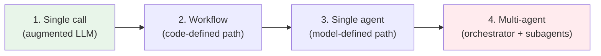

# Workflows vs Agents

> **Level:** Intermediate · **Time:** ~25 min · **Exam relevance:** CCAR-P D1 (1.3, 1.5), CCAR-P D5 (5.2)

## In plain English

Imagine two ways to get a kitchen renovated.

In the first, you hand a contractor a detailed plan: remove the old units on Monday, plumbing on Tuesday, tiling on
Wednesday, inspection on Thursday. Each tradesperson is skilled, but **the plan decides the order**. That is a
**workflow**.

In the second, you tell an experienced project manager "I want a working kitchen by the end of the month, budget
X" and they decide who to call, in what order, and what to do when the plumber finds rotten pipes. **The project
manager decides the order** as they learn about the house. That is an **agent**.

Both use skilled workers (the language model). The difference is who controls the path: your code, or the model.

Anthropic's engineering article [Building effective agents](https://www.anthropic.com/engineering/building-effective-agents)
(December 2024) draws exactly this line. It groups both under the umbrella "agentic systems", then separates:

- **Workflows**: the model and its tools are orchestrated along code paths you wrote in advance.
- **Agents**: the model directs its own process and tool use, deciding step by step how to reach the goal.

## Why it matters

Getting this distinction right is the first architectural decision on almost every Claude project, and it is the
decision that is most often made badly.

- **Cost and latency scale with autonomy.** An agent makes many model calls, each re-reading a growing context.
  A workflow makes a known, bounded number of calls. Anthropic's multi-agent research write-up reports that agents
  used roughly four times the tokens of a chat interaction, and multi-agent systems roughly fifteen times (see
  [multi-agent architecture](04-multi-agent-architecture.md)).
- **Predictability.** A workflow can be tested like ordinary software because its path is fixed. An agent's path
  varies from run to run, so it needs outcome-based evaluation, tracing and guardrails.
- **Errors compound.** In an agent, a wrong early decision feeds every later decision. In a workflow, you can put a
  programmatic check between steps and stop the bad output from travelling.
- **Exam weight.** CCAR-P objective 1.3 asks you to select between workflow, agentic and augmented-LLM patterns, and
  scenario questions frequently reward the *simpler* option when the task is well defined.

## How it works

### The complexity ladder

Think of the options as rungs on a ladder. Climb only as far as the task needs.



| Rung | Who decides the next step? | Typical number of model calls | Best for |
|---|---|---|---|
| Single augmented call | Nobody; one request, one answer | 1 | Classification, extraction, summarisation, Q&A over retrieved text |
| Workflow | Your code | Fixed or bounded (2–10) | Tasks that decompose into known steps |
| Single agent | The model, inside a loop you host | Unbounded without limits | Open-ended tasks where the steps cannot be predicted |
| Multi-agent | An orchestrator model, delegating to subagents | Many times a single agent | Broad, parallelisable work that overflows one context window |

The "augmented LLM" at the bottom is not a toy. It is a single call to Claude enriched with retrieval, tools and
memory. The Building effective agents article makes the point that optimising one well-prompted call with retrieval
and good examples is frequently all an application needs.

### The four-question test: should this be an agent?

Before choosing an agent, check four things. If any answer is "no", stay on a lower rung.

| Question | What a "yes" looks like | What a "no" looks like |
|---|---|---|
| **Complexity**: is the task multi-step and hard to specify in advance? | "Investigate why last night's batch job failed and propose a fix" | "Extract the invoice total from this PDF" |
| **Value**: does the outcome justify extra cost and latency? | Saves an engineer an hour per incident | A field that a regex could fill |
| **Viability**: is Claude actually good at this kind of task? | Code reading, research, document analysis | Tasks needing real-time sensor control or exact arithmetic over millions of rows |
| **Cost of error**: can mistakes be caught and reversed? | Changes go through tests, review or a dry run | Irreversible payments, deletions or public messages with no checkpoint |

This test comes from Anthropic's guidance in the claude-api skill and mirrors the article's advice: agentic systems
trade latency and cost for task performance, so that trade must be justified.

### When not to build an agent

Signs you are reaching for an agent too early:

- **You can draw the flowchart.** If you can write down every step and branch, write it as code. That is a workflow,
  and it will be cheaper, faster and easier to test.
- **The task is a lookup.** "Answer from our policy documents" is retrieval plus one call, not an agent.
- **Latency matters more than flexibility.** A customer-facing chat that must respond in two seconds rarely has room
  for a five-turn tool loop.
- **Actions are irreversible and unsupervised.** An agent that can move money or delete records without a gate is a
  design flaw, not a feature (see [human in the loop](05-human-in-the-loop.md)).
- **You cannot evaluate it.** If you have no way to tell a good run from a bad one, you cannot safely grant autonomy.

### What frameworks do and do not give you

Frameworks (including Anthropic's own Agent SDK) remove boilerplate: the loop, tool dispatch, retries, context
management. The article's caution is that abstraction layers can hide the actual prompts and responses, which makes
debugging harder and tempts you to add complexity you do not need. A sensible approach: build the first version
against the raw API so you understand the mechanics, then adopt a harness once you know what it is doing for you.
[Page 6](06-managed-agents-and-agent-sdk.md) compares the options.

### Three principles for agents you do build

The article closes with three principles, paraphrased here:

1. **Keep the design simple.** An agent is, at heart, a model using tools in a loop. Resist adding layers.
2. **Make the agent's reasoning visible.** Surface its plan and steps so humans can follow and correct it.
3. **Invest in the agent–computer interface (ACI).** Tool names, descriptions, parameters and error messages deserve
   the care you would give a human user interface. Design tools so mistakes are hard to make (the article's example:
   requiring absolute file paths removed a class of errors). See
   [tool design best practices](../07-tool-use-and-function-calling/05-tool-design-best-practices.md).

## Example

The same business request implemented on two rungs. *Contoso Health* wants each inbound referral letter summarised
and routed to the right clinic.

**Workflow version.** The steps are known, so code controls them:

```python
"""Workflow: extract -> validate -> route. Code decides the path."""
import json
import anthropic

client = anthropic.Anthropic()  # reads ANTHROPIC_API_KEY from the environment
MODEL = "claude-opus-5-5"

REFERRAL_SCHEMA = {
    "type": "object",
    "properties": {
        "specialty": {"type": "string", "enum": ["cardiology", "dermatology", "orthopaedics", "other"]},
        "urgency": {"type": "string", "enum": ["routine", "soon", "urgent"]},
        "summary": {"type": "string"},
    },
    "required": ["specialty", "urgency", "summary"],
    "additionalProperties": False,
}


def extract(letter: str) -> dict:
    response = client.messages.create(
        model=MODEL,
        max_tokens=1024,
        output_config={"format": {"type": "json_schema", "schema": REFERRAL_SCHEMA}, "effort": "low"},
        messages=[{"role": "user", "content": f"Extract the referral details.\n<letter>{letter}</letter>"}],
    )
    if response.stop_reason != "end_turn":
        raise RuntimeError(f"Unexpected stop_reason: {response.stop_reason}")
    text = next(block.text for block in response.content if block.type == "text")
    return json.loads(text)


def route(referral: dict) -> str:
    # Plain code: deterministic, testable, free.
    if referral["urgency"] == "urgent":
        return "triage-nurse-queue"
    return f"{referral['specialty']}-clinic-queue"


letter = "Patient reports intermittent chest tightness on exertion for three weeks..."
details = extract(letter)
print(route(details), details["summary"])
```

> **Cost:** requires API credits (live mode).

**Why not an agent here?** Every step is known in advance, routing is a business rule, and one structured call does
the only part that needs language understanding. Making Claude "decide what to do next" would add cost and variance
for no benefit.

**When the same organisation would want an agent:** a clinician asks "Why did this patient's referral take nine
days?" Answering requires looking at the referral log, the clinic calendar, message history and perhaps a policy
change, in an order that depends on what each lookup reveals. Nobody can draw that flowchart in advance. That is an
agent task (see [the agent loop](03-the-agent-loop.md)).

## Enterprise use case

*Northwind Lending* processes small-business loan applications. The architecture review produced this split:

| Task | Rung chosen | Reason |
|---|---|---|
| Classify uploaded documents (bank statement, tax return, ID) | Single augmented call | One input, one label; Claude Haiku 5.5 at low effort is enough |
| Build the application summary for an underwriter | Workflow (prompt chain with a validation gate) | Fixed steps: extract, cross-check figures in code, draft summary |
| Answer an underwriter's free-form questions about an application | Agent with read-only tools | Questions are unpredictable; the path depends on what each document shows |
| Approve or decline the loan | Not automated | High cost of error and regulatory accountability; a human decides, Claude supplies evidence |

Notice that the most consequential step is deliberately *not* agentic. Autonomy was granted where the task was
open-ended and mistakes were cheap to catch (read-only questions), and withheld where they were not.

## Common mistakes

- **"Agent" as a status symbol.** Choosing an agent because it sounds advanced, when a two-step chain would do.
- **Skipping the single-call baseline.** Not measuring how far one well-prompted call with retrieval gets you
  before adding loops.
- **Confusing tool use with agency.** A single call that uses one tool is still a single call. Agency is about the
  model choosing the sequence of steps over many turns.
- **Granting write access by default.** Starting with every tool enabled instead of the minimum the task needs
  (capability bloat, CCAR-P-3.1).
- **Treating workflows as second-class.** Production systems are usually mostly workflow with one agentic step,
  not the other way round.

## Security considerations

- Autonomy expands the attack surface. An agent that reads untrusted content (web pages, emails, tickets) and can
  call tools is exposed to [indirect prompt injection](../12-ai-security/03-indirect-prompt-injection.md). A workflow
  with fixed steps limits what injected text can make happen.
- Apply least privilege per rung: a single-call classifier needs no tools at all. See
  [tool misuse and excessive agency](../12-ai-security/05-tool-misuse-and-excessive-agency.md).
- Decide where accountability lives. If the system can take an action, someone must own that action's outcome.

## Troubleshooting

| Symptom | Likely cause | Fix |
|---|---|---|
| Agent costs far more than forecast | Unbounded loop, or the task was never open-ended | Measure a workflow baseline; add budgets ([agent reliability](07-agent-reliability.md)) |
| Results vary wildly between identical runs | Model is choosing the path for a task with a fixed path | Move the fixed steps into code; keep the model for language tasks |
| Workflow keeps growing new branches for edge cases | The task really is open-ended | Replace the branching section with a bounded agent step |
| Stakeholders cannot explain what the system did | No visibility into steps | Log plans and tool calls; show them in the UI |

## Check your understanding

1. In one sentence each, define a workflow and an agent.
2. A team wants to "build an agent" that converts CSV expense exports into a fixed JSON format. Which rung would you
   recommend, and why?
3. Name the four questions of the "should this be an agent?" test.
4. Why does the cost of error matter more for agents than for workflows?
5. Give one reason the Building effective agents article is cautious about frameworks.

<details>
<summary>Answers</summary>

1. A workflow orchestrates the model along code paths you defined in advance; an agent lets the model decide its own
   sequence of steps and tool calls.
2. A single call with structured outputs, or plain code if the mapping is deterministic. The steps are fully known,
   so there is nothing for an agent to decide.
3. Complexity, value, viability and cost of error.
4. Because an agent's early mistakes feed into later decisions without a programmatic checkpoint, and its actions are
   chosen at run time, so an error can turn into an unreviewed action.
5. Frameworks can hide the underlying prompts and responses, making debugging harder, and they make it easy to add
   unnecessary complexity.

</details>

## Further reading

- Anthropic Engineering — [Building effective agents](https://www.anthropic.com/engineering/building-effective-agents)
- Anthropic Engineering — [How we built our multi-agent research system](https://www.anthropic.com/engineering/multi-agent-research-system)
- Claude API docs — [Tool use overview](https://platform.claude.com/docs/en/agents-and-tools/tool-use/overview)
- In this repository: [workflow patterns](02-workflow-patterns.md), [architecture patterns](../13-enterprise-ai-architecture/02-architecture-patterns.md),
  [task decomposition and chaining](../03-prompt-engineering/05-task-decomposition-and-chaining.md)
