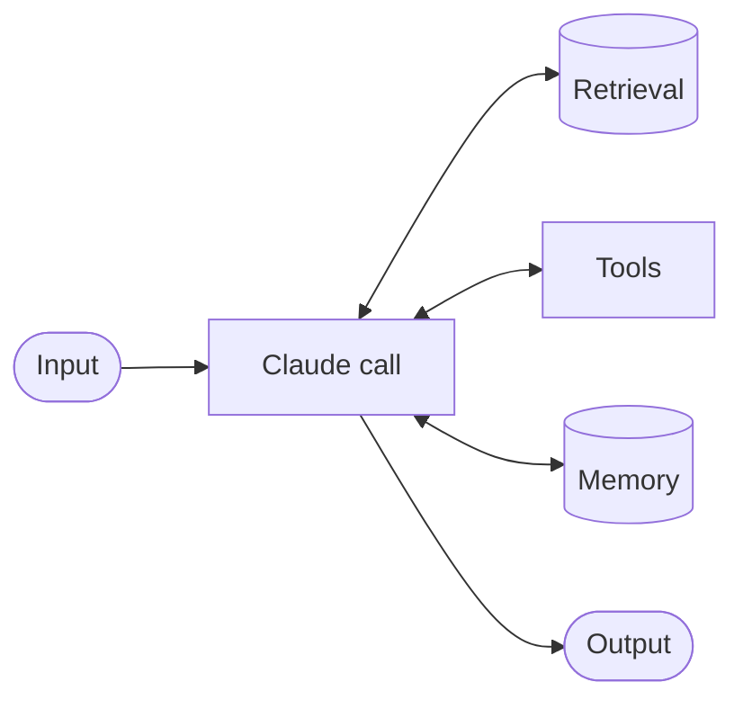
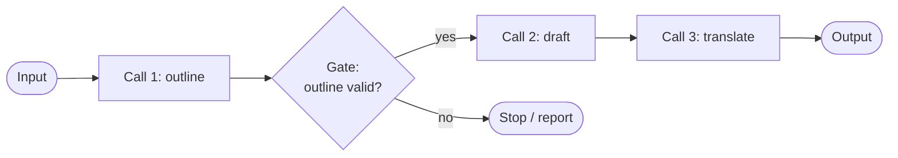
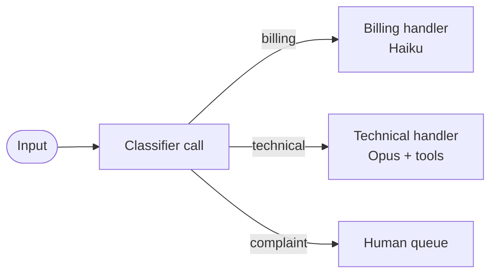
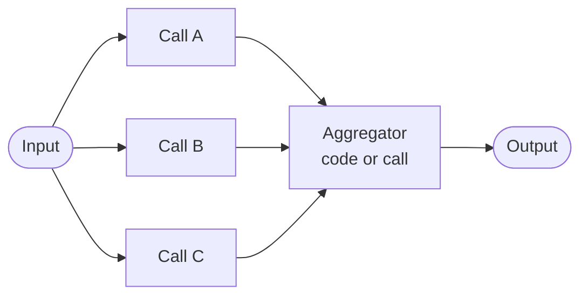
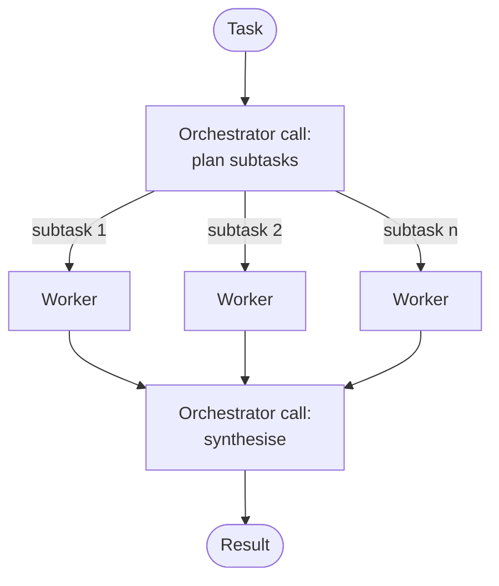
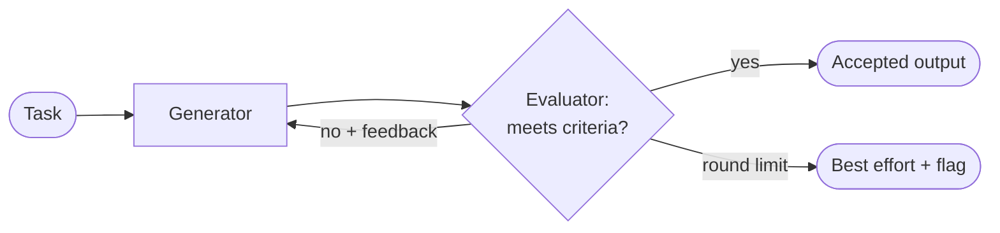

# Workflow Patterns

> **Level:** Intermediate · **Time:** ~40 min · **Exam relevance:** CCAR-P D1 (1.3, 1.5), CCAR-P D4 (4.5)

## In plain English

Most useful Claude systems are built from a handful of reusable shapes, the way most buildings are built from
beams, arches and columns. Learn the shapes and you can recognise them in any design review, combine them, and
explain the trade-offs to a stakeholder in a sentence.

This page covers the building block (the **augmented LLM**) and five composable **workflow patterns**:

| Pattern | One-line idea | Everyday analogy |
|---|---|---|
| Prompt chaining | Do the task in fixed steps; each step's output feeds the next | An assembly line |
| Routing | Classify the input, then send it to a specialised handler | A hospital triage desk |
| Parallelisation | Run independent pieces at once (sectioning) or the same piece several times (voting) | Several reviewers reading at the same time |
| Orchestrator–workers | A lead model decides the subtasks at run time and delegates them | A site foreman handing out jobs |
| Evaluator–optimiser | One call drafts, another critiques, repeat until good enough | Writer and editor |

The pattern names follow Anthropic's article [Building effective agents](https://www.anthropic.com/engineering/building-effective-agents).
The explanations, diagrams and code below are this repository's own.

## Why it matters

- **Decomposition is an exam objective.** CCAR-P-1.5 asks you to apply decomposition techniques; these patterns are
  the vocabulary for doing so.
- **Each pattern buys something specific.** Chaining buys accuracy per step, routing buys specialisation and cost
  control, parallelisation buys speed or confidence, orchestrator–workers buys flexibility, evaluator–optimiser buys
  quality. Each also costs something, usually latency or tokens.
- **They are cheaper than agents.** Every pattern here except orchestrator–workers keeps the control flow in your code,
  so it is predictable and testable.

## How it works

All the code sketches share one small helper. It sets no `temperature` (not supported on current models), uses
adaptive thinking by default, and checks `stop_reason` before trusting the text.

```python
import anthropic

client = anthropic.Anthropic()  # credentials come from the environment, never from code

SMART = "claude-opus-5-5"
FAST = "claude-haiku-5-5"


def ask(prompt: str, *, model: str = SMART, system: str | None = None,
        effort: str = "medium", max_tokens: int = 4096) -> str:
    """One model call. Raises if the response did not finish normally."""
    kwargs = {"system": system} if system else {}
    response = client.messages.create(
        model=model,
        max_tokens=max_tokens,
        output_config={"effort": effort},
        messages=[{"role": "user", "content": prompt}],
        **kwargs,
    )
    if response.stop_reason != "end_turn":
        raise RuntimeError(f"stop_reason={response.stop_reason}")
    return "".join(b.text for b in response.content if b.type == "text")
```

> **Cost:** requires API credits (live mode). Every pattern below makes several calls per input.

### 0. The augmented LLM (the building block)

A single model call enriched with three capabilities: **retrieval** (relevant documents in context), **tools**
(functions the model can ask you to run) and **memory** (state carried between sessions). Every pattern below is a
composition of augmented LLM calls.



Design tip: give each augmentation a clear, well-documented interface. MCP ([module 08](../08-model-context-protocol/README.md))
is one standard way to do that.

### 1. Prompt chaining

Break the task into fixed sequential steps. Between steps, you can insert a **gate**: a programmatic check that stops
the chain if the intermediate output is wrong.



**Use when** the task splits cleanly into steps and each step is easier than the whole. **Trade-off:** more latency
(calls run one after another) in exchange for higher accuracy per step.

```python
def release_notes(changelog: str) -> str:
    bullets = ask(f"List user-visible changes as bullets, one per line.\n<changelog>{changelog}</changelog>",
                  model=FAST, effort="low")
    if len([line for line in bullets.splitlines() if line.strip().startswith("-")]) < 1:  # gate
        raise ValueError("No user-visible changes found; refusing to draft notes")
    draft = ask(f"Write customer-friendly release notes from these bullets:\n{bullets}")
    return ask(f"Rewrite for a non-technical audience in under 150 words:\n{draft}", model=FAST, effort="low")
```

### 2. Routing

Classify the input first, then send it to the handler built for that class. Each handler gets a focused prompt, and
easy classes can go to a cheaper model.



**Use when** inputs fall into distinct categories that are better handled separately. **Trade-off:** misclassification
sends the input down the wrong path, so measure classifier accuracy and keep a fallback route.

```python
ROUTES = {
    "billing": dict(model=FAST, system="You answer billing questions using the attached policy."),
    "technical": dict(model=SMART, system="You are a senior support engineer."),
}


def handle(ticket: str) -> str:
    label = ask(
        "Classify this ticket as exactly one word: billing, technical or complaint.\n"
        f"<ticket>{ticket}</ticket>",
        model=FAST, effort="low", max_tokens=256,
    ).strip().lower()
    if label not in ROUTES:  # complaints and anything unexpected go to people
        return "escalated-to-human"
    return ask(ticket, **ROUTES[label])
```

For a production classifier, prefer structured outputs with an `enum` over parsing free text
(see [structured output](../03-prompt-engineering/06-structured-output.md)).

### 3. Parallelisation

Two variants:

- **Sectioning**: split independent subtasks and run them concurrently, for example checking a contract for
  liability clauses, data-protection clauses and termination clauses at the same time.
- **Voting**: run the *same* task several times, or with different prompts, and aggregate, for example three
  independent reviews of a code change, flagging it if any reviewer finds a problem.



**Use when** subtasks are independent (sectioning, for speed) or you want more confidence than one call gives
(voting). A useful special case is running a **guardrail check in parallel** with the main response instead of in
sequence. **Trade-off:** token cost multiplies by the number of branches; latency is the slowest branch.

```python
from concurrent.futures import ThreadPoolExecutor

CHECKS = {
    "liability": "Does this contract cap liability? Quote the clause or say NONE.",
    "data_protection": "Does this contract define personal-data processing duties? Quote or say NONE.",
    "termination": "What notice period applies to termination? Quote or say NONE.",
}


def review_contract(contract: str) -> dict[str, str]:
    with ThreadPoolExecutor(max_workers=len(CHECKS)) as pool:
        futures = {name: pool.submit(ask, f"{q}\n<contract>{contract}</contract>", effort="low")
                   for name, q in CHECKS.items()}
        return {name: f.result() for name, f in futures.items()}
```

Voting would instead submit the same prompt three times and combine with a rule such as "flag if any vote says
VULNERABLE". Because current models do not accept `temperature`, diversity comes from varied prompts or perspectives
rather than sampling settings.

### 4. Orchestrator–workers

A lead model (the orchestrator) reads the task, **decides at run time** which subtasks are needed, hands each to a
worker call, then synthesises the results. Unlike sectioning, the subtasks are not known in advance.



**Use when** the decomposition depends on the input, for example "update every service affected by this API change"
where you do not know which services until you look. **Trade-off:** less predictable; the plan itself can be wrong.
This pattern sits on the boundary with agents and is the basis of [multi-agent architecture](04-multi-agent-architecture.md).

```python
import json

PLAN_SCHEMA = {
    "type": "object",
    "properties": {"subtasks": {"type": "array", "items": {"type": "string"}}},
    "required": ["subtasks"],
    "additionalProperties": False,
}


def orchestrate(task: str) -> str:
    plan_response = client.messages.create(
        model=SMART, max_tokens=2048,
        output_config={"format": {"type": "json_schema", "schema": PLAN_SCHEMA}, "effort": "high"},
        messages=[{"role": "user", "content": f"Break this into independent research subtasks:\n{task}"}],
    )
    if plan_response.stop_reason != "end_turn":
        raise RuntimeError(plan_response.stop_reason)
    plan_text = next(b.text for b in plan_response.content if b.type == "text")
    subtasks = json.loads(plan_text)["subtasks"][:6]      # hard cap enforced in code
    with ThreadPoolExecutor(max_workers=4) as pool:
        findings = list(pool.map(lambda s: ask(s, model=FAST, effort="low"), subtasks))
    joined = "\n\n".join(f"<finding task='{t}'>{f}</finding>" for t, f in zip(subtasks, findings))
    return ask(f"Task: {task}\nCombine these findings into one answer:\n{joined}")
```

Note the guardrail: code caps how many workers the orchestrator can spawn, whatever the plan asks for. (Structured
outputs guarantee the plan's shape, but array-length constraints are not enforced by the schema, so the cap lives in code.)

### 5. Evaluator–optimiser

One call generates, a second call evaluates against explicit criteria, and the loop repeats with the feedback until
the evaluator passes it or a round limit is hit.



**Use when** you have clear evaluation criteria and iteration measurably improves the result (translation nuance,
policy-compliant wording, code that must pass tests). **Trade-off:** each round adds two calls; without a round limit
it can loop forever.

```python
def refine(task: str, criteria: str, max_rounds: int = 3) -> tuple[str, bool]:
    draft = ask(task)
    for _ in range(max_rounds):
        verdict = ask(
            f"Criteria:\n{criteria}\n\nDraft:\n{draft}\n\n"
            "Reply PASS if every criterion is met. Otherwise reply FAIL and list the specific fixes.",
            effort="high",
        )
        if verdict.strip().upper().startswith("PASS"):
            return draft, True
        draft = ask(f"Task: {task}\nRevise this draft using the feedback.\nDraft:\n{draft}\nFeedback:\n{verdict}")
    return draft, False  # caller decides: ship with a flag, or escalate to a human
```

Where the criteria can be checked by code (tests pass, JSON validates, word count), use code as the evaluator. It is
cheaper and cannot be talked round.

### Combining patterns

Real systems nest these shapes. A support pipeline might **route** first, use a **chain** for billing questions,
run a **parallel** guardrail check on every answer, and send hard technical issues to an **orchestrator–workers**
investigation. Keep each composition only if an evaluation shows it improves results.

### Choosing a pattern

| If the task... | Start with |
|---|---|
| Has fixed, ordered steps | Prompt chaining |
| Arrives in distinct categories | Routing |
| Has independent parts, or needs a second opinion | Parallelisation |
| Needs subtasks that depend on the input | Orchestrator–workers |
| Has checkable quality criteria and benefits from revision | Evaluator–optimiser |
| Has no predictable path at all | An agent ([the agent loop](03-the-agent-loop.md)) |

## Example

*Acme Logistics* produces a weekly operations digest from about 400 incident tickets. The original design was a
single agent with a "search tickets" tool, which was slow and inconsistent. The redesign:

1. **Route** each ticket with Claude Haiku 5.5 into one of six categories (cheap, high volume).
2. **Parallelise by section**: one Opus 5.5 call per category summarises that category's tickets.
3. **Chain** the six summaries into a single digest draft.
4. **Evaluator–optimiser** with code-checkable criteria (every category present, under 800 words, no customer names)
   plus one model-graded criterion (tone), capped at two rounds.

The result ran in a predictable number of calls and could be regression-tested category by category. For the bulk
classification step, the team later moved to the Message Batches API for a 50% cost reduction because the digest is
not latency-sensitive (see [batch processing](../06-claude-api/05-batch-processing.md)).

## Enterprise use case

*Fabrikam Insurance* reviews claim correspondence for regulatory wording. Their architecture uses:

- **Parallel guardrail**: a fast screening call checks every outbound letter for prohibited promises at the same time
  as the drafting call runs, so the check adds no latency.
- **Evaluator–optimiser** with a written compliance rubric owned by the legal team. Letters that fail after two
  rounds go to a human reviewer with the evaluator's feedback attached, which turns the loop into a
  [human-in-the-loop](05-human-in-the-loop.md) escalation instead of an infinite retry.

## Common mistakes

- **No gates in chains.** A bad first step propagates silently. Add cheap programmatic checks between steps.
- **Routing without a fallback.** Every router needs an "unknown" path, usually to a human or a general handler.
- **Unbounded evaluator loops.** Always set a round limit and decide what happens when it is reached.
- **Same model judging itself with the same prompt.** The evaluator should have different instructions, explicit
  criteria and, where possible, code-based checks.
- **Parallelising dependent work.** If branch B needs branch A's result, they are a chain, not parallel.
- **Orchestrators with no cap.** Limit the number of workers the plan can request.

## Security considerations

- Treat every intermediate output as untrusted input to the next step: validate structure, escape before rendering,
  never `eval` it (see [insecure output handling](../12-ai-security/06-insecure-output-handling.md)).
- Routing is a security boundary: an attacker who can steer classification can reach a more privileged handler. Give
  handlers only the tools their class needs.
- In orchestrator–workers, the orchestrator's plan may be influenced by injected content. Constrain plans with a
  schema and an allow-list of subtask types.

## Troubleshooting

| Symptom | Likely cause | Fix |
|---|---|---|
| Chain output degrades at a later step | Earlier output passed unchecked | Add a gate; tighten the earlier prompt |
| Router sends many inputs to the wrong handler | Ambiguous categories or free-text labels | Use an `enum` schema; add examples; measure confusion matrix |
| Parallel run slower than expected | Rate limits throttling concurrent calls | Cap concurrency; see [rate limits and capacity](../15-production-operations/06-rate-limits-and-capacity.md) |
| Evaluator always fails the draft | Criteria impossible or contradictory | Review criteria with the domain owner; log feedback per round |
| Orchestrator produces near-duplicate subtasks | Plan prompt lacks boundaries | Ask for non-overlapping subtasks with a scope statement each |

## Check your understanding

1. What distinguishes orchestrator–workers from parallel sectioning?
2. Where would you place a gate in a prompt chain, and what might it check?
3. A team wants three independent opinions on whether a pull request is safe. Which pattern and variant is that?
4. Why must every evaluator–optimiser loop have a round limit, and what should happen when it is reached?
5. How can routing reduce cost?

<details>
<summary>Answers</summary>

1. In sectioning, your code defines the subtasks in advance; in orchestrator–workers, a model decides the subtasks at
   run time based on the input.
2. Between steps, typically after any step whose output the next step relies on. It might check structure (valid
   JSON, required fields), counts, or business rules, and stop the chain if they fail.
3. Parallelisation, voting variant.
4. Without a limit the loop can run indefinitely when criteria cannot be met. At the limit, return the best draft with
   a flag, or escalate to a human with the evaluator's feedback.
5. Simple categories can go to a smaller, cheaper model (such as Claude Haiku 5.5) at low effort, keeping the more
   capable model for the hard cases.

</details>

## Further reading

- Anthropic Engineering — [Building effective agents](https://www.anthropic.com/engineering/building-effective-agents)
- Claude API docs — [Structured outputs](https://platform.claude.com/docs/en/build-with-claude/structured-outputs)
- Claude API docs — [Batch processing](https://platform.claude.com/docs/en/build-with-claude/batch-processing)
- In this repository: [task decomposition and chaining](../03-prompt-engineering/05-task-decomposition-and-chaining.md),
  [model selection](../05-claude-products-and-models/03-model-selection.md), [architecture patterns](../13-enterprise-ai-architecture/02-architecture-patterns.md)
