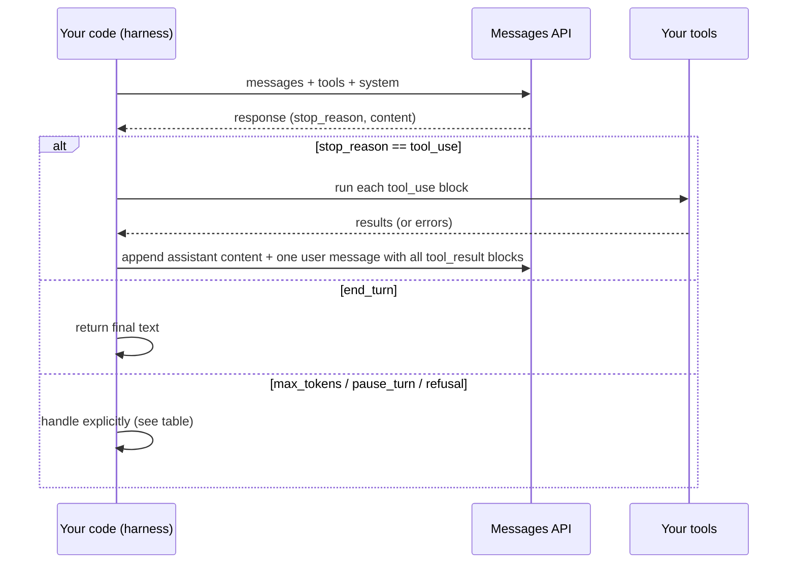

# The Agent Loop

> **Level:** Intermediate · **Time:** ~35 min · **Exam relevance:** CCAR-P D1 (1.3, 1.4), CCAR-P D3 (3.1)

## In plain English

An agent is surprisingly simple underneath. It is a loop:

1. Show Claude the goal, the conversation so far and the tools it may use.
2. Claude either answers, or asks you to run one or more tools.
3. You run the tools and hand back the results.
4. Go back to step 1, until Claude says it is done or you decide to stop it.

That is all. A detective works the same way: look at the evidence, decide what to check next, check it, update the
theory, repeat until the case is solved or the time runs out. The intelligence is in choosing the next step; the
loop itself is a few lines of code.

What separates a toy agent from a production one is not the loop. It is everything around it: how it ends, what it
is allowed to do, how much it may spend, and what you can see afterwards.

## Why it matters

- **Every agent product is this loop.** Claude Code, the Agent SDK, Managed Agents and the SDK Tool Runner all run
  a version of it. Understanding the raw loop lets you reason about all of them.
- **Most agent bugs are loop bugs**: unhandled stop reasons, tool results sent in the wrong shape, no exit condition,
  or a context that grows until the request fails.
- **Exam relevance.** Designing orchestration (CCAR-P-1.4) and judging tool configuration for capability bloat
  (CCAR-P-3.1) both assume you know what happens inside each turn.

## How it works

### One turn, step by step



The API is stateless. On every turn you send the **whole** conversation: the original request, every assistant
message (including its `tool_use` blocks, and any thinking blocks, unchanged) and every `tool_result`.

### Every way a turn can end

Always read `stop_reason` before using `content`.

| `stop_reason` | Meaning | What your loop should do |
|---|---|---|
| `end_turn` | Claude finished its answer | Exit the loop and return the text |
| `tool_use` | Claude wants one or more tools run | Run them all, append results in **one** user message, continue |
| `max_tokens` | The response hit your `max_tokens` cap mid-output | Do not trust partial tool input; raise the cap or treat as failure |
| `pause_turn` | A long-running server-side tool (for example web search) paused | Append the assistant content as-is and send again to let it continue |
| `refusal` | Safety systems declined the request | Stop; read `stop_details`; route to a fallback or a human, do not retry blindly |
| `stop_sequence` | A custom stop sequence was hit | Handle per your design (rare in agents) |

### The tool result contract

- Each `tool_result` must reference the `tool_use_id` of the block it answers.
- If Claude asked for several tools in one turn (parallel tool use), return **all** results together in a single
  user message. Splitting them across messages teaches the model to stop calling tools in parallel.
- If a tool fails, still return a `tool_result` with `is_error: true` and a useful message. Dropping it breaks the
  conversation; a clear error lets Claude adapt (retry differently, try another tool, or explain).

### Thinking and effort in an agent

On current models thinking is adaptive: Claude decides when and how much to reason, and you tune depth with
`output_config={"effort": ...}`. Agentic and coding work generally benefits from `high`, while simple worker or
classification steps run well at `low`. Thinking blocks returned in a response must be passed back unchanged in the
next request. If you append `response.content` as a whole (as the code below does), this happens automatically.

## Example

A minimal but production-shaped manual loop for *Northwind Lending*'s read-only "application question" agent. It
handles every stop reason, runs parallel tool calls, returns errors properly, and enforces a turn limit.

```python
"""Manual agent loop with explicit stop-reason handling and a turn budget."""
import json
import re

import anthropic

client = anthropic.Anthropic()  # reads credentials from the environment
MODEL = "claude-opus-5-5"
MAX_TURNS = 12

TOOLS = [
    {
        "name": "get_application",
        "description": "Fetch a loan application by ID. Returns applicant business name, amount requested and status.",
        "strict": True,
        "input_schema": {
            "type": "object",
            "properties": {"application_id": {"type": "string", "description": "Format APP-123456"}},
            "required": ["application_id"],
            "additionalProperties": False,
        },
    },
    {
        "name": "list_documents",
        "description": "List documents attached to an application, with type and upload date.",
        "strict": True,
        "input_schema": {
            "type": "object",
            "properties": {"application_id": {"type": "string", "description": "Format APP-123456"}},
            "required": ["application_id"],
            "additionalProperties": False,
        },
    },
]

# Synthetic data standing in for real systems.
FAKE_DB = {"APP-000123": {"business": "Example Bakery Ltd", "amount": 25000, "status": "in_review"}}
FAKE_DOCS = {"APP-000123": [{"type": "bank_statement", "uploaded": "2026-09-30"}]}


APP_ID = re.compile(r"^APP-[0-9]{6}$")


def run_tool(name: str, args: dict) -> str:
    # Strict schemas guarantee shape and types; value rules (formats, ranges, ownership) are checked here.
    if not APP_ID.match(args.get("application_id", "")):
        raise ValueError("application_id must look like APP-123456")
    if name == "get_application":
        record = FAKE_DB.get(args["application_id"])
        if record is None:
            raise KeyError(f"No application {args['application_id']}")
        return json.dumps(record)
    if name == "list_documents":
        return json.dumps(FAKE_DOCS.get(args["application_id"], []))
    raise ValueError(f"Unknown tool {name}")  # never execute anything not on the allow-list


def run_agent(question: str) -> str:
    messages = [{"role": "user", "content": question}]
    for turn in range(MAX_TURNS):
        response = client.messages.create(
            model=MODEL,
            max_tokens=16000,
            system="You answer underwriters' questions about loan applications using only the tools provided.",
            tools=TOOLS,
            output_config={"effort": "high"},
            messages=messages,
        )

        if response.stop_reason == "end_turn":
            return "".join(b.text for b in response.content if b.type == "text")

        if response.stop_reason == "pause_turn":
            messages.append({"role": "assistant", "content": response.content})
            continue

        if response.stop_reason in ("max_tokens", "refusal"):
            raise RuntimeError(f"Agent stopped early: {response.stop_reason}")

        # stop_reason == "tool_use": run every requested tool, collect all results.
        messages.append({"role": "assistant", "content": response.content})
        results = []
        for block in response.content:
            if block.type != "tool_use":
                continue
            try:
                output, is_error = run_tool(block.name, block.input), False
            except Exception as exc:  # report the failure to Claude instead of crashing the loop
                output, is_error = f"Tool error: {exc}", True
            results.append({"type": "tool_result", "tool_use_id": block.id,
                            "content": output, "is_error": is_error})
        messages.append({"role": "user", "content": results})  # one message, all results

    raise RuntimeError(f"No final answer after {MAX_TURNS} turns")


if __name__ == "__main__":
    print(run_agent("What is the status of APP-000123 and has a bank statement been uploaded?"))
```

> **Cost:** requires API credits (live mode). A run like this typically takes two or three turns.

Things to notice:

- `strict: True` guarantees the tool input matches the schema's shape and types. Strict schemas do not support every
  JSON Schema constraint (string length, numeric ranges and some array rules are not enforced), so value rules such
  as the ID format are checked in code before the tool runs.
- The tools are **read-only**. Granting only what the task needs is the main defence against capability bloat.
- `MAX_TURNS` is a hard stop. [Agent reliability](07-agent-reliability.md) adds token and cost budgets, checkpoints
  and tracing.
- `tool_choice` is left at its default (`auto`). Forcing a specific tool (`any` or `tool`) is rejected on current
  models; steer with instructions instead.

If you do not need this level of control, the SDK's Tool Runner (`client.beta.messages.tool_runner`) runs the same
loop for you from decorated Python functions. [Page 6](06-managed-agents-and-agent-sdk.md) compares the options, and
[lab-12](../19-hands-on-labs/lab-12-agentic-task-execution/README.md) builds this loop offline in mock mode.

### Context growth

Each turn appends the assistant message and the tool results, so the request grows every turn. Long tool outputs
(log files, large query results) are the usual cause of runaway context. Mitigations, in order of preference:

1. **Return less.** Tools should summarise, paginate and filter rather than dump raw data.
2. **Cache the stable prefix.** Put the system prompt and tool definitions first and unchanging so prompt caching can
   reuse them (see [prompt caching](../04-context-engineering/03-prompt-caching.md)).
3. **Clear or compact.** Context editing removes old tool results; compaction summarises older history (see
   [compaction and context editing](../04-context-engineering/05-compaction-and-context-editing.md)).
4. **Delegate.** Hand reading-heavy subtasks to a subagent that returns only a summary
   ([multi-agent architecture](04-multi-agent-architecture.md)).

## Enterprise use case

*Contoso Health*'s IT service desk runs an agent that diagnoses access problems. The loop is the one above, with
three enterprise additions:

- **Tool tiers.** Read tools (look up user, read group membership, read sign-in log) run automatically. The one write
  tool (`reset_mfa`) is wrapped by an approval gate ([human in the loop](05-human-in-the-loop.md)).
- **Identity.** Tools run with a service identity scoped to the help desk, never with an administrator's credentials
  (see [agent identity and permissions](../12-ai-security/09-agent-identity-and-permissions.md)).
- **Trace per run.** Every turn's request ID, tool name, arguments (with personal data masked), duration and token
  usage go to the observability platform, so a failed diagnosis can be replayed.

## Common mistakes

- **Only checking for `tool_use`.** Treating anything else as "done" turns `max_tokens` and `refusal` into silent
  wrong answers.
- **Sending tool results in separate messages.** Breaks parallel tool use.
- **Dropping failed tool calls.** Every `tool_use` needs a matching `tool_result`, errors included.
- **Rebuilding the assistant message from text only.** You lose `tool_use` blocks and thinking blocks; append the full
  `response.content`.
- **No turn limit.** An agent that cannot finish will loop until your budget is gone.
- **Giant tool outputs.** Returning an entire table or log fills the context and degrades decisions.
- **Matching tool input as raw strings.** Tool inputs arrive as parsed JSON objects; use them as such.

## Security considerations

- **Tool output is untrusted.** A document or web page returned by a tool can contain instructions aimed at the
  model. Keep write tools gated, and never let tool output select which credentials are used.
- **Validate arguments before execution**, even with `strict` schemas: check the caller is allowed to touch that
  record ID, enforce path allow-lists, and refuse unknown tool names.
- **Least privilege per tool.** Separate read and write tools so you can gate writes without slowing reads. See
  [tool security](../07-tool-use-and-function-calling/06-tool-security.md).

## Troubleshooting

| Symptom | Likely cause | Fix |
|---|---|---|
| 400 error mentioning `tool_use_id` | A `tool_use` block without a matching `tool_result`, or results split across messages | Return one result per call, all in a single user message |
| Agent stops mid-sentence | `max_tokens` too low | Raise it; stream for large values |
| Claude calls tools one at a time when they could be parallel | Earlier results were sent in separate messages | Batch results into one message |
| Agent repeats the same tool call | Tool error message unhelpful, or result ambiguous | Return clear, specific errors and structured results |
| Request size grows until it fails | Large tool outputs accumulating | Summarise in tools; use context editing or compaction |

## Check your understanding

1. Why must your code resend the whole conversation on every turn?
2. Claude asks for three tools in one response, and one of them throws an exception. What do you send back?
3. What should the loop do on `pause_turn`, and how is that different from `max_tokens`?
4. Name two ways to keep an agent's context from growing without bound.
5. Why is leaving `tool_choice` at `auto` the right default on current models?

<details>
<summary>Answers</summary>

1. The Messages API is stateless; the model only knows what is in the current request.
2. One user message containing three `tool_result` blocks, each with the matching `tool_use_id`. The failed one has
   `is_error: true` and a clear error message.
3. On `pause_turn`, append the assistant content unchanged and call again so the server tool can continue. On
   `max_tokens`, the output was cut off at your cap, so the content may be incomplete and should not be executed.
4. Any two of: make tools return smaller, filtered results; context editing to clear old tool results; compaction to
   summarise history; delegating reading-heavy work to subagents that return summaries.
5. Forcing a tool (`any` or `tool`) is rejected on current models; `auto` plus clear instructions (and `strict`
   schemas) is the supported way to steer tool use.

</details>

## Further reading

- Claude API docs — [Tool use overview](https://platform.claude.com/docs/en/agents-and-tools/tool-use/overview)
- Claude API docs — [Handling stop reasons](https://platform.claude.com/docs/en/build-with-claude/handling-stop-reasons)
- Claude Agent SDK docs — [How the agent loop works](https://code.claude.com/docs/en/agent-sdk/agent-loop)
- In this repository: [the tool-use loop](../07-tool-use-and-function-calling/03-the-tool-use-loop.md),
  [tool design best practices](../07-tool-use-and-function-calling/05-tool-design-best-practices.md),
  [agent reliability](07-agent-reliability.md)
