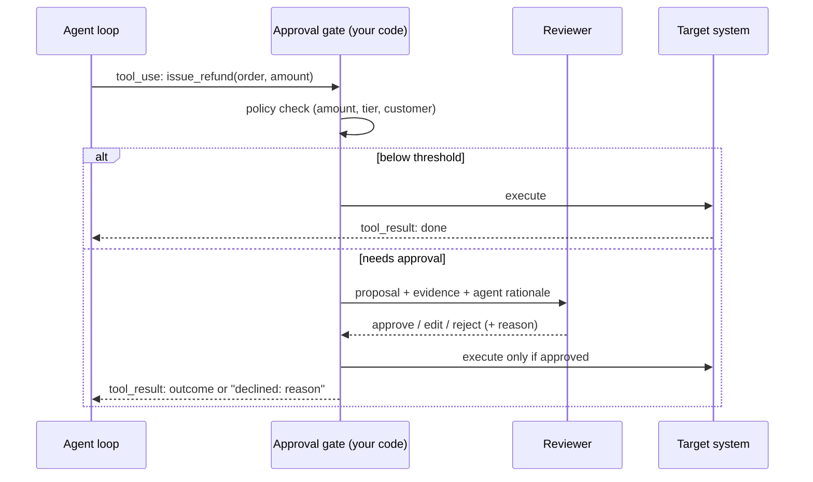

# Human in the Loop

> **Level:** Intermediate to Advanced · **Time:** ~35 min · **Exam relevance:** CCAR-P D5 (5.3, 5.1, 5.2), CCAR-P D1 (1.2)

## In plain English

A new employee is not given the authority to sign contracts on day one. They can read anything they need, draft
anything they like, and ask a manager to approve anything that commits the company. As they prove reliable, the
approval threshold rises.

Human-in-the-loop (HITL) design applies the same idea to AI systems. You decide, in advance, which outputs and actions
Claude may complete on its own, which need a person to approve them, and which must be handed to a person entirely.
The goal is not to have a human check everything (that defeats the purpose) but to place human judgement exactly where
the cost of a mistake is high or the system's confidence is low.

## Why it matters

- **Accountability.** Many decisions (credit, clinical, employment, legal) must have an accountable human, often by
  regulation. Under the EU General Data Protection Regulation (GDPR), for example, people have rights around decisions
  based solely on automated processing that significantly affect them (see
  [data governance and compliance](../13-enterprise-ai-architecture/05-data-governance-and-compliance.md)).
- **Irreversibility.** Sending an email, paying an invoice or deleting a record cannot be undone by a better prompt.
- **Errors compound in agents.** A checkpoint before a consequential step stops one bad decision from becoming many.
- **Trust and adoption.** Users adopt systems they can supervise. Clear approval points make the system explainable.
- **Exam relevance.** CCAR-P-5.3 asks you to apply human-in-the-loop validation; expect scenarios where you must pick
  *where* the human goes, not just *whether*.

## How it works

### Three HITL mechanisms

| Mechanism | Trigger | Human role | Example |
|---|---|---|---|
| **Approval gate** | The *action type* is consequential | Approve, edit or reject before it runs | Agent proposes refund over a threshold; supervisor approves |
| **Confidence threshold** | The *case* is uncertain | Review only low-confidence outputs | Document classifier sends cases below a threshold to a person |
| **Escalation** | The system *cannot or must not* handle it | Take over the case | Complaint mentions legal action; route to a human team |

These combine. A typical design auto-completes high-confidence, low-risk cases; queues medium cases for review;
gates every irreversible action; and escalates anything out of scope.

### A risk-tiering matrix

Classify every tool and output by **reversibility** and **impact**, then assign a control.

| | Low impact | High impact |
|---|---|---|
| **Reversible** | Auto-run, log it (read data, draft text, create a ticket) | Auto-run with notification and easy undo (update a non-critical field) |
| **Irreversible** | Approval gate, or auto-run with tight limits (send internal message) | Approval gate always; consider two-person approval (payments, deletions, external communications, access changes) |

Write the matrix down with the business owner. It becomes the policy your code enforces and the evidence auditors
ask for.

### Where to put an approval gate



Key properties:

- **The gate is code, not a prompt.** Asking Claude to "check with the user before refunding" is guidance; a function
  that will not execute without an approval record is a control.
- **The model learns the outcome.** Return a `tool_result` such as "declined by reviewer: amount exceeds policy" so the
  agent can explain or try an alternative, rather than retrying blindly.
- **Show the reviewer evidence**, not just the action: what the agent saw, why it proposes this, and what will change.
- **Record the decision**: who approved, when, what they saw, and any edits. That audit trail is part of the control.

### Confidence thresholds done properly

A model's self-reported confidence ("I am 90% sure") is not a calibrated probability. Use it as one signal, and set
thresholds using measurement:

1. Collect a labelled evaluation set ([building eval datasets](../14-evaluation-and-testing/03-building-eval-datasets.md)).
2. Record the system's confidence signal and correctness for each case. Useful signals include a structured
   `confidence` field, agreement across several parallel calls (voting), whether retrieval found supporting sources,
   and rule-based checks such as totals that reconcile.
3. Pick the threshold that gives an acceptable error rate in the auto-approved band, then measure how many cases go to
   review. That trade-off (accuracy against reviewer workload) is a business decision; present it as one.
4. Re-check the threshold whenever the model, prompt or data changes.

### Escalation paths

Every system needs a defined way out:

- **Triggers**: out-of-scope request, policy keywords (legal threat, self-harm, regulator), repeated tool failures,
  budget exhausted, `refusal` stop reason, user asks for a person.
- **Hand-off package**: summary of the case, what was tried, evidence, and the reason for escalation, so the person
  does not start from scratch.
- **Ownership and SLA**: a named queue, a response target, and monitoring of queue length.

### HITL support in Claude's agent surfaces

| Surface | How you add a human gate |
|---|---|
| Manual loop or SDK Tool Runner | Check inside the tool function (return a "declined" result), or inspect pending `tool_use` blocks before running them |
| Claude Agent SDK | Permission modes plus allow and deny rules, a permission callback, and hooks that run before a tool executes |
| Claude Managed Agents | Per-tool permission policies (`always_allow`, `always_ask`, `auto`); with `always_ask` the session pauses and your client returns a confirmation |
| Claude Code | Permission settings and hooks (see [permissions and settings](../09-claude-code/04-permissions-and-settings.md) and [hooks](../09-claude-code/06-hooks.md)) |

As of 2026-10-24, these mechanisms are described in the Agent SDK permissions documentation and the Managed Agents
tools documentation linked under Further reading.

## Example

*Northwind Lending*'s servicing agent can look up accounts and propose fee waivers. Waivers of 50 or more (synthetic
currency units) need a supervisor. The gate lives in the tool function, so it works the same whether you use a manual
loop or the Tool Runner.

```python
"""Approval gate enforced in code. Runs offline: the reviewer is simulated."""
from dataclasses import dataclass, field
from datetime import datetime, timezone

AUTO_LIMIT = 50


@dataclass
class ApprovalRecord:
    action: str
    params: dict
    decision: str
    reviewer: str
    reason: str
    at: str = field(default_factory=lambda: datetime.now(timezone.utc).isoformat())


AUDIT_LOG: list[ApprovalRecord] = []


def request_human_approval(action: str, params: dict, rationale: str) -> tuple[str, str, str]:
    """In production: post to a review queue and wait. Here: a deterministic stand-in."""
    print(f"[REVIEW] {action} {params}\n  agent rationale: {rationale}")
    if params["amount"] > 200:
        return "rejected", "supervisor-7", "Exceeds waiver policy; offer payment plan instead"
    return "approved", "supervisor-7", "Within policy for long-standing customer"


def waive_fee(account_id: str, amount: int, rationale: str) -> str:
    """Tool implementation. The model sees only the returned string."""
    params = {"account_id": account_id, "amount": amount}
    if amount < AUTO_LIMIT:
        decision, reviewer, reason = "auto-approved", "policy", f"Below {AUTO_LIMIT}"
    else:
        decision, reviewer, reason = request_human_approval("waive_fee", params, rationale)
    AUDIT_LOG.append(ApprovalRecord("waive_fee", params, decision, reviewer, reason))
    if decision == "rejected":
        return f"Declined by reviewer: {reason}. Do not retry this waiver."
    # ... call the billing system here, with an idempotency key (see agent reliability) ...
    return f"Fee of {amount} waived on {account_id} ({decision})."


if __name__ == "__main__":
    print(waive_fee("ACC-1001", 20, "Late fee caused by our outage"))
    print(waive_fee("ACC-1002", 120, "Customer of 9 years, first late payment"))
    print(waive_fee("ACC-1003", 500, "Customer requested full waiver"))
    for record in AUDIT_LOG:
        print(record)
```

Expose `waive_fee` as a tool (for example with `@beta_tool` and the Tool Runner, or in a manual loop). Claude can
propose any waiver, but cannot bypass the gate, and learns why a waiver was declined.
[lab-13](../19-hands-on-labs/lab-13-human-in-the-loop/README.md) extends this with confidence-based routing and an
escalation queue.

## Enterprise use case

*Contoso Health* uses Claude to pre-fill prior-authorisation forms from clinical notes.

| Stage | Control |
|---|---|
| Field extraction | Structured output with a per-field `evidence` quote; fields without evidence are left blank, never guessed |
| Confidence routing | Forms where every field has evidence and validation rules pass go to a "quick review" queue; others go to "full review" |
| Submission to the insurer | Always an approval gate: a clinician signs off. Claude never submits |
| Escalation | Notes mentioning conditions outside the supported list go straight to a specialist team with a hand-off summary |
| Monitoring | Weekly sample of quick-review forms re-checked by a second reviewer to detect automation bias |

The last row matters. Reviewers who approve hundreds of correct forms start approving without reading ("automation
bias" or "rubber-stamping"). Sampling, rotating reviewers, and occasionally inserting known-bad test cases keep the
human control real.

## Common mistakes

- **Approval by prompt.** Instructions like "ask before acting" are not enforcement. Gate in code.
- **Gating everything.** Reviewers drown, approve blindly, and the gate becomes theatre. Gate by risk tier.
- **Showing the reviewer only the action.** Without evidence and rationale, the reviewer cannot judge it.
- **Trusting self-reported confidence** without calibrating it against labelled data.
- **No path for "declined".** The agent retries the same action, or the conversation dead-ends.
- **No escalation SLA.** Escalated cases sit unowned in a queue.
- **Forgetting the audit trail.** An approval you cannot evidence is, to an auditor, an approval that did not happen.

## Security considerations

- **Approval UIs are an attack surface.** Injected text can try to make a harmful action look benign ("this transfer
  is the routine monthly payment"). Render the *actual parameters* from the tool call, not the model's description.
- **Bind approvals to exact parameters.** Approve "pay 120 to account X", and reject execution if any parameter
  changed after approval.
- **Separate duties.** The person requesting an action through the agent should not be the person approving it for
  high-impact actions.
- See [human oversight](../12-ai-security/13-human-oversight.md) and
  [tool misuse and excessive agency](../12-ai-security/05-tool-misuse-and-excessive-agency.md).

## Troubleshooting

| Symptom | Likely cause | Fix |
|---|---|---|
| Review queue grows without limit | Threshold too strict or gating low-risk actions | Re-tier actions; re-measure threshold on labelled data |
| Errors slip through approved cases | Rubber-stamping, or reviewers lack evidence | Show evidence; sample-audit approvals; insert test cases |
| Agent keeps retrying a declined action | Declined result unclear | Return an explicit "declined, do not retry" message with reason |
| Users bypass the system | Gate adds too much delay | Measure approval latency; add SLA and staffing; auto-approve the lowest tier |

## Check your understanding

1. What is the difference between an approval gate and a confidence threshold?
2. Why should an approval gate be implemented in code rather than in the system prompt?
3. How would you set a confidence threshold for auto-approving document classifications?
4. Name three items a good escalation hand-off package contains.
5. What is automation bias, and name one way to counter it.

<details>
<summary>Answers</summary>

1. An approval gate triggers on the type of action (consequential actions always need approval). A confidence
   threshold triggers on how uncertain a particular case is (only low-confidence cases go to review).
2. The model can be wrong or manipulated (for example by prompt injection); a code gate cannot be talked round and
   produces an auditable record.
3. Measure on a labelled evaluation set: record the confidence signal and correctness for each case, choose the
   threshold that gives an acceptable error rate among auto-approved cases, and check the resulting review volume
   with the business owner. Re-check after any change.
4. Any three of: case summary, what was tried, supporting evidence, the escalation reason, relevant identifiers.
5. Reviewers approving without real scrutiny because the system is usually right. Counter it with sample audits,
   rotating reviewers, showing evidence, or seeding known-bad test cases.

</details>

## Further reading

- Claude Agent SDK docs — [Permissions](https://code.claude.com/docs/en/agent-sdk/permissions) and [Hooks](https://code.claude.com/docs/en/agent-sdk/hooks)
- Managed Agents docs — [Overview](https://platform.claude.com/docs/en/managed-agents/overview)
- Anthropic Engineering — [Building effective agents](https://www.anthropic.com/engineering/building-effective-agents) (checkpoints and human feedback)
- NIST — [AI Risk Management Framework](https://www.nist.gov/itl/ai-risk-management-framework)
- In this repository: [human oversight](../12-ai-security/13-human-oversight.md),
  [lab-13](../19-hands-on-labs/lab-13-human-in-the-loop/README.md), [agent reliability](07-agent-reliability.md)
