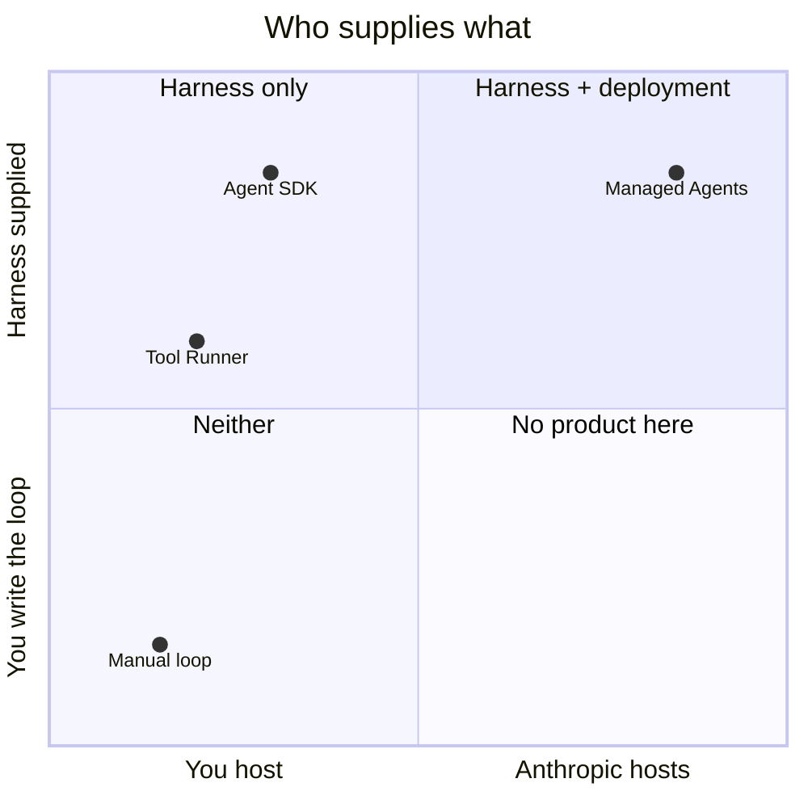
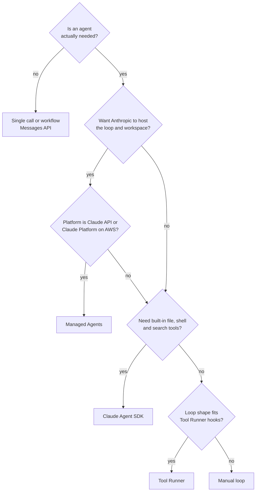

# Managed Agents, Agent SDK, Tool Runner or Manual Loop

> **Level:** Intermediate to Advanced · **Time:** ~35 min · **Exam relevance:** CCAR-P D1 (1.3, 1.4), CCAR-P D3 (3.1, 3.7), CCAR-P D7 (7.1)

## In plain English

Once you have decided you really need an agent, there are four ways to build one with Claude. A home-cooking
analogy helps:

- **Manual loop**: you buy raw ingredients and cook everything yourself. Total control, all the work.
- **Tool Runner**: a meal kit. The recipe steps (the loop) are handled; you supply the main ingredients (your tools).
  You still cook in your own kitchen.
- **Claude Agent SDK**: a fully equipped professional kitchen you install at home. It comes with knives, ovens and
  techniques (built-in file, shell and search tools, permissions, subagents) from Claude Code. Still your house.
- **Claude Managed Agents**: a restaurant that cooks for you in its own kitchen. You describe the meal (agent
  configuration) and Anthropic runs the loop *and* hosts the workspace where tools run.

Two independent questions separate them: **who supplies the harness** (the loop plus context management) and **who
supplies the deployment** (the infrastructure the agent runs on).

## Why it matters

- **Build-versus-buy is an architecture decision.** It decides who operates the loop, where tools execute, where data
  lives and which cloud platforms you can use.
- **The names are easy to confuse.** The Tool Runner and the Agent SDK are different packages; Managed Agents is a
  third, hosted product. Exam scenarios and design reviews both test whether you can tell them apart.
- **Matching surface to requirement avoids rework.** A team that needs Amazon Bedrock deployment, for example, cannot
  use Managed Agents there (availability below).

## How it works

### The four approaches at a glance

This comparison is drawn from the claude-api skill's "Building an Agent: Four Approaches" guidance and the Agent
SDK overview, as of 2026-10-24.

| # | Approach | You write | Harness | Deployment | Tools available | Choose it when |
|---|---|---|---|---|---|---|
| 1 | **Manual loop** on the Messages API | The whole `while stop_reason == "tool_use"` loop | You | You | Only tools you define (plus server tools you declare) | You need full control of the loop, or want no beta dependency |
| 2 | **Tool Runner** (`client.beta.messages.tool_runner`) in the `anthropic` SDK | Just the tool functions | SDK (harness only) | You | Only tools you define | A custom-tool agent without hand-writing the loop (most custom cases) |
| 3 | **Claude Managed Agents** (REST API, beta) | Agent configuration, plus results for any custom tools | Anthropic | Anthropic (per-session sandbox), or a self-hosted sandbox | Hosted bash, file and code tools, Skills, MCP, plus your tools | You want Anthropic to run the loop and host the workspace; long-running, versioned or scheduled agents |
| 4 | **Claude Agent SDK** (`claude-agent-sdk`, a separate package) | A prompt plus options | SDK: the Claude Code harness | You | Built-in Read, Write, Edit, Bash, Glob, Grep, web tools, plus MCP and subagents | A batteries-included coding or file-system agent running on your own infrastructure |



Key point: options 1, 2 and 4 all leave deployment to you. Only Managed Agents adds managed deployment.

### 1. Manual loop

Covered fully in [the agent loop](03-the-agent-loop.md). Choose it when you need a control flow the Tool Runner does
not expose, a custom transport, or zero beta dependencies. Remember that you own everything: stop-reason handling,
retries, context growth, `pause_turn`.

### 2. Tool Runner

Part of the regular Anthropic Python and TypeScript SDKs (beta). You decorate functions; the SDK builds the tool
schemas from signatures and docstrings, calls the API, runs your functions and loops until Claude stops calling tools.

```python
import anthropic
from anthropic import beta_tool

client = anthropic.Anthropic()


@beta_tool
def get_shipment_status(tracking_id: str) -> str:
    """Look up the current status of a shipment.

    Args:
        tracking_id: Acme Logistics tracking ID, for example ACM-00012345.
    """
    return '{"status": "in_transit", "eta": "2026-10-27"}'  # synthetic stand-in for a real lookup


runner = client.beta.messages.tool_runner(
    model="claude-opus-5-5",
    max_tokens=16000,
    tools=[get_shipment_status],
    messages=[{"role": "user", "content": "Where is shipment ACM-00012345 and when will it arrive?"}],
)
for message in runner:          # one BetaMessage per turn; stops when Claude is done
    print(message.stop_reason)
```

> **Cost:** requires API credits (live mode).

Notes from the SDK guidance (as of 2026-10-24): the runner still gives you per-turn control (inspect pending tool
calls in the loop body for approval gates, modify results, handle errors), and human approval does not require a
manual loop because you can gate inside the tool function ([human in the loop](05-human-in-the-loop.md)). The Python
runner does not auto-resume `pause_turn` from long-running server tools, so check the final message's `stop_reason`.

### 3. Claude Managed Agents

A hosted agent platform on the Claude API (beta, beta header `managed-agents-2026-04-01`, which the SDK sets for you).
The model:

- **Agent**: a persisted, versioned configuration (model, system prompt, tools, MCP servers, Skills). Create it once,
  ideally from version-controlled files; reference it by ID.
- **Environment**: the container template for the workspace, including networking rules.
- **Session**: one run. Each session gets its own container; the loop runs on Anthropic's orchestration layer and acts
  on the container through tools. You exchange events (messages, tool confirmations, custom tool results) over a
  stream.

```python
# Setup (run once, not per request). Store the returned IDs.
agent = client.beta.agents.create(
    name="Ops report writer",
    model="claude-opus-5-5",
    system="You write the weekly operations summary from the files provided.",
    tools=[{
        "type": "agent_toolset_20260401",
        "default_config": {"enabled": True, "permission_policy": {"type": "auto"}},
        "configs": [{"name": "web_fetch", "enabled": False}, {"name": "web_search", "enabled": False}],
    }],
)
environment = client.beta.environments.create(
    name="ops-reports",
    config={"type": "cloud", "networking": {"type": "limited", "allow_package_managers": False,
                                            "allow_mcp_servers": False}},
)

# Per run
session = client.beta.sessions.create(agent=agent.id, environment_id=environment.id)
with client.beta.sessions.events.stream(session_id=session.id) as stream:   # open the stream first
    client.beta.sessions.events.send(
        session_id=session.id,
        events=[{"type": "user.message", "content": [{"type": "text", "text": "Draft this week's summary."}]}],
    )
    for event in stream:
        if event.type == "agent.message":
            print("".join(b.text for b in event.content if b.type == "text"), end="")
        elif event.type == "session.status_idle" and event.stop_reason.type != "requires_action":
            break
```

> **Cost:** requires API credits (live mode). Sessions bill for model usage and for the hosted runtime.

Platform features worth knowing for design discussions (from the claude-api skill and Managed Agents docs, as of
2026-10-24; verify current details before relying on them):

| Feature | Design relevance |
|---|---|
| Permission policies per tool (`always_allow`, `always_ask`, `auto`) | Built-in approval gates; `always_ask` pauses the session for a `user.tool_confirmation` |
| Session budgets | A hard, dollar-denominated spend cap per session; the session pauses (`budget_reached`) rather than overspending |
| Vault credentials | Secrets substituted at network egress and never visible inside the sandbox |
| Multi-agent sessions | A roster of agents (including copies of itself) for delegation, without hosting the orchestration yourself |
| Outcomes | A separate grader iterates the agent against your rubric (an evaluator–optimiser built into the platform) |
| Scheduled deployments | Sessions fired on a cron schedule, with run records |
| Self-hosted sandboxes | The loop stays hosted, but tools execute on your own infrastructure |

**Availability.** As of 2026-10-24, the claude-api skill's platform table lists Managed Agents as beta on the
first-party Claude API and on Claude Platform on AWS, and **not available** on Amazon Bedrock, Google Cloud Vertex AI
or Microsoft Foundry. For agents on those platforms, use the Messages API with tool use (options 1 or 2) or the
Agent SDK.

### 4. Claude Agent SDK

Claude Code packaged as a Python or TypeScript library. You call `query()` with a prompt and options; it drives
the full Claude Code harness, including built-in tools, permissions, hooks, subagents, sessions, MCP and Skills. It
runs in a process you operate and can authenticate through the Claude API or cloud platforms (Bedrock, Claude
Platform on AWS, Vertex AI, Foundry), per its quickstart.

```python
import asyncio
from claude_agent_sdk import query, ClaudeAgentOptions, AssistantMessage, ResultMessage


async def main() -> None:
    async for message in query(
        prompt="Read the files in ./runbooks and list any runbook that has no rollback section.",
        options=ClaudeAgentOptions(
            allowed_tools=["Read", "Glob", "Grep"],   # read-only: least privilege
            system_prompt="You audit operational runbooks. Do not modify files.",
        ),
    ):
        if isinstance(message, AssistantMessage):
            for block in message.content:
                if hasattr(block, "text"):
                    print(block.text)
        elif isinstance(message, ResultMessage):
            print(f"Done: {message.subtype}")


asyncio.run(main())
```

> **Cost:** requires API credits (live mode). Install with `pip install claude-agent-sdk`.

The Agent SDK is not the same thing as the Tool Runner. The Tool Runner loops over tools *you* define and has no
built-in tools or file system; the Agent SDK is the whole Claude Code harness. See
[headless, CI and the Agent SDK](../09-claude-code/09-headless-ci-and-agent-sdk.md) for running it in pipelines.

### Decision guide



## Example

Three requests arrive at the same platform team, and each lands on a different approach:

| Request | Deciding factors | Approach |
|---|---|---|
| "Classify each inbound support email and call our CRM lookup tool when needed" | Tools are yours, runs inside your service, short loops | **Tool Runner**: you write the tool functions; the SDK runs the loop |
| "Run a nightly agent that reads the repo, edits files and opens a PR" | Needs a sandbox with bash and files, runs on a schedule, no servers to maintain | **Managed Agents**: Anthropic hosts the loop and the per-session workspace |
| "Build an internal coding assistant that runs on our own build machines" | Needs Claude Code's built-in tools on infrastructure you control | **Claude Agent SDK**: the Claude Code harness as a library, deployed by you |

A fourth case, a regulated workflow whose every step must pass a custom approval service, is where the **manual loop**
earns its extra code: you own each request and can insert the approval call exactly where policy requires.

## Enterprise use case

*Fabrikam Insurance* evaluated all four for three agents:

| Agent | Requirement highlights | Choice | Why |
|---|---|---|---|
| Nightly policy-document reconciliation | Runs on a schedule, needs a workspace to process files, no on-call team for infrastructure | Managed Agents with a scheduled deployment and a session budget | No loop or scheduler to operate; hard spend cap |
| Claims adjuster assistant inside the claims app | Custom tools into the claims system, strict latency, deployed in their existing AWS account via Amazon Bedrock | Tool Runner (Bedrock client) | Managed Agents is not available on Bedrock; custom tools only |
| Developer agent that fixes failing data-pipeline tests in CI | Must read and edit code and run tests | Agent SDK in the CI runner | Built-in Read, Edit and Bash; permission rules restrict it to the repository |

The architecture decision record for the first row is the kind of document described in
[architecture decision records](../13-enterprise-ai-architecture/07-architecture-decision-records.md).

## Common mistakes

- **Treating the Tool Runner and Agent SDK as interchangeable.** Different packages, different scope.
- **Assuming Managed Agents runs everywhere.** Check platform availability before committing.
- **Creating a Managed Agents agent per request.** Agents are persistent, versioned objects. Create once; start
  sessions per run.
- **Enabling every built-in tool.** Web access, shell and write tools should be enabled only when the job needs them.
- **Adopting a harness before understanding the loop.** Debugging is far easier if you know what the harness does.
- **Ignoring `pause_turn` with runners** that do not resume it automatically.

## Security considerations

- **Where tools execute is a trust boundary.** With Managed Agents the sandbox is Anthropic-hosted (or self-hosted);
  with the other three it is your process. Decide which data may enter each.
- **Credentials.** Prefer vault credentials (Managed Agents) or short-lived, narrowly scoped credentials injected at
  run time. Never place secrets in prompts or agent configurations (see
  [secrets management](../12-ai-security/10-secrets-management.md)).
- **Network egress.** Restrict sandbox networking to the hosts the job needs.
- **Permission policies and hooks** are your enforcement points; review them as code.

## Troubleshooting

| Symptom | Likely cause | Fix |
|---|---|---|
| Tool Runner returns early with a partial answer | A server tool paused (`pause_turn`) | Check `stop_reason`; restart the runner with the paused turn appended, or use a manual loop |
| Managed Agents session sits idle | Waiting for a tool confirmation or a custom tool result (`requires_action`), or budget reached | Respond with the needed event, or raise the budget |
| Agent SDK cannot authenticate | API key not in the process environment | Export the key in the environment that runs the agent; the SDK does not read `.env` files itself |
| "Managed Agents not supported" on a cloud platform | Not available on that platform | Use Tool Runner, manual loop or Agent SDK there |

## Check your understanding

1. Which of the four approaches supply a harness, and which also supply deployment?
2. A team needs a custom-tool agent deployed via Google Cloud Vertex AI. Which approaches are available?
3. What is the practical difference between the Tool Runner and the Claude Agent SDK?
4. Name two Managed Agents features that act as reliability or governance controls.
5. Why is calling `agents.create()` on every user request a mistake?

<details>
<summary>Answers</summary>

1. Tool Runner, Agent SDK and Managed Agents supply a harness; only Managed Agents also supplies deployment. The
   manual loop supplies neither.
2. Manual loop, Tool Runner (both on the Messages API via the Vertex client) or the Agent SDK. Managed Agents is not
   available on Vertex AI (as of 2026-10-24).
3. The Tool Runner automates the loop over tools you define, with no built-in tools; the Agent SDK is the full Claude
   Code harness with built-in file, shell and search tools, permissions, hooks and subagents.
4. Any two of: per-tool permission policies, session budgets, vault credentials, outcomes grading, networking limits.
5. Agents are persistent, versioned configurations meant to be created once and referenced by ID; creating one per
   request wastes calls, loses versioning and puts control-plane work on the request path.

</details>

## Further reading

- Claude API docs — [Tool Runner](https://platform.claude.com/docs/en/agents-and-tools/tool-use/tool-runner)
- Claude API docs — [Managed Agents overview](https://platform.claude.com/docs/en/managed-agents/overview)
- Claude Code docs — [Agent SDK overview](https://code.claude.com/docs/en/agent-sdk/overview) and [quickstart](https://code.claude.com/docs/en/agent-sdk/quickstart)
- In this repository: [the agent loop](03-the-agent-loop.md), [cloud platforms](../06-claude-api/07-cloud-platforms.md),
  [headless, CI and the Agent SDK](../09-claude-code/09-headless-ci-and-agent-sdk.md)

<!-- page-nav:start -->
---

[← Previous: Human in the Loop](05-human-in-the-loop.md) · [Module overview](README.md) · [Next: Agent Reliability →](07-agent-reliability.md)
<!-- page-nav:end -->
