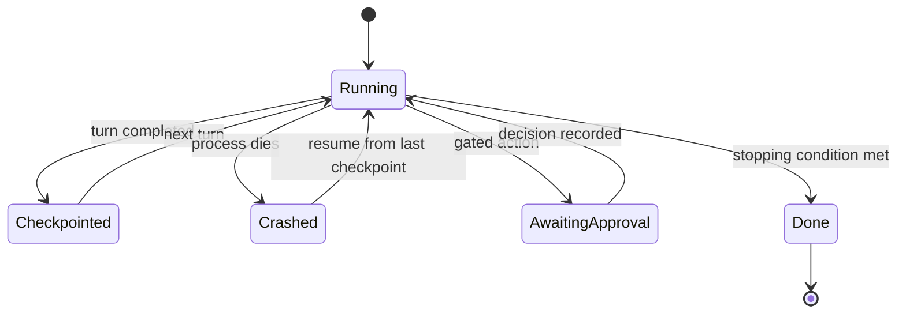

# Agent Reliability

> **Level:** Advanced · **Time:** ~40 min · **Exam relevance:** CCAR-P D5 (5.1, 5.2), CCAR-P D4 (4.5, 4.6), CCAR-P D3 (3.4), CCAR-P D1 (1.4)

## In plain English

A reliable agent is like a well-run expedition. Before setting out you agree a budget and a turn-back time. You never
pay the same supplier twice because a receipt went missing. You leave notes at each camp so a rescue team (or you,
tomorrow) can carry on from the last camp instead of the trailhead. And someone back at base can see where you are.

Those four habits map directly to agent engineering:

| Expedition habit | Agent engineering |
|---|---|
| Budget and turn-back time | **Budgets and stopping conditions** |
| Never pay twice | **Idempotent tools** |
| Notes at each camp | **Checkpoints** |
| Base can see where you are | **Observability** |

## Why it matters

- **Agents fail in new ways.** Infinite loops, repeated side effects after a retry, a crash at turn 40 that throws
  away an hour of work, a cost spike nobody sees until the invoice arrives.
- **Errors compound.** Anthropic's multi-agent research write-up notes that in long-running agents a minor failure can
  derail a whole run, which is why they resume from checkpoints and tell the agent when a tool has failed rather than
  restarting from scratch.
- **Non-determinism makes debugging hard.** The same input can take a different path next time, so you need traces of
  what actually happened.
- **Exam relevance.** Guardrails and failure modes (CCAR-P-5.1, 5.2), cost and latency optimisation (4.5) and
  monitoring at scale (3.4, 4.6) all apply directly to agents.

## How it works

### 1. Budgets

Set several independent limits. Whichever trips first stops the run.

| Budget | Protects against | Where to enforce |
|---|---|---|
| **Turn limit** | Loops that never converge | Your loop counter |
| **Token budget** | Context growth and runaway spend | Sum `usage.input_tokens` and `usage.output_tokens` per turn |
| **Cost budget** | Spend, especially with multi-agent fan-out | Convert usage to cost with current prices; Managed Agents session budgets do this server-side |
| **Wall-clock deadline** | Hung tools, slow subagents, user-facing latency | Timeouts on every tool and an overall deadline |
| **Per-tool call limits** | Hammering an external system | Counters per tool name |
| **Subagent limit** | Unbounded delegation | Count spawns ([multi-agent architecture](04-multi-agent-architecture.md)) |

Claude-side aids (as of 2026-10-24; see the claude-api reference and live docs for current details):

- `max_tokens` caps a single response. The model is not aware of it; hitting it truncates output.
- **Task budgets** (beta, `output_config.task_budget`) tell Claude how many tokens it has for the whole agentic task,
  so it can pace itself and finish gracefully rather than being cut off. It is advisory, not a hard cap.
- **Effort** (`output_config.effort`) trades thoroughness for tokens. Lower effort usually means fewer and more
  consolidated tool calls, which suits subagents and simple steps.
- **Managed Agents session budgets** are hard, dollar-denominated caps enforced by the platform; the session pauses
  when it reaches the cap.

### 2. Stopping conditions

An agent should stop for a *reason you can name*. Define them explicitly:

| Stop type | Example | Outcome to report |
|---|---|---|
| Success | `end_turn` with an answer that passes validation | Result |
| Verified success | Tests pass, totals reconcile, schema validates | Result plus evidence |
| Budget exhausted | Turn, token, cost or time limit hit | Partial result, clearly labelled, plus what remains |
| Blocked | Needs approval, missing permission, required data unavailable | Escalation ([human in the loop](05-human-in-the-loop.md)) |
| Unsafe or refused | `refusal` stop reason, policy trigger | Stop; route to a person; no automatic retry |
| No progress | Same tool call with the same arguments repeated, or no new information for N turns | Stop with a diagnostic |

Prefer **verifiable** success conditions. "Claude said it was done" is weaker than "the test suite passes" or "the
output validates against the schema".

### 3. Idempotency

Retries are unavoidable: network errors, timeouts, rate limits and crash recovery all re-run steps. A tool is
**idempotent** if running it twice with the same input has the same effect as running it once. Reads are naturally
idempotent. Writes need design:

- **Idempotency keys.** Derive a key from the run ID plus the logical operation (not from a timestamp), send it to the
  target system, and have the system (or your wrapper) return the stored result for a repeated key.
- **Check-then-act with a unique constraint.** "Create ticket for incident 42" checks whether one exists first, and
  the database rejects duplicates anyway.
- **Prefer set-state over increment.** "Set status to closed" is safe to repeat; "add 10 credits" is not.
- **Record the effect before reporting it.** If you crash between performing the effect and returning the
  `tool_result`, the record lets the resumed run skip the repeat.

The Anthropic SDKs retry some failed API requests automatically (connection errors, 429 and 5xx responses). That is
safe for model calls; it is your tools that must be idempotent.

### 4. Checkpoints and durable execution

A checkpoint is a saved snapshot from which the run can resume: the conversation so far, budget counters, completed
side effects and any plan. Save one after every turn that changed something.



Practical guidance:

- **Keep history append-only.** Store messages exactly as sent and received, including thinking and tool-use blocks.
  On current models, thinking blocks are tied to the conversation that produced them, and editing earlier turns can
  invalidate them, so resume by appending rather than rewriting history.
- **Store side-effect records with the checkpoint** so idempotency survives restarts.
- **Long waits (human approval) are checkpoints too.** Persist, release resources, resume when the decision arrives.
- **Deploying new versions** while runs are in flight needs care. Anthropic describes shifting traffic gradually
  between old and new versions (rainbow deployments) so running agents are not broken mid-task.

### 5. Observability

You cannot read every transcript, so instrument for aggregate questions and keep traces for drill-down.

| Signal | Examples |
|---|---|
| **Traces** | One trace per run; a span per model call and per tool call with name, duration, status, token usage, request ID |
| **Metrics** | Success rate by stop type, turns per run, tokens and cost per completed task, tool error rate, approval latency, escalation rate |
| **Logs** | Structured events (tool chosen, arguments with sensitive data masked, decisions at gates) |
| **Evaluations** | Sampled runs graded offline against outcome rubrics ([module 14](../14-evaluation-and-testing/README.md)) |

As of 2026-10-24, the Anthropic SDKs can emit OpenTelemetry spans, and Managed Agents sessions can be inspected in the
Claude Console; see [observability](../15-production-operations/02-observability.md) for the operational setup.
Measure **cost per completed task**, not per request: a cheap request that needs extra turns or retries is not cheap.

## Example

A self-contained, offline demonstration of the four controls (standard library only). The "agent" here is a scripted
stand-in so you can see budgets, idempotency and checkpoint-resume work without API calls. In a real loop, you would
call `budget.charge(response.usage)` after each model call and wrap write tools with `IdempotentExecutor`.

```python
"""Budgets, idempotency and checkpoint/resume, demonstrated offline."""
from __future__ import annotations

import hashlib
import json
import tempfile
import time
from dataclasses import asdict, dataclass, field
from pathlib import Path


class BudgetExceeded(Exception):
    pass


@dataclass
class Budget:
    max_turns: int = 8
    max_tokens: int = 50_000
    deadline_s: float = 60.0
    turns: int = 0
    tokens: int = 0
    started: float = field(default_factory=time.monotonic)

    def charge(self, input_tokens: int, output_tokens: int) -> None:
        self.turns += 1
        self.tokens += input_tokens + output_tokens
        if self.turns > self.max_turns:
            raise BudgetExceeded(f"turn limit {self.max_turns}")
        if self.tokens > self.max_tokens:
            raise BudgetExceeded(f"token limit {self.max_tokens}")
        if time.monotonic() - self.started > self.deadline_s:
            raise BudgetExceeded("deadline")


@dataclass
class Checkpoint:
    run_id: str
    messages: list = field(default_factory=list)
    effects: dict = field(default_factory=dict)   # idempotency key -> stored result
    turns: int = 0
    tokens: int = 0

    def save(self, path: Path) -> None:
        tmp = path.with_suffix(".tmp")
        tmp.write_text(json.dumps(asdict(self)))
        tmp.replace(path)                          # atomic rename: never a half-written checkpoint

    @classmethod
    def load(cls, path: Path, run_id: str) -> "Checkpoint":
        return cls(**json.loads(path.read_text())) if path.exists() else cls(run_id=run_id)


class IdempotentExecutor:
    """Runs a side-effecting function at most once per logical operation."""

    def __init__(self, checkpoint: Checkpoint):
        self.cp = checkpoint

    def run(self, op_name: str, args: dict, fn) -> str:
        key = hashlib.sha256(f"{self.cp.run_id}:{op_name}:{json.dumps(args, sort_keys=True)}".encode()).hexdigest()
        if key in self.cp.effects:
            return self.cp.effects[key] + " (replayed, not re-executed)"
        result = fn(**args)
        self.cp.effects[key] = result              # record before reporting
        return result


SENT_EMAILS: list[str] = []                        # the external world


def send_notice(customer: str) -> str:
    SENT_EMAILS.append(customer)
    return f"notice sent to {customer}"


def run(path: Path, crash_after_turn: int | None = None) -> None:
    cp = Checkpoint.load(path, run_id="run-2026-10-24-001")
    budget = Budget(turns=cp.turns, tokens=cp.tokens)
    executor = IdempotentExecutor(cp)
    plan = ["CUST-1", "CUST-2", "CUST-3"]          # scripted "tool calls" the agent would make
    for turn, customer in enumerate(plan, start=1):
        if turn <= cp.turns:
            continue                               # already done before the crash
        budget.charge(input_tokens=1_200, output_tokens=150)
        cp.messages.append({"turn": turn, "result": executor.run("send_notice", {"customer": customer}, send_notice)})
        cp.turns, cp.tokens = budget.turns, budget.tokens
        cp.save(path)
        if crash_after_turn == turn:
            raise SystemExit(f"simulated crash after turn {turn}")
    print("finished:", cp.messages[-1], "| turns", cp.turns, "| tokens", cp.tokens)


if __name__ == "__main__":
    ckpt = Path(tempfile.mkdtemp()) / "run.json"
    try:
        run(ckpt, crash_after_turn=2)
    except SystemExit as exc:
        print(exc)
    run(ckpt)                                      # resumes at turn 3, does not resend 1 and 2
    print("emails actually sent:", SENT_EMAILS)    # ['CUST-1', 'CUST-2', 'CUST-3'], no duplicates
```

Run it with `python3 agent_reliability_demo.py`: the first call "crashes" after two notices, the second resumes from
the checkpoint and sends only the third. [lab-18](../19-hands-on-labs/lab-18-reliability-engineering/README.md) and
[lab-12](../19-hands-on-labs/lab-12-agentic-task-execution/README.md) build these controls into a live agent loop.

## Enterprise use case

*Acme Logistics* runs an overnight agent that reconciles carrier invoices against delivery records and raises
disputes. The reliability design:

| Control | Implementation |
|---|---|
| Budgets | 30 turns and a token cap per invoice batch; overall deadline of 05:00 so results are ready for the morning shift |
| Stopping conditions | Success means every invoice is "matched", "disputed" or "escalated"; totals reconcile in code |
| Idempotency | `raise_dispute` uses the key `batch_id:invoice_id`; the carrier portal adapter refuses duplicate keys |
| Checkpoints | After each invoice; a crashed run resumes at the next unprocessed invoice |
| Observability | One trace per batch, spans per invoice; dashboard of cost per invoice, dispute rate and escalation rate; alert if cost per invoice doubles week on week |
| Human gate | Disputes above a value threshold need a finance analyst's approval before submission |

Six weeks in, the cost-per-invoice alert fired. Traces showed one carrier had changed its PDF layout, causing repeated
extraction retries. Because the stop reason "no progress" was defined, the runs failed fast instead of exhausting
budgets, and the dashboard showed the problem the same morning.

## Common mistakes

- **Only a turn limit.** Turns do not bound cost when each turn's context is huge. Use token or cost budgets too.
- **Retrying non-idempotent tools.** The classic duplicate email, duplicate payment, duplicate ticket.
- **Idempotency keys from timestamps or random IDs.** A retry generates a new key, so nothing is deduplicated.
- **Restarting from scratch after a crash.** Expensive, and it repeats side effects.
- **Rewriting history when resuming.** Breaks thinking-block continuity and makes behaviour harder to reproduce.
- **Logging everything verbatim.** Personal data and secrets end up in logs. Mask at the source.
- **Measuring cost per request.** Track cost per completed task.

## Security considerations

- **Budgets are a security control**: they bound the damage from a looping or manipulated agent (resource exhaustion
  is listed in the OWASP Top 10 for LLM applications as unbounded consumption).
- **Checkpoints contain sensitive data** (conversation, tool outputs). Encrypt them, restrict access, and set
  retention consistent with your data policy.
- **Trace data needs the same protection as the data it describes.** Mask personal data and never log credentials
  ([logging and auditability](../12-ai-security/11-logging-and-auditability.md)).
- **Idempotency keys must not be guessable across tenants** if they are exposed to external systems.

## Troubleshooting

| Symptom | Likely cause | Fix |
|---|---|---|
| Duplicate side effects after an incident | Non-idempotent tool retried | Add idempotency keys; record effects before reporting |
| Runs hit the turn limit with no answer | No progress detection, vague goal, or tool errors | Detect repeated calls; improve tool error messages; tighten the task |
| Resumed run behaves differently | History rewritten, or tool state not checkpointed | Append-only history; checkpoint side-effect records |
| Cost spike without traffic change | Context growth or retries | Check tokens per turn in traces; add context editing; cap retries |
| Cannot explain a bad outcome | No per-step traces | Add spans per model and tool call with request IDs |

## Check your understanding

1. Why is a turn limit alone not a sufficient budget?
2. What makes a tool idempotent, and how do idempotency keys achieve it for writes?
3. What should a checkpoint contain, and why should history stay append-only?
4. Give three stopping conditions other than "Claude finished".
5. Why measure cost per completed task rather than per request?

<details>
<summary>Answers</summary>

1. Each turn can carry a very large context or expensive tool output, so a small number of turns can still be costly
   or slow. Token, cost and time budgets bound those.
2. Running it twice with the same input has the same effect as once. A key derived from the run and the logical
   operation lets the target system (or a wrapper) recognise a repeat and return the stored result instead of acting
   again.
3. The conversation exactly as exchanged, budget counters, side-effect records and any plan. Append-only history keeps
   the run reproducible and avoids invalidating thinking blocks tied to earlier turns.
4. Any three of: budget exhausted, blocked pending approval, refusal or policy trigger, no progress detected,
   verified success (tests pass or output validates).
5. A cheaper request that needs more turns or retries to finish can cost more overall; the business cares about the
   cost of getting the job done.

</details>

## Further reading

- Anthropic Engineering — [How we built our multi-agent research system](https://www.anthropic.com/engineering/multi-agent-research-system) (production reliability section)
- Claude API docs — [Errors](https://platform.claude.com/docs/en/api/errors) and [Rate limits](https://platform.claude.com/docs/en/api/rate-limits)
- OWASP — [Top 10 for LLM Applications](https://genai.owasp.org/llm-top-10/)
- In this repository: [reliability engineering](../15-production-operations/05-reliability-engineering.md),
  [observability](../15-production-operations/02-observability.md),
  [errors, rate limits and retries](../06-claude-api/06-errors-rate-limits-retries.md)
