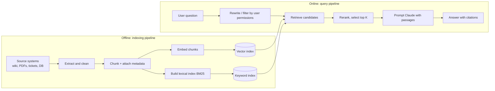

# RAG Fundamentals

> **Level:** Intermediate · **Time:** ~25 min · **Exam relevance:** CCAR-P D3 (3.5, 3.6), CCAR-P D1 (1.2)

## In plain English

Claude knows a great deal about the world, but it has never read your company's expense policy, last week's incident
reports or the contract you signed in March. Retrieval-augmented generation (RAG) fixes that by doing what a good
research assistant does: before answering, look up the relevant pages, put them on the desk, and answer from them.

An analogy: an open-book exam. The student (Claude) is capable, but the exam is about one specific textbook. RAG is
the index at the back of the book plus the habit of turning to the right page before writing an answer. If the index
is poor, the student turns to the wrong page and answers confidently from it. Most RAG problems are index problems,
not student problems.

## Why it matters

- **Freshness.** A model's training data stops at a cutoff date. Your knowledge base changes daily. RAG lets answers
  reflect what is true now without retraining anything.
- **Private knowledge.** Internal documents were never in training data. RAG brings them in at request time, under
  your access controls.
- **Traceability.** Because the answer is built from specific passages, you can show users where each claim came
  from, which matters in regulated work (see [grounding and citations](05-grounding-and-citations.md)).
- **Cost and scale.** A corpus of millions of documents cannot fit in any context window. Retrieval selects the few
  thousand tokens that matter for this question.
- **Reducing hallucination.** Instructing Claude to answer only from supplied passages, and to say when the passages do
  not contain the answer, sharply reduces invented facts. It does not eliminate them, which is why you evaluate
  (see [RAG evaluation](06-rag-evaluation.md)).

For the architect exam, RAG design sits under Domain 3, objectives CCAR-P-3.5 (pipelines, chunking, indexing) and
CCAR-P-3.6 (matching retrieval to data shape and query pattern). See the [registry](../16-certification-tracks/registry.yaml).

## How it works

A RAG system has two halves that run at different times.



### The offline half: indexing

1. **Ingest.** Pull documents from source systems through connectors or exports. Record where each one came from, who
   may read it, and when it last changed.
2. **Extract and clean.** Turn PDFs, HTML and slides into text. Remove navigation boilerplate, repeated headers and
   footers. Keep structure markers such as headings and table boundaries, because chunking uses them.
3. **Chunk.** Split each document into retrievable units, usually a few hundred tokens each. See
   [chunking strategies](02-chunking-strategies.md).
4. **Attach metadata.** Document ID, title, section path, date, owner, product line, access-control labels.
   Metadata powers filters and citations later.
5. **Index.** Compute an embedding vector for each chunk and store it in a vector index. Many production systems also
   build a lexical (keyword) index. See [embeddings and indexing](03-embeddings-and-indexing.md).

### The online half: retrieval and generation

1. **Understand the query.** Optionally rewrite it (expand acronyms, split a compound question), and derive filters
   from it ("policies effective in 2026") and from the user's identity (only documents they are entitled to see).
2. **Retrieve candidates.** Search the index for perhaps 50–150 candidate chunks using lexical, dense or hybrid
   retrieval. See [retrieval strategies](04-retrieval-strategies.md).
3. **Rerank and select.** A reranker scores candidates against the question; keep the best 5–20.
4. **Generate.** Send the selected passages to Claude with instructions to answer only from them, cite them, and say
   when the answer is not present.
5. **Post-process.** Validate the output, render citations as links, log what was retrieved for evaluation.

### Vocabulary

| Term | Meaning |
|---|---|
| Corpus | The full set of documents you can retrieve from |
| Chunk | One retrievable unit of text, with metadata |
| Embedding | A vector of numbers representing a chunk's meaning; similar meanings give nearby vectors |
| Top K | How many chunks you pass to the model after retrieval |
| Recall | Of the chunks that hold the answer, how many did retrieval find? |
| Precision | Of the chunks retrieval returned, how many were relevant? |
| Grounding | Making the answer depend on, and point to, the supplied sources |

### Where RAG fails

Every failure maps to one stage. Knowing which stage failed is the core diagnostic skill.

| Stage | Failure | Symptom |
|---|---|---|
| Ingest | Document never indexed, or stale copy | "I could not find that" when the doc exists |
| Extract | Table flattened into word soup, scanned PDF without text | Wrong numbers, missing content |
| Chunk | Answer split across two chunks; chunk lacks context ("it increases by 5%") | Partial or ambiguous answers |
| Retrieve | Query vocabulary differs from document vocabulary; exact codes missed | Relevant chunk not in top K |
| Rerank / select | Right chunk retrieved but cut off by small K | Answer present in candidates but not in prompt |
| Generate | Model blends prior knowledge with passages, ignores "not found" instruction | Plausible but unsupported claims |
| Access control | Filter applied after retrieval or not at all | Users see content they should not |

## Example

A minimal, dependency-free RAG loop. Retrieval here is a toy keyword scorer so the example runs anywhere; later pages
replace it with real chunking, embeddings and hybrid search. The generation step is the part that carries over
unchanged.

> **Cost:** requires API credits (live mode).

```python
"""Minimal RAG: toy retrieval + grounded generation with Claude."""
import re
import anthropic

CORPUS = [
    {"id": "travel-001", "title": "Travel policy §2 Flights",
     "text": "Economy class is required for flights under 6 hours. Business class needs VP approval."},
    {"id": "travel-002", "title": "Travel policy §3 Hotels",
     "text": "Hotel nightly cap is 180 EUR in tier-1 cities and 120 EUR elsewhere."},
    {"id": "it-014", "title": "IT policy §4 Laptops",
     "text": "Laptops are refreshed every 36 months. Lost devices must be reported within 24 hours."},
]

def tokenize(s: str) -> set[str]:
    return set(re.findall(r"[a-z0-9]+", s.lower()))

def retrieve(question: str, k: int = 2) -> list[dict]:
    q = tokenize(question)
    scored = sorted(CORPUS, key=lambda d: len(q & tokenize(d["text"] + " " + d["title"])), reverse=True)
    return [d for d in scored[:k] if q & tokenize(d["text"] + " " + d["title"])]

def answer(question: str) -> str:
    passages = retrieve(question)
    if not passages:
        return "No relevant policy found."
    context = "\n".join(
        f'<passage id="{p["id"]}" title="{p["title"]}">{p["text"]}</passage>' for p in passages
    )
    client = anthropic.Anthropic()  # reads ANTHROPIC_API_KEY from the environment
    response = client.messages.create(
        model="claude-opus-5-5",
        max_tokens=1024,
        system=(
            "You answer employee policy questions using only the passages provided. "
            "Cite passage ids in square brackets. If the passages do not contain the answer, "
            "say so plainly and do not guess."
        ),
        messages=[{"role": "user", "content": f"<passages>\n{context}\n</passages>\n\nQuestion: {question}"}],
    )
    if response.stop_reason != "end_turn":
        raise RuntimeError(f"Unexpected stop_reason: {response.stop_reason}")
    return "".join(b.text for b in response.content if b.type == "text")

if __name__ == "__main__":
    print(answer("What is the hotel cap in a tier-1 city?"))
```

Notice three habits that matter more than any library choice: passages are clearly delimited, the model is told what
to do when the answer is absent, and `stop_reason` is checked before the content is used.

## Enterprise use case

*Northwind Lending* runs a contact centre where agents answer questions about 900 internal procedure documents that
change weekly. Agents were searching a wiki and reading three or four pages per call.

The architecture team built a RAG assistant:

- **Indexing:** a nightly job pulls changed pages from the wiki, chunks by heading, and tags each chunk with
  `product` (mortgage, personal loan, card), `region`, `effective_date` and an access label.
- **Retrieval:** hybrid keyword and dense search, filtered by the agent's region and product queue, reranked to the
  top 8 chunks.
- **Generation:** Claude answers in three sentences or fewer with citations that link to the wiki section, and says
  "not covered by current procedures" when retrieval finds nothing above a relevance threshold.
- **Feedback:** agents mark answers as helpful, wrong or incomplete; wrong answers go into the evaluation set.

The team measured success by average handle time and by the rate of answers that a weekly reviewer marked as
unsupported, not by how fluent answers sounded.

## Common mistakes

- **Tuning the prompt when retrieval is broken.** If the right chunk is not in the prompt, no prompt fixes it. Check
  retrieval first.
- **One giant top K "to be safe".** More passages add noise, cost and latency, and can bury the relevant one. Retrieve
  broadly, then rerank to a focused set.
- **No "not found" path.** Without an explicit instruction and a relevance threshold, the model fills gaps with
  plausible text.
- **Forgetting freshness metadata.** Two versions of a policy in the index will both be retrieved. Store effective dates
  and filter or prefer the current one.
- **Building RAG when the corpus is small.** If everything fits comfortably in the context window, consider loading it
  all with prompt caching instead. See [RAG vs long context](07-rag-vs-long-context.md).

## Security considerations

- **Retrieved text is untrusted input.** A document can contain instructions aimed at the model ("ignore previous
  instructions and…"). Delimit passages, tell Claude that passage content is data, and never let retrieved text
  trigger privileged tools without checks. See [indirect prompt injection](../12-ai-security/03-indirect-prompt-injection.md).
- **Enforce access control at retrieval time,** with filters derived from the authenticated user, not from anything
  in the prompt. Filtering after generation is too late: the model has already seen the content.
- **The index is a copy of sensitive data.** Apply the same classification, encryption, retention and deletion rules as
  the source systems. A deleted source document must also be deleted from the index.
- **Log carefully.** Retrieval logs contain document text and user questions; treat them as sensitive.

## Troubleshooting

| Symptom | Likely cause | First check |
|---|---|---|
| "I don't know" for a documented fact | Document not indexed or not retrieved | Search the index directly for a distinctive phrase |
| Confident wrong answer | Wrong or stale chunk retrieved | Log the retrieved chunk IDs for that query |
| Answer mixes two products | Missing metadata filter | Inspect filters applied to the query |
| Answer correct but uncited | Prompt or citation configuration | Enable the citations feature ([page 5](05-grounding-and-citations.md)) |
| Slow responses | Too many candidates or large K | Measure each stage's latency separately |

More in [RAG troubleshooting](../24-troubleshooting/rag.md).

## Check your understanding

1. Name the two halves of a RAG pipeline and say which one runs on every user request.
2. A user asks about a policy and gets "not found", but the policy exists. List three stages that could be at fault.
3. Why should access-control filtering happen during retrieval rather than after generation?
4. What two instructions in the system prompt most reduce unsupported answers?

<details>
<summary>Answers</summary>

1. The offline indexing pipeline (ingest, extract, chunk, embed, index) and the online query pipeline (retrieve, rerank,
   generate). The online half runs on every request.
2. Ingest (never indexed or stale), extract (text not extracted, for example a scanned PDF), chunking (answer split or
   context lost), retrieval (vocabulary mismatch), or selection (relevant chunk cut by a small K). Any three.
3. Once restricted text is in the prompt, the model may use or reveal it; post-generation filtering cannot reliably
   remove information that has influenced the answer.
4. Answer only from the supplied passages, and say explicitly when the passages do not contain the answer (plus cite
   sources).

</details>

## Further reading

- Anthropic, [Contextual Retrieval](https://www.anthropic.com/news/contextual-retrieval) (September 2024).
- Claude docs, [Citations](https://platform.claude.com/docs/en/build-with-claude/citations).
- Claude docs, [Embeddings](https://platform.claude.com/docs/en/build-with-claude/embeddings).
- In this repository: [chunking strategies](02-chunking-strategies.md), [lab-11 RAG pipeline](../19-hands-on-labs/lab-11-rag-pipeline/README.md).

<!-- page-nav:start -->
---

[Module overview](README.md) · [Next: Chunking Strategies →](02-chunking-strategies.md)
<!-- page-nav:end -->
