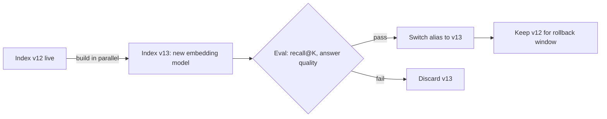

# Embeddings and Indexing

> **Level:** Intermediate · **Time:** ~30 min · **Exam relevance:** CCAR-P D3 (3.5, 3.6)

## In plain English

An embedding turns a piece of text into a list of numbers (a vector) so that texts with similar meaning end up close
together. "How do I reset my password?" and "I forgot my login credentials" share almost no words, but their vectors
are near each other. A vector index is a database built to answer one question fast: "which stored vectors are
closest to this one?"

Picture a library where books are shelved by topic rather than by title. Embeddings decide where each book goes;
the index is the floor plan that lets you walk straight to the right shelf.

## Why it matters

- Embeddings let retrieval find passages that answer a question even when the wording differs (semantic match).
- The embedding model is a long-lived dependency: every stored vector is tied to the model that produced it. Changing
  models means re-embedding the whole corpus.
- Index design decides latency, cost, filtering ability and how safely you can refresh content.

This page supports CCAR-P-3.5 (indexing) and CCAR-P-3.6 (retrieval choices) in the
[registry](../16-certification-tracks/registry.yaml).

## How it works

### What Anthropic provides, and what it does not

As of 2026-10-24, **Anthropic does not offer its own embeddings model.** The Claude API generates text; it does not
return vectors. Anthropic's [embeddings documentation](https://platform.claude.com/docs/en/build-with-claude/embeddings)
says this directly, names **Voyage AI (by MongoDB)** as one provider with a wide range of models, and advises you to
assess several embeddings vendors for your use case. The selection factors it lists are:

- **Dataset size and domain specificity** of the model's training data.
- **Inference performance:** lookup speed and end-to-end latency at production scale.
- **Customisation:** options to continue training on private data or specialise for a domain vocabulary.

The same page lists Voyage AI general-purpose models (for example `voyage-4-large`, `voyage-4`, `voyage-4-lite`),
domain models (code, finance, law), multimodal and contextualised-chunk models, and rerankers. Model names change, so
treat the page as the source of truth rather than this summary. It also recommends specifying whether input is a
**query** or a **document** (`input_type`) for retrieval tasks, because asymmetric encoding improves retrieval quality.

You can use any embeddings provider with Claude, including models offered by your cloud platform or open-weight models
you host yourself. Claude only ever sees the retrieved text, never the vectors.

### Choosing an embeddings model

| Criterion | Question to ask |
|---|---|
| Retrieval quality on *your* data | Does it beat alternatives on your evaluation set (recall@K)? Public leaderboards are a starting point only |
| Domain | Is there a model tuned for your domain (legal, financial, code) or languages? |
| Input length | Does the maximum input exceed your largest chunk? |
| Dimensions | More dimensions can mean better quality but larger storage; some models allow shortening vectors |
| Cost and latency | Cost per million tokens to embed the corpus and each query; query-time latency |
| Data handling | Where does the text go? Retention terms, region, contractual coverage for regulated data |
| Deployment | Hosted API, cloud marketplace, or self-hosted for air-gapped environments |
| Stability | How long will the model version be supported? A deprecation forces a full re-embed |

### Similarity

Retrieval compares vectors with cosine similarity, dot product or Euclidean distance. If vectors are normalised to
length 1 (many providers do this), cosine and dot product give the same ranking. Always use the metric the provider
recommends and configure the index to match.

### Vector stores

| Option | Examples (illustrative, not endorsements) | When it fits |
|---|---|---|
| Extension to an existing database | PostgreSQL with a vector extension, a document database with vector search | You already run the database; moderate scale; you want joins and transactions with metadata |
| Search engine with vector support | Engines that combine BM25 and vectors | You need hybrid lexical plus dense search and rich filters |
| Dedicated vector database | Managed or self-hosted vector databases | Very large corpora, high query rates, specialised index tuning |
| Cloud-managed knowledge base | Retrieval services from your cloud provider | You want ingestion, chunking and retrieval managed for you, accepting less control |
| In-memory library | Approximate nearest neighbour libraries | Prototypes, labs, small read-only corpora |

**Approximate nearest neighbour (ANN)** indexes such as HNSW or IVF trade a small amount of recall for large speed
gains. Their parameters (graph connectivity, number of lists probed) are tuning knobs: measure recall against an exact
search on a sample before trusting defaults.

**Filtering** matters as much as similarity. Check that your store can apply metadata filters (tenant, access label,
date, product) *during* the search, not only by post-filtering a top K, which can return too few results.

### Index refresh

Knowledge changes. Plan for three kinds of change from day one:

1. **Additions and edits.** Detect changed source documents (modification time, content hash), re-chunk them, embed
   only the changed chunks, and upsert by stable chunk ID. Remove chunks that no longer exist in the new version of the
   document, otherwise stale passages linger.
2. **Deletions.** Propagate deletes from the source, including legal or privacy deletion requests. Keep an audit trail.
3. **Pipeline changes.** A new chunking rule or embedding model changes every vector. Do not mix vectors from two
   models in one index: their spaces are not comparable.

Freshness should be a measured service-level objective, for example "a published policy change is searchable within
4 hours", with monitoring on the lag.

### Index versioning

Treat the index like a deployable artifact:



- Record for each index version: embedding model and version, chunking configuration, source snapshot time, build date.
- Build a new version alongside the live one, evaluate it, then switch an alias. Keep the old one for rollback.
- Store the index version in request logs so you can explain any answer later.

## Example

Embedding and an in-memory index with versioned metadata. The embedding function is pluggable: the default is a
deterministic hashing embedder so the code runs offline without any keys; swap in your provider's client for real
semantic quality.

```python
"""Versioned in-memory vector index with a pluggable embedder (stdlib only)."""
from __future__ import annotations
import hashlib
import math
import os
import re
from dataclasses import dataclass

DIM = 256

def hashing_embed(texts: list[str], input_type: str) -> list[list[float]]:
    """Offline stand-in: bag-of-words hashed into DIM buckets, L2-normalised.
    It captures word overlap only, not meaning. Replace with a real embeddings API."""
    vectors = []
    for t in texts:
        v = [0.0] * DIM
        for word in re.findall(r"[a-z0-9]+", t.lower()):
            v[int(hashlib.sha256(word.encode()).hexdigest(), 16) % DIM] += 1.0
        norm = math.sqrt(sum(x * x for x in v)) or 1.0
        vectors.append([x / norm for x in v])
    return vectors

def provider_embed(texts: list[str], input_type: str) -> list[list[float]]:
    """Example of a real provider (Voyage AI client). Needs VOYAGE_API_KEY in the environment."""
    import voyageai  # pip install voyageai
    client = voyageai.Client()  # reads VOYAGE_API_KEY
    return client.embed(texts, model="voyage-4", input_type=input_type).embeddings

EMBED = provider_embed if os.environ.get("USE_VOYAGE") == "1" else hashing_embed

@dataclass
class IndexedChunk:
    chunk_id: str
    text: str
    metadata: dict
    vector: list[float]

class VectorIndex:
    def __init__(self, version: str, embed_model: str, chunking: str):
        self.manifest = {"version": version, "embed_model": embed_model, "chunking": chunking}
        self.items: dict[str, IndexedChunk] = {}

    def upsert(self, chunks: list[dict]) -> None:
        vectors = EMBED([c["text"] for c in chunks], "document")
        for c, v in zip(chunks, vectors):
            self.items[c["id"]] = IndexedChunk(c["id"], c["text"], c["metadata"], v)

    def delete_doc(self, doc_id: str) -> None:
        for cid in [k for k, v in self.items.items() if v.metadata.get("doc_id") == doc_id]:
            del self.items[cid]

    def search(self, query: str, k: int = 3, where: dict | None = None) -> list[tuple[float, IndexedChunk]]:
        qv = EMBED([query], "query")[0]
        candidates = [
            c for c in self.items.values()
            if not where or all(c.metadata.get(f) == val for f, val in where.items())
        ]  # filter BEFORE ranking, so K results are all eligible
        scored = [(sum(a * b for a, b in zip(qv, c.vector)), c) for c in candidates]
        return sorted(scored, key=lambda s: s[0], reverse=True)[:k]

if __name__ == "__main__":
    idx = VectorIndex(version="2026-10-24.1", embed_model="hashing-256", chunking="md-headings-400")
    idx.upsert([
        {"id": "pw-1", "text": "Reset your password from the sign-in page using the Forgot password link.",
         "metadata": {"doc_id": "it-faq", "tenant": "northwind"}},
        {"id": "vpn-1", "text": "The VPN client must be updated monthly.",
         "metadata": {"doc_id": "it-faq", "tenant": "northwind"}},
        {"id": "pw-2", "text": "Password reset for partner portal accounts is handled by the partner team.",
         "metadata": {"doc_id": "partner-faq", "tenant": "fabrikam"}},
    ])
    for score, chunk in idx.search("how do I reset my password", where={"tenant": "northwind"}):
        print(f"{score:.2f}", chunk.chunk_id, idx.manifest["version"])
```

## Enterprise use case

*Acme Logistics* runs a multilingual shipping-documentation assistant across 14 countries. Their decisions:

- **Model selection:** three candidate embeddings models were compared on a 500-question set covering six languages
  and a long tail of customs codes. The best general model was weak on customs codes, which pushed the team towards
  hybrid retrieval (see [retrieval strategies](04-retrieval-strategies.md)) rather than a more expensive model.
- **Store:** they already ran PostgreSQL, so they used a vector extension, which gave them metadata filtering by
  country and transactional upserts alongside the document registry.
- **Refresh:** a change-data-capture feed from the document management system triggers re-chunking of changed
  documents within 30 minutes; a nightly reconciliation job catches missed deletes.
- **Versioning:** a model upgrade was built as a parallel index, evaluated for a week on shadow traffic, then switched
  by alias with a 14-day rollback window.

## Common mistakes

- **Assuming Claude produces embeddings.** It does not; you need a separate embeddings provider.
- **Mixing vectors from two embedding models** in one index after a partial migration.
- **Embedding queries and documents the same way** when the provider supports asymmetric query/document modes.
- **Post-filtering a small top K,** which returns zero results for users with narrow permissions.
- **No deletion path,** leaving withdrawn or legally deleted content searchable.
- **Choosing a store before knowing the filter, scale and hybrid requirements.**

## Security considerations

- **Data flows to the embeddings provider.** Every chunk and every query is sent to it. Review its retention, region
  and contractual terms with the same rigour as your LLM provider, especially for regulated data.
- **Vectors are sensitive.** Research has shown that text can be partially reconstructed from embeddings. Encrypt the
  index, restrict access, and include it in data-retention and deletion processes.
- **Multi-tenancy.** Use per-tenant indexes or mandatory tenant filters enforced by the service layer, never by the
  prompt. Test that one tenant cannot retrieve another's chunks.
- **Poisoning.** Anyone who can write to a source system can write to your index. Restrict which sources are indexed and
  monitor for unusual content.

## Troubleshooting

| Symptom | Likely cause | Fix |
|---|---|---|
| Recall dropped after an upgrade | Mixed model vectors, or query embedded with a different model | Rebuild the index with one model; check query path config |
| Exact codes and IDs not found | Dense embeddings blur rare tokens | Add BM25 (hybrid) or exact-match filters |
| Filtered searches return few results | Post-filtering after top K | Use pre-filtering or increase candidate pool |
| Deleted document still cited | Deletes not propagated | Add delete events and a reconciliation job |
| Latency spikes | ANN parameters, cold cache, oversized candidate set | Tune index parameters; measure each stage |

## Check your understanding

1. Does the Claude API return embeddings? What does Anthropic's documentation recommend?
2. Why must you not mix vectors from two embedding models in one index?
3. What is the difference between pre-filtering and post-filtering, and why does it matter for access control?
4. List three things to record in an index version manifest.

<details>
<summary>Answers</summary>

1. No. Anthropic does not offer its own embeddings model; its docs name Voyage AI as one provider and advise assessing
   several vendors against criteria such as domain fit, inference performance and customisation.
2. Each model defines its own vector space, so distances between vectors from different models are meaningless.
3. Pre-filtering restricts the candidates before similarity ranking; post-filtering removes ineligible results from an
   already-ranked top K. Post-filtering can return too few results, and if applied late or skipped it risks exposing
   restricted content. Access filters should be enforced in the retrieval query itself.
4. Any three of: embedding model and version, chunking configuration, source snapshot time, build date, index version
   identifier.

</details>

## Further reading

- Claude docs, [Embeddings](https://platform.claude.com/docs/en/build-with-claude/embeddings) (checked 2026-10-24).
- Anthropic, [Contextual Retrieval](https://www.anthropic.com/news/contextual-retrieval).
- Next: [retrieval strategies](04-retrieval-strategies.md).
